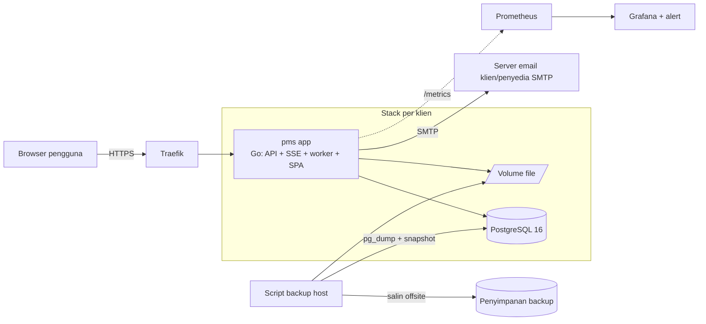
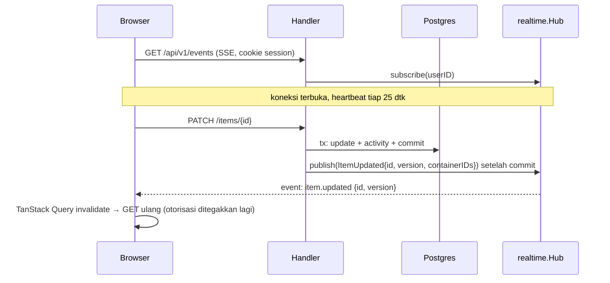

# ARCHITECTURE — PMS

| | |
|---|---|
| **Versi** | 0.1 (draft) |
| **Cakupan detail** | M0 + M1 (47 requirement). Modul M2–M7 hanya digambarkan sebagai titik ekstensi (§12) |
| **Sumber** | [PRD_PMS.md](PRD_PMS.md) §4, §6, §10 |
| **Dokumen terkait** | [DATABASE.md](DATABASE.md), [WORKFLOWS.md](WORKFLOWS.md), [../api/openapi.yaml](../api/openapi.yaml), [DESIGN_SYSTEM.md](DESIGN_SYSTEM.md), [UI_SPEC.md](UI_SPEC.md), [BACKLOG.md](BACKLOG.md) |

---

## 1. Prinsip arsitektur

1. **Modular monolith, satu binary Go.** Satu proses melayani API REST, SSE, worker job, dan file statis SPA (`go:embed`). Tidak ada microservice.
2. **Satu instance per klien.** Tidak ada `account_id` di tabel. Isolasi klien = container dan database terpisah (PRD §10).
3. **Postgres adalah satu-satunya penyimpanan data**: data relasional, antrian job (River), session, pencarian (full-text), dan metadata file.
4. **Kontrak dulu.** `api/openapi.yaml` adalah sumber kebenaran; kode Go server stub dan tipe TypeScript dihasilkan darinya.
5. **Otorisasi terpusat.** Semua keputusan akses lewat satu paket `policy`. Handler tidak boleh membandingkan peran sendiri.
6. **Boleh sederhana, tidak boleh tidak aman.** Pintasan yang diambil ditandai `shortcut:` di kode beserta kapan harus diganti (§13).

## 2. Konteks sistem



Aktor eksternal: pengguna (browser), server SMTP, operator (CLI `pms`, script update/backup). Integrasi Pydio Cells/MinIO bukan bagian rilis 1.0; titik sambungnya adalah interface `Storage` (§8).

## 3. Struktur repo

```text
pms/
├── api/openapi.yaml            kontrak API (sumber kebenaran)
├── server/
│   ├── cmd/pms/                main: serve | migrate | bootstrap
│   ├── internal/
│   │   ├── platform/           config, db (pgx pool), http (router, middleware), log, metrics
│   │   ├── auth/               login, session, password, undangan, TOTP (M3)
│   │   ├── user/               user, group, seat, user type
│   │   ├── space/              space + sharing space
│   │   ├── item/               project/folder/task, lokasi, assignee, follower, sharing item
│   │   ├── view/               definisi view (Table, Board)
│   │   ├── workflow/           workflow + status (M1: read-only, default)
│   │   ├── comment/            komentar + mention
│   │   ├── file/               upload/download + antarmuka Storage
│   │   ├── notification/       inbox + event → notifikasi
│   │   ├── search/             pencarian global
│   │   ├── activity/           activity log
│   │   ├── recycle/            soft delete, restore
│   │   ├── realtime/           hub SSE
│   │   ├── mail/               template + pengiriman SMTP (lewat job)
│   │   ├── policy/             keputusan otorisasi tunggal
│   │   └── gen/                kode hasil generate (oapi-codegen, sqlc) — tidak diedit
│   ├── migrations/             goose (SQL)
│   └── queries/                SQL untuk sqlc, satu file per modul
├── web/                        React + Vite + TypeScript
│   └── src/{routes,features,components,lib,i18n}/
├── deploy/                     template docker-compose klien, script backup/restore/update
├── docs/
└── Dockerfile                  multi-stage: build web → build Go (embed) → image distroless
```

Aturan ketergantungan antar paket di `internal/` (dijaga dengan tes `go list` di CI):

```text
handler (http) → service modul → repo (sqlc)
                      ↓
                    policy      (semua modul boleh memanggil policy)
modul A tidak mengimpor repo modul B; antar modul lewat service/interface kecil.
platform/* tidak mengimpor modul bisnis.
```

## 4. Lapisan di dalam satu modul

| Lapisan | Tanggung jawab | Tidak boleh |
|---|---|---|
| `handler` | Parse request, validasi bentuk, panggil service, tulis response/error | Logika bisnis, SQL, cek peran |
| `service` | Aturan bisnis, transaksi, panggil `policy`, tulis activity log, emit event | Mengakses `http.Request` |
| `repo` | Query hasil sqlc, satu fungsi per query | Aturan bisnis |
| `events` | Struct event domain (mis. `ItemUpdated`) dipublish setelah commit | Dipublish sebelum commit |

**Transaksi:** satu request mutasi = satu transaksi (`pgx.Tx`) yang mencakup perubahan data, baris activity log, dan baris job River (enqueue email) sehingga ketiganya atomik. Event realtime dipublish **setelah commit**.

## 5. Autentikasi & session

- **Login:** email + password (argon2id). Respons mengeset cookie `pms_session` (httpOnly, Secure, SameSite=Lax). Token acak 256-bit; yang disimpan di tabel `sessions` hanya SHA-256-nya.
- **Masa berlaku (SEC-04):** idle timeout 14 hari (`last_seen_at` diperbarui paling sering sekali per 5 menit), batas absolut 30 hari. ID session dirotasi saat login dan saat user type berubah.
- **Pencabutan:** semua session user dihapus saat ganti/reset password atau user dinonaktifkan. User bisa logout dari satu session; admin bisa mencabut semua session user.
- **CSRF:** SameSite=Lax + middleware yang menolak request `POST/PUT/PATCH/DELETE` dengan header `Origin` yang tidak sama dengan `PMS_BASE_URL` (403). Tanpa Origin dan tanpa `Sec-Fetch-Site: same-origin` → ditolak.
- **Rate limit login:** per IP dan per email, di memori proses (`shortcut: satu replika; pindah ke tabel Postgres bila lebih dari satu replika`).
- **Tidak ada public signup (AUTH-01).** User masuk lewat undangan (`user_tokens` purpose `invite`). Admin pertama dibuat oleh `pms bootstrap`.
- **Reset password:** token sekali pakai, berlaku 1 jam, respons "forgot" selalu sama agar email tidak bisa ditebak.

## 6. Model otorisasi

### 6.1 Konsep

- **User type** (global per user): `admin`, `regular`, `external`, `collaborator`, `viewer`. Menentukan **plafon** kemampuan.
- **Share role** (per Space atau item): `full`, `editor`, `limited`, `read`. Diberikan ke user atau grup.
- **Kemampuan (capability):** `view`, `comment`, `change_status`, `attach`, `edit`, `create`, `delete`, `share`.

| Share role | Kemampuan |
|---|---|
| `read` | view |
| `limited` | view, comment, change_status, attach |
| `editor` | limited + edit, create |
| `full` | editor + delete, share |

| User type | Plafon |
|---|---|
| `admin`, `regular` | semua kemampuan |
| `external` | sampai `editor` (tanpa delete, share) |
| `collaborator` | sampai `limited` |
| `viewer` | view, comment |

### 6.2 Aturan keputusan (`policy.Can(user, capability, target)`)

1. Himpun share yang berlaku untuk target: share langsung pada item, **ditambah** share pada semua leluhur lewat **semua** lokasinya (item bisa punya banyak lokasi), ditambah share pada Space-nya.
2. Role efektif = gabungan (union) kemampuan semua share tersebut, baik yang langsung maupun lewat grup.
3. Kemampuan akhir = role efektif ∩ plafon user type.
4. Pemilik Personal space selalu `full`. Personal space tidak terlihat oleh siapa pun selain pemiliknya, termasuk admin.
5. Admin otomatis `full` di semua Space bertipe `shared` (asumsi; perlu dikonfirmasi, lihat §14).
6. Target yang `deleted_at IS NOT NULL` hanya bisa diakses lewat Recycle bin (`view` dan `restore`).
7. Jawaban "tidak ada akses" selalu **404**, bukan 403, agar keberadaan item tidak bocor. 403 dipakai hanya jika item terlihat tapi aksinya tidak diizinkan.

Implementasi query: CTE rekursif naik lewat `item_locations` (lihat [DATABASE.md](DATABASE.md) §4). Untuk daftar di dalam container yang sudah diizinkan, anak-anaknya diwarisi tanpa cek per baris. Untuk pencarian dan My to-do, filter akses disisipkan ke query. `shortcut: CTE rekursif per query, cukup sampai ±50 ribu item per instance; ganti ke tabel closure bila p95 daftar atau pencarian melewati target PRD §6`.

### 6.3 Tes wajib (SEC-02)

Matriks otomatis: setiap kombinasi (5 user type × 4 share role × 8 kemampuan × {akses langsung, lewat grup, lewat leluhur, lewat lokasi kedua}) dihasilkan dari tabel di atas dan diuji terhadap endpoint nyata. Tambahan tes negatif IDOR: akses item, file, komentar, dan lampiran dengan ID milik Space lain harus 404.

## 7. Real-time (SSE)



- Event hanya membawa **ID, tipe, versi**, tidak membawa isi data. Isi selalu diambil ulang lewat REST sehingga otorisasi ditegakkan di satu tempat.
- Penerima dihitung saat publish: assignee, follower, dan user yang punya akses ke container item (jumlahnya kecil per instance).
- Klien yang terputus menyambung ulang dengan `Last-Event-ID`; hub menyimpan 1.000 event terakhir di memori. Jika ID terlalu lama, klien menerima event `resync` lalu membuang seluruh cache.
- Target latensi PRD: ≤ 3 detik.
- `shortcut: hub di memori, satu replika; ganti ke Postgres LISTEN/NOTIFY bila replika > 1`.

## 8. Penyimpanan file

```go
// server/internal/file/storage.go
type Storage interface {
    Put(ctx context.Context, key string, r io.Reader) (size int64, err error)
    Get(ctx context.Context, key string) (io.ReadCloser, error)
    Delete(ctx context.Context, key string) error
}
```

- MVP: `LocalStorage` menulis ke `PMS_FILES_DIR`. Key berupa `ab/cd/<uuid>` (dua level direktori dari UUID). Nama file asli hanya disimpan di database.
- **File tidak pernah ditimpa**; tiap upload mendapat key baru. Karena itu backup database lebih dulu lalu file selalu konsisten (OPS-01).
- **Upload (SEC-01):** batas ukuran `PMS_MAX_UPLOAD_MB` (default 100) dicek lewat `http.MaxBytesReader`; tipe dideteksi dari isi (`http.DetectContentType` + sniff tambahan), ekstensi dan MIME dari klien diabaikan; ditolak jika termasuk executable (PE, ELF, Mach-O, script shell) atau arsip yang berisi executable tingkat atas. SHA-256 dihitung saat streaming dan disimpan.
- **Download:** hanya lewat `GET /attachments/{id}/download` yang memanggil `policy.Can(view)` atas item pemiliknya. Header `Content-Disposition: attachment`, `X-Content-Type-Options: nosniff`, `Content-Security-Policy: sandbox`.
- **Penghapusan:** hapus attachment = soft delete; file fisik dihapus oleh job River `purge_file` hanya ketika item dihapus permanen (BIN-03) atau saat attachment dihapus dan sudah melewati masa Recycle bin.
- Titik ekstensi: `PydioStorage`, `S3Storage` (TASK-08B) cukup mengimplementasikan interface ini.

## 9. Job & email

- River berjalan di proses yang sama, memakai pool pgx yang sama (`river_job` di Postgres klien).
- Job M0/M1: `send_email` (undangan, reset password, notifikasi), `purge_file`, `cleanup_sessions` (harian), `cleanup_tokens` (harian).
- Email dibuat dari template Go di `internal/mail/templates/<locale>/<nama>.{subject,html,txt}` dan dikirim lewat SMTP (`PMS_SMTP_*`). Locale diambil dari `users.locale`. Kegagalan SMTP → retry eksponensial River (maks 8 kali), lalu masuk antrian gagal yang terlihat di metrik dan alert (OPS-03).
- Jika SMTP belum dikonfigurasi, mailer berpindah ke mode `log` yang menulis isi email (termasuk link) ke log. Ini dipakai untuk bootstrap lokal dan tes.

## 10. Pencarian

- Postgres full-text dengan konfigurasi `simple` (netral bahasa; cocok untuk rencana multi-bahasa) dan pencocokan prefix (`to_tsquery('simple', 'kata:*')`).
- Kolom `search tsvector` dihasilkan otomatis pada `items` (judul bobot A, teks deskripsi bobot B), `comments`, dan `users`; indeks GIN.
- Hasil dikelompokkan per tipe: item (task, project/folder), komentar, user. Filter akses disisipkan di query (§6.2). Scope: seluruh instance, satu Space, atau satu container.
- Target PRD: p95 < 800 ms. `shortcut: tanpa ranking lanjutan; bila hasil terasa kurang relevan di pilot, pertimbangkan trigram atau mesin pencari terpisah sesuai keputusan PRD §10`.

## 11. Observabilitas & operasi

| Aspek | Rancangan |
|---|---|
| Log | `slog` JSON ke stdout: `time, level, msg, request_id, user_id, route, status, duration_ms`. Request ID dibuat middleware (atau diambil dari `X-Request-Id` Traefik) dan dikembalikan di header respons dan di body error |
| Metrik | `/metrics` (hanya jaringan internal, bukan lewat Traefik publik): `pms_http_requests_total{method,route,status}`, `pms_http_request_duration_seconds{method,route}`, `pms_jobs_available`, `pms_jobs_failed_total`, `pms_db_pool_{acquired,idle,total,max}_conns`, `pms_db_pool_{acquire,empty_acquire}_total`, `pms_backup_last_success_timestamp_seconds` (ditulis `backup.sh` lewat textfile collector node_exporter bila `BACKUP_TEXTFILE_DIR` diisi); `pms_sse_connections` ditambahkan di S1.4.4. Metrik dilayani di port internal `METRICS_ADDRESS` (default `:9090`) |
| Alert (Grafana, `deploy/monitoring/grafana/provisioning/alerting/pms-alerts.yaml`) | error 5xx > 2% selama 5 menit; job gagal > 0 selama 15 menit; backup terakhir > 26 jam; disk volume > 85%; app tidak sehat |
| Health | `GET /healthz` (proses hidup), `GET /readyz` (database dapat dijangkau dan migrasi terbaru terpasang) |
| Migrasi | `pms migrate up` dijalankan otomatis saat start; app menolak start bila gagal (OPS-02) |
| Update | `deploy/update.sh <versi>`: backup pre-deploy → `pull` image → `up -d` → tunggu `/readyz` → jika gagal tampilkan perintah restore ke dump pre-deploy |
| Backup | `deploy/backup.sh` (cron host): `pg_dump -Fc` dulu, lalu snapshot volume file; salin ke luar server; retensi 14 hari; tulis metrik `backup_last_success_timestamp`. `deploy/restore.sh` untuk uji bulanan |
| Bootstrap | `pms bootstrap --email … --name … --org …` (idempoten; menolak bila admin sudah ada) membuat Account, admin pertama berstatus `invited`, workflow default, Space default "General"; mengirim email undangan, atau mencetak link ke log bila SMTP belum ada |

### Konfigurasi (env)

| Variabel | Default | Keterangan |
|---|---|---|
| `PMS_BASE_URL` | – (wajib) | URL publik; dipakai CSRF dan link email |
| `PMS_DATABASE_URL` | – (wajib) | DSN Postgres |
| `PMS_MAX_SEATS` | – (wajib) | Batas seat (USR-03) |
| `PMS_FILES_DIR` | `/data/files` | Volume file |
| `PMS_MAX_UPLOAD_MB` | `100` | SEC-01 |
| `PMS_SMTP_HOST/PORT/USER/PASS/FROM` | kosong | Kosong → mode log |
| `PMS_SECRET_KEY` | – (wajib) | Enkripsi rahasia TOTP (M3) dan tanda tangan |
| `PMS_DEFAULT_LOCALE` | `en` | Locale user baru |
| `PMS_LOG_LEVEL` | `info` | |

## 12. Frontend

```text
web/src/
├── routes/          TanStack Router (file-based): /login, /spaces/$spaceId, /items/$itemId, ...
├── features/<modul>/  komponen + hook per modul (item, view, inbox, users, ...)
├── components/ui/   komponen dari ui-kit (disalin) + komponen baru PMS
├── lib/api/         klien fetch + tipe hasil openapi-typescript
├── lib/realtime.ts  EventSource → queryClient.invalidateQueries
└── i18n/en/*.json   semua teks UI
```

- **State server** hanya di TanStack Query; **state view** (filter, sort, group, kolom) di search params URL yang diketik (zod) sehingga "Copy link to this view" (SPC-17) cukup menyalin URL.
- Pembaruan optimistis untuk drag status di Board dan edit inline; saat server menjawab 409 (SEC-03) cache dibatalkan, data terbaru diambil ulang, dan toast konflik ditampilkan.
- Semua teks lewat `t()` (react-i18next); MVP hanya locale `en`. Aturan lengkap di [DESIGN_SYSTEM.md](DESIGN_SYSTEM.md).
- SPA disajikan Go dari `go:embed`; rute yang tidak dikenal di bawah `/` mengembalikan `index.html` (fallback SPA), kecuali yang berawalan `/api/`.

## 13. Pintasan yang disengaja (`shortcut:`)

| Area | Pintasan | Ganti ketika |
|---|---|---|
| Akses item | CTE rekursif per query | p95 daftar/pencarian > target pada ±50 ribu item |
| Realtime | Hub di memori, satu replika | Replika app > 1 → Postgres LISTEN/NOTIFY |
| Rate limit login | Di memori | Replika app > 1 |
| Penyimpanan file | Volume lokal | Integrasi Pydio/MinIO (TASK-08B) |
| Pencarian | Postgres FTS `simple` | Relevansi buruk atau > 100 ribu item |
| Notifikasi email | Satu email per notifikasi | Keluhan volume → digest (backlog) |

## 14. Keputusan terbuka (perlu konfirmasi)

1. Admin otomatis `full` di semua Space `shared` (§6.2 butir 5). Alternatif: admin harus menambahkan dirinya sendiri, lebih privat tetapi merepotkan operasional.
2. Penghapusan item permanen otomatis setelah N hari di Recycle bin, atau hanya manual (BIN-03)? Rancangan saat ini: hanya manual.
3. Bahasa isi email undangan untuk user baru: memakai `PMS_DEFAULT_LOCALE` karena locale user belum ada.

## 15. Titik ekstensi untuk M2–M7

| Kebutuhan | Titik sambung yang sudah disiapkan di M1 |
|---|---|
| Gantt + penjadwalan (M2) | Paket baru `internal/schedule` memakai kolom `start_date`, `due_date`, `duration_days` pada `items`; tabel `item_dependencies` ditambahkan oleh migrasi M2 |
| Custom field (M2) | Kolom `items.fields jsonb` sudah ada; definisi field ditambahkan oleh migrasi M2 |
| Workflow custom + approval (M3) | `statuses` dan `workflows` sudah menjadi tabel nyata; M1 hanya mengisi workflow default |
| Request form (M3) | Memanggil `item.Service.Create` yang sama; `item_followers` dipakai FORM-08 |
| Time & budget (M4) | Tabel `time_entries` baru; `items.fields` menampung budget |
| Dashboard/report (M5) | Query agregat membaca tabel yang sama; tidak ada penyimpanan data terpisah |
