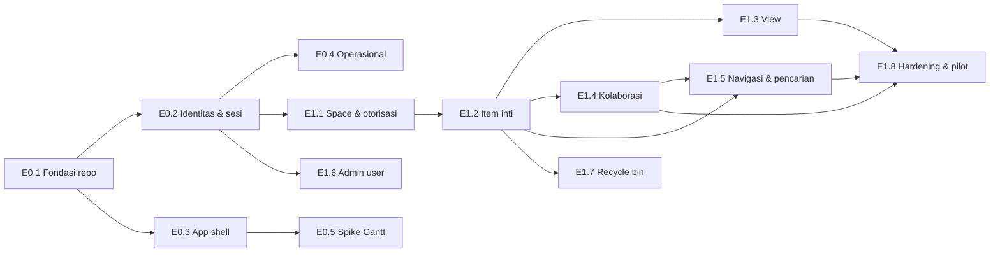

# BACKLOG — PMS (M0 – M2)

| | |
|---|---|
| **Versi** | 0.1 (draft) |
| **Cakupan** | Epic dan user story untuk M0, M1 (47 requirement PRD), dan M2 (13 requirement; ditulis 13 Nov 2026). M3–M12 ditulis saat milestone dimulai |
| **Satuan estimasi** | **Hari ideal** satu developer dibantu AI (hari fokus penuh, termasuk tes dan review sendiri; di luar rapat/gangguan). Estimasi kasar dari bawah ke atas, **belum dikalibrasi** dengan kecepatan nyata |
| **Terkait** | [PRD.md](PRD.md), [TASKS.md](TASKS.md) (urutan kerja dan tugas teknis), [ARCHITECTURE.md](ARCHITECTURE.md), [DATABASE.md](DATABASE.md), [UI_SPEC.md](UI_SPEC.md) |

**Definition of Done (berlaku untuk semua story):** kode ter-merge dengan CI hijau (lint, typecheck, `go test`, build); migrasi diuji maju pada database kosong; endpoint baru ada di `openapi.yaml` sebelum implementasi; tes otorisasi untuk setiap endpoint baru; teks UI lewat `t()`; keyboard dan label ARIA diperiksa; tidak ada `shortcut:` tanpa catatan batas dan kapan diganti.

---

## Ringkasan

<!-- SUMMARY:START -->
| Epic | Story | Hari ideal |
|---|---|---|
| E0.1 Fondasi repo dan pipeline | 3 | 4.5 |
| E0.2 Identitas dan sesi | 6 | 5.5 |
| E0.3 App shell dan design system | 2 | 2 |
| E0.4 Operasional | 2 | 2 |
| E0.5 Spike | 1 | 1 |
| E1.1 Space dan otorisasi | 4 | 10 |
| E1.2 Item inti | 6 | 14.5 |
| E1.3 View | 4 | 9 |
| E1.4 Kolaborasi | 4 | 8 |
| E1.5 Navigasi dan pencarian | 4 | 7.5 |
| E1.6 Admin user | 2 | 4 |
| E1.7 Recycle bin | 1 | 2.5 |
| E1.8 Hardening dan kesiapan pilot | 2 | 3.5 |
| E2.1 Jadwal dan dependensi | 3 | 9 |
| E2.2 Effort dan progress | 2 | 4.5 |
| E2.3 Custom field | 3 | 9 |
| E2.4 Gantt | 3 | 8 |
| E2.5 View lain dan Space | 4 | 8.5 |
| E2.6 Hardening | 1 | 2 |
| **M0** | 14 | **15** |
| **M1** | 27 | **59** |
| **M2** | 16 | **41** |
| **Total** | 57 | **115** |
<!-- SUMMARY:END -->

## Peta epic dan dependensi

---

# MILESTONE M0 — Fondasi

## E0.1 Fondasi repo dan pipeline

### S0.1.1 — Kerangka repo dan alur kontrak API
- **Sebagai** developer, **saya ingin** repo dengan struktur PRD §10.3 dan generator kode dari `openapi.yaml`, **agar** FE/BE tidak bisa melenceng.
- **PRD:** — (infrastruktur)
- **Est:** 1.5 · **Dep:** —
- **Acceptance criteria:**
  - `make gen` menghasilkan stub Go (`oapi-codegen`) dan tipe TS (`openapi-typescript`) dari `api/openapi.yaml`; CI gagal bila hasil generate berbeda dari yang ter-commit.
  - `make dev` menjalankan server Go dan Vite bersamaan; satu halaman "hello" memanggil `GET /healthz` lewat klien hasil generate.
  - Aturan ketergantungan antar paket (ARCHITECTURE §3) dijaga tes `go list`.

### S0.1.2 — Tooling database dan migrasi identitas
- **Sebagai** developer, **saya ingin** goose + sqlc + pgx terpasang beserta tabel identitas, **agar** semua modul berikutnya memakai satu cara akses data.
- **PRD:** — (infrastruktur)
- **Est:** 1.5 · **Dep:** S0.1.1
- **Acceptance criteria:**
  - Migrasi `0001`–`0002` (extensions, `account`, `users`, `sessions`, `user_tokens`) berjalan pada Postgres 16 kosong dan diuji maju oleh CI (service Postgres).
  - `pms migrate up` idempoten; `GET /readyz` gagal bila migrasi belum terpasang.
  - Satu query sqlc contoh dengan tes terhadap Postgres sungguhan (tanpa mock).

### S0.1.3 — Dockerfile, CI, dan image di GHCR
- **Sebagai** operator, **saya ingin** satu image yang dibangun CI, **agar** tiap klien memakai artefak yang sama dan terkunci versinya.
- **PRD:** — (infrastruktur; mendukung PRD §10.3)
- **Est:** 1.5 · **Dep:** S0.1.1, S0.1.2
- **Acceptance criteria:**
  - Dockerfile multi-stage menghasilkan satu image berisi binary Go dengan SPA di-embed; ukuran dan pengguna non-root dicatat.
  - GitHub Actions: lint, typecheck, `go test` (Postgres service), build; pada tag `v*` push ke GHCR private dengan tag versi.
  - Image berjalan di Compose lokal dan melayani SPA + `/api/v1/healthz`.

## E0.2 Identitas dan sesi

### S0.2.1 — Platform HTTP
- **Sebagai** developer, **saya ingin** router, middleware, dan format error baku, **agar** semua handler konsisten dan aman.
- **PRD:** SEC-04 (bagian CSRF)
- **Est:** 1.0 · **Dep:** S0.1.1, S0.1.2
- **Acceptance criteria:**
  - Middleware: request ID, log JSON, pemulihan panic, pemeriksaan `Origin` untuk method yang mengubah data, batas ukuran body.
  - Error memakai `application/problem+json` dengan `code` dan `request_id` (WORKFLOWS §10).
  - Konfigurasi dibaca dari env dengan validasi saat start (variabel wajib hilang → gagal start dengan pesan jelas).

### S0.2.2 — Login, logout, dan session
- **Sebagai** user, **saya ingin** masuk dan keluar dengan aman, **agar** akun saya terlindungi.
- **PRD:** AUTH-01, AUTH-02, SEC-04
- **Est:** 1.5 · **Dep:** S0.2.1
- **Acceptance criteria:**
  - Password di-hash argon2id; cookie `httpOnly; Secure; SameSite=Lax`; token acak 256-bit, hanya hash yang disimpan.
  - Idle timeout 14 hari, batas absolut 30 hari, ID dirotasi saat login; logout mencabut session.
  - Rate limit per IP dan per email; pesan error sama untuk email salah, password salah, akun invited, dan deactivated.
  - Tes: session kedaluwarsa → 401; CSRF (Origin salah) → 403.

### S0.2.3 — Reset dan ganti password
- **Sebagai** user, **saya ingin** mengatur ulang dan mengganti password, **agar** saya bisa memulihkan akses.
- **PRD:** AUTH-03, AUTH-04
- **Est:** 0.5 · **Dep:** S0.2.2, S0.2.6
- **Acceptance criteria:**
  - `forgot` selalu menjawab 202 yang sama; token berlaku 1 jam dan sekali pakai.
  - `reset` dan `change` mencabut session sesuai WORKFLOWS §5; password lemah ditolak 422.

### S0.2.4 — Undangan dan penerimaan undangan
- **Sebagai** user baru, **saya ingin** menerima undangan dan membuat password, **agar** saya bisa masuk tanpa signup publik.
- **PRD:** AUTH-06
- **Est:** 1.0 · **Dep:** S0.2.2, S0.2.6
- **Acceptance criteria:**
  - `GET /auth/invitations/{token}` dan `POST …/accept` sesuai openapi; token kedaluwarsa/terpakai → 410.
  - Saat aktivasi: status `active`, Personal space dibuat, session dibuat.

### S0.2.5 — Perintah bootstrap
- **Sebagai** operator, **saya ingin** `pms bootstrap`, **agar** instance klien baru siap dipakai satu perintah.
- **PRD:** AUTH-09
- **Est:** 0.5 · **Dep:** S0.2.4
- **Acceptance criteria:**
  - Membuat `account`, admin `invited`, workflow default beserta statusnya, dan Space "General"; mengirim undangan atau mencetak link ke log bila SMTP kosong.
  - Idempoten: dijalankan lagi saat admin sudah ada → kode keluar ≠ 0 tanpa mengubah data.

### S0.2.6 — Email (SMTP + job)
- **Sebagai** sistem, **saya ingin** mengirim email lewat antrian, **agar** pengiriman tahan gangguan.
- **PRD:** SET-10
- **Est:** 1.0 · **Dep:** S0.2.1
- **Acceptance criteria:**
  - River berjalan di proses yang sama; job `send_email` dengan retry eksponensial (maks 8).
  - Template `en` untuk undangan dan reset password (subjek, HTML, teks); mode `log` bila SMTP kosong.
  - Tes dengan server SMTP tiruan (undangan terkirim sekali; kegagalan di-retry).

## E0.3 App shell dan design system

### S0.3.1 — Setup frontend
- **Sebagai** developer, **saya ingin** fondasi UI siap pakai, **agar** layar bisa dibangun cepat dan konsisten.
- **PRD:** SET-01 (fondasi)
- **Est:** 1.0 · **Dep:** S0.1.1
- **Acceptance criteria:**
  - TanStack Router (file-based) + Query, react-i18next (`en`), Tailwind v4, komponen `ui-kit` disalin dan `LinkButton` diadaptasi, font lokal, density `compact` default, `data-brand`, mode terang/gelap.
  - Aturan ESLint `no-literal-string` aktif; `axe` terpasang di Playwright.

### S0.3.2 — Layar autentikasi dan shell kosong
- **Sebagai** user, **saya ingin** layar login dan shell dasar, **agar** saya bisa masuk dan melihat aplikasi.
- **PRD:** AUTH-01, AUTH-03, AUTH-04, AUTH-06, SET-01
- **Est:** 1.0 · **Dep:** S0.3.1, S0.2.2, S0.2.3, S0.2.4
- **Acceptance criteria:**
  - Login, Forgot, Reset, Accept invitation, `/settings/security` sesuai UI_SPEC §4.1; navigasi `?next=` hanya menerima path internal.
  - Shell dengan sidebar dan topbar kosong (menu profil + logout).

## E0.4 Operasional

### S0.4.1 — Compose klien, update, dan backup
- **Sebagai** operator, **saya ingin** template deployment dan script operasional, **agar** setiap klien dapat dipasang, diperbarui, dan dipulihkan dengan aman.
- **PRD:** OPS-01, OPS-02
- **Est:** 1.5 · **Dep:** S0.1.3, S0.2.5
- **Acceptance criteria:**
  - `deploy/` berisi Compose (app + postgres + volume file, label Traefik, `MAX_SEATS` dll.) dan `.env.example`.
  - `update.sh <versi>`: backup pre-deploy → pull → up → tunggu `/readyz`; bila gagal mencetak perintah restore.
  - `backup.sh` (dump database lebih dulu, lalu file) dan `restore.sh`; **restore penuh diuji** pada instance uji dan waktunya dicatat terhadap target RPO ≤ 24 jam / RTO ≤ 4 jam.

### S0.4.2 — Observabilitas
- **Sebagai** operator, **saya ingin** log, metrik, dan alert dasar, **agar** masalah terlihat sebelum klien melapor.
- **PRD:** OPS-03
- **Est:** 0.5 · **Dep:** S0.2.1
- **Acceptance criteria:**
  - `/metrics` berisi metrik ARCHITECTURE §11; `/healthz` dan `/readyz` berfungsi.
  - Alert Grafana dasar (5xx, job gagal, backup basi, disk) terdefinisi sebagai file provisioning di `deploy/`.

## E0.5 Spike

### S0.5.1 — Spike Gantt (SVAR) dan penjadwalan di Go
- **Sebagai** pemilik produk, **saya ingin** bukti bahwa SVAR MIT cukup dan penjadwalan di Go layak, **agar** risiko M2 diketahui sebelum diteruskan.
- **PRD:** — (mengurangi risiko VIEW-05A/B)
- **Est:** 1.0 (batas waktu keras) · **Dep:** S0.3.1
- **Acceptance criteria:**
  - Satu halaman memuat ±200 task dengan dependensi dummy; drag/resize berfungsi.
  - Fungsi Go prototipe menggeser task penerus untuk dependensi FS dengan hari kerja Senin–Jumat, diuji dengan 3 kasus.
  - Catatan keputusan: "lanjut SVAR MIT" atau "perlu PRO / ganti library", beserta alasannya, ditulis di `docs/`.

---

# MILESTONE M1 — Core Work Management (MVP)

## E1.1 Space dan otorisasi

### S1.1.1 — Data Space dan CRUD
- **Sebagai** user, **saya ingin** membuat dan mengelola Space, **agar** pekerjaan punya lokasi.
- **PRD:** SPC-01
- **Est:** 2.0 · **Dep:** S0.1.2, S0.2.5
- **Acceptance criteria:**
  - Migrasi `spaces`, `shares`, `groups`, `group_members`; endpoint `/spaces` dan `/spaces/{id}` sesuai openapi dengan `If-Match`.
  - Personal space dibuat saat aktivasi, tidak bisa dihapus atau dibagikan; Space default dibuat bootstrap.
  - Menghapus Space bertipe `shared` memindahkan isinya ke Recycle bin (tergantung S1.7.1; sebelum itu soft delete saja).

### S1.1.2 — Paket `policy` (mesin otorisasi)
- **Sebagai** developer, **saya ingin** satu tempat keputusan akses, **agar** tidak ada celah otorisasi yang tersebar.
- **PRD:** USR-02, SEC-02
- **Est:** 3.0 · **Dep:** S1.1.1
- **Acceptance criteria:**
  - `Can(user, capability, target)` dan filter SQL untuk daftar, sesuai ARCHITECTURE §6 (union share lewat semua lokasi dan leluhur, ∩ plafon user type, Personal space privat, admin `full` di Space `shared`).
  - Jawaban tanpa akses selalu 404; aksi tidak diizinkan pada item terlihat → 403.
  - Definisi matriks (share role, user type) berada di satu tempat dan dipakai juga oleh endpoint matriks UI (USR-02).
  - **Catatan keputusan 12 Nov (superseded oleh D-17.1, 20 Nov 2026: Explicit Access Only):** admin otomatis `full` di semua Space `shared`, bukan Personal space (D-17); sertakan dalam matriks tes S1.1.4.

### S1.1.3 — API sharing dan ShareDialog
- **Sebagai** pemilik, **saya ingin** membagikan Space/project/folder ke user atau grup dengan role, **agar** kolaborator mendapat akses yang tepat.
- **PRD:** SPC-11
- **Est:** 3.0 · **Dep:** S1.1.2, S0.3.2
- **Acceptance criteria:**
  - `GET/PUT …/shares` untuk Space dan item; share yang diwarisi ditampilkan beserta asalnya dan tidak bisa dihapus dari anak.
  - ShareDialog sesuai UI_SPEC §4.2: cari user/grup, pilih role, peringatan saat menghapus akses sendiri; email tak dikenal menawarkan undang sebagai external (admin).
  - Tidak bisa memberi role lebih tinggi dari kemampuan sendiri (`share` diperlukan).

### S1.1.4 — Matriks tes otorisasi
- **Sebagai** pemilik produk, **saya ingin** bukti otomatis bahwa data tidak bocor, **agar** produk aman dijual.
- **PRD:** SEC-02
- **Est:** 2.0 · **Dep:** S1.1.2, S1.2.2
- **Acceptance criteria:**
  - Tabel kasus dihasilkan dari definisi matriks: 5 user type × 4 share role × kemampuan × {langsung, lewat grup, lewat leluhur, lewat lokasi kedua}, diuji ke endpoint nyata.
  - Tes negatif IDOR: item, file, komentar, dan lampiran dari Space lain → 404; Personal space orang lain tidak terlihat, termasuk oleh admin.
  - Tes dijalankan di CI dan memblokir merge bila gagal.

## E1.2 Item inti

### S1.2.1 — Skema item dan workflow default
- **PRD:** WF-01
- **Est:** 2.0 · **Dep:** S1.1.1
- **Sebagai** developer, **saya ingin** tabel item, lokasi, dan workflow, **agar** semua fitur kerja punya fondasi data.
- **Acceptance criteria:**
  - Migrasi `workflows`, `statuses`, `items`, `item_locations`, `item_assignees`, `item_followers` sesuai DATABASE §3, termasuk `search tsvector`, `version`, `rank`, dan `CHECK` tanggal.
  - Trigger pencegah siklus lokasi + tes siklus.
  - Bootstrap membuat workflow default (New, In Progress, Completed, On Hold, Cancelled) dengan grup yang benar.

### S1.2.2 — Item service (create, get, patch)
- **Sebagai** user, **saya ingin** membuat dan mengubah project, folder, dan task, **agar** pekerjaan tercatat.
- **PRD:** TASK-01, TASK-02, TASK-04, TASK-05A, TASK-06, SEC-03
- **Est:** 4.0 · **Dep:** S1.2.1, S1.1.2
- **Acceptance criteria:**
  - `POST /items`, `GET/PATCH/DELETE /items/{id}`, `reorder` sesuai openapi; subitem lewat `parent_item_id`.
  - `PATCH` memakai `If-Match` (409 `version_conflict`, 428 tanpa header); setiap perubahan menulis `activity` dalam transaksi yang sama.
  - Aturan status: perubahan memerlukan `change_status`; masuk grup Completed mengisi `completed_at` (WORKFLOWS §1); validasi `due ≥ start`.
  - Assignee hanya user aktif; pembuat dan assignee otomatis menjadi follower.

### S1.2.3 — Endpoint daftar (children dan root Space)
- **PRD:** SPC-04, SPC-02
- **Est:** 2.0 · **Dep:** S1.2.2
- **Sebagai** user, **saya ingin** melihat isi Space dan container, **agar** saya bisa menelusuri pekerjaan.
- **Acceptance criteria:**
  - `GET /spaces/{id}/items` dan `GET /items/{id}/children` dengan filter `type`, `status_group`, `assignee`, `sort`, dan pagination kursor.
  - Daftar di dalam container yang diizinkan tidak melakukan cek akses per baris (pewarisan); p95 < 300 ms untuk 500 item pada data uji.

### S1.2.4 — UI pembuatan project, folder, dan task
- **PRD:** SPC-05, SPC-06, TASK-01
- **Est:** 2.5 · **Dep:** S1.2.2, S0.3.2
- **Sebagai** user, **saya ingin** membuat project, folder, dan task dengan cepat, **agar** saya bisa mulai bekerja.
- **Acceptance criteria:**
  - Modal Create project/folder sesuai UI_SPEC §4.2 dan wireframe §5.4 (LocationPicker, DateRangePicker, pilihan default view, sharing); field finansial belum tampil.
  - Task dibuat lewat tombol **+**, baris "+ Item" di Table, dan "+ Add" di Board (dua yang terakhir menunggu S1.3.2/S1.3.3).
  - Validasi nama wajib; error server dipetakan ke field.

### S1.2.5 — Panel detail item
- **PRD:** SPC-07, SPC-08, SPC-09, TASK-03, TASK-04, TASK-05A, TASK-06
- **Est:** 3.0 · **Dep:** S1.2.2, S0.3.2
- **Sebagai** user, **saya ingin** panel detail untuk mengubah semua atribut item, **agar** saya tidak berpindah halaman.
- **Acceptance criteria:**
  - Panel membuka lewat `?task=` dan `/tasks/$itemId`; judul inline, StatusPicker, AssigneePicker (multi), DateRangePicker (working days only), Description (TipTap, simpan otomatis), menu ⋯ (copy link, convert to milestone, delete).
  - Aksi tanpa izin disembunyikan; setiap edit memakai `If-Match`.
  - Semua popup (menu, picker, dialog) diuji dengan klik nyata di Playwright.

### S1.2.6 — Subitem
- **PRD:** TASK-02
- **Est:** 1.0 · **Dep:** S1.2.5
- **Sebagai** user, **saya ingin** memecah task jadi subitem, **agar** pekerjaan besar bisa dilacak bagian-bagiannya.
- **Acceptance criteria:**
  - Daftar subitem dan "Add subitem" di panel; klik membuka subitem dengan breadcrumb ke induk; jumlah subitem tampil di kartu dan baris.
  - Subitem tidak bisa menjadi induk dirinya sendiri atau turunannya (tes siklus dari UI).

## E1.3 View

### S1.3.1 — API view
- **PRD:** VIEW-08
- **Est:** 1.5 · **Dep:** S1.2.1
- **Sebagai** user, **saya ingin** menyimpan dan mengelola view, **agar** tampilan favorit saya selalu tersedia.
- **Acceptance criteria:**
  - Migrasi `views`; CRUD, duplicate, dan satu `is_default` per scope (indeks unik parsial); view `personal` hanya terlihat pemiliknya.
  - Container baru otomatis mendapat view Table dan Board; default view mengikuti pilihan saat dibuat.

### S1.3.2 — Table view
- **PRD:** VIEW-01, SPC-02
- **Est:** 3.5 · **Dep:** S1.2.3, S1.3.1, S1.2.5
- **Sebagai** user, **saya ingin** melihat dan mengedit pekerjaan dalam tabel, **agar** saya bisa bekerja cepat dengan banyak item.
- **Acceptance criteria:**
  - TanStack Table + Virtual: kolom Name (hierarki expand/collapse), Status, Assignee, Start, Due; edit inline; baris "+ Item"; reorder dengan drag dan menu "Move to…".
  - 500 item: render awal p95 < 1,5 detik; navigasi `J/K/Enter/E/S/A` berfungsi.
  - Filter, sort, dan group disimpan di URL.

### S1.3.3 — Board view
- **PRD:** VIEW-02
- **Est:** 2.5 · **Dep:** S1.2.3, S1.3.1, S1.2.5
- **Sebagai** user, **saya ingin** papan Kanban per status, **agar** progres terlihat sekilas.
- **Acceptance criteria:**
  - Kolom per status workflow; kartu menampilkan judul, assignee, tanggal, jumlah subitem/lampiran/komentar.
  - Drag kartu antar kolom mengubah status secara optimistis; konflik/error mengembalikan kartu dan menampilkan toast; alternatif keyboard dan menu "Move to…".
  - "+ Add" di tiap kolom membuat task dengan status kolom itu.

### S1.3.4 — ViewTabs dan pengelolaan view
- **PRD:** VIEW-08, SPC-17
- **Est:** 1.5 · **Dep:** S1.3.2
- **Sebagai** user, **saya ingin** mengelola view, **agar** saya bisa menyesuaikan dan membagikan tampilan.
- **Acceptance criteria:**
  - Menu per view: Copy link (URL saat ini), Rename, Duplicate (Public/Personal), Set as default, Move left/right, Delete (ConfirmDialog; default tidak bisa dihapus).
  - Membuka URL view yang disalin memulihkan filter, sort, dan view yang sama.

## E1.4 Kolaborasi

### S1.4.1 — Komentar dan mention
- **PRD:** TASK-07
- **Est:** 2.5 · **Dep:** S1.2.5
- **Sebagai** user, **saya ingin** berkomentar dan menyebut orang, **agar** diskusi tercatat di item.
- **Acceptance criteria:**
  - TipTap dengan @mention (user, grup, followers); server memvalidasi JSON ProseMirror (node/mark yang diizinkan) dan mengekstrak mention ke `comment_mentions`.
  - Komentar dapat diedit/dihapus oleh penulis (dan `full`); `If-Match` pada edit.
  - Tes XSS: payload berbahaya di JSON ditolak atau dibersihkan; tidak ada HTML mentah tersimpan.

### S1.4.2 — Lampiran file
- **PRD:** TASK-08A, SEC-01
- **Est:** 2.5 · **Dep:** S1.2.5
- **Sebagai** user, **saya ingin** melampirkan file ke item, **agar** dokumen kerja berada di satu tempat.
- **Acceptance criteria:**
  - Interface `Storage` + `LocalStorage`; upload multipart dengan `MaxBytesReader` (`PMS_MAX_UPLOAD_MB`), deteksi tipe dari isi, tolak executable, SHA-256, nama file acak, tanpa timpa.
  - Download lewat endpoint berizin dengan header `attachment` + `nosniff` + CSP sandbox; item tanpa akses → 404.
  - UI FileDropzone menampilkan batas ukuran dan alasan penolakan; tes upload file palsu (ekstensi `.png` berisi ELF) ditolak.

### S1.4.3 — Optimistic locking end-to-end
- **PRD:** SEC-03
- **Est:** 1.0 · **Dep:** S1.2.5
- **Sebagai** user, **saya ingin** tidak menimpa perubahan orang lain tanpa sadar, **agar** data tidak hilang.
- **Acceptance criteria:**
  - ConflictBanner dan toast konflik sesuai DESIGN_SYSTEM §5.2; draf pengguna tidak hilang dan bisa diterapkan ulang.
  - Tes E2E dua sesi: sesi A mengubah judul, sesi B menyimpan versi lama → B melihat banner dan bisa "Reapply".

### S1.4.4 — Realtime (SSE)
- **PRD:** — (NFR real-time PRD §6)
- **Est:** 2.0 · **Dep:** S1.2.3
- **Sebagai** user, **saya ingin** melihat perubahan rekan tanpa memuat ulang, **agar** tim selalu sinkron.
- **Acceptance criteria:**
  - `GET /events` dengan hub di memori, heartbeat 25 detik, `Last-Event-ID` (1.000 event), event `resync` bila terlalu lama.
  - Klien menginvalidasi TanStack Query berdasarkan `container_ids`; `LiveIndicator` menunjukkan status koneksi.
  - Perubahan oleh sesi A tampil di sesi B dalam ≤ 3 detik (diuji E2E); penerima event diperiksa izinnya.

## E1.5 Navigasi dan pencarian

### S1.5.1 — Sidebar dan navigasi
- **PRD:** NAV-01, SPC-04
- **Est:** 1.5 · **Dep:** S1.1.1, S0.3.2
- **Sebagai** user, **saya ingin** sidebar dengan pohon Space dan jalan pintas, **agar** saya cepat berpindah.
- **Acceptance criteria:**
  - Pohon Space → project/folder (dapat dibuka-tutup, urutan `rank`), Personal space, Shared with me (`GET /me/shared`), menu More, Recycle bin.
  - Dapat diciutkan; pilihan diingat per user; navigasi keyboard.
  - **Catatan keputusan 12 Nov:** tambahkan `account_name` ke `Me` (D-34, tambahan kontrak) untuk header sidebar, dan banner "Your session expired" lewat parameter `?reason=expired` dari guard (D-31).

### S1.5.2 — Notifikasi dan Inbox
- **PRD:** NAV-03
- **Est:** 2.5 · **Dep:** S1.4.1, S0.2.6
- **Sebagai** user, **saya ingin** diberi tahu saat ada yang relevan, **agar** saya tidak ketinggalan.
- **Acceptance criteria:**
  - Migrasi `notifications`; pembuatan notifikasi mengikuti tabel WORKFLOWS §6 (penerima, pengecualian pelaku, hanya yang masih punya `view`).
  - Inbox: daftar, titik belum dibaca, Mark all as read, Archive all, filter belum dibaca; badge di topbar diperbarui realtime.
  - Email notifikasi dikirim lewat job (semua event aktif kecuali `comment` sebelum SET-05).

### S1.5.3 — My to-do
- **PRD:** NAV-05
- **Est:** 1.0 · **Dep:** S1.2.3
- **Sebagai** user, **saya ingin** daftar tugas saya, **agar** saya tahu apa yang harus dikerjakan.
- **Acceptance criteria:**
  - `GET /me/todo` dengan filter All/Active/Overdue dan sort Date, Date modified, Date created, Status, Title; opsi Priority/Importance disembunyikan sampai M2.
  - Hanya task dengan status grup Active yang tampil pada "Only active"; "Overdue" = due lampau dan belum Completed.

### S1.5.4 — Pencarian global
- **PRD:** NAV-06
- **Est:** 2.5 · **Dep:** S1.1.2, S1.2.3
- **Sebagai** user, **saya ingin** mencari apa pun dengan cepat, **agar** saya tidak perlu menelusuri pohon.
- **Acceptance criteria:**
  - `tsvector` pada `items`, `comments`, `users` dengan konfigurasi `simple` + prefix; query disaring izin (item di luar akses tidak pernah muncul).
  - CommandPalette (Ctrl/Cmd+K) dengan hasil per grup + halaman `/search`; scope Everywhere / Space / Project.
  - p95 < 800 ms pada 10 ribu item data uji.

## E1.6 Admin user

### S1.6.1 — Manajemen user dan seat
- **PRD:** USR-01, USR-03
- **Est:** 3.0 · **Dep:** S0.2.4, S0.3.2
- **Sebagai** admin, **saya ingin** mengundang dan mengelola user dalam batas seat, **agar** akses tim terkendali.
- **Acceptance criteria:**
  - Invite (cek `PMS_MAX_SEATS`, 422 `seats_exhausted`), resend, deactivate (session dicabut, seat bebas), reactivate, ubah user type; guard `last_admin`.
  - UI `/settings/users` (tab Users dan Groups, ringkasan seat) dan `/settings/users/types` (matriks dari definisi `policy`).
  - Non-admin tidak melihat menu; URL langsung → 404.
  - **Catatan keputusan 12 Nov:** URL undangan tidak boleh disimpan di argumen job: worker email membuat token saat mengirim (D-33); seat dicek saat undang dan aktifkan kembali (WORKFLOWS §3).

### S1.6.2 — Profil dan pengaturan workspace
- **PRD:** SET-02
- **Est:** 1.0 · **Dep:** S0.3.2
- **Sebagai** user, **saya ingin** mengatur profil dan preferensi, **agar** aplikasi sesuai kebiasaan saya.
- **Acceptance criteria:**
  - `GET/PATCH /me`: nama, perusahaan, jabatan, negara, lokasi, departemen, telepon, timezone, format tanggal/jam, awal minggu, density, tema, pintasan kirim komentar.
  - Tanggal dan angka di UI mengikuti pengaturan ini.

## E1.7 Recycle bin

### S1.7.1 — Soft delete, restore, dan Recycle bin
- **PRD:** BIN-01, BIN-02
- **Est:** 2.5 · **Dep:** S1.2.2
- **Sebagai** user, **saya ingin** menghapus dengan aman, **agar** kesalahan bisa dibatalkan.
- **Acceptance criteria:**
  - Hapus item menandai item dan turunan tanpa lokasi hidup lain dengan `deleted_root_id` yang sama (DATABASE §5); restore memulihkan semuanya; lokasi orang tua yang hilang → pulih ke root Space.
  - Toast **Undo** 8 detik; halaman Recycle bin dengan alasan bila tidak bisa dipulihkan.
  - Item terhapus tidak muncul di pencarian, My to-do, atau notifikasi baru; tes cascade dengan item multi-lokasi.
  - **Catatan keputusan 12 Nov:** Recycle bin hanya dibersihkan manual di M1 (D-18); tidak ada penghapusan otomatis.

## E1.8 Hardening dan kesiapan pilot

### S1.8.1 — Tes E2E dan aksesibilitas
- **PRD:** — (kualitas; PRD §6, §5.14)
- **Est:** 2.0 · **Dep:** S1.3.3, S1.4.1, S1.5.2
- **Sebagai** pemilik produk, **saya ingin** lima alur kritis teruji otomatis, **agar** regresi tertangkap sebelum klien.
- **Acceptance criteria:**
  - Playwright: login; buat proyek; buat task; ubah status di Board (drag); kirim komentar dengan mention hingga muncul di Inbox user lain.
  - `axe` bersih (tanpa pelanggaran serius/kritis) pada layar utama di mode terang dan gelap.
  - Tes dijalankan di CI pada setiap PR.

### S1.8.2 — Performa dan kesiapan pilot
- **PRD:** — (kualitas; PRD §6)
- **Est:** 1.5 · **Dep:** S1.8.1
- **Sebagai** pemilik produk, **saya ingin** angka performa dan runbook, **agar** pilot internal bisa dimulai dengan tenang.
- **Acceptance criteria:**
  - Data uji 500 item/project dan 10 ribu item total: p95 Table/Board < 1,5 detik, pencarian < 800 ms; hasil dicatat.
  - Runbook: bootstrap, update, backup, restore, rotasi `PMS_SECRET_KEY`, menambah seat.
  - Daftar bug terbuka diprioritaskan; tidak ada bug otorisasi atau kehilangan data yang terbuka.

---

# MILESTONE M2 — Planning & Scheduling

**Cakupan:** VIEW-05A, VIEW-05B, VIEW-03, VIEW-04, VIEW-06, VIEW-09; TASK-05B, TASK-09, TASK-10, TASK-11A; SET-07; SPC-03, SPC-10 (PRD §8).
**Exit criteria (PRD):** proyek bisa dijadwalkan penuh di Gantt dengan dependensi; durasi menghormati work schedule; custom field tampil di semua view.

**Titik awal (dari M0/M1):** `items` sudah punya `start_date`, `due_date`, `duration_days`, `is_milestone`, dan `fields jsonb`; `item_locations` mendukung banyak lokasi dan `POST /items/{id}/locations` ada di kontrak. `views.type` baru `table`/`board`. `server/internal/schedule` kini punya `Calendar` (S2.1.1); propagasi berantai dan tipe SS/FF/SF belum ada. Sort `priority` dan `importance` sudah ada di kontrak daftar tetapi disembunyikan sampai M2. Keputusan spike: lanjut SVAR MIT ([GANTT_SPIKE.md](GANTT_SPIKE.md)); performa dan penyimpanan perubahan belum diuji.

**Keputusan M2 (disetujui 13 Nov 2026):**

| # | Keputusan | Ref | Mempengaruhi |
|---|---|---|---|
| M2-1 | Prioritas disimpan sebagai kolom `importance` (`high`/`normal`/`low`) pada `items`, bukan custom field | D-36 | S2.5.3 |
| M2-2 | Penjadwalan otomatis berjalan saat tanggal atau dependensi berubah, dalam satu transaksi; tidak ada tombol "jadwal ulang semua" | D-37 | S2.1.3 |
| M2-3 | Penerus digeser otomatis hanya bila melanggar dependensi, tidak pernah dimajukan | D-38 | S2.1.3 |
| M2-4 | Satu work schedule per workspace; per user menunggu M4 | D-39 | S2.1.1 |
| M2-5 | Nilai custom field disimpan di `items.fields` berkunci id definisi; kolom tampil bila definisi ada di Space yang sedang dilihat | D-40 | S2.3.x |

**Di luar M2:** baseline (grup kolom hanya placeholder), actual cost, timesheet (M4), form dan approval (M3), dashboard dan report (M5), template Space (M6), work schedule per user, tombol "jadwal ulang semua".

---

## E2.1 Jadwal dan dependensi

### S2.1.1 — Work schedule (SET-07)
- **PRD:** SET-07
- **Est:** 2.5 · **Dep:** M1
- **Sebagai** admin, **saya ingin** menetapkan hari kerja, kapasitas harian, dan libur, **agar** durasi dan jadwal task mengikuti kalender kerja organisasi.
- **Acceptance criteria:**
  - Admin mengatur hari kerja (default Senin–Jumat), jam kerja per hari (default 8), dan daftar tanggal libur lewat `/settings/work-schedule`; non-admin hanya bisa membaca.
  - Perubahan memakai `If-Match`; konflik memberi 409.
  - Fungsi Go `workdays(start, duration)` dan `duration(start, finish)` memakai jadwal ini; kasus libur di tengah rentang, libur di akhir pekan, dan jadwal tanpa hari kerja ditolak (422) teruji.

### S2.1.2 — Dependensi item (data dan API)
- **PRD:** VIEW-05B
- **Est:** 2.5 · **Dep:** M1
- **Sebagai** user, **saya ingin** menghubungkan task dengan dependensi FS/SS/FF/SF, **agar** urutan kerja jelas.
- **Acceptance criteria:**
  - Dependensi dibuat dan dihapus lewat API antara dua item yang pembacanya sama-sama punya akses; tipe FS, SS, FF, SF dengan lag (hari kerja, boleh negatif).
  - Siklus ditolak (422), juga siklus tidak langsung (A→B→C→A) dan dependensi ke diri sendiri.
  - Item yang masuk Recycle bin tidak ikut perhitungan, dan dependensinya kembali bila direstore.
  - Pengguna tanpa akses ke salah satu ujung tidak melihat ujung itu (404/disembunyikan), tes IDOR lulus.

### S2.1.3 — Mesin penjadwalan di Go
- **PRD:** VIEW-05B
- **Est:** 4.0 · **Dep:** S2.1.1, S2.1.2
- **Sebagai** PM, **saya ingin** task penerus bergeser otomatis ketika pendahulunya berubah, **agar** jadwal tetap konsisten tanpa hitung manual.
- **Acceptance criteria:**
  - Mengubah tanggal atau durasi sebuah task, atau menambah/mengubah dependensi, menghitung ulang seluruh rantai penerus dalam **satu transaksi** dan mengembalikan daftar item yang berubah.
  - Keempat tipe (FS, SS, FF, SF) dan lag benar menurut tabel kasus; hasil mengikuti hari kerja dan libur dari S2.1.1.
  - Keputusan M2-3 berlaku: penerus tidak pernah dimajukan, hanya digeser bila melanggar.
  - Milestone (durasi 0) dan task tanpa tanggal ditangani tanpa galat.
  - Rantai 500 task selesai dalam ≤ 300 ms (p95) pada PostgreSQL uji.
  - Setiap item yang digeser mencatat aktivitas dan menaikkan `version`; klien lain menerima event SSE.

## E2.2 Effort dan progress

### S2.2.1 — Effort dan allocation (TASK-05B)
- **PRD:** TASK-05B
- **Est:** 2.5 · **Dep:** S2.1.1
- **Sebagai** PM, **saya ingin** mengisi effort dan alokasi per orang, **agar** beban kerja dan durasi terhitung.
- **Acceptance criteria:**
  - Panel detail memuat effort (jam) dan alokasi per assignee (persen atau jam per hari); durasi dapat dihitung dari effort dan alokasi memakai kapasitas harian dari S2.1.1.
  - Menghapus assignee menghapus alokasinya; total alokasi di atas 100% memberi peringatan, bukan galat.
  - Mengubah effort tidak menggeser jadwal kecuali user memilih "hitung ulang durasi".

### S2.2.2 — Progress project (TASK-09)
- **PRD:** TASK-09
- **Est:** 2.0 · **Dep:** S2.2.1
- **Sebagai** PM, **saya ingin** melihat progres project dan risikonya, **agar** tahu mana yang terlambat.
- **Acceptance criteria:**
  - Metode progres dipilih per project: jumlah task selesai, durasi berbobot, atau rata-rata persen task; persen dihitung di server.
  - Indikator risiko (hijau/kuning/merah) mengikuti aturan tertulis di `WORKFLOWS.md` (mis. terlambat bila `due_date` lewat dan belum selesai).
  - Task di Recycle bin dan status `cancelled` tidak dihitung.

## E2.3 Custom field

### S2.3.1 — Definisi custom field dan API (TASK-10)
- **PRD:** TASK-10
- **Est:** 3.0 · **Dep:** M1
- **Sebagai** admin Space, **saya ingin** membuat field kustom dengan pilihan berwarna, **agar** tim memakai atribut yang sesuai pekerjaannya.
- **Acceptance criteria:**
  - Admin atau pemilik Space membuat, mengubah, mengurutkan, dan mengarsipkan definisi field per Space; menghapus opsi yang sedang dipakai ditolak atau diarsipkan, tidak menghilangkan nilai item.
  - Nilai disimpan di `items.fields` berkunci id definisi dan divalidasi server (id tak dikenal 422).
  - Field berlaku untuk task, project, dan folder di Space itu; keputusan M2-5 berlaku untuk item multi-lokasi.

### S2.3.2 — Tipe field lengkap (TASK-11A)
- **PRD:** TASK-11A
- **Est:** 3.0 · **Dep:** S2.3.1
- **Sebagai** user, **saya ingin** tipe field yang sesuai datanya, **agar** angka, tanggal, dan orang tersimpan benar.
- **Acceptance criteria:**
  - Tipe: Text, Number, Currency, Percent, Single select, Multiple select, People, Date, Duration, Checkbox. Setiap tipe punya validasi server dan pesan galat jelas.
  - Currency memiliki simbol, desimal, dan pemisah ribuan; Percent 0–100 atau lebih bila diizinkan; format mengikuti locale user.
  - Conditional marker (aturan warna berdasarkan nilai) dan agregasi default (jumlah, rata-rata, min, maks, hitung) tersedia untuk tipe numerik.
  - People hanya menerima user yang terlihat oleh pemilih; user nonaktif ditampilkan namun tidak bisa dipilih baru.

### S2.3.3 — Custom field di panel, Table, Board, dan pemilih kolom (VIEW-09)
- **PRD:** VIEW-09, TASK-10, TASK-11A
- **Est:** 3.0 · **Dep:** S2.3.2
- **Sebagai** user, **saya ingin** melihat dan mengedit custom field di semua tampilan, **agar** tidak berpindah layar.
- **Acceptance criteria:**
  - Panel detail memuat semua field Space; sel Table dapat diedit inline; kartu Board menampilkan field yang dipilih.
  - Pemilih kolom mengelompokkan Management, Schedule, Other, dan Custom fields; pilihan disimpan per view. Grup Baselines tampil nonaktif ("segera hadir") karena baseline di luar M2.
  - Filter dan sort berdasarkan custom field bekerja di URL dan di server (bukan hanya di klien) untuk tipe skalar dan select.
  - Table dengan 500 item dan 10 kolom custom tetap p95 ≤ 1 detik.

## E2.4 Gantt

### S2.4.1 — Tipe view Gantt dan Calendar
- **PRD:** VIEW-05A, VIEW-06
- **Est:** 1.0 · **Dep:** M1
- **Sebagai** user, **saya ingin** menambah view Gantt dan Calendar pada project, **agar** bisa memilih tampilan sesuai kebutuhan.
- **Acceptance criteria:**
  - Enum `view_type` memuat `gantt` dan `calendar`; ViewTabs menawarkan keduanya pada "Add view"; view bawaan project baru tetap Table dan Board.
  - Duplikasi, rename, default, dan hapus bekerja seperti view lain.

### S2.4.2 — Gantt: bar, progres, drag/resize, milestone (VIEW-05A)
- **PRD:** VIEW-05A
- **Est:** 4.0 · **Dep:** S2.4.1, S2.2.2
- **Sebagai** PM, **saya ingin** melihat dan mengubah jadwal di bagan Gantt, **agar** perencanaan visual.
- **Acceptance criteria:**
  - Bar per item dengan hierarki project → task → subitem dapat dilipat; progres % tampil; milestone tampil sebagai penanda.
  - Drag memindahkan tanggal dan resize mengubah durasi; keduanya memanggil `PATCH` dengan `If-Match` dan memperbarui dari respons server. Gagal (409/403) mengembalikan bar dan menampilkan toast.
  - Pengguna dengan hak lihat saja tidak bisa drag (kontrol nonaktif, bukan hanya diabaikan).
  - 500 task dirender dan digulir tanpa jeda yang terlihat (p95 render ≤ 1.5 detik).
  - Bisa dipakai dengan keyboard untuk memilih bar dan menggeser per hari; label ARIA ada.

### S2.4.3 — Gantt: dependensi dan penjadwalan (VIEW-05B)
- **PRD:** VIEW-05B
- **Est:** 3.0 · **Dep:** S2.4.2, S2.1.3
- **Sebagai** PM, **saya ingin** menarik garis dependensi dan melihat penerus bergeser, **agar** jadwal terhubung.
- **Acceptance criteria:**
  - Garis dependensi (FS/SS/FF/SF) digambar dari data server; membuat dan menghapus garis lewat drag dan menu memanggil API S2.1.2.
  - Setelah drag atau perubahan dependensi, bar penerus bergeser sesuai `affected_items` dari server; library tidak menghitung jadwal sendiri.
  - Dependensi yang akan membuat siklus ditolak dengan pesan jelas dan tidak ada perubahan yang tersimpan.
  - Dua pengguna mengedit bersamaan: yang kalah mendapat pesan konflik dan data segar (S1.4.3).

## E2.5 View lain dan Space

### S2.5.1 — Board swimlane dan field kartu (VIEW-03, VIEW-04)
- **PRD:** VIEW-03, VIEW-04
- **Est:** 3.0 · **Dep:** S2.3.3
- **Sebagai** user, **saya ingin** mengelompokkan Board per assignee dan memilih isi kartu, **agar** papan sesuai cara tim bekerja.
- **Acceptance criteria:**
  - Group by None atau Assignee membuat swimlane; item tanpa assignee masuk "Unassigned"; item dengan banyak assignee muncul di tiap lajur dan drag di antara lajur mengubah assignee dengan konfirmasi.
  - Kartu menampilkan field pilihan: cover image (dari lampiran gambar pertama), days in status, lokasi, author, ID, tipe item, tanggal, custom field; pilihan disimpan per view.
  - Drag status tetap optimistis dengan rollback.

### S2.5.2 — Calendar (VIEW-06)
- **PRD:** VIEW-06
- **Est:** 2.5 · **Dep:** S2.4.1
- **Sebagai** user, **saya ingin** melihat task pada kalender bulanan, **agar** tenggat terlihat sekilas.
- **Acceptance criteria:**
  - Tampilan bulanan dengan Today, prev, next; filter sama dengan view lain; item tampil dari `start_date` sampai `due_date`; item tanpa tanggal ada di daftar "Unscheduled".
  - Drag item ke hari lain mengubah tanggal (mengikuti S2.1.3); awal pekan mengikuti pengaturan user; libur dari S2.1.1 diberi tanda.
  - Dapat dipakai dengan keyboard; hari dan item punya label ARIA.

### S2.5.3 — Preset filter dan sort Space (SPC-03)
- **PRD:** SPC-03
- **Est:** 1.5 · **Dep:** S2.3.3
- **Sebagai** user, **saya ingin** preset All tasks, All active, dan My active, **agar** tidak menyusun filter berulang.
- **Acceptance criteria:**
  - Tiga preset tersedia di Table/Board/Calendar; sort Priority, Due date, Status, Name, Predecessors, Manual order bekerja di server dan tercermin di URL.
  - Sort Priority memakai keputusan M2-1 (kolom `importance`); Predecessors mengurutkan berdasarkan jumlah dan posisi dependensi.
  - Opsi Priority/Importance yang disembunyikan di M1 sekarang tampil, termasuk di My to-do.

### S2.5.4 — UI multi-lokasi (SPC-10)
- **PRD:** SPC-10
- **Est:** 1.5 · **Dep:** M1
- **Sebagai** user, **saya ingin** menambahkan item ke project atau Space lain, **agar** satu pekerjaan muncul di beberapa tempat.
- **Acceptance criteria:**
  - Panel detail menampilkan daftar lokasi; "Add location" memilih Space atau project tujuan yang bisa diakses user; menghapus lokasi terakhir ditolak.
  - Item muncul di Table dan Board setiap lokasi; perubahan di satu tempat terlihat di tempat lain (satu item, bukan salinan).
  - Hapus lokasi tidak menghapus item; siklus hierarki yang dibuat lewat lokasi baru ditolak.

## E2.6 Hardening

### S2.6.1 — E2E, aksesibilitas, dan performa M2
- **PRD:** — (kualitas; PRD §6)
- **Est:** 2.0 · **Dep:** semua story M2
- **Sebagai** tim, **saya ingin** bukti end-to-end, **agar** M2 bisa dinyatakan selesai.
- **Acceptance criteria:**
  - Tiga alur Playwright dengan PostgreSQL: (1) atur work schedule → buat task berdependensi → geser pendahulu → penerus bergeser mengikuti libur; (2) buat custom field → isi nilai → tampil di Table, Board, dan Gantt; (3) Calendar dan swimlane dengan drag.
  - `axe` pada Gantt, Calendar, dan pengaturan custom field (terang dan gelap).
  - Matriks otorisasi diperluas ke dependensi dan custom field; tes IDOR lulus.
  - Gantt dan Table 500 task serta rantai dependensi 500 task diukur dan dicatat di TESTING.
  - Runbook pilot diperbarui untuk migrasi M2 dan rollback.

---

## Di luar M0 – M2 (rujukan)

Semua requirement M3–M7 ada di PRD §5 dan §8; story-nya ditulis saat milestone dimulai. Yang paling mungkin berubah akibat pilot M1: Table (kolom custom), filter default, struktur panel detail, dan pengaturan notifikasi.

## Selisih estimasi terhadap rencana PRD

<!-- GAP:START -->
Estimasi bottom-up di atas dibandingkan dengan rencana PRD §8 (5 hari kerja per minggu):

| | Rencana PRD | Estimasi backlog | Selisih |
|---|---|---|---|
| M0 | 3 minggu = 15 hari | **15 hari** | +0 |
| M1 | 8 minggu = 40 hari | **59 hari** (≈ 11.8 minggu) | +19 hari (≈ +3.8 minggu) |
| M2 | 6 minggu = 30 hari | **41 hari** (≈ 8.2 minggu) | +11 hari (≈ +2.2 minggu) |

**M0 sesuai rencana. M1 diperkirakan lebih lama dari rencana PRD.** Estimasi ini kasar dan belum dikalibrasi; angka sebenarnya baru diketahui setelah M0 selesai dan kecepatan nyata terukur. Pilihan yang tersedia:

| Opsi | Isi | Akibat |
|---|---|---|
| **A. Ubah baseline M1** (rekomendasi) | M1 menjadi ±12 minggu; rilis 1.0 bergeser sekitar 4 minggu (minggu 35 → 39). Isi M1 tidak berubah | Exit criteria M1 ("satu proyek nyata end-to-end") tetap utuh karena komentar, file, dan Inbox ikut |
| B. Pangkas cakupan M1 | Tunda grup di Share/Users, Shared with me, duplicate dan urut view, edit/hapus komentar, hasil pencarian per grup (±3 hari) | Masih ±56 hari; **tidak cukup** untuk mencapai 40 tanpa memindahkan satu epic penuh |
| C. Pecah M1 menjadi M1a dan M1b | M1a = E1.1, E1.2, E1.3, E1.6, E1.7, S1.4.3 (**41 hari** ≈ rencana 40). M1b = komentar, file, realtime, Inbox, To-do, pencarian, hardening (**18 hari**) | Pilot dimulai di akhir M1a **tanpa komentar dan file**, sehingga belum bisa menjalankan proyek sungguhan; hanya menguji alur inti dan otorisasi |

**Keputusan (D-16, 12 Nov 2026): opsi A dipilih** dan PRD §8 sudah diubah (M1 12 minggu, GA minggu 39). Kalibrasi ulang setelah epic E1.1.

**M2 (13 Nov 2026):** selisih +11 hari terutama dari mesin penjadwalan (S2.1.3) dan Gantt (S2.4.2, S2.4.3). Menunda SPC-10 (S2.5.4, 1.5 hari) dan bagian field kartu VIEW-04 (±1 hari) ke M3 hanya menghemat ±2.5 hari, jadi tidak cukup menutup selisih; sisanya butuh pemangkasan lain atau jadwal baru. Keputusan belum diambil. Kalibrasi ulang dengan kecepatan nyata M1 dan setelah gelombang A M2.
<!-- GAP:END -->
