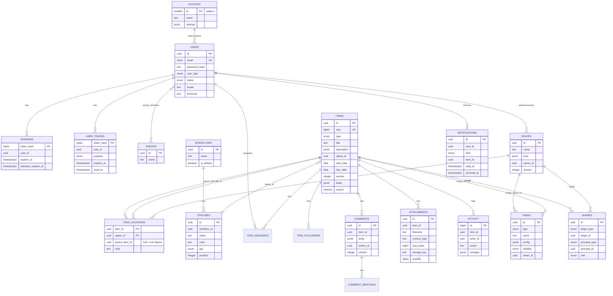

# DATABASE — PMS

| | |
|---|---|
| **Versi** | 0.1 (draft) |
| **Cakupan** | Skema untuk M0 + M1. Tabel M2–M7 ditambahkan lewat migrasi pada milestone masing-masing |
| **DBMS** | PostgreSQL 16, satu database per instance klien |
| **Sumber kebenaran skema** | File migrasi `server/migrations/*.sql` (goose). Dokumen ini hanya memuat ERD dan keputusan desain yang tidak terlihat dari SQL. Bila berbeda, **migrasi yang benar** |

---

## 1. Konvensi

| Topik | Aturan |
|---|---|
| Primary key | `uuid` versi 7 dibuat di Go (urut waktu, indeks efisien). Tabel log memakai `bigint generated always as identity` |
| ID yang terlihat user | `items.seq` (bigint identity) ditampilkan sebagai "ID" task/project |
| Waktu | `timestamptz` (UTC). Tanggal jadwal item memakai `date` (tanpa jam) |
| Teks | `text`; email memakai `citext` |
| Enum | Tipe enum Postgres (`CREATE TYPE`) untuk nilai yang stabil; tabel referensi untuk nilai yang bisa diubah admin (status, workflow) |
| Rich text | `jsonb` berisi dokumen ProseMirror (TipTap). Tidak pernah HTML mentah |
| Soft delete | `deleted_at timestamptz` + `deleted_by`. Query default selalu memfilter `deleted_at IS NULL` lewat view/query sqlc |
| Locking | `version integer not null default 1` pada tabel yang diedit user; naik 1 tiap update |
| Urutan | `rank text` (fractional index) agar drag-drop tidak mengubah baris lain |
| Audit kolom | `created_at`, `updated_at` (trigger), `created_by` bila relevan |
| Nama | `snake_case`, tabel jamak, FK `<tabel_tunggal>_id` |

## 2. ERD (M0 + M1)



Tabel bantu yang tidak digambar agar ERD terbaca: `group_members`, `item_assignees`, `item_followers`, `comment_mentions`, `user_prefs` (digabung ke `users`). Tabel milik River (`river_job`, `river_leader`, …) dibuat oleh migrasi River dan tidak dimodifikasi.

## 3. Tabel dan keputusan desain

### 3.1 Identitas

| Tabel | Keputusan |
|---|---|
| `account` | Satu baris (`id smallint primary key check (id = 1)`). Menyimpan nama organisasi dan pengaturan. **Batas seat tidak disimpan di sini**, tetapi dibaca dari env `PMS_MAX_SEATS` (USR-03) |
| `users` | `status`: `invited` → `active` → `deactivated`. Seat terpakai = jumlah `invited` + `active`; `deactivated` membebaskan seat. Pengaturan per user (locale, timezone, format tanggal/jam, awal minggu) disimpan di kolom langsung; tidak ada tabel prefs terpisah. Email unik tanpa memandang huruf besar-kecil (`citext`). User tidak pernah dihapus fisik; riwayat dan item yang dibuatnya tetap merujuk ke baris ini |
| `sessions` | Hanya hash SHA-256 token yang disimpan. Kolom `expires_at` (idle) dan `absolute_expires_at` (30 hari). Dihapus oleh job harian dan saat password berubah |
| `user_tokens` | Satu tabel untuk undangan (`invite`) dan reset password (`reset`); hash token, `expires_at`, `used_at`. Pemakaian token bersifat sekali pakai lewat `UPDATE … WHERE used_at IS NULL RETURNING` |
| `groups`, `group_members` | Grup sederhana (nama + anggota) untuk sharing dan mention. Grup bawaan "Everyone" tidak disimpan; dihitung dari user non-external |

### 3.2 Space dan sharing

| Tabel | Keputusan |
|---|---|
| `spaces` | `kind` = `shared` atau `personal`. Satu Personal space per user, dibuat saat aktivasi (`owner_id` unik untuk `personal`). Space default "General" dibuat oleh `pms bootstrap` |
| `shares` | Satu tabel untuk Space dan item: `(target_type, target_id, principal_type, principal_id, role)`. `principal_type` = `user` atau `group`. Unik pada kelimanya. `role` = `read`/`limited`/`editor`/`full`. Share pada container berlaku untuk seluruh turunannya (pewarisan dihitung saat query, tidak disalin) |

FK pada `shares.target_id` tidak bisa dibuat langsung karena targetnya polimorfik. Konsistensinya dijaga oleh trigger `BEFORE INSERT` yang memeriksa keberadaan target, dan oleh job pembersih yang menghapus share yatim.

### 3.3 Item (project, folder, task)

Satu tabel `items` untuk semua tipe (PRD §4). `type` = `project` | `folder` | `task`; tipe custom ditambah di M7.

| Kolom penting | Keputusan |
|---|---|
| `type` | Menentukan kolom yang bermakna. Project memakai `owner_id`, `default_workflow_id`, `default_view_type`; task tidak. Kolom yang tidak relevan bernilai `NULL`. `CHECK` memastikan project/folder tidak punya `status_id` yang tidak sesuai |
| `status_id` | FK ke `statuses`. Grup status (Active/Completed/Deferred/Cancelled) diturunkan lewat join, tidak disalin ke item |
| `start_date`, `due_date`, `duration_days` | `date` dan `integer`. `CHECK (due_date >= start_date)`. Perhitungan hari kerja dilakukan aplikasi, bukan database (M2) |
| `is_milestone` | `boolean`; milestone selalu `duration_days = 0` |
| `description` | `jsonb` ProseMirror; teks datar untuk pencarian diekstrak aplikasi ke kolom `description_text` |
| `fields` | `jsonb default '{}'` — disiapkan untuk custom field M2; tidak dipakai M1 |
| `version` | Optimistic locking (SEC-03): `UPDATE … WHERE id = $1 AND version = $2`, nol baris terpengaruh → 409 |
| `search` | `tsvector` generated: `setweight(to_tsvector('simple', title),'A') \|\| setweight(to_tsvector('simple', description_text),'B')`; indeks GIN |
| `completed_at` | Diisi saat status masuk grup Completed, dikosongkan bila keluar |
| `deleted_at`, `deleted_by`, `deleted_root_id` | Soft delete (lihat §5) |

**Lokasi dan hierarki (`item_locations`).** Hierarki bukan kolom `parent_id`, karena satu item bisa berada di banyak lokasi (SPC-10, P1). Tiap baris berarti "item X berada di Space S, di bawah parent P (atau langsung di root Space bila P kosong)".

```text
item_locations(item_id, space_id, parent_item_id NULL, rank)
  PRIMARY KEY (item_id, space_id, parent_item_id)   -- NULL dipetakan lewat indeks unik parsial
  INDEX (parent_item_id, rank), INDEX (space_id, rank) WHERE parent_item_id IS NULL
```

- Subtask memakai mekanisme yang sama: `parent_item_id` menunjuk task induk.
- **Tidak boleh siklus.** Dicek di service sebelum menambah lokasi (CTE rekursif dari parent baru naik ke atas tidak boleh bertemu item itu sendiri) dan dijaga trigger sebagai jaring pengaman.
- Setiap item wajib punya minimal satu lokasi (dicek di service saat menghapus lokasi terakhir → ditolak, gunakan hapus item).
- `rank` ditentukan per (parent, space); reorder hanya menulis satu baris.

**Query akses (potongan inti).** Mengumpulkan semua leluhur sebuah item lewat semua lokasi:

```sql
WITH RECURSIVE up(item_id, space_id) AS (
    SELECT l.parent_item_id, l.space_id FROM item_locations l WHERE l.item_id = $1
  UNION
    SELECT l.parent_item_id, l.space_id
    FROM up JOIN item_locations l ON l.item_id = up.item_id
    WHERE up.item_id IS NOT NULL
)
SELECT * FROM up;  -- lalu join ke shares (target item/space) untuk user + grupnya
```

Indeks `item_locations (item_id)` mendukung langkah rekursif. Lihat ARCHITECTURE §6.2 dan pintasan di §13 untuk batas skalanya.

### 3.4 Workflow dan status

| Tabel | Keputusan |
|---|---|
| `workflows` | M1 hanya berisi satu workflow `is_default = true` yang dibuat oleh bootstrap (tidak bisa diubah lewat UI sampai M3) |
| `statuses` | `grp` = `active`/`completed`/`deferred`/`cancelled`; `color` (token palet, bukan hex); `position`. Seed default: **New**, **In Progress** (active), **Completed** (completed), **On Hold** (deferred), **Cancelled** (cancelled) |

### 3.5 Kolaborasi

| Tabel | Keputusan |
|---|---|
| `item_assignees`, `item_followers` | Tabel penghubung `(item_id, user_id)`. Pembuat dan assignee otomatis menjadi follower. Indeks `(user_id, item_id)` mendukung My to-do |
| `comments` | `body jsonb` ProseMirror, `body_text` untuk pencarian, `version`, `edited_at`, soft delete. Mention diekstrak dari JSON saat simpan ke `comment_mentions(comment_id, mention_type, target_id)` — `user`, `group`, atau `followers` |
| `attachments` | `storage_key` unik, `sha256`, `size_bytes`, `content_type` hasil deteksi server. Soft delete; file fisik dihapus oleh job (ARCHITECTURE §8) |
| `activity` | Append-only: `(item_id, actor_id, action, changes jsonb, created_at)`. `changes` berisi pasangan `{field: {from, to}}`. Indeks `(item_id, id DESC)`. Tidak pernah diupdate atau dihapus selain bersama item yang dihapus permanen |
| `notifications` | `kind` = `mention`, `assigned`, `status_changed`, `comment`, `shared`. `read_at` dan `archived_at` terpisah (NAV-03: Mark all as read vs Archive all). Indeks parsial `(user_id, created_at DESC) WHERE archived_at IS NULL` |

### 3.6 View

`views(id, scope_space_id NULL, scope_item_id NULL, type, name, config jsonb, visibility, owner_id, position, is_default)` dengan `CHECK` tepat satu dari kedua scope terisi.

- `type`: `table`, `board` (M1). `gantt`, `calendar`, `timelog` ditambahkan ke enum oleh migrasi milestone terkait.
- `visibility`: `public` (semua yang punya akses ke scope) atau `personal` (hanya `owner_id`).
- `config` (jsonb) menyimpan kolom yang tampil, urutan, grouping, dan preset filter bawaan. **State sementara** (filter yang sedang dipakai) tidak disimpan di database, tetapi di URL (UI_SPEC §3).
- Hanya satu view `is_default` per scope (indeks unik parsial).
- Setiap container baru otomatis mendapat view Table dan Board sesuai "default view" yang dipilih saat dibuat.

## 4. Indeks utama

| Tabel | Indeks | Mendukung |
|---|---|---|
| `items` | `(seq)` unik; GIN `(search)`; `(status_id) WHERE deleted_at IS NULL`; `(due_date) WHERE deleted_at IS NULL` | ID, pencarian, filter status, My to-do |
| `item_locations` | `(item_id)`; `(parent_item_id, rank)`; `(space_id, rank) WHERE parent_item_id IS NULL` | Query akses, daftar anak, daftar root Space |
| `shares` | `(target_type, target_id)`; `(principal_type, principal_id)` | Cek akses dan "Shared with me" |
| `item_assignees` | `(user_id, item_id)` | My to-do |
| `activity` | `(item_id, id DESC)` | Panel aktivitas |
| `notifications` | `(user_id, created_at DESC) WHERE archived_at IS NULL` | Inbox |
| `sessions` | `(user_id)`, `(absolute_expires_at)` | Revokasi, pembersihan |
| `users` | GIN pada `to_tsvector('simple', name)`; `(status)` | Pencarian user, hitung seat |

## 5. Soft delete dan Recycle bin

Menghapus item (BIN-01) menandai item **dan turunannya yang tidak punya lokasi hidup lain** dalam satu transaksi:

1. `deleted_root_id := id item yang dihapus`; `deleted_at := now()`; `deleted_by := user`.
2. Turunan hanya ikut terhapus jika **semua** lokasinya berada di dalam subtree yang dihapus. Turunan yang masih punya lokasi hidup di tempat lain tetap hidup, hanya baris `item_locations` ke parent yang dihapus yang ditandai tak aktif (`item_locations.deleted_root_id`).
3. Restore (BIN-02) memulihkan semua baris dengan `deleted_root_id` yang sama, beserta lokasinya. Jika parent lokasi sudah dihapus permanen, item dipulihkan ke root Space asalnya.
4. Penghapusan permanen (BIN-03, M6) menghapus baris, `activity`, komentar, lampiran (job `purge_file` menghapus file fisik), lalu `river` job pembersihan.

Item di Recycle bin tidak ikut hasil pencarian, My to-do, atau notifikasi baru, dan tidak dihitung dalam angka agregat.

## 6. Migrasi

| Aturan | Isi |
|---|---|
| Alat | goose, file SQL berurut `0001_*.sql`, dijalankan otomatis saat start (`pms migrate up`) |
| Arah | Hanya maju (forward-only). Tidak ada `down` di produksi; pemulihan = restore dump pre-deploy (OPS-02) |
| Transaksi | Setiap migrasi dalam satu transaksi, kecuali `CREATE INDEX CONCURRENTLY` yang ditandai `-- +goose NO TRANSACTION` |
| Kompatibilitas | Migrasi harus kompatibel mundur satu versi aplikasi (tambah kolom dulu, hapus kolom di rilis berikutnya) |
| Seed | Data awal (workflow dan status default) dibuat oleh `pms bootstrap`, bukan migrasi, agar migrasi tetap murni skema |
| Urutan M0 | `0001_extensions` (`citext`, `pgcrypto` bila perlu) → `0002_identity` → `0003_spaces_items` → `0004_workflow` → `0005_collab` → `0006_views_notifications` → River |

## 7. Data yang sengaja belum ada (M2+)

`item_dependencies`, definisi custom field, `time_entries`, `approvals`, `request_forms`, `dashboards`, `widgets`, `reports`, `baselines`, `work_schedules`. Kolom `items.fields`, enum `views.type`, dan `statuses`/`workflows` sudah disiapkan agar penambahan ini tidak mengubah struktur tabel M1.
