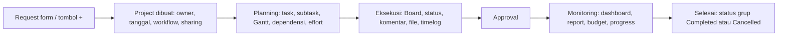
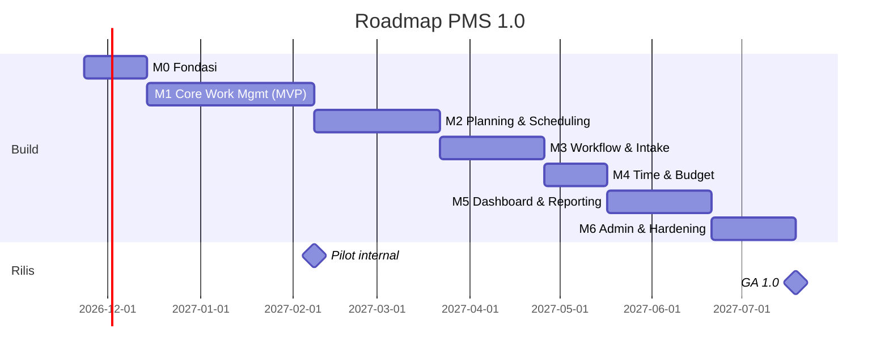

# PRD — PMS (Project & Work Management System)

| | |
|---|---|
| **Versi** | 0.3 (draft) — revisi hasil review: ketergantungan antar milestone, pemisahan requirement, keamanan & operasional |
| **Tanggal** | 12 November 2026 |
| **Status** | Draft untuk review |
| **Repo** | [github.com/anissaefuddin/pms](https://github.com/anissaefuddin/pms) |
| **Sumber input** | [ANALISA_FITUR_SCREEN.md](ANALISA_FITUR_SCREEN.md) (99 flow, 540 screen Wrike Web), [Wrike_Feature_Scanning.md](Wrike_Feature_Scanning.md) (inventaris fitur dan paket) |

> **Batasan produk:** PMS adalah aplikasi *work management* sendiri dengan kemampuan fungsional setara Wrike. Nama, logo, ilustrasi, teks UI, template bawaan, dan tampilan visual dibuat sendiri. Tidak boleh menyalin merek, aset, atau copy milik Wrike.

---

## 1. Latar Belakang & Tujuan

Tim butuh satu platform untuk menerima permintaan kerja, merencanakan proyek, mengeksekusi task, dan memantau progres, waktu, serta anggaran. Selama ini kebutuhan tersebut tersebar di beberapa alat. Analisa 99 flow layar Wrike dipakai sebagai acuan fungsional.

**Tujuan produk**

1. Satu hierarki kerja (Space → Project/Folder → Task → Subtask) dengan banyak view atas data yang sama.
2. Alur kerja yang bisa dikonfigurasi: status, transisi, approval, dan request form.
3. Visibilitas manajemen lewat dashboard, report, timelog, dan budget.
4. Administrasi multi-user dengan tipe lisensi, peran akses, dan keamanan (2FA).

**Metrik keberhasilan (target 3 bulan setelah GA)**

| Metrik | Target |
|---|---|
| Proyek aktif yang dikelola penuh di PMS | ≥ 80% proyek tim |
| Task dibuat via request form (bukan chat/email) | ≥ 50% permintaan masuk |
| Pengguna aktif mingguan / total seat | ≥ 70% |
| Waktu muat view Table/Board (≤ 500 item) | p95 < 1,5 detik |

## 2. Persona

| Persona | Kebutuhan utama | Tipe user |
|---|---|---|
| **Admin akun** | Kelola user, tipe lisensi, workflow, custom field, keamanan | Admin |
| **Project manager** | Buat proyek, rencanakan di Gantt, pantau dashboard/report, budget | Regular User |
| **Anggota tim** | Lihat My to-do, update status, log waktu, komentar | Regular User |
| **Requester** (internal/eksternal) | Kirim request form, pantau status | Collaborator / External |
| **Stakeholder** | Lihat progres, beri approval | Viewer / Collaborator |

## 3. Ruang Lingkup

**Masuk lingkup (rilis 1.0):** seluruh flow di [ANALISA_FITUR_SCREEN.md](ANALISA_FITUR_SCREEN.md), dipetakan ke requirement di §5 dan milestone di §8.

**Di luar lingkup rilis 1.0** (dari inventaris Wrike, P2):

- Fitur AI (Copilot, summarization, risk insights, AI agents, MCP server)
- Resource booking, job roles, skills, planned vs actual utilization
- Proofing file, versioning dokumen, document editor
- Integrasi pihak ketiga dua arah (Jira/GitHub sync, Salesforce, Adobe), BI connector
- SSO/SAML, audit/access reports lengkap, locked spaces
- Programme/portfolio timeline lintas proyek, Whiteboard
- Aplikasi mobile/desktop native (rilis 1.0 cukup web responsif)
- Multi-tenant dalam satu instance: setiap klien mendapat instance terpisah (§10)
- Billing/subscription otomatis: seat diatur manual per instance
- Email masuk menjadi task (email-to-task); rilis 1.0 hanya email keluar
- Integrasi penyimpanan file eksternal (Pydio Cells, MinIO/S3); MVP memakai disk lokal dengan interface `Storage` yang siap diganti
- Manajemen tarif dan actual cost (TASK-14): rilis 1.0 hanya mencatat budget (rencana) dan jam aktual
- Fitur arsip project: item yang selesai tetap tersedia lewat filter status

## 4. Model Domain

```text
Account (tepat satu per instance klien: nama, seat limit, settings)
├── Users (user type, groups, work schedule)
├── Workflows ── Status (group: Active | Completed | Deferred | Cancelled)
├── Custom fields (type, options, aggregation; scope: space)
├── Custom item types / Blueprints
├── Request forms
├── Dashboards ── Widgets
├── Reports (+ subscriptions)
└── Spaces
    └── Items (tipe: Project | Folder | Task | custom), pohon parent-child
        ├── many-to-many lokasi (satu item bisa berada di banyak project/folder)
        ├── assignees, dates, effort, progress, custom field values
        ├── dependencies (FS, SS, FF, SF)
        ├── comments, attachments, approvals, activity log
        ├── time entries
        └── views (Table, Board, Gantt, Calendar, Files, Chart, Timelog; public/personal)
```

Prinsip penting:

- **Satu entitas Item**: Project, Folder, Task, dan custom item type memakai tabel item yang sama, dibedakan oleh `item_type`. Sifat seperti owner, tanggal, budget, dan default view bergantung pada tipenya.
- **View hanya representasi.** Mengganti view tidak menduplikasi data.
- **Soft delete.** Item yang dihapus masuk ke Recycle bin dan bisa dipulihkan.

## 5. Kebutuhan Fungsional

Prioritas: **P0** wajib untuk MVP, **P1** diperlukan untuk rilis 1.0, **P2** bisa menyusul. Kolom "Screen" merujuk ke nama flow di analisa screen.

### 5.1 Autentikasi & Onboarding (AUTH)

| ID | Requirement | Prio | Screen |
|---|---|---|---|
| AUTH-01 | Login email + password dan tautan lupa password. **Tidak ada public signup**: user masuk hanya lewat undangan (AUTH-06, USR-01) | P0 | Logging in |
| AUTH-02 | Logout dari menu profil | P0 | Logging out |
| AUTH-03 | Reset password via email; indikator kekuatan password, minimal 6 karakter | P0 | Resetting password |
| AUTH-04 | Ganti password (lama/baru/ulang) | P0 | Changing password |
| AUTH-05 | 2FA TOTP: QR + secret key, verifikasi kode 6 digit, status aktif dan tanggalnya | P1 | Setting up two-factor authentication |
| AUTH-06 | Terima undangan tim: nama, password, departemen, jabatan, persetujuan ToS | P0 | Accepting a team invitation |
| AUTH-07 | Wizard first-run untuk admin pertama: nama organisasi → proyek pertama + 3 task → pilih view → undang anggota. Pertanyaan profil perusahaan dari layar sumber (ukuran tim, departemen) tidak dipakai karena instance sudah milik satu klien | P1 | Onboarding |
| AUTH-08 | Login dengan one-time password | P2 | Logging in |
| AUTH-09 | Bootstrap instance lewat perintah CLI (`pms bootstrap`, dijalankan operator): membuat Account, admin pertama (email dari argumen, link set-password via email), workflow default, dan Space default. Idempoten; menolak jalan jika admin sudah ada | P0 | — (operasional) |

### 5.2 Navigasi, Inbox & Pencarian (NAV)

| ID | Requirement | Prio | Screen |
|---|---|---|---|
| NAV-01 | Sidebar: Search, Inbox, More, daftar Space (Personal + tim), Shared with me, Blueprints, Hidden spaces | P0 | Customizing sidebar menu |
| NAV-02 | Sidebar bisa dikustomisasi (show/hide: Created by me, Workload, Calendars, Dashboards, My to-do, Request forms, Timesheets, Reports, Stream, Starred). Search dan Inbox selalu tampil | P1 | Customizing sidebar menu |
| NAV-03 | Inbox notifikasi (mention, assign, perubahan) dengan indikator belum dibaca; Mark all as read dan Archive all | P0 | Inbox, Marking all as read |
| NAV-04 | Stream aktivitas dengan filter (Everything, Followed, Assigned to me, My conversations) dan opsi "Hide auto updates" | P1 | Stream |
| NAV-05 | My to-do: daftar task milik user dengan filter (All/Active/Overdue) dan sort (Priority, Date, Modified, Created, Status, Importance, Title) | P0 | My to-do, Filtering & sorting to-do |
| NAV-06 | Pencarian global (Ctrl/Cmd+K) dengan scope (Everywhere / Space / Project); hasil dikelompokkan (Tasks, Projects & Folders, Comments, Users, Request forms) | P0 | Searching Wrike |
| NAV-07 | Halaman hasil pencarian dengan filter preset, keyword, filter tambahan, dan sort Relevance | P1 | Filtering search results |
| NAV-08 | Bookmark URL eksternal (URL, Title, Description) di space | P2 | Adding a bookmark |
| NAV-09 | Form feedback produk (subject, rating, komentar) | P2 | Leaving a feedback |

### 5.3 Space, Project & Folder (SPC)

| ID | Requirement | Prio | Screen |
|---|---|---|---|
| SPC-01 | CRUD Space dasar: nama, deskripsi, anggota, sharing. Space default dibuat saat bootstrap (AUTH-09) dan setiap user mendapat Personal space, sehingga Project selalu punya lokasi | P0 | Creating a space |
| SPC-02 | Space overview: tab view (Table/Board) atas seluruh item space | P0 | Space overview |
| SPC-03 | Preset filter space (All tasks, All active, My active) dan sort (Priority, Due date, Status, Name, Predecessors, Manual order) | P1 | Filtering space presets |
| SPC-04 | Pohon Projects and folders di sidebar dan view di dalamnya | P0 | Projects and folders |
| SPC-05 | Buat Project lewat tombol "+": name, location, default workflow, owner, start/finish date, default view, sharing. Field finansial (billing type, budget) ditambahkan ke form ini oleh TASK-12 di M4 | P0 | Creating a project |
| SPC-06 | Buat Folder (tanpa atribut proyek): name, location, workflow, default view, sharing | P0 | Creating a folder |
| SPC-07 | Panel detail project: status, assignee/owner, tanggal, subitem, files, deskripsi, activity log; rename inline. Bagian approval baru muncul saat SPC-12 tersedia (M3) | P0 | View project detail, Editing a project name |
| SPC-08 | Status project mengikuti workflow (Backlog, In Progress, Completed, On Hold, Cancelled, …) | P0 | Changing project status |
| SPC-09 | Set start/due date project | P0 | Setting project dates |
| SPC-10 | Multi-lokasi: satu item bisa ditambahkan ke beberapa project/folder/space | P1 | Adding a project location |
| SPC-11 | Sharing dengan peran Full, Editor, Limited, Read Only ke user, grup, atau email eksternal | P0 | Sharing a project |
| SPC-12 | Approval pada item: description, approvers, due date, files; approver memilih Approve/Reject + komentar; tampil penghitung (0/2) | P1 | Adding an approval, Approving a project |
| SPC-13 | Blueprint: simpan struktur item (task/project/folder + status, assignee, tanggal) sebagai template dan buat item dari blueprint | P1 | Creating a blueprint |
| SPC-14 | Kustomisasi menu blueprint: tipe item, nama, ikon | P2 | Customizing blueprints menu |
| SPC-15 | Export project ke Excel dan import | P1 | Exporting project to excel |
| SPC-16 | Public snapshot: salinan read-only view Gantt dengan public link, opsi tampilkan nama assignee, riwayat snapshot | P2 | Creating a public snapshot |
| SPC-17 | Menu view: copy link to view, rename, duplicate, move up/down, delete | P0 | Copying a link |
| SPC-18 | Buat Space dari template per kategori (Marketing, HR, IT, PM, dll.). Template membawa project, task, view, form, custom field, dan workflow | P1 | Creating a space |

### 5.4 Views (VIEW)

| ID | Requirement | Prio | Screen |
|---|---|---|---|
| VIEW-01 | **Table**: kolom bisa dipilih, inline edit, hierarki expand/collapse, tambah item di baris terakhir | P0 | Space overview, Filtering custom fields |
| VIEW-02 | **Board/Kanban**: kolom per status, drag-drop kartu mengubah status | P0 | Board view |
| VIEW-03 | Board: group by (None / Assignee) dalam bentuk swimlane | P1 | Sorting by group |
| VIEW-04 | Board: atur field yang tampil di kartu (cover image, days in status, location, author, ID, item type, tanggal, custom field) | P1 | Editing card preview |
| VIEW-05A | **Gantt**: bar per item, progres %, drag/resize untuk ubah tanggal, milestone | P0 | Gantt chart view |
| VIEW-05B | Gantt: dependensi FS/SS/FF/SF dan penjadwalan (hari kerja, geser task penerus) yang dihitung di backend; library Gantt hanya menampilkan | P1 | Gantt chart view |
| VIEW-05C | Gantt: baseline dan variance tracking | P2 | Filtering custom fields |
| VIEW-06 | **Calendar**: tampilan bulanan, navigasi Today/prev/next, filter | P1 | Adding a calendar view |
| VIEW-07 | **Timelog view**: daftar time entry per proyek dengan kolom user, tanggal, durasi, kategori, komentar, billing type, lock. Kolom fees/cost menyusul bersama TASK-14 | P1 | Timelog view |
| VIEW-08 | Kelola view: tambah view, set default, duplicate (Public/Personal), rename, urutkan, hide/show | P0 | Setting a default view, Duplicating a view, Renaming a view |
| VIEW-09 | Pemilih kolom dengan grup Management, Schedule, Other, Custom fields, Baselines | P1 | Filtering custom fields |
| VIEW-10 | View Files dan Chart di level project | P2 | Adding a calendar view |

### 5.5 Task & Item (TASK)

| ID | Requirement | Prio | Screen |
|---|---|---|---|
| TASK-01 | Buat task dari "+" global, inline di Table, di kolom Board, dan di Gantt; field: name, type, status, assignee, date, location | P0 | Adding a task, Adding a new item (board), Adding a new item (gantt) |
| TASK-02 | Subitem bertingkat dengan jumlah subitem tampil di kartu/panel | P0 | Adding a subitem |
| TASK-03 | Panel detail item: status, assignee, date, description (rich text), subitems, files, activity; menu aksi: convert to milestone, delete. Bagian approval baru muncul saat SPC-12 tersedia (M3) | P0 | Editing an item, Adding a description |
| TASK-04 | Ubah status sesuai workflow item | P0 | Changing a status |
| TASK-05A | Date picker: start, due, duration, opsi working days only (sebelum SET-07 tersedia, hari kerja default Senin–Jumat) | P0 | Setting a date |
| TASK-05B | Effort dan allocation per item; durasi mengikuti work schedule dari SET-07 | P1 | Setting a date, Editing an item |
| TASK-06 | Multi-assignee dengan pencarian user (nama, email, jabatan) | P0 | Adding an assignee |
| TASK-07 | Komentar dengan @mention user/grup/followers dan lampiran; mention memicu notifikasi | P0 | Adding a comment |
| TASK-08A | Lampiran file dari komputer, disimpan di volume lokal lewat interface `Storage` (aturan keamanan file di SEC-01) | P0 | Adding a file |
| TASK-08B | Lampiran dari cloud storage dan link; backend `Storage` untuk Pydio Cells dan MinIO | P2 | Adding a file |
| TASK-09 | Progress project: metode (task count / duration / rata-rata), persen, indikator risiko | P1 | Setting progress |
| TASK-10 | Custom field single/multi select (mis. Impact) dengan opsi berwarna; scope per space; berlaku untuk task/project/folder | P1 | Adding impact, Editing impact settings |
| TASK-11A | Tipe custom field: Text, Number, Currency, Percent, Single/Multiple select, People, Date, Duration, Checkbox; simbol, desimal, separator ribuan, conditional marker, agregasi default | P1 | Editing budget settings |
| TASK-11B | Custom field tipe Formula | P2 | Editing budget settings |
| TASK-12 | Budget project (currency field) diedit di panel detail | P1 | Editing a budget |
| TASK-13 | Timesheet mingguan: baris per task (pin), sel durasi per hari + komentar, total | P1 | Editing a timesheet |
| TASK-14 | Actual cost: tarif per user (atau job role) per jam, dengan **rate snapshot disimpan di setiap time entry** saat entry dibuat, sehingga perubahan tarif tidak mengubah histori. Rumus: `Actual Cost = Σ (logged_hours_i × rate_snapshot_i)` untuk entry billable; ditampilkan sebagai budget vs actual cost | P2 | Timelog view, Editing a budget |

### 5.6 Workflow & Status (WF)

| ID | Requirement | Prio | Screen |
|---|---|---|---|
| WF-01 | Workflow default tersedia saat akun dibuat | P0 | Changing a status |
| WF-02 | Buat/edit workflow; status dikelompokkan ke Active, Completed, Deferred, Cancelled | P1 | Creating a workflow, Editing workflow |
| WF-03A | Per status: nama, warna (palet), auto-assign saat masuk status, transisi yang diizinkan (opsi lock) | P1 | Creating a status |
| WF-03B | Approval otomatis saat masuk status, dengan status tujuan untuk Approved/Rejected | P2 | Creating a workflow |

### 5.7 Request Form (FORM)

| ID | Requirement | Prio | Screen |
|---|---|---|---|
| FORM-01 | Form builder: tipe pertanyaan (single line, paragraph, single/multiple answer, date, number, attachment, assignee, importance), multi-halaman, section header, field wajib | P1 | Creating a request form |
| FORM-02 | Response settings: create task/project, set status, save to location, assign to, create approval | P1 | Creating a request form |
| FORM-03 | Sharing form: internal (seluruh akun) atau eksternal (public link) | P1 | Creating a request form, Manage forms |
| FORM-04 | Kustomisasi email konfirmasi (sender name, logo, greeting, message, closing) | P2 | Customizing a form |
| FORM-05 | Halaman Manage forms (name, belongs to, access, link, last modified by) | P1 | Manage forms |
| FORM-06 | Requester memilih form dari menu dan submit; hasilnya menjadi item sesuai response settings | P1 | Sending a request form |
| FORM-07 | Logika kondisional antar pertanyaan | P2 | — (inventaris fitur) |
| FORM-08 | Pelacakan request. Requester internal otomatis menjadi follower item yang dibuat dari form-nya, melihat daftar "My requests" beserta statusnya, dan hanya bisa mengakses item tersebut (bukan seluruh project) kecuali punya akses lain. Requester eksternal (public link) menerima email konfirmasi dan email saat status masuk grup Completed atau Cancelled | P1 | Sending a request form |

### 5.8 Dashboard & Analytics (DASH)

| ID | Requirement | Prio | Screen |
|---|---|---|---|
| DASH-01 | Dashboard per space/user berisi widget daftar task (to do this week, to review, completed, assigned to me) | P1 | Dashboard, Renaming a dashboard |
| DASH-02 | Widget dari template (my tasks, overdue, followed, backlog, starred, …) atau custom (data source, reporting on, metrics, break by, group by, fields, filters) | P1 | Adding a custom widget |
| DASH-03A | Tipe visual: indicator, pie (classic/donut/ring), column, bar, line, table; pengaturan legend, label, sumbu, "Others" slice | P1 | Editing a widget, Switching widget view |
| DASH-03B | Tipe visual area dan pivot | P2 | Switching widget view |
| DASH-04 | Deskripsi widget | P2 | Adding widget description |
| DASH-05 | Layout dashboard vertikal / horizontal | P2 | Changing layout |
| DASH-06 | Rename, duplicate (name + space), move, delete dashboard. Menghapus dashboard tidak menghapus data | P1 | Duplicating a dashboard, Renaming a dashboard, Deleting a dashboard |
| DASH-07 | Public link dashboard: toggle, URL token, tanggal kedaluwarsa, password opsional | P2 | Creating a public link |
| DASH-08 | Analytics board dengan library widget (burndown, task completion, projects by status, by custom field, list) | P2 | Creating custom analytics |

### 5.9 Report (RPT)

| ID | Requirement | Prio | Screen |
|---|---|---|---|
| RPT-01 | Buat report dari template (active tasks by assignee, weekly project status, overdue, due this month, unassigned, time spent, utilization) atau custom | P1 | Creating a report |
| RPT-02 | Editor report: title, location, data source (multi space/project), based on (projects / tasks / time entries), layout (table/column), filters (status, assignee, tipe, importance, effort, tanggal), group by | P1 | Editing a report |
| RPT-03 | Daftar report (name, created by, space, sharing, created, updated, subscription) | P1 | Creating a report |
| RPT-04 | Subscribe report: dikirim via email pada hari dan jam terpilih | P2 | Subscribing to a report |

### 5.10 Kustomisasi Item & Menu (CUST)

| ID | Requirement | Prio | Screen |
|---|---|---|---|
| CUST-01 | Custom item type (mis. Bug fix, Meeting notes) dengan nama, ikon, dan field bawaan; dapat dinyalakan/dimatikan di menu "+" | P2 | Customizing a menu |

### 5.11 Akun, Profil & Settings (SET)

| ID | Requirement | Prio | Screen |
|---|---|---|---|
| SET-01 | Halaman Settings dengan dua grup: Personal settings dan Account management | P0 | Settings, Manage forms |
| SET-02 | Profil: nama, company, job title, negara, lokasi, departemen, telepon | P0 | Updating profile details |
| SET-03 | Workspace settings per user: timezone, bahasa, format tanggal/jam, awal minggu; default task (backlogged, effort mode, durasi), shortcut submit komentar. Pilihan bahasa di MVP hanya English | P1 | Updating profile details |
| SET-04 | Account info: nama akun, status trial, role, tanggal bergabung, subscription & seat, daftar administrator | P1 | Account info |
| SET-05 | Preferensi email notifikasi per jenis event (mention, assign, share, report, perubahan task). Bagian email-to-task di layar ini P2 | P1 | Updating email preferences |
| SET-06 | Tema: Light / Dark / ikuti sistem, plus beberapa tema warna | P2 | Switching to dark mode |
| SET-07 | Work schedule: hari kerja, kapasitas harian, pengecualian tanggal (libur); dipakai oleh perhitungan durasi | P1 | Work schedule |
| SET-08 | Halaman Apps & Integrations (katalog + API key). Rilis 1.0 cukup REST API + webhook; integrasi lain P2 | P2 | Apps & Integrations |
| SET-09 | Transfer kepemilikan akun. Backup tidak dibuat sebagai fitur UI; ditangani operasional (§10) | P2 | Deleting an account |
| SET-10 | Email keluar via SMTP yang dikonfigurasi per instance (env): undangan, reset password, notifikasi, report terjadwal; dikirim lewat job queue dengan retry; template per locale | P0 | Accepting a team invitation, Resetting password, Updating email preferences |

### 5.12 Pengguna & Tim (USR)

| ID | Requirement | Prio | Screen |
|---|---|---|---|
| USR-01 | Undang user via email + pesan opsional + user type (Admin, Regular, External, Collaborator, Viewer) | P0 | Inviting a teammate |
| USR-02 | Matriks izin per user type dan kategori (General, Sharing, Folders & Projects, Tasks, Time tracking, Collaborate, Reports, …) | P0 | User types |
| USR-03 | Halaman Users: kolom name, email, type, status, work schedule; grup; info seat (dipakai/pending/tersedia, batas dari env `MAX_SEATS`, dicek saat undang/aktivasi); **nonaktifkan user**: seat dibebaskan, session dicabut, item dan riwayat yang dibuatnya tetap ada | P0 | Deleting a user |
| USR-04 | Penghentian instance klien adalah prosedur operator, bukan tombol di UI: export data lengkap ke klien → backup akhir disimpan sesuai kontrak → stack dan volume dihapus. Tidak ada fitur hapus akun di aplikasi | P1 | Deleting an account |

### 5.13 Recycle Bin (BIN)

| ID | Requirement | Prio | Screen |
|---|---|---|---|
| BIN-01 | Item yang dihapus masuk Recycle bin (daftar + filter/sort) | P0 | Recycle bin |
| BIN-02 | Restore item beserta subitem, field, dan riwayatnya | P0 | Restoring an item |
| BIN-03 | Kosongkan recycle bin (hapus permanen, dengan konfirmasi) | P1 | Emptying recycle bin |

### 5.14 Keamanan & Operasional (SEC / OPS)

| ID | Requirement | Prio | Screen |
|---|---|---|---|
| SEC-01 | File upload: batas ukuran per file (env, default 100 MB), tolak tipe executable berdasarkan isi file (bukan hanya ekstensi), download hanya lewat endpoint yang mengecek izin atas item, header `Content-Disposition: attachment` + `X-Content-Type-Options: nosniff`. File disimpan dengan nama acak dan tidak pernah ditimpa | P0 | Adding a file |
| SEC-02 | Tes negatif otorisasi: IDOR (akses item, file, dan komentar dengan ID milik orang lain), akses lintas Space, dan item multi-lokasi. Aturan multi-lokasi: akses user ke item = gabungan izin dari semua lokasi item tersebut | P0 | Sharing a project, Adding a project location |
| SEC-03 | Optimistic locking: setiap item punya `version`; update dengan versi lama ditolak (HTTP 409) dan UI memuat ulang data terbaru dengan pesan konflik | P0 | Editing an item |
| SEC-04 | Session: idle timeout 14 hari, batas absolut 30 hari; ID session dirotasi saat login dan saat hak akses berubah; semua session dicabut saat ganti/reset password atau user dinonaktifkan; proteksi CSRF (cookie SameSite=Lax + cek header `Origin` pada request yang mengubah data) | P0 | Logging in, Changing password |
| SEC-05 | Form publik: rate limit per IP, honeypot anti-spam, batas jumlah dan ukuran lampiran. Scan malware (ClamAV) untuk lampiran dari form publik ditunda ke P2 | P1 | Creating a request form |
| OPS-01 | Backup: RPO ≤ 24 jam, RTO ≤ 4 jam per klien. Database di-dump lebih dulu, lalu file. Karena file tidak pernah ditimpa (SEC-01), setiap file yang dirujuk database pasti ikut di backup. Restore penuh diuji sebelum GA dan setiap bulan setelahnya | P0 | — (operasional) |
| OPS-02 | Update & migrasi: script update menjalankan backup pre-deploy otomatis → pull image versi baru → start. Migrasi hanya maju (forward-only), dan setiap migrasi berjalan dalam transaksi. Jika migrasi gagal, app menolak start; pemulihan dilakukan dengan restore dump pre-deploy dan kembali ke image versi lama | P0 | — (operasional) |
| OPS-03 | Observability: log JSON terstruktur (`slog`) dengan request ID; metrik Prometheus (error rate, latency, panjang antrian dan job gagal di River); alert Grafana untuk error rate, job gagal, backup gagal, dan disk hampir penuh | P0 | — (operasional) |

## 6. Kebutuhan Non-Fungsional

| Area | Requirement |
|---|---|
| **Keamanan** | Detail teruji di SEC-01..05. Password di-hash argon2id; session cookie httpOnly + Secure + SameSite; rate limit login; 2FA TOTP; validasi otorisasi di server untuk setiap item (sharing role × user type, diuji dengan matriks otomatis); rich text disimpan sebagai JSON tervalidasi, tidak pernah HTML mentah; public link memakai token acak, bisa kedaluwarsa, password opsional |
| **Isolasi klien** | Satu instance (app + Postgres + volume file) per klien; tidak ada data klien lain di database yang sama |
| **Performa** | Table/Board ≤ 500 item p95 < 1,5 detik (virtualisasi baris); Gantt ≤ 1.000 bar tetap responsif; pencarian (Postgres full-text) p95 < 800 ms |
| **Real-time** | Perubahan status, komentar, dan notifikasi tampil di user lain dalam ≤ 3 detik (SSE) |
| **Audit** | Setiap perubahan item tercatat di activity log (siapa, kapan, dari → ke) |
| **Data** | Soft delete + restore; `pg_dump` harian + snapshot volume file, disalin ke luar server, retensi 14 hari, uji restore bulanan; export Excel |
| **Aksesibilitas** | Navigasi keyboard, label ARIA, kontras warna WCAG AA di tema light dan dark |
| **i18n** | Semua teks UI dan email lewat kunci terjemahan sejak awal; MVP hanya English, bahasa lain cukup menambah file locale; timezone dan format tanggal per user |
| **Operasional** | Image versi terkunci per klien; migrasi DB otomatis saat start setelah backup pre-deploy; health check endpoint; detail di OPS-01..03 |
| **Browser** | Chrome, Edge, Firefox, Safari versi terbaru; layout responsif minimal 1280 px (mobile hanya untuk read dan update status) |

## 7. Alur Utama End-to-End



Tiga hal yang dibedakan:
- **Selesai** berarti item masuk status grup Completed atau Cancelled. Item tetap ada dan bisa dicari lewat filter status.
- **Arsip** tidak ada di rilis 1.0 (lihat §3).
- **Hapus** adalah aksi terpisah, bukan tahap akhir alur. Item yang dihapus masuk Recycle bin (BIN-01..03) dan bisa dipulihkan sampai bin dikosongkan.

## 8. Milestone

Estimasi mengasumsikan **satu developer dibantu AI**, dengan siklus kerja 2 mingguan. Durasi bersifat indikatif dan dikalibrasi ulang di akhir M1 berdasarkan kecepatan nyata.

| Milestone | Durasi | Isi (ID requirement) | Exit criteria |
|---|---|---|---|
| **M0 — Fondasi** | 3 minggu (Mgg 1–3) | Kerangka repo sesuai §10 (Go + Vite di-embed, alur OpenAPI → kode Go + tipe TS, goose, sqlc); CI GitHub Actions + push image ke GHCR; template Compose klien + script backup; i18n setup; design system shadcn (sidebar, modal, dropdown, date picker, toast); spike SVAR Gantt + penjadwalan di Go; AUTH-01..04, AUTH-06, AUTH-09; SET-01 shell, SET-10; SEC-04; OPS-01..03 | `pms bootstrap` → login → sidebar dengan Space default berjalan dari image GHCR di Compose klien uji; update dengan backup pre-deploy dan restore teruji sekali; alert backup gagal terkirim |
| **M1 — Core Work Management (MVP)** | 8 minggu (Mgg 4–11) | SPC-01, 02, 04..09, 11, 17; TASK-01..04, TASK-05A, TASK-06, 07, TASK-08A; VIEW-01, 02, 08; WF-01; NAV-01, 03, 05, 06; USR-01..03; BIN-01..02; SET-02; SEC-01..03; real-time SSE | Tim internal bisa menjalankan 1 proyek nyata end-to-end di Table + Board; matriks otorisasi dan tes negatif SEC-02 hijau; **pilot internal dimulai** |
| **M2 — Planning & Scheduling** | 6 minggu (Mgg 12–17) | VIEW-05A, VIEW-05B, VIEW-03, 04, 06, 09; TASK-05B, TASK-09, 10, TASK-11A; SET-07; SPC-03, 10 | Proyek bisa dijadwalkan penuh di Gantt dengan dependensi; durasi menghormati work schedule; custom field tampil di semua view |
| **M3 — Workflow, Approval & Intake** | 5 minggu (Mgg 18–22) | WF-02, WF-03A; SPC-12, 13; FORM-01..03, 05, 06, 08; NAV-02, 04, 07; AUTH-05; SEC-05 | Permintaan masuk via form → menjadi task berstatus sesuai workflow → approval berjalan → requester melihat status request-nya |
| **M4 — Time & Budget** | 3 minggu (Mgg 23–25) | TASK-12, 13; VIEW-07; SPC-15 (export/import Excel) | Timesheet mingguan terisi dan tampil di Timelog; panel project menampilkan budget (rencana) dan total jam aktual. Actual cost tidak termasuk (TASK-14, P2) |
| **M5 — Dashboard & Reporting** | 5 minggu (Mgg 26–30) | DASH-01, 02, DASH-03A, DASH-06; RPT-01..03 | PM bisa membangun dashboard dan report tanpa bantuan developer; angka cocok dengan data mentah (diuji otomatis) |
| **M6 — Admin, Onboarding & Hardening** | 4 minggu (Mgg 31–34) | SPC-18 (template space); AUTH-07; SET-03..05; USR-04 (prosedur + runbook); BIN-03; uji restore OPS-01 terhadap target RTO; uji performa & keamanan, perbaikan bug | Seluruh P0 + P1 lulus UAT dan 5 flow Playwright hijau; pentest internal tanpa temuan high; target NFR §6 tercapai |
| **GA — Rilis 1.0** | Mgg 35 | Deploy instance klien pertama, migrasi data pilot, dokumentasi user, pelatihan | Klien pertama go-live |
| **M7 — Post-GA (P2)** | Backlog | AUTH-08; NAV-08, 09; SPC-14, 16; VIEW-05C, VIEW-10; TASK-08B, TASK-11B, TASK-14; WF-03B; DASH-03B; FORM-04, 07; DASH-04, 05, 07, 08; RPT-04; CUST-01; SET-06, 08, 09; item di luar lingkup §3 | Diprioritaskan ulang berdasarkan feedback pilot |



**Ketergantungan antar milestone**

- M2 bergantung pada model Item, tanggal, dan view framework dari M1.
- M3 bergantung pada workflow default (M1) dan custom field (M2), karena form memetakan jawaban ke field.
- M4 bergantung pada work schedule (M2). M5 bergantung pada time entry (M4) dan custom field (M2).
- Kalau ada developer kedua, M4 dan M5 bisa dikerjakan sebagian paralel, karena widget berbasis task di M5 tidak bergantung pada M4.

## 9. Risiko & Mitigasi

| Risiko | Dampak | Mitigasi |
|---|---|---|
| Gantt + dependensi + hari kerja kompleks | Jadwal M2 molor | Spike di M0; SVAR (MIT) hanya untuk tampilan, penjadwalan di Go; beli SVAR PRO ($749, sekali bayar) jika baseline/critical path ternyata wajib |
| Model izin (sharing role × user type) rumit | Kebocoran data | Satu modul policy terpusat + matriks tes otomatis per kombinasi |
| Scope creep ke fitur P2 | GA tertunda | Fitur P2 hanya masuk lewat review backlog M7 |
| Performa view untuk proyek besar | UX buruk | Virtualisasi baris sejak M1; uji beban di M6 |
| Satu developer (bus factor 1) | Proyek berhenti jika developer berhalangan | Keputusan teknis tercatat di repo, CI wajib hijau, kode dibuat dari spec OpenAPI agar mudah dilanjutkan orang lain |
| Mengelola banyak instance klien | Versi dan migrasi tidak sinkron, backup terlewat | Versi image dikunci per klien, update bertahap (klien internal dulu), backup + uji restore terjadwal, monitoring terpusat di Grafana |
| Kemiripan dengan produk komersial | Risiko hukum/merek | Desain visual dan teks sendiri; screenshot Wrike hanya dipakai sebagai referensi fungsi, tidak masuk aset produk |

## 10. Keputusan Teknis & Deployment

Diputuskan 12 November 2026.

### 10.1 Keputusan produk

| Topik | Keputusan |
|---|---|
| Hosting | Self-host; semua instance klien dijalankan oleh pemilik produk (homeserver atau VPS per klien). On-prem di server klien hanya jika diwajibkan |
| Model penjualan | Dijual ke klien sebagai instance standalone per klien (single-tenant), bukan multi-tenant |
| Integrasi rilis 1.0 | Email keluar via SMTP. Email-to-task dan integrasi lain P2 |
| Billing & seat | Seat dikelola manual lewat env `MAX_SEATS`; tidak ada billing otomatis |
| Bahasa | Siap multi-bahasa sejak awal; MVP hanya English |
| Tim | Satu developer dibantu AI → modular monolith, satu codebase |

### 10.2 Tech stack

| Lapisan | Pilihan | Alasan |
|---|---|---|
| Backend | Go, router `net/http` bawaan | Satu binary ringan per klien; routing bawaan Go sudah cukup |
| Kontrak API | REST + `api/openapi.yaml`; `oapi-codegen` (Go) dan `openapi-typescript` (web) | Satu sumber kebenaran; kontrak FE/BE tidak bisa melenceng |
| Database | PostgreSQL 16 sebagai satu-satunya penyimpanan data | Recursive CTE untuk pohon item, JSONB untuk custom field, full-text search untuk pencarian |
| Akses DB & migrasi | `pgx` + `sqlc`, migrasi `goose` (otomatis saat start) | SQL ditulis tangan dengan hasil type-safe |
| Background job | River (antrian di atas Postgres) | Email, notifikasi, dan report terjadwal tanpa Redis |
| Real-time | SSE dari proses app (satu replika per klien) | Cukup arah server → browser; perubahan data lewat REST |
| Auth | Session cookie di Postgres, argon2id, TOTP (`pquerna/otp`) | Tanpa IdP terpisah; SSO di luar lingkup 1.0 |
| Penyimpanan file | Volume disk lokal di balik interface `Storage` (Put/Get/Delete) | Implementasi Pydio Cells / MinIO menyusul tanpa mengubah pemanggil |
| Email | SMTP per instance, template per locale, dikirim lewat River | Integrasi wajib rilis 1.0 |
| Frontend | React + Vite + TypeScript, build di-embed ke binary Go (`go:embed`) | Satu container melayani UI + API; SSR tidak dibutuhkan |
| UI kit | shadcn/ui + Tailwind (sama dengan `ui-kit` yang sudah ada) | Pakai ulang komponen yang sudah ada |
| Routing & data | TanStack Router (state view/filter di URL) + TanStack Query | "Copy link to this view" cukup salin URL; cache diperbarui dari event SSE |
| Table | TanStack Table + TanStack Virtual | Headless, baris bertingkat, virtualisasi |
| Drag & drop | dnd-kit | Board, urutan view/sidebar, form builder, widget dashboard |
| Gantt | SVAR React Gantt (MIT) | Gratis untuk produk komersial; penjadwalan dihitung di Go |
| Chart | Apache ECharts | Mencakup semua tipe widget DASH-03A dan DASH-03B |
| Rich text | TipTap (MIT) + extension mention, disimpan sebagai JSON tervalidasi | Deskripsi dan komentar dengan @mention, aman dari XSS |
| i18n | `react-i18next` (web), template email per locale (server) | MVP: `en` saja |
| Tes | `go test` terhadap Postgres sungguhan, matriks otorisasi, Playwright untuk 5 flow kritis | Login, buat proyek, buat task, ubah status di Board, kirim request form |

### 10.3 Repo, rilis, dan deployment

```text
pms/                     github.com/anissaefuddin/pms
├── api/openapi.yaml     kontrak API
├── server/              Go (cmd/, internal/<modul>/, migrations/, queries/)
├── web/                 React + Vite
├── deploy/              template docker-compose klien, script backup/restore
├── docs/                PRD, analisa screen
└── Dockerfile           multi-stage → satu image
```

- **CI:** GitHub Actions menjalankan lint, typecheck, `go test` dengan service Postgres, dan build, lalu push image bertag versi ke GHCR private. Polanya sama dengan Losaka LENS.
- **Bundle per klien:** Docker Compose berisi `app` + `postgres` + volume file, di belakang Traefik dengan subdomain per klien. Tidak ada Redis maupun MinIO di MVP.
- **Rilis:** tag image dikunci di Compose tiap klien. Update dilakukan manual per klien lewat Portainer atau script, dan Watchtower dimatikan untuk stack PMS.
- **Backup:** `pg_dump` harian + snapshot volume file, disalin ke luar server, retensi 14 hari, uji restore otomatis setiap bulan.
- **Seat:** `MAX_SEATS` di env Compose klien.

## Lampiran — Cakupan Flow

Seluruh 99 flow di [ANALISA_FITUR_SCREEN.md](ANALISA_FITUR_SCREEN.md) dirujuk minimal sekali di kolom "Screen" pada §5.
