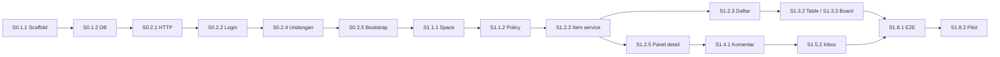

# TASKS — PMS (M0 + M1)

| | |
|---|---|
| **Versi** | 0.2 (kolom Status ditambahkan; lihat [HANDOVER.md](HANDOVER.md)) |
| **Fungsi** | Urutan kerja berdasarkan dependensi dan daftar tugas teknis per story. Kriteria penerimaan lengkap ada di [BACKLOG.md](BACKLOG.md); dokumen ini tidak mengulanginya |
| **Aturan ukuran** | Satu tugas ≤ 0.5 hari ideal. Tugas yang lebih besar dipecah sebelum dikerjakan |
| **Cara dipakai** | Kerjakan story sesuai urutan di §1. Saat sebuah story dimulai, jadikan tugasnya **GitHub Issues** (satu issue per story, tugas sebagai checklist, label `M0`/`M1` dan nama epic) agar progres terhubung ke commit dan PR. Centang di file ini hanya untuk gambaran awal; sumber kebenaran progres adalah issue |

---

## 1. Urutan eksekusi (dihasilkan dari dependensi)

**Status:** `DRAFT` `PROPOSED` `APPROVED` `IN_PROGRESS` `BLOCKED` `DONE`. `DONE` hanya dengan bukti di [TESTING.md](TESTING.md). `DONE` per 12 Nov 2026: S0.1.1, S0.2.1, S0.2.4, S0.4.1, S0.4.2, S0.5.1. Delapan story M0 lain masih `IN_PROGRESS` dengan kesenjangan yang tercatat di TESTING.md.

Urutan topologis dengan satu developer (tidak paralel), 5 hari kerja per minggu. **Jadwal ini akan bergeser**; kalibrasi ulang setelah M0 selesai.

<!-- SCHEDULE:START -->
| Urutan | Story | Judul | Hari | Hari ke- | Minggu | Status |
|---|---|---|---|---|---|---|
| 1 | S0.1.1 | Kerangka repo dan alur kontrak API | 1.5 | 0–1.5 | 1 | DONE |
| 2 | S0.1.2 | Tooling database dan migrasi identitas | 1.5 | 1.5–3 | 1 | DONE |
| 3 | S0.1.3 | Dockerfile, CI, dan image di GHCR | 1.5 | 3–4.5 | 1 | DONE |
| 4 | S0.2.1 | Platform HTTP | 1 | 4.5–5.5 | 2 | DONE |
| 5 | S0.2.2 | Login, logout, dan session | 1.5 | 5.5–7 | 2 | DONE |
| 6 | S0.2.6 | Email (SMTP + job) | 1 | 7–8 | 2 | DONE |
| 7 | S0.2.3 | Reset dan ganti password | 0.5 | 8–8.5 | 2 | DONE |
| 8 | S0.2.4 | Undangan dan penerimaan undangan | 1 | 8.5–9.5 | 2 | DONE |
| 9 | S0.2.5 | Perintah bootstrap | 0.5 | 9.5–10 | 2 | DONE |
| 10 | S0.3.1 | Setup frontend | 1 | 10–11 | 3 | DONE |
| 11 | S0.3.2 | Layar autentikasi dan shell kosong | 1 | 11–12 | 3 | DONE |
| 12 | S0.4.1 | Compose klien, update, dan backup | 1.5 | 12–13.5 | 3 | DONE |
| 13 | S0.4.2 | Observabilitas | 0.5 | 13.5–14 | 3 | DONE |
| 14 | S0.5.1 | Spike Gantt (SVAR) dan penjadwalan di Go | 1 | 14–15 | 3 | DONE |
| 15 | S1.1.1 | Data Space dan CRUD | 2 | 15–17 | 4 | DONE |
| 16 | S1.1.2 | Paket `policy` (mesin otorisasi) | 3 | 17–20 | 4 | IN_PROGRESS |
| 17 | S1.1.3 | API sharing dan ShareDialog | 3 | 20–23 | 5 | IN_PROGRESS |
| 18 | S1.2.1 | Skema item dan workflow default | 2 | 23–25 | 5 | DONE |
| 19 | S1.2.2 | Item service (create, get, patch) | 4 | 25–29 | 6 | DONE |
| 20 | S1.1.4 | Matriks tes otorisasi | 2 | 29–31 | 7 | IN_PROGRESS |
| 21 | S1.2.3 | Endpoint daftar (children dan root Space) | 2 | 31–33 | 7 | DONE |
| 22 | S1.2.4 | UI pembuatan project, folder, dan task | 2.5 | 33–35.5 | 8 | DONE |
| 23 | S1.2.5 | Panel detail item | 3 | 35.5–38.5 | 8 | DONE |
| 24 | S1.2.6 | Subitem | 1 | 38.5–39.5 | 8 | IN_PROGRESS |
| 25 | S1.3.1 | API view | 1.5 | 39.5–41 | 9 | DONE |
| 26 | S1.3.2 | Table view | 3.5 | 41–44.5 | 9 | PROPOSED |
| 27 | S1.3.3 | Board view | 2.5 | 44.5–47 | 10 | PROPOSED |
| 28 | S1.3.4 | ViewTabs dan pengelolaan view | 1.5 | 47–48.5 | 10 | PROPOSED |
| 29 | S1.4.1 | Komentar dan mention | 2.5 | 48.5–51 | 11 | PROPOSED |
| 30 | S1.4.2 | Lampiran file | 2.5 | 51–53.5 | 11 | PROPOSED |
| 31 | S1.4.3 | Optimistic locking end-to-end | 1 | 53.5–54.5 | 11 | PROPOSED |
| 32 | S1.4.4 | Realtime (SSE) | 2 | 54.5–56.5 | 12 | PROPOSED |
| 33 | S1.5.1 | Sidebar dan navigasi | 1.5 | 56.5–58 | 12 | PROPOSED |
| 34 | S1.5.2 | Notifikasi dan Inbox | 2.5 | 58–60.5 | 13 | PROPOSED |
| 35 | S1.5.3 | My to-do | 1 | 60.5–61.5 | 13 | PROPOSED |
| 36 | S1.5.4 | Pencarian global | 2.5 | 61.5–64 | 13 | PROPOSED |
| 37 | S1.6.1 | Manajemen user dan seat | 3 | 64–67 | 14 | PROPOSED |
| 38 | S1.6.2 | Profil dan pengaturan workspace | 1 | 67–68 | 14 | PROPOSED |
| 39 | S1.7.1 | Soft delete, restore, dan Recycle bin | 2.5 | 68–70.5 | 15 | PROPOSED |
| 40 | S1.8.1 | Tes E2E dan aksesibilitas | 2 | 70.5–72.5 | 15 | PROPOSED |
| 41 | S1.8.2 | Performa dan kesiapan pilot | 1.5 | 72.5–74 | 15 | PROPOSED |
<!-- SCHEDULE:END -->

## 2. Jalur kritis

Hal yang paling menentukan jadwal: **S1.1.2 (policy)** dan **S1.2.2 (item service)**. Keduanya dipakai hampir semua story berikutnya dan kesalahan desain di sini mahal diperbaiki; sediakan waktu review ekstra dan tulis tesnya lebih dulu.

## 3. Risiko jadwal yang perlu dipantau

| Risiko | Sinyal awal | Tindakan |
|---|---|---|
| Estimasi M1 terlalu rendah | Story M0 melewati estimasi > 20% | Pakai kecepatan nyata untuk menghitung ulang M1 sebelum S1.1.1 dimulai (lihat BACKLOG, bagian selisih) |
| `policy` ternyata lambat | p95 daftar > 300 ms pada data uji (S1.2.3) | Aktifkan rencana tabel closure (ARCHITECTURE §13) |
| SVAR tidak cukup | Hasil spike S0.5.1 negatif | Putuskan SVAR PRO atau library lain **sebelum** M2 direncanakan |
| Bug popup Base UI | Dialog/menu gagal di browser nyata | Uji klik nyata di Playwright sejak S0.3.2 (DESIGN_SYSTEM §4.3) |

---

# 4. Tugas per story

## M0

### E0.1 Fondasi repo dan pipeline

**S0.1.1 Kerangka repo dan alur kontrak API**
- [x] Inisialisasi `server/` (go mod, `cmd/pms`), `web/` (Vite + TS), `Makefile` (`dev`, `gen`, `test`, `lint`)
- [x] Salin `api/openapi.yaml` (sudah ada) dan pasang `oapi-codegen` (konfigurasi strict server) + `openapi-typescript`
- [x] Tes `go list` untuk aturan ketergantungan paket; langkah CI "generate lalu `git diff --exit-code`"
- [x] Halaman hello memanggil `/healthz` lewat klien hasil generate

**S0.1.2 Tooling database dan migrasi identitas**
- [ ] Pool `pgx`, konfigurasi `sqlc` (`queries/`, `gen/`), runner goose tertanam di `pms migrate`
- [ ] Migrasi `0001_extensions` dan `0002_identity` (`account`, `users`, `sessions`, `user_tokens`)
- [ ] `readyz` memeriksa versi migrasi terbaru; tes migrasi maju pada database kosong di CI
- [ ] Helper tes: database sementara per paket tes (template DB + clone)

**S0.1.3 Dockerfile, CI, dan image di GHCR**
- [x] Dockerfile multi-stage (build web → build Go dengan `go:embed` → image minimal, user non-root)
- [x] Workflow Actions: lint, typecheck, `go test` + service Postgres, build; cache modul
- [x] Job rilis pada tag `v*` → push `ghcr.io/anissaefuddin/pms:<versi>` (private)
- [ ] Verifikasi: image berjalan dan melayani SPA + `/api/v1/healthz`

**S0.2.1 Platform HTTP**
- [ ] Router `net/http` + middleware: request ID, log `slog`, recover, batas body, cek `Origin`
- [ ] Penulis error `problem+json` + pemetaan `code` (WORKFLOWS §10)
- [ ] Loader konfigurasi env dengan validasi dan pesan galat jelas
- [ ] Tes middleware (Origin salah → 403, panic → 500 dengan `request_id`)

**S0.2.2 Login, logout, dan session**
- [ ] Hash argon2id + kebijakan password (≥ 8, daftar password umum)
- [ ] Tabel/query session: buat, rotasi, perbarui `last_seen` (≤ 1×/5 menit), cabut
- [ ] Endpoint `login`/`logout`/`me` + middleware autentikasi
- [ ] Rate limit memori per IP dan per email (+ komentar `shortcut:`)
- [ ] Tes: kedaluwarsa idle/absolut, pesan error seragam, rotasi ID

**S0.2.3 Reset dan ganti password**
- [ ] `forgot` (202 seragam) dan `reset` (token sekali pakai, cabut semua session)
- [ ] `change` (cabut session lain, rotasi session ini) + tes

**S0.2.4 Undangan dan penerimaan undangan**
- [ ] Pembuat token undangan + `GET /auth/invitations/{token}`
- [ ] `accept`: aktivasi, hash password, buat Personal space, buat session
- [ ] Tes: token kedaluwarsa, token terpakai (410), password lemah (422)

**S0.2.5 Perintah bootstrap**
- [ ] `pms bootstrap`: account, admin `invited`, workflow dan status default, Space "General"
- [ ] Idempoten + kode keluar ≠ 0 bila admin sudah ada; cetak link bila SMTP kosong
- [ ] Tes dua kali jalan

**S0.2.6 Email (SMTP + job)**
- [ ] Pasang River + migrasi River; klien SMTP; mode `log`
- [ ] Job `send_email` dengan retry; template `en` (undangan, reset)
- [ ] Tes dengan server SMTP tiruan

**E0.3** · **S0.3.1 Setup frontend**
- [ ] TanStack Router/Query, react-i18next (`en`), Tailwind v4, `data-brand`/`data-density`, mode gelap
- [x] Salin komponen `ui-kit`; ganti `LinkButton` ke adapter TanStack; font lokal
- [x] ESLint `no-literal-string`; Playwright + `axe` terpasang

**S0.3.2 Layar autentikasi dan shell kosong**
- [ ] Login, Forgot, Reset, Accept invitation, `/settings/security`
- [ ] Shell: sidebar + topbar + menu profil/logout; `?next=` hanya path internal
- [ ] Tes Playwright klik nyata untuk menu profil

**E0.4** · **S0.4.1 Compose klien, update, dan backup**
- [ ] `deploy/docker-compose.yml` + `.env.example` + label Traefik
- [ ] `update.sh` (backup pre-deploy → pull → up → tunggu `/readyz`)
- [ ] `backup.sh` (dump lalu file, retensi 14 hari, salin keluar) dan `restore.sh`
- [ ] Uji restore penuh pada instance uji; catat waktu terhadap RPO/RTO

**S0.4.2 Observabilitas**
- [ ] Metrik ARCHITECTURE §11 di `/metrics`; metrik `backup_last_success_timestamp` dari script
- [ ] Provisioning alert Grafana (5xx, job gagal, backup basi, disk)

**E0.5** · **S0.5.1 Spike Gantt dan penjadwalan**
- [x] Halaman SVAR dengan ±200 task dan dependensi dummy
- [x] Fungsi Go geser penerus FS dengan hari kerja Senin–Jumat + 3 tes
- [x] Tulis catatan keputusan di `docs/`

## M1

### E1.1 Space dan otorisasi

**S1.1.1 Data Space dan CRUD**
- [ ] Migrasi `spaces`, `shares`, `groups`, `group_members` + trigger validasi target share
- [ ] Query sqlc dan service Space; endpoint `/spaces*`
- [ ] Personal space saat aktivasi; guard hapus/bagikan

**S1.1.2 Paket `policy`**
- [ ] Definisi tunggal matriks (share role, user type, kemampuan) sebagai data
- [ ] Query CTE rekursif akses (leluhur lewat semua lokasi + share user/grup)
- [ ] `Can()` + filter SQL untuk daftar; aturan 404 vs 403
- [ ] Tes unit tabel-driven untuk seluruh kombinasi matriks

**S1.1.3 API sharing dan ShareDialog**
- [ ] `GET/PUT` shares Space dan item (+ share diwarisi dengan asal)
- [ ] ShareDialog (cari, role, peringatan hapus akses sendiri)
- [ ] Alur "undang sebagai external" dari dialog (admin)

**S1.1.4 Matriks tes otorisasi**
- [x] Matriks 5 tipe × 4 role × 4 jalur untuk GET, PATCH, create subtask, dan DELETE Item pada endpoint nyata
- [x] Tes batas visibilitas Item dan Item di Personal Space
- [ ] Tes batas visibilitas file, komentar, dan lampiran
- [ ] Jadikan langkah CI yang memblokir merge

### E1.2 Item inti

**S1.2.1 Skema item dan workflow default**
- [ ] Migrasi `workflows`, `statuses`, `items`, `item_locations`, assignees, followers
- [ ] Trigger anti-siklus + tes; indeks DATABASE §4
- [ ] Seed workflow default lewat bootstrap

**S1.2.2 Item service**
- [x] `POST/GET/PATCH/DELETE /items` + optimistic locking (`If-Match`, 409/428)
- [x] `activity` dalam transaksi yang sama; follower otomatis
- [x] Aturan status (`completed_at`), validasi tanggal, assignee aktif
- [x] `reorder` dengan `rank` fractional
- [x] Tes konflik versi dan rollback ketika penulisan activity gagal

**S1.2.3 Endpoint daftar**
- [x] `/spaces/{id}/items` dan `/items/{id}/children` (filter, sort, kursor)
- [x] Data uji 500 item; p95 80 ms pada HTTP lokal dengan 200 Item per halaman

**S1.2.4 UI pembuatan project, folder, dan task**
- [x] Picker Space/container, kalender hari kerja, owner, default view, dan sharing di modal Create Item
- [x] Create task dari tombol **+** global. Entry point Table dan Board mengikuti S1.3.2–S1.3.3
- [x] Validasi nama dan pemetaan error server terstruktur ke field

**S1.2.5 Panel detail item**
- [x] Panel samping dengan `?task=` dan halaman `/tasks/$itemId`
- [x] StatusPicker, AssigneePicker, dan kalender hari kerja
- [x] Judul inline, deskripsi TipTap tersimpan saat kehilangan fokus, dan menu ⋯
- [x] Kontrol berdasarkan `my_capabilities`, PATCH dengan ETag, dan tes browser

**S1.2.6 Subitem**
- [x] Daftar, "Add subitem", dan navigasi kembali ke induk
- [x] Jumlah subitem pada baris yang tersedia. Form membuat Item baru dengan parent tetap, dan siklus lokasi diuji pada PostgreSQL
- [ ] Tampilkan jumlah subitem pada kartu Board setelah S1.3.3

### E1.3 View

**S1.3.1 API view**
- [ ] Migrasi `views`; CRUD, duplicate, default unik per scope
- [ ] Pembuatan view bawaan saat container dibuat

**S1.3.2 Table view**
- [ ] DataTable (TanStack Table + Virtual) dengan hierarki expand/collapse
- [ ] Edit inline sel; baris "+ Item"
- [ ] Reorder drag + "Move to…"; navigasi keyboard
- [ ] Filter/sort/group di URL; ukur 500 item

**S1.3.3 Board view**
- [ ] Kolom dari workflow; BoardCard (dnd-kit) + sensor keyboard
- [ ] Drag ubah status optimistis + rollback + toast
- [ ] "+ Add" per kolom

**S1.3.4 ViewTabs dan pengelolaan view**
- [ ] Menu per view (copy link, rename, duplicate, default, urut, hapus)
- [ ] Tes membuka URL tersalin memulihkan tampilan

### E1.4 Kolaborasi

**S1.4.1 Komentar dan mention**
- [ ] Skema `comments`, `comment_mentions`; validator JSON ProseMirror (allowlist node/mark)
- [ ] Endpoint komentar + ekstraksi mention
- [ ] CommentThread + editor mention; tes XSS

**S1.4.2 Lampiran file**
- [ ] Interface `Storage` + `LocalStorage` (+ komentar `shortcut:`)
- [ ] Upload: batas ukuran, deteksi tipe, tolak executable, SHA-256, nama acak
- [ ] Download berizin + header aman; FileDropzone + pesan penolakan
- [ ] Tes file palsu (`.png` berisi ELF)

**S1.4.3 Optimistic locking end-to-end**
- [ ] ConflictBanner + simpan draf lokal + "Reapply"
- [ ] Tes E2E dua sesi

**S1.4.4 Realtime (SSE)**
- [ ] Hub memori, heartbeat, `Last-Event-ID`, `resync`
- [ ] Publikasi event setelah commit; hitung penerima
- [ ] `lib/realtime.ts` + invalidasi query + `LiveIndicator`
- [ ] Tes E2E ≤ 3 detik

### E1.5 Navigasi dan pencarian

**S1.5.1 Sidebar dan navigasi**
- [ ] Pohon Space/project/folder, Personal, Shared with me (`/me/shared`), More, Recycle bin
- [ ] Ciut/lebar tersimpan; navigasi keyboard

**S1.5.2 Notifikasi dan Inbox**
- [ ] Migrasi `notifications`; pembuat notifikasi (satu tempat, aturan WORKFLOWS §6)
- [ ] Inbox UI + Mark all as read + Archive all; badge realtime
- [ ] Email notifikasi lewat job

**S1.5.3 My to-do**
- [ ] `GET /me/todo` + filter/sort; halaman UI

**S1.5.4 Pencarian global**
- [ ] Kolom `tsvector` + indeks GIN; query berfilter akses
- [ ] CommandPalette + `/search`; scope
- [ ] Ukur p95 pada 10 ribu item

### E1.6 Admin user

**S1.6.1 Manajemen user dan seat**
- [ ] Invite/resend/deactivate/reactivate/ubah type + guard `last_admin` + hitung seat
- [ ] UI Users + Groups + ringkasan seat; matriks `/settings/users/types`
- [ ] Tes `seats_exhausted`, `last_admin`, pencabutan session saat nonaktif

**S1.6.2 Profil dan pengaturan workspace**
- [ ] `GET/PATCH /me`; halaman profil + workspace (density, tema)
- [ ] Format tanggal/zona waktu diterapkan di UI

### E1.7 Recycle bin

**S1.7.1 Soft delete, restore, dan Recycle bin**
- [ ] Hapus kaskade dengan `deleted_root_id`; restore + fallback ke root Space
- [ ] Halaman Recycle bin + toast Undo
- [ ] Pastikan item terhapus dikecualikan dari pencarian/to-do/notifikasi; tes multi-lokasi

### E1.8 Hardening dan kesiapan pilot

**S1.8.1 Tes E2E dan aksesibilitas**
- [ ] 5 alur Playwright (login, buat proyek, buat task, drag status, komentar+mention → Inbox)
- [ ] `axe` pada layar utama terang/gelap; masukkan ke CI

**S1.8.2 Performa dan kesiapan pilot**
- [ ] Data uji 500/10 ribu item; ukur dan catat
- [ ] Runbook (bootstrap, update, backup, restore, rotasi kunci, tambah seat)
- [ ] Triase bug terbuka; pastikan tidak ada bug otorisasi/kehilangan data
