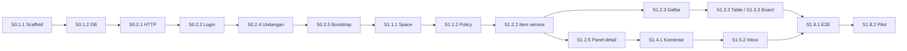

# TASKS — PMS (M0 – M12 dan GA)

| | |
|---|---|
| **Versi** | 0.2 (kolom Status ditambahkan; lihat [HANDOVER.md](HANDOVER.md)) |
| **Fungsi** | Urutan kerja berdasarkan dependensi dan daftar tugas teknis per story. Kriteria penerimaan lengkap ada di [BACKLOG.md](BACKLOG.md); dokumen ini tidak mengulanginya |
| **Aturan ukuran** | Satu tugas ≤ 0.5 hari ideal. Tugas yang lebih besar dipecah sebelum dikerjakan |
| **Cara dipakai** | Kerjakan story sesuai urutan di §1. Saat sebuah story dimulai, jadikan tugasnya **GitHub Issues** (satu issue per story, tugas sebagai checklist, label `M0`/`M1`/`M2` dan nama epic) agar progres terhubung ke commit dan PR. Centang di file ini hanya untuk gambaran awal; sumber kebenaran progres adalah issue |

---

## 1. Urutan eksekusi (dihasilkan dari dependensi)

**Status:** `DRAFT` `PROPOSED` `APPROVED` `IN_PROGRESS` `BLOCKED` `DONE`. `DONE` hanya dengan bukti di [TESTING.md](TESTING.md). Per 13 Nov 2026: seluruh story M0 dan M1 `DONE` kecuali S1.1.4 (`IN_PROGRESS`: required check CI diblokir GitHub, HTTP 403). Status per story M2 ada di tabel di bawah.

Urutan topologis dengan satu developer (tidak paralel), 5 hari kerja per minggu. **Jadwal ini akan bergeser**; kalibrasi ulang setelah M0 selesai.

<!-- SCHEDULE:START -->
| Urutan | Story | Judul | Hari | Hari ke- | Minggu | Status |
|---|---|---|---|---|---|---|
| 1 | S0.1.1 | Kerangka repo dan alur kontrak API | 1.5 | 0–1.5 | 1 | DONE |
| 2 | S0.1.2 | Tooling database dan migrasi identitas | 1.5 | 1.5–3 | 1 | DONE |
| 3 | S0.1.3 | Dockerfile, CI, dan image di GHCR | 1.5 | 3–4.5 | 1 | DONE |
| 4 | S0.2.1 | Platform HTTP | 1 | 4.5–5.5 | 2 | DONE |
| 5 | S0.2.2 | Login, logout, dan session | 1.5 | 5.5–7 | 2 | DONE |
| 6 | S0.2.6 | Email (SMTP + job) | 1 | 7–8 | 2 | DONE |
| 7 | S0.2.3 | Reset dan ganti password | 0.5 | 8–8.5 | 2 | DONE |
| 8 | S0.2.4 | Undangan dan penerimaan undangan | 1 | 8.5–9.5 | 2 | DONE |
| 9 | S0.2.5 | Perintah bootstrap | 0.5 | 9.5–10 | 2 | DONE |
| 10 | S0.3.1 | Setup frontend | 1 | 10–11 | 3 | DONE |
| 11 | S0.3.2 | Layar autentikasi dan shell kosong | 1 | 11–12 | 3 | DONE |
| 12 | S0.4.1 | Compose klien, update, dan backup | 1.5 | 12–13.5 | 3 | DONE |
| 13 | S0.4.2 | Observabilitas | 0.5 | 13.5–14 | 3 | DONE |
| 14 | S0.5.1 | Spike Gantt (SVAR) dan penjadwalan di Go | 1 | 14–15 | 3 | DONE |
| 15 | S1.1.1 | Data Space dan CRUD | 2 | 15–17 | 4 | DONE |
| 16 | S1.1.2 | Paket `policy` (mesin otorisasi) | 3 | 17–20 | 4 | DONE |
| 17 | S1.1.3 | API sharing dan ShareDialog | 3 | 20–23 | 5 | DONE |
| 18 | S1.2.1 | Skema item dan workflow default | 2 | 23–25 | 5 | DONE |
| 19 | S1.2.2 | Item service (create, get, patch) | 4 | 25–29 | 6 | DONE |
| 20 | S1.1.4 | Matriks tes otorisasi | 2 | 29–31 | 7 | IN_PROGRESS |
| 21 | S1.2.3 | Endpoint daftar (children dan root Space) | 2 | 31–33 | 7 | DONE |
| 22 | S1.2.4 | UI pembuatan project, folder, dan task | 2.5 | 33–35.5 | 8 | DONE |
| 23 | S1.2.5 | Panel detail item | 3 | 35.5–38.5 | 8 | DONE |
| 24 | S1.2.6 | Subitem | 1 | 38.5–39.5 | 8 | DONE |
| 25 | S1.3.1 | API view | 1.5 | 39.5–41 | 9 | DONE |
| 26 | S1.3.2 | Table view | 3.5 | 41–44.5 | 9 | DONE |
| 27 | S1.3.3 | Board view | 2.5 | 44.5–47 | 10 | DONE |
| 28 | S1.3.4 | ViewTabs dan pengelolaan view | 1.5 | 47–48.5 | 10 | DONE |
| 29 | S1.4.1 | Komentar dan mention | 2.5 | 48.5–51 | 11 | DONE |
| 30 | S1.4.2 | Lampiran file | 2.5 | 51–53.5 | 11 | DONE |
| 31 | S1.4.3 | Optimistic locking end-to-end | 1 | 53.5–54.5 | 11 | DONE |
| 32 | S1.4.4 | Realtime (SSE) | 2 | 54.5–56.5 | 12 | DONE |
| 33 | S1.5.1 | Sidebar dan navigasi | 1.5 | 56.5–58 | 12 | DONE |
| 34 | S1.5.2 | Notifikasi dan Inbox | 2.5 | 58–60.5 | 13 | DONE |
| 35 | S1.5.3 | My to-do | 1 | 60.5–61.5 | 13 | DONE |
| 36 | S1.5.4 | Pencarian global | 2.5 | 61.5–64 | 13 | DONE |
| 37 | S1.6.1 | Manajemen user dan seat | 3 | 64–67 | 14 | DONE |
| 38 | S1.6.2 | Profil dan pengaturan workspace | 1 | 67–68 | 14 | DONE |
| 39 | S1.7.1 | Soft delete, restore, dan Recycle bin | 2.5 | 68–70.5 | 15 | DONE |
| 40 | S1.8.1 | Tes E2E dan aksesibilitas | 2 | 70.5–72.5 | 15 | DONE |
| 41 | S1.8.2 | Performa dan kesiapan pilot | 1.5 | 72.5–74 | 15 | DONE |
| 42 | S2.1.1 | Work schedule (SET-07) | 2.5 | 74–76.5 | 16 | DONE |
| 43 | S2.1.2 | Dependensi item (data dan API) | 2.5 | 76.5–79 | 16 | DONE |
| 44 | S2.1.3 | Mesin penjadwalan di Go | 4.0 | 79–83 | 17 | DONE |
| 45 | S2.2.1 | Effort dan allocation (TASK-05B) | 2.5 | 83–85.5 | 18 | DONE |
| 46 | S2.2.2 | Progress project (TASK-09) | 2.0 | 85.5–87.5 | 18 | DONE |
| 47 | S2.3.1 | Definisi custom field dan API (TASK-10) | 3.0 | 87.5–90.5 | 19 | DONE |
| 48 | S2.3.2 | Tipe field lengkap (TASK-11A) | 3.0 | 90.5–93.5 | 19 | DONE |
| 49 | S2.4.1 | Tipe view Gantt dan Calendar | 1.0 | 93.5–94.5 | 19 | DONE |
| 50 | S2.4.2 | Gantt: bar, progres, drag/resize, milestone (VIEW-05A) | 4.0 | 94.5–98.5 | 20 | DONE |
| 51 | S2.4.3 | Gantt: dependensi dan penjadwalan (VIEW-05B) | 3.0 | 98.5–101.5 | 21 | DONE |
| 52 | S2.3.3 | Custom field di panel, Table, Board, dan pemilih kolom (VIEW-09) | 3.0 | 101.5–104.5 | 21 | DONE |
| 53 | S2.5.1 | Board swimlane dan field kartu (VIEW-03, VIEW-04) | 3.0 | 104.5–107.5 | 22 | DONE |
| 54 | S2.5.2 | Calendar (VIEW-06) | 2.5 | 107.5–110 | 22 | DONE |
| 55 | S2.5.3 | Preset filter dan sort Space (SPC-03) | 1.5 | 110–111.5 | 23 | DONE |
| 56 | S2.5.4 | UI multi-lokasi (SPC-10) | 1.5 | 111.5–113 | 23 | DONE |
| 57 | S2.6.1 | E2E, aksesibilitas, dan performa M2 | 2.0 | 113–115 | 23 | DONE |
| 58 | S3.1.1 | Editor workflow dan status (WF-02, WF-03A) | 4 | 115–119 | 24 | DONE |
| 59 | S3.2.1 | Approval pada item (SPC-12) | 3.5 | 119–122.5 | 25 | DONE |
| 60 | S3.2.2 | Blueprint (SPC-13) | 3 | 122.5–125.5 | 26 | DONE |
| 61 | S3.3.1 | Skema form dan API pembuat form (FORM-01, FORM-02) | 3.5 | 125.5–129 | 26 | DONE |
| 62 | S3.3.2 | UI form builder | 4 | 129–133 | 27 | DONE |
| 63 | S3.3.3 | Sharing form dan Manage forms (FORM-03, FORM-05) | 2 | 133–135 | 28 | DONE |
| 64 | S3.3.4 | Submit form internal menjadi item (FORM-06) | 2.5 | 135–137.5 | 28 | DONE |
| 65 | S3.3.5 | Form publik dan keamanan (SEC-05) | 3 | 137.5–140.5 | 29 | DONE |
| 66 | S3.3.6 | Pelacakan request (FORM-08) | 2.5 | 140.5–143 | 29 | DONE |
| 67 | S3.4.1 | Kustomisasi sidebar (NAV-02) | 1.5 | 143–144.5 | 29 | DONE |
| 68 | S3.4.2 | Stream aktivitas (NAV-04) | 2.5 | 144.5–147 | 30 | DONE |
| 69 | S3.4.3 | Halaman hasil pencarian (NAV-07) | 2 | 147–149 | 30 | DONE |
| 70 | S3.5.1 | 2FA TOTP (AUTH-05) | 3 | 149–152 | 31 | DONE |
| 71 | S3.6.1 | E2E, aksesibilitas, dan keamanan M3 | 2 | 152–154 | 31 | DONE |
| 72 | S4.1.1 | Skema time entry dan API | 2.5 | 154–156.5 | 32 | DONE |
| 73 | S4.1.2 | Timesheet mingguan (TASK-13) | 3.5 | 156.5–160 | 33 | DONE |
| 74 | S4.1.3 | Timelog view (VIEW-07) | 2.5 | 160–162.5 | 33 | DONE |
| 75 | S4.2.1 | Budget project (TASK-12) | 1.5 | 162.5–164 | 33 | DONE |
| 76 | S4.3.1 | Export project ke Excel (SPC-15) | 2.5 | 164–166.5 | 34 | DONE |
| 77 | S4.3.2 | Import dari Excel (SPC-15) | 3 | 166.5–169.5 | 34 | DONE |
| 78 | S4.4.1 | E2E dan regresi M4 | 1.5 | 169.5–171 | 35 | DONE |
| 79 | S5.1.1 | Skema dashboard dan widget (DASH-01, DASH-06) | 3 | 171–174 | 35 | DONE |
| 80 | S5.1.2 | Mesin data widget (DASH-02) | 4 | 174–178 | 36 | DONE |
| 81 | S5.1.3 | Widget daftar task dan template (DASH-01, DASH-02) | 3 | 178–181 | 37 | DONE |
| 82 | S5.1.4 | Widget visual (DASH-03A) | 4 | 181–185 | 38 | DONE |
| 83 | S5.1.5 | UI dashboard | 3 | 185–188 | 38 | DONE |
| 84 | S5.2.1 | Skema report dan daftar report (RPT-03) | 2.5 | 188–190.5 | 39 | DONE |
| 85 | S5.2.2 | Editor dan eksekusi report (RPT-02) | 4 | 190.5–194.5 | 39 | DONE |
| 86 | S5.2.3 | Template report (RPT-01) | 3 | 194.5–197.5 | 40 | DONE |
| 87 | S5.3.1 | Uji kecocokan angka dan E2E | 2.5 | 197.5–200 | 41 | DONE |
| 88 | S6.1.1 | Template Space (SPC-18) | 4 | 200–204 | 41 | DONE |
| 89 | S6.1.2 | Wizard first-run (AUTH-07) | 2.5 | 204–206.5 | 42 | DONE |
| 90 | S6.2.1 | Pengaturan workspace per user dan info akun (SET-03, SET-04) | 2 | 206.5–208.5 | 42 | DONE |
| 91 | S6.2.2 | Preferensi email notifikasi (SET-05) | 2 | 208.5–210.5 | 43 | DONE |
| 92 | S6.2.3 | Kosongkan Recycle bin (BIN-03) | 1 | 210.5–211.5 | 43 | DONE |
| 93 | S6.3.1 | Prosedur penghentian instance (USR-04) | 1.5 | 211.5–213 | 43 | DONE |
| 94 | S6.3.2 | Uji restore terhadap RTO (OPS-01) | 2 | 213–215 | 44 | DONE |
| 95 | S6.3.3 | Uji keamanan internal | 4 | 215–219 | 44 | DONE |
| 96 | S6.3.4 | Uji performa target NFR | 2.5 | 219–221.5 | 45 | IN_PROGRESS |
| 97 | S6.3.5 | UAT P0 + P1 dan lima flow Playwright | 3 | 221.5–224.5 | 45 | IN_PROGRESS |
| 98 | S6.3.6 | Perbaikan bug dan stabilisasi | 3 | 224.5–227.5 | 46 | IN_PROGRESS |
| 99 | GA.1 | Deploy instance klien pertama | 2 | 227.5–229.5 | 46 | PROPOSED |
| 100 | GA.2 | Migrasi data pilot | 2 | 229.5–231.5 | 47 | PROPOSED |
| 101 | GA.3 | Dokumentasi user | 2.5 | 231.5–234 | 47 | PROPOSED |
| 102 | GA.4 | Pelatihan dan serah terima | 1.5 | 234–235.5 | 48 | PROPOSED |
<!-- SCHEDULE:END -->

**Gelombang M2.** Gelombang berjalan berurutan; story yang tidak saling bergantung di dalam satu gelombang boleh paralel hanya oleh sesi terpisah dengan kepemilikan file yang jelas. `api/openapi.yaml`, nomor migrasi, `schedule`, dan `items/patch.go` dipegang satu sesi pada satu waktu.

| Gelombang | Story | Hari |
|---|---|---|
| A. Fondasi data | S2.1.1, S2.1.2, S2.3.1, S2.4.1 | 9 |
| B. Logika inti | S2.1.3, S2.2.1, S2.3.2 | 9.5 |
| C. Gantt dan field di tampilan | S2.2.2 → S2.4.2, S2.3.3 | 9 |
| D. Fitur turunan | S2.4.3, S2.5.1, S2.5.2, S2.5.3, S2.5.4 | 11.5 |
| E. Penutup | S2.6.1 | 2 |

Aturan: S2.1.3 titik risiko tertinggi (tes tabel ≥ 20 kasus lebih dulu, review independen, jangan mulai S2.4.3 sebelum benchmark 500 task lulus); ukur SVAR dengan 500 task di awal S2.4.2; setiap akhir gelombang jalankan seluruh suite Go dengan PostgreSQL nyata dan catat di TESTING; kalibrasi estimasi 41 hari setelah gelombang A. Jalur kritis M2: S2.1.1 → S2.1.2 → S2.1.3 → S2.4.2 → S2.4.3 → S2.6.1.

**Cakupan M3–GA (ditambahkan 13 Nov 2026).** Story M3 sampai GA di bawah baru berisi tugas teknis dan estimasi kasar; kriteria penerimaan lengkap ditulis di [BACKLOG.md](BACKLOG.md) saat milestone dimulai, dan estimasi dikalibrasi ulang dari kecepatan nyata M2. Total estimasi: M3 39 hari (rencana PRD 25), M4 17 (15), M5 29 (25), M6 27.5 (20), GA 8 (5), jadi **120.5 hari** melawan 90 hari di PRD (selisih +30.5). Selisih ini belum diputuskan.

## 2. Jalur kritis

Hal yang paling menentukan jadwal: **S1.1.2 (policy)** dan **S1.2.2 (item service)**. Keduanya dipakai hampir semua story berikutnya dan kesalahan desain di sini mahal diperbaiki; sediakan waktu review ekstra dan tulis tesnya lebih dulu.

## 3. Risiko jadwal yang perlu dipantau

| Risiko | Sinyal awal | Tindakan |
|---|---|---|
| Estimasi M1 terlalu rendah | Story M0 melewati estimasi > 20% | Pakai kecepatan nyata untuk menghitung ulang M1 sebelum S1.1.1 dimulai (lihat BACKLOG, bagian selisih) |
| `policy` ternyata lambat | p95 daftar > 300 ms pada data uji (S1.2.3) | Aktifkan rencana tabel closure (ARCHITECTURE §13) |
| SVAR tidak cukup | Hasil spike S0.5.1 negatif | Putuskan SVAR PRO atau library lain **sebelum** M2 direncanakan |
| Penjadwalan berantai lebih rumit dari spike (SS/FF/SF, lag negatif, libur) | Tabel kasus S2.1.3 terus bertambah | Tes tabel lebih dulu; batasi ke aturan M2-3; jangan tambah mode jadwal lain |
| SVAR MIT kurang untuk 500 task atau dependensi | Drag/link berhenti bekerja pada 500 task (S2.4.2) | Ukur di awal S2.4.2; fallback: tampilan baca-saja + edit lewat panel, catat sebagai keputusan baru |
| Filter/sort custom field lambat di `jsonb` | p95 Table > 1 detik di 500 item (S2.3.3) | Indeks ekspresi per tipe populer; ukur sebelum memilih |
| Perubahan jadwal berantai memicu banyak event SSE dan konflik versi | Toast konflik sering muncul saat dua orang mengedit | Satu event ringkas per transaksi (`affected_items`) |
| Estimasi M2 41 hari melebihi 30 hari rencana | Story pertama M2 melewati estimasi > 20% | Hitung ulang dari kecepatan nyata; tawarkan penundaan SPC-10 dan sebagian VIEW-04 |
| Bug popup Base UI | Dialog/menu gagal di browser nyata | Uji klik nyata di Playwright sejak S0.3.2 (DESIGN_SYSTEM §4.3) |

---

# 4. Tugas per story

## M0

### E0.1 Fondasi repo dan pipeline

**S0.1.1 Kerangka repo dan alur kontrak API**
- [x] Inisialisasi `server/` (go mod, `cmd/pms`), `web/` (Vite + TS), `Makefile` (`dev`, `gen`, `test`, `lint`)
- [x] Salin `api/openapi.yaml` (sudah ada) dan pasang `oapi-codegen` (konfigurasi strict server) + `openapi-typescript`
- [x] Tes `go list` untuk aturan ketergantungan paket; langkah CI "generate lalu `git diff --exit-code`"
- [x] Halaman hello memanggil `/healthz` lewat klien hasil generate

**S0.1.2 Tooling database dan migrasi identitas**
- [x] Pool `pgx`, konfigurasi `sqlc` (`queries/`, `gen/`), runner goose tertanam di `pms migrate`
- [x] Migrasi `0001_extensions` dan `0002_identity` (`account`, `users`, `sessions`, `user_tokens`)
- [x] `readyz` memeriksa versi migrasi terbaru; tes migrasi maju pada database kosong di CI
- [x] Helper tes: database sementara per paket tes (template DB + clone) — `testdb.NewMigrated` (template + clone) 14 Nov 2026

**S0.1.3 Dockerfile, CI, dan image di GHCR**
- [x] Dockerfile multi-stage (build web → build Go dengan `go:embed` → image minimal, user non-root)
- [x] Workflow Actions: lint, typecheck, `go test` + service Postgres, build; cache modul
- [x] Job rilis pada tag `v*` → push `ghcr.io/anissaefuddin/pms:<versi>` (private)
- [x] Verifikasi: image berjalan dan melayani SPA + `/api/v1/healthz` — diverifikasi 14 Nov 2026 (TESTING.md, audit M0/M1)

**S0.2.1 Platform HTTP**
- [x] Router `net/http` + middleware: request ID, log `slog`, recover, batas body, cek `Origin`
- [x] Penulis error `problem+json` + pemetaan `code` (WORKFLOWS §10)
- [x] Loader konfigurasi env dengan validasi dan pesan galat jelas
- [x] Tes middleware (Origin salah → 403, panic → 500 dengan `request_id`)

**S0.2.2 Login, logout, dan session**
- [x] Hash argon2id + kebijakan password (≥ 8, daftar password umum)
- [x] Tabel/query session: buat, rotasi, perbarui `last_seen` (≤ 1×/5 menit), cabut
- [x] Endpoint `login`/`logout`/`me` + middleware autentikasi
- [x] Rate limit memori per IP dan per email (+ komentar `shortcut:`)
- [x] Tes: kedaluwarsa idle/absolut, pesan error seragam, rotasi ID

**S0.2.3 Reset dan ganti password**
- [x] `forgot` (202 seragam) dan `reset` (token sekali pakai, cabut semua session)
- [x] `change` (cabut session lain, rotasi session ini) + tes

**S0.2.4 Undangan dan penerimaan undangan**
- [x] Pembuat token undangan + `GET /auth/invitations/{token}`
- [x] `accept`: aktivasi, hash password, buat Personal space, buat session
- [x] Tes: token kedaluwarsa, token terpakai (410), password lemah (422)

**S0.2.5 Perintah bootstrap**
- [x] `pms bootstrap`: account, admin `invited`, workflow dan status default, Space "General"
- [x] Idempoten + kode keluar ≠ 0 bila admin sudah ada; cetak link bila SMTP kosong
- [x] Tes dua kali jalan

**S0.2.6 Email (SMTP + job)**
- [x] Pasang River + migrasi River; klien SMTP; mode `log`
- [x] Job `send_email` dengan retry; template `en` (undangan, reset)
- [x] Tes dengan server SMTP tiruan

**E0.3** · **S0.3.1 Setup frontend**
- [x] TanStack Router/Query, react-i18next (`en`), Tailwind v4, `data-brand`/`data-density`, mode gelap
- [x] Salin komponen `ui-kit`; ganti `LinkButton` ke adapter TanStack; font lokal
- [x] ESLint `no-literal-string`; Playwright + `axe` terpasang

**S0.3.2 Layar autentikasi dan shell kosong**
- [x] Login, Forgot, Reset, Accept invitation, `/settings/security`
- [x] Shell: sidebar + topbar + menu profil/logout; `?next=` hanya path internal
- [x] Tes Playwright klik nyata untuk menu profil

**E0.4** · **S0.4.1 Compose klien, update, dan backup**
- [x] `deploy/docker-compose.yml` + `.env.example` + label Traefik
- [x] `update.sh` (backup pre-deploy → pull → up → tunggu `/readyz`)
- [x] `backup.sh` (dump lalu file, retensi 14 hari, salin keluar) dan `restore.sh`
- [x] Uji restore penuh pada instance uji; catat waktu terhadap RPO/RTO

**S0.4.2 Observabilitas**
- [x] Metrik ARCHITECTURE §11 di `/metrics`; metrik `backup_last_success_timestamp` dari script
- [x] Provisioning alert Grafana (5xx, job gagal, backup basi, disk)

**E0.5** · **S0.5.1 Spike Gantt dan penjadwalan**
- [x] Halaman SVAR dengan ±200 task dan dependensi dummy
- [x] Fungsi Go geser penerus FS dengan hari kerja Senin–Jumat + 3 tes
- [x] Tulis catatan keputusan di `docs/`

## M1

### E1.1 Space dan otorisasi

**S1.1.1 Data Space dan CRUD**
- [x] Migrasi `spaces`, `shares`, `groups`, `group_members` + trigger validasi target share
- [x] Query sqlc dan service Space; endpoint `/spaces*`
- [x] Personal space saat aktivasi; guard hapus/bagikan

**S1.1.2 Paket `policy`**
- [x] Definisi tunggal matriks (share role, user type, kemampuan) sebagai data
- [x] Query CTE rekursif akses (leluhur lewat semua lokasi + share user/grup)
- [x] `Can()` + filter SQL untuk daftar; aturan 404 vs 403
- [x] Tes unit tabel-driven untuk seluruh kombinasi matriks

**S1.1.3 API sharing dan ShareDialog**
- [x] `GET/PUT` shares Space dan item (+ share diwarisi dengan asal)
- [x] ShareDialog (cari, role, peringatan hapus akses sendiri)
- [x] Alur "undang sebagai external" dari dialog (admin)

**S1.1.4 Matriks tes otorisasi**
- [x] Matriks 5 tipe × 4 role × 4 jalur untuk GET, PATCH, create subtask, dan DELETE Item pada endpoint nyata
- [x] Tes batas visibilitas Item dan Item di Personal Space
- [x] Tes batas visibilitas file, komentar, dan lampiran
- [x] Jadikan langkah CI yang memblokir merge. **Selesai 14 Nov 2026:** repo kini publik; job `authorization-matrix` menjadi required status check di branch `main` (`enforce_admins` mati, tanpa syarat review; force push dan penghapusan dilarang). Run hijau: PR #3.

### E1.2 Item inti

**S1.2.1 Skema item dan workflow default**
- [x] Migrasi `workflows`, `statuses`, `items`, `item_locations`, assignees, followers
- [x] Trigger anti-siklus + tes; indeks DATABASE §4
- [x] Seed workflow default lewat bootstrap

**S1.2.2 Item service**
- [x] `POST/GET/PATCH/DELETE /items` + optimistic locking (`If-Match`, 409/428)
- [x] `activity` dalam transaksi yang sama; follower otomatis
- [x] Aturan status (`completed_at`), validasi tanggal, assignee aktif
- [x] `reorder` dengan `rank` fractional
- [x] Tes konflik versi dan rollback ketika penulisan activity gagal

**S1.2.3 Endpoint daftar**
- [x] `/spaces/{id}/items` dan `/items/{id}/children` (filter, sort, kursor)
- [x] Data uji 500 item; p95 80 ms pada HTTP lokal dengan 200 Item per halaman

**S1.2.4 UI pembuatan project, folder, dan task**
- [x] Picker Space/container, kalender hari kerja, owner, default view, dan sharing di modal Create Item
- [x] Create task dari tombol **+** global. Entry point Table dan Board mengikuti S1.3.2–S1.3.3
- [x] Validasi nama dan pemetaan error server terstruktur ke field

**S1.2.5 Panel detail item**
- [x] Panel samping dengan `?task=` dan halaman `/tasks/$itemId`
- [x] StatusPicker, AssigneePicker, dan kalender hari kerja
- [x] Judul inline, deskripsi TipTap tersimpan saat kehilangan fokus, dan menu ⋯
- [x] Kontrol berdasarkan `my_capabilities`, PATCH dengan ETag, dan tes browser

**S1.2.6 Subitem**
- [x] Daftar, "Add subitem", dan navigasi kembali ke induk
- [x] Jumlah subitem pada baris yang tersedia. Form membuat Item baru dengan parent tetap, dan siklus lokasi diuji pada PostgreSQL
- [x] Tampilkan jumlah subitem pada kartu Board. Playwright memverifikasi angka pada kartu

### E1.3 View

**S1.3.1 API view**
- [x] Migrasi `views`; CRUD, duplicate, default unik per scope
- [x] Pembuatan view bawaan saat container dibuat

**S1.3.2 Table view**
- [x] DataTable (TanStack Table + Virtual) dengan hierarki expand/collapse
- [x] Edit inline sel; baris "+ Item"
- [x] Reorder drag + "Move to…"; navigasi keyboard
- [x] Filter/sort/group di URL; ukur 500 item

**S1.3.3 Board view**
- [x] Kolom dari workflow; BoardCard (dnd-kit) + sensor keyboard — **dipenuhi dengan drag HTML5 bawaan + `<select>` status per kartu sebagai jalur keyboard, bukan dnd-kit** (D-96)
- [x] Drag ubah status optimistis + rollback + toast
- [x] "+ Add" per kolom

**S1.3.4 ViewTabs dan pengelolaan view**
- [x] Menu per view (copy link, rename, duplicate, default, urut, hapus)
- [x] Tes membuka URL tersalin memulihkan tampilan

### E1.4 Kolaborasi

**S1.4.1 Komentar dan mention**
- [x] Skema `comments`, `comment_mentions`; validator JSON ProseMirror (allowlist node/mark)
- [x] Endpoint komentar + ekstraksi mention
- [x] CommentThread + editor mention; tes XSS

**S1.4.2 Lampiran file**
- [x] Interface `Storage` + `LocalStorage` (+ komentar `shortcut:`)
- [x] Upload: batas ukuran, deteksi tipe, tolak executable, SHA-256, nama acak
- [x] Download berizin + header aman; FileDropzone + batas ukuran dan pesan penolakan
- [x] Tes file palsu (`.png` berisi ELF)

**S1.4.3 Optimistic locking end-to-end**
- [x] ConflictBanner + draf lokal + Reapply dan Discard; rollback dan toast untuk status
- [x] Tes E2E dua sesi

**S1.4.4 Realtime (SSE)**
- [x] Hub memori, heartbeat, `Last-Event-ID`, `resync`
- [x] Publikasi event setelah commit; izin penerima diperiksa saat pengiriman dan replay
- [x] `lib/realtime.ts` + invalidasi query + indikator koneksi
- [x] Tes E2E ≤ 3 detik

### E1.5 Navigasi dan pencarian

**S1.5.1 Sidebar dan navigasi**
- [x] Pohon Space/project/folder, Personal, Shared with me (`/me/shared`), serta rute Recycle bin melalui More. Daftar dan restore Recycle bin mengikuti S1.7.1.
- [x] Ciut/lebar per user, navigasi keyboard, dan Space terakhir dengan fallback Personal
- [x] `account_name` di `Me`, banner sesi kedaluwarsa, dan `Retry-After` pada 429 autentikasi

**S1.5.2 Notifikasi dan Inbox**
- [x] Migrasi `notifications`; pembuat notifikasi mengikuti WORKFLOWS §6
- [x] Inbox dengan filter Unread only, Mark all as read, Archive all, dan badge realtime
- [x] Job email transaksional untuk event selain komentar biasa

**S1.5.3 My to-do**
- [x] `GET /me/todo` dan UI dengan filter, sort, pagination, dan perubahan status ber-ETag

**S1.5.4 Pencarian global**
- [x] Kolom `tsvector` + indeks GIN; query berfilter akses
- [x] CommandPalette + `/search`; scope Everywhere, Space, dan Project
- [x] p95 HTTP lokal 46,18 ms pada 10.000 Item dan 500 komentar

### E1.6 Admin user

**S1.6.1 Manajemen user dan seat**
- [x] Invite/resend/deactivate/reactivate/ubah type + guard `last_admin` + hitung seat
- [x] UI Users + Groups + ringkasan seat; matriks `/settings/users/types`
- [x] Tes `seats_exhausted`, `last_admin`, pencabutan sesi, dan pembuatan token oleh worker undangan

**S1.6.2 Profil dan pengaturan workspace**
- [x] `GET/PATCH /me`; halaman profil, density, tema, dan pintasan komentar
- [x] Format tanggal, angka, zona waktu, dan awal minggu diterapkan di UI

### E1.7 Recycle bin

**S1.7.1 Soft delete, restore, dan Recycle bin**
- [x] Hapus kaskade dengan `deleted_root_id`; restore + fallback ke root Space
- [x] Halaman Recycle bin + toast Undo 8 detik
- [x] Item terhapus dikecualikan dari pencarian/to-do/notifikasi; tes multi-lokasi

### E1.8 Hardening dan kesiapan pilot

**S1.8.1 Tes E2E dan aksesibilitas**
- [x] 5 alur Playwright dengan PostgreSQL (login, buat proyek, buat task, drag status, komentar+mention → Inbox)
- [x] `axe` pada layar utama terang/gelap; workflow CI setiap PR

**S1.8.2 Performa dan kesiapan pilot**
- [x] Data uji 500/10 ribu item; p95 dicatat di TESTING
- [x] [Runbook pilot](PILOT_RUNBOOK.md) mencakup bootstrap, update, backup, restore, rotasi kunci, dan seat
- [x] Triase pilot dan latihan rollback DB + file; regresi otorisasi dan pemulihan lulus pada fixture

## M2

### E2.1 Jadwal dan dependensi

**S2.1.1 Work schedule (SET-07)**
- [x] `openapi.yaml`: `GET/PUT /settings/work-schedule`
- [x] Migrasi `work_schedules` (satu baris per account) dan `work_schedule_exceptions` (tanggal, nama)
- [x] Paket `schedule`: kalender dari data (ganti asumsi Senin–Jumat tetap)
- [x] Endpoint dan tes otorisasi (admin tulis, semua baca)
- [x] Layar pengaturan + tes Playwright

**S2.1.2 Dependensi item (data dan API)**
- [x] `openapi.yaml`: `GET/POST /items/{id}/dependencies`, `DELETE /dependencies/{id}`
- [x] Migrasi `00016` menambah `item_dependencies`, unik per pasangan terarah dan CHECK bukan diri sendiri
- [x] Deteksi siklus (CTE rekursif) dalam transaksi Serializable
- [x] Policy: butuh hak edit pada penerus dan hak lihat pada pendahulu
- [x] Tes integrasi PostgreSQL untuk izin, siklus, request bersamaan, soft delete, dan restore

**S2.1.3 Mesin penjadwalan di Go**
- [x] Mesin menangani empat tipe, lag bertanda, hari kerja/libur, milestone, dan tanggal parsial dalam ≥ 20 kasus tabel
- [x] Propagasi topologis memeriksa semua pendahulu aktif. Siklus pada data menyebabkan rollback
- [x] PATCH Item serta POST/PATCH dependensi menyimpan pergeseran, versi, dan aktivitas dalam satu transaksi. PATCH Item tetap memakai `If-Match`
- [x] Respons dan SSE mengirim `affected_items` sesuai izin baca. Satu event SSE diterbitkan setelah commit
- [x] PostgreSQL menguji konflik edit bersamaan dan p95 ≤ 300 ms pada rantai 500 task
- [x] Implementasi D-37/M2-2 dan D-38/M2-3 dicatat di `DECISIONS.md`

### E2.2 Effort dan progress

**S2.2.1 Effort dan allocation (TASK-05B)**
- [x] OpenAPI dan binding Go/TypeScript memuat `effort_minutes`, alokasi per assignee, dan `recalculate_duration`
- [x] Migrasi `00019` menambah kolom nullable dan CHECK nilai nonnegatif serta pasangan unit/nilai
- [x] `schedule.EffortDuration` memakai kapasitas workspace dan membulatkan ke atas. Tes unit dan PostgreSQL lulus
- [x] Panel Item mendukung jam, persen, jam/hari, peringatan di atas 100%, dan hitung ulang eksplisit. Tes Playwright lulus

**S2.2.2 Progress project (TASK-09)**
- [x] Aturan perhitungan, batas hari risiko, dan cakupan lokasi ditulis di `WORKFLOWS.md` §1.1
- [x] Migrasi `00021` menyimpan metode Project dan persen manual Task. API menghitung persen dan risiko Project saat baca
- [x] Tes tabel tiga metode, kasus kosong, ambang risiko, dan tes PostgreSQL untuk izin serta jalur lokasi
- [x] Panel Project dan baris Table menampilkan progres dan risiko. Panel Task menyimpan persen manual dengan `If-Match`

### E2.3 Custom field

**S2.3.1 Definisi custom field dan API (TASK-10)**
- [x] `openapi.yaml`: `/spaces/{id}/custom-fields` dan `fields` pada PATCH item
- [x] Migrasi `00017` menambah `custom_fields` (space, nama, tipe, opsi jsonb, posisi, arsip)
- [x] Validasi nilai pada PATCH item dalam transaksi yang sama dengan `If-Match`
- [x] Pengelolaan memerlukan akses penuh di Space. Nilai dibatasi ke lokasi Space yang terlihat pada item.
- [x] Dialog pengelolaan dari Space actions dan tes PostgreSQL/Chrome

**S2.3.2 Tipe field lengkap (TASK-11A)**
- [x] Migrasi `00020`, OpenAPI, dan validator untuk sepuluh tipe, dengan tes tabel untuk batas dan nilai kosong
- [x] Format dan parsing locale dengan `Intl`, diuji untuk id-ID dan en-US
- [x] Editor nilai per tipe memakai `ui-kit`, terhubung ke panel Item dengan `If-Match`
- [x] Definisi menyimpan marker berurutan dan agregasi default. Panel menerapkan marker pertama yang cocok. Fungsi agregasi numerik diuji untuk konsumen view
- [x] Chrome menguji Currency dan People dengan mock serta API Go dan PostgreSQL nyata

**S2.3.3 Custom field di panel, Table, Board, dan pemilih kolom (VIEW-09)**
- [x] Pemilih kolom (Management, Schedule, Other, Custom fields; Baselines nonaktif "Coming soon") dan penyimpanan di `views.config.columns`
- [x] Filter/sort server untuk `fields`: `sort=field:<id>` dan `field=<id>:<nilai>` (tanpa indeks tambahan, diukur). Multi select dan People tidak bisa diurut, People tidak punya filter di UI
- [x] Render dan edit sel per tipe di Table (dialog editor yang sama dengan panel)
- [x] Panel detail memuat semua field Space (S2.3.1/S2.3.2). Board menampilkan field yang dipilih pada kartu
- [x] Ukur 500 item dan catat di TESTING (sisi server; Table tetap virtual)

### E2.4 Gantt

**S2.4.1 Tipe view Gantt dan Calendar**
- [x] Migrasi maju `00018` menambah `gantt` dan `calendar` pada enum `view_type` tanpa mengubah baris atau aturan seed yang ada
- [x] OpenAPI, tipe klien dan sqlc diperbarui. `TestViewLifecycle` mencakup izin, duplikasi, rename, default, dan hapus untuk kedua tipe
- [x] ViewTabs menawarkan Gantt dan Calendar. Chrome memverifikasi pembuatan view public dan personal serta placeholder setelah reload

**S2.4.2 Gantt: bar, progres, drag/resize, milestone (VIEW-05A)**
- [x] Adaptor data Item → SVAR dan kembali (tanggal sebagai `YYYY-MM-DD`, tengah malam lokal, tanpa zona waktu). SVAR hanya melaporkan sisi yang digeser dan `diff` hari, tanggal baru dihitung dari item
- [x] Hierarki, lipat/buka, skala hari/minggu/bulan, sorotan hari ini
- [x] Drag/resize → PATCH `If-Match`. Layar berubah hanya setelah respons server, gagal (409/403) menyisakan bar semula dan toast
- [x] Mode baca untuk pengguna tanpa hak edit (`readonly` pada library)
- [x] Ukur 500 task (Chrome) dan catat
- [x] Navigasi keyboard dan axe (panah memilih, kiri/kanan menggeser sehari, Shift mengubah tanggal selesai)

**S2.4.3 Gantt: dependensi dan penjadwalan (VIEW-05B)**
- [x] Render link dari `POST /dependencies/query` (satu request untuk seluruh pohon) dan pemilih tipe di panel pendahulu. Lag belum bisa diubah di UI
- [x] Buat dengan klik pegangan bar (atau form panel yang bisa dipakai keyboard), ubah tipe, dan hapus lewat API. Bar penerus mengikuti data server setelah daftar dibaca ulang
- [x] Penjadwalan otomatis SVAR mati (`schedule.auto=false`), jadwal hanya dari backend
- [x] Tes Playwright: link, tipe, hapus, tambah pendahulu menggeser penerus, siklus ditolak dengan pesan server
- [x] Realtime: event SSE membuat query link ikut dibaca ulang (tanpa tes dua browser)

### E2.5 View lain dan Space

**S2.5.1 Board swimlane dan field kartu (VIEW-03, VIEW-04)**
- [x] Pengelompokan di klien (Board memuat satu daftar per Space/project)
- [x] Konfigurasi kartu di `views.config.columns` dan tombol "Card fields"
- [x] `days in status` dari kolom baru `items.status_changed_at` (migrasi `00022`), bukan riwayat aktivitas. Sampul dari `cover_attachment_id`
- [x] Tes Playwright untuk swimlane, drag lintas lajur dengan konfirmasi, dan pemilih kartu

**S2.5.2 Calendar (VIEW-06)**
- [x] Kalender bulanan dengan CSS grid, tanpa dependensi baru. Awal pekan dari profil, libur dan hari non-kerja dari work schedule
- [x] Memuat seluruh item daftar Space (bukan per rentang bulan), sama seperti Table dan Board
- [x] Drag → PATCH (penerus digeser server). Alt+panah menggeser sehari atau seminggu. Daftar Unscheduled
- [x] Tes Playwright dan axe

**S2.5.3 Preset filter dan sort Space (SPC-03)**
- [x] Migrasi kolom `importance` (`00023`, D-36) dan pemilih di panel detail
- [x] Sort `priority`, `importance`, `predecessors` di endpoint daftar dan `openapi.yaml`. Preset memakai `status_group` dan `assignee` yang sudah ada
- [x] UI preset (Table, Board, Calendar), sort Priority dan Importance tampil di My to-do, tes

**S2.5.4 UI multi-lokasi (SPC-10)**
- [x] Server: `PUT /items/{id}/locations` (ada di kontrak tetapi belum diimplementasi) menggantikan lokasi yang terlihat. Lokasi tersembunyi dipertahankan
- [x] Pemilih tujuan hanya menampilkan Space dengan hak Create dan project di dalamnya. Lokasi terakhir tidak bisa dihapus, siklus ditolak
- [x] Tes Playwright dan tes otorisasi lokasi (`TestReplaceItemLocations`)

### E2.6 Hardening

**S2.6.1 E2E, aksesibilitas, dan performa M2**
- [x] Tiga alur Playwright dengan Go API dan PostgreSQL (`TestBrowserM2Flows`, `m2-live.spec.ts`), masuk CI
- [x] Perluasan matriks otorisasi (`TestM2AuthorizationMatrix`: dependensi, custom field, lokasi, importance, IDOR)
- [x] Benchmark dan pencatatan p95 di TESTING
- [x] Perbarui `PILOT_RUNBOOK.md`, `TESTING.md`, `HANDOVER.md`. Gantt kini juga menampilkan custom field sebagai kolom

## M3

### E3.1 Workflow

**S3.1.1 Editor workflow dan status (WF-02, WF-03A)**
- [x] `openapi.yaml`: CRUD workflow dan status, `auto_assign`, daftar transisi, opsi `locked`
- [x] Migrasi kolom status (auto-assign, transisi, lock) dan tabel `status_transitions`; aman untuk data M1
- [x] Terapkan transisi di `PATCH /items/{id}` dan drag Board: transisi tak sah 422 dengan pesan jelas
- [x] Auto-assign saat masuk status (pengguna yang mengubah atau assignee tetap) dicatat di aktivitas
- [x] UI editor workflow: grup Active/Completed/Deferred/Cancelled, warna dari palet token, urutkan, hapus dengan pemindahan item
- [x] Tes: matriks transisi, lock, hapus status yang dipakai, dan otorisasi (hanya admin Space)

### E3.2 Approval dan blueprint

**S3.2.1 Approval pada item (SPC-12)**
- [x] `openapi.yaml`: `/items/{id}/approvals`, keputusan approve/reject dengan komentar
- [x] Migrasi `approvals` dan `approval_approvers` (keputusan per approver); penghitung (0/2) dihitung di server
- [x] Approver menerima notifikasi dan Inbox; hasil hanya dicatat, tidak mengubah status (D-41)
- [x] Policy: hanya approver yang memutuskan; keputusan boleh diubah, penghapusan approver menghapus keputusannya (tanpa reset otomatis)
- [x] UI panel approval dan tes otorisasi + Playwright

**S3.2.2 Blueprint (SPC-13)**
- [x] `openapi.yaml`: simpan item sebagai blueprint dan buat item dari blueprint
- [x] Migrasi `blueprints` (struktur item jsonb dengan status, assignee, tanggal relatif)
- [x] Pembuatan item dari blueprint dalam satu transaksi (hierarki, dependensi, field kustom)
- [x] UI simpan dan pakai blueprint; tes bahwa hasil tidak berbagi data dengan sumber

### E3.3 Formulir permintaan

**S3.3.1 Skema form dan API pembuat form (FORM-01, FORM-02)**
- [x] `openapi.yaml`: CRUD form, halaman, pertanyaan, response settings
- [x] Migrasi `request_forms` (definisi dan pengaturan respons sebagai jsonb tervalidasi), `form_submissions`
- [x] Validasi definisi: tipe pertanyaan, field wajib, multi-halaman, section header
- [x] Response settings: buat task/project, status awal, lokasi, assign to, buat approval
- [x] Tes integrasi dan otorisasi

**S3.3.2 UI form builder**
- [x] Editor pertanyaan dengan drag urutan dan pratinjau (semua tipe FORM-01)
- [x] Multi-halaman dan section header; pengaturan wajib per pertanyaan
- [x] Layar response settings dan penyimpanan dengan `If-Match`
- [x] Aksesibilitas keyboard dan axe; tes Playwright

**S3.3.3 Sharing form dan Manage forms (FORM-03, FORM-05)**
- [x] Akses internal (seluruh akun) dan eksternal (tautan publik dengan token acak)
- [x] Halaman Manage forms: nama, milik, akses, tautan, diubah oleh
- [x] Cabut dan rotasi tautan publik; tes bahwa tautan lama ditolak

**S3.3.4 Submit form internal menjadi item (FORM-06)**
- [x] Pemilih form di menu dan layar pengisian; validasi di server
- [x] Endpoint submit membuat item sesuai response settings dalam satu transaksi
- [x] Lampiran dari form memakai batas dan penyimpanan S1.4.2
- [x] Tes: field wajib, tipe salah, lokasi tanpa hak tulis

**S3.3.5 Form publik dan keamanan (SEC-05)**
- [x] Endpoint publik tanpa sesi dengan CSRF-aman dan token tautan
- [x] Rate limit per IP (memakai pengaturan proxy tepercaya), honeypot, batas jumlah dan ukuran lampiran
- [x] Item hasil memiliki pembuat khusus (requester eksternal); tidak ada data internal bocor di respons
- [x] Tes keamanan: spam, lampiran besar, tipe terblokir, tautan dicabut

**S3.3.6 Pelacakan request (FORM-08)**
- [x] Requester internal otomatis follower; daftar "My requests" beserta status
- [x] Akses terbatas pada item hasil form (bukan seluruh project) kecuali punya akses lain; tes IDOR
- [x] Email konfirmasi dan email saat status berubah untuk requester eksternal
- [x] UI My requests dan tes Playwright

### E3.4 Navigasi lanjutan

**S3.4.1 Kustomisasi sidebar (NAV-02)**
- [x] Pengaturan show/hide per user (Created by me, Workload, Calendars, Dashboards, My to-do, Request forms, Timesheets, Reports, Stream, Starred). API menerima kesepuluh kunci; halaman Settings hanya menawarkan yang sudah ada (My to-do, Request forms, Stream)
- [x] Search dan Inbox selalu tampil; item untuk fitur yang belum aktif disembunyikan
- [x] Simpan di profil dan tes

**S3.4.2 Stream aktivitas (NAV-04)**
- [x] `openapi.yaml`: `GET /stream` dengan filter Everything, Followed, Assigned to me, My conversations
- [x] Opsi "Hide auto updates"; paginasi cursor; hanya aktivitas yang boleh dilihat user
- [x] UI Stream dan tes otorisasi

**S3.4.3 Halaman hasil pencarian (NAV-07)**
- [x] Halaman penuh dengan preset filter, keyword, filter tambahan, dan sort Relevance
- [x] Memakai Search S1.5.4; tidak membocorkan hasil di luar hak
- [x] Tes dan axe

### E3.5 Keamanan akun

**S3.5.1 2FA TOTP (AUTH-05)**
- [x] Migrasi secret TOTP terenkripsi dan kode cadangan; kunci enkripsi dari konfigurasi
- [x] Setup: QR dan secret, verifikasi kode 6 digit; status aktif dan tanggalnya
- [x] Login meminta kode kedua; rate limit percobaan; pencabutan sesi saat 2FA diaktifkan
- [x] Reset 2FA oleh admin lewat prosedur tercatat (API + `security_events` + runbook; belum ada tombol UI dan belum ada email pemberitahuan); tes dan Playwright

### E3.6 Hardening M3

**S3.6.1 E2E, aksesibilitas, dan keamanan M3**
- [x] Alur Playwright: workflow dengan transisi, form publik → item → approval, My requests
- [x] Perluas matriks otorisasi (approval, form, stream) dan tes keamanan form publik
- [x] Perbarui `PILOT_RUNBOOK.md` (migrasi, kunci 2FA), `TESTING.md`, `HANDOVER.md`

## M4

### E4.1 Time tracking

**S4.1.1 Skema time entry dan API**
- [x] `openapi.yaml`: `/time-entries`, kategori, billing type, kunci (lock)
- [x] Migrasi `time_entries` dan indeks (user, tanggal, item)
- [x] Validasi durasi, tanggal, dan hak; entry terkunci tidak bisa diubah; tes otorisasi

**S4.1.2 Timesheet mingguan (TASK-13)**
- [x] Grid mingguan: baris per task (pin), sel durasi per hari, komentar, total
- [x] Simpan per sel dengan penanganan konflik; navigasi keyboard dan format durasi
- [x] Pin task dan pemilih task yang boleh dicatat; tes Playwright

**S4.1.3 Timelog view (VIEW-07)**
- [x] Tipe view `timelog` (enum) dan daftar entry per project
- [x] Kolom user, tanggal, durasi, kategori, komentar, billing type, lock; filter dan sort server
- [x] Tes performa pada 10 ribu entry

### E4.2 Budget

**S4.2.1 Budget project (TASK-12)**
- [x] Field budget (currency) di panel detail project memakai custom field S2.3.2
- [x] Tampilkan total jam aktual berdampingan; actual cost tidak termasuk (TASK-14, P2)
- [x] Tes dan otorisasi

### E4.3 Export dan import

**S4.3.1 Export project ke Excel (SPC-15)**
- [x] Endpoint export berbasis job dengan batas ukuran; hasil .xlsx berisi item, hierarki, tanggal, field kustom
- [x] Sanitasi nilai agar tidak menjadi formula (CSV/Excel injection)
- [x] Tes isi berkas dan hak akses

**S4.3.2 Import dari Excel (SPC-15)**
- [x] Unggah, pratinjau, dan pemetaan kolom; validasi per baris dengan laporan galat
- [x] Impor dalam satu transaksi atau per batch yang dapat dibatalkan; batas ukuran dan jumlah baris
- [x] Tes dengan berkas rusak, kolom tak dikenal, dan data besar

### E4.4 Hardening M4

**S4.4.1 E2E dan regresi M4**
- [x] Alur Playwright dengan PostgreSQL: isi Timesheet → tampil di Timelog dan total Budget
- [x] Matriks otorisasi time entry; perbarui TESTING dan HANDOVER
- [x] Alur ekspor → impor Excel memulihkan judul, tanggal, hierarki multi-induk, dan nilai Currency pada fixture PostgreSQL

## M5

### E5.1 Dashboard

**S5.1.1 Skema dashboard dan widget (DASH-01, DASH-06)**
- [x] `openapi.yaml`: CRUD dashboard per Space/user; rename, duplicate (nama + Space), move, delete
- [x] Migrasi `dashboards` dan `widgets` (konfigurasi jsonb tervalidasi)
- [x] Menghapus dashboard tidak menghapus data; tes otorisasi

**S5.1.2 Mesin data widget (DASH-02)**
- [x] Definisi data source, reporting on, metrics, break by, group by, field, filter sebagai skema tertutup
- [x] Penerjemah ke SQL parameter (tanpa SQL bebas dari klien) dan penerapan policy akses
- [x] Indeks dan batas waktu kueri; tes kecocokan dengan data mentah

**S5.1.3 Widget daftar task dan template (DASH-01, DASH-02)**
- [x] Widget to do this week, to review, completed, assigned to me
- [x] Template widget: my tasks, overdue, followed, backlog
- [x] Template widget starred: memakai bintang pribadi pada Item (`item_stars`, `PUT/DELETE /items/{id}/star`, `GET /stars`, halaman Starred, tombol bintang di panel Item)
- [x] Pembuat widget custom dari mesin data; tes (API: `config.query` divalidasi dan dihitung per pemirsa; formulir pembuat di dialog widget, S5.1.5)

**S5.1.4 Widget visual (DASH-03A)**
- [x] Indicator, pie (classic/donut/ring), column, bar, line, table
- [x] Legend, label, sumbu, irisan "Others"; warna dari token dan kontras aksesibel
- [x] Pratinjau saat mengedit dan tes visual dasar

**S5.1.5 UI dashboard**
- [x] Daftar dan tata letak dashboard, tambah/edit/hapus widget
- [x] Rename, duplicate, move, delete dengan konfirmasi
- [x] Tes Playwright dan axe

### E5.2 Report

**S5.2.1 Skema report dan daftar report (RPT-03)**
- [x] `openapi.yaml`: CRUD report, sharing, langganan
- [x] Migrasi `reports` (definisi jsonb) dan `report_subscriptions`
- [x] Daftar: nama, pembuat, Space, sharing, dibuat, diubah, langganan

**S5.2.2 Editor dan eksekusi report (RPT-02)**
- [x] Editor: judul, lokasi, data source multi-Space/project, based on (projects/tasks/time entries), layout table/column
- [x] Filter (status, assignee, tipe, importance, effort, tanggal) dan group by
- [x] Eksekusi memakai mesin data S5.1.2 dan policy; ekspor hasil; tes

**S5.2.3 Template report (RPT-01)**
- [x] Template: active tasks by assignee, weekly project status, overdue, due this month, unassigned, time spent, utilization
- [x] Report custom dari nol; tes angka per template
- [x] Pengiriman langganan lewat email memakai River

### E5.3 Hardening M5

**S5.3.1 Uji kecocokan angka dan E2E**
- [x] Tes otomatis: angka dashboard dan report cocok dengan data mentah pada fixture bervariasi
- [x] Alur Playwright membangun dashboard dan report tanpa developer
- [x] Ukur p95 widget dan report pada 10 ribu item; perbarui TESTING

## M6

### E6.1 Onboarding dan template

**S6.1.1 Template Space (SPC-18)**
- [x] `openapi.yaml`: daftar template per kategori (Marketing, HR, IT, PM, …) dan pembuatan Space dari template
- [x] Format template memuat project, task, view, form, custom field, workflow; versi dan kompatibilitas
- [x] Pembuatan Space dari template dalam satu transaksi dan idempoten; tes
- [x] UI pemilih template di Space baru

**S6.1.2 Wizard first-run (AUTH-07)**
- [x] Wizard untuk admin pertama: nama organisasi → proyek pertama + 3 task → pilih view → undang anggota
- [x] Hanya tampil sekali dan dapat dilewati; menyimpan status selesai di akun
- [x] Tes Playwright dan axe

### E6.2 Pengaturan

**S6.2.1 Pengaturan workspace per user dan info akun (SET-03, SET-04)**
- [x] Timezone, bahasa (hanya English), format tanggal/jam, awal minggu, default task (durasi dan effort; "backlogged" dan "effort mode" belum punya fitur, D-54), shortcut komentar
- [x] Account info: nama akun, status trial, role, tanggal bergabung, seat, daftar administrator (tanpa status trial: lihat D-54)
- [x] Tes dan axe

**S6.2.2 Preferensi email notifikasi (SET-05)**
- [x] Preferensi per jenis event (mention, assign, share, report, perubahan task)
- [x] Worker email menghormati preferensi; tes bahwa event dimatikan tidak mengirim email
- [x] UI pengaturan

**S6.2.3 Kosongkan Recycle bin (BIN-03)**
- [x] Hapus permanen dengan konfirmasi; hanya pemilik atau admin sesuai policy
- [x] File di penyimpanan ikut dibersihkan oleh housekeeping; tes tak ada yatim

### E6.3 Hardening dan kesiapan rilis

**S6.3.1 Prosedur penghentian instance (USR-04)**
- [x] Runbook: export data lengkap ke klien → backup akhir → hapus stack dan volume
- [x] Skrip export dan uji pada instance uji; tidak ada tombol hapus akun di UI

**S6.3.2 Uji restore terhadap RTO (OPS-01)**
- [x] Restore penuh pada instance bersih dengan data mendekati ukuran pilot; catat waktu
- [x] Bandingkan dengan RPO/RTO di PRD dan catat hasil di TESTING

**S6.3.3 Uji keamanan internal**
- [x] Pemeriksaan OWASP pada auth, sesi, upload, form publik, IDOR di semua endpoint
- [x] Pemindaian dependensi dan image; perbaiki temuan high
- [x] Laporan temuan dan bukti perbaikan

**S6.3.4 Uji performa target NFR**
- [x] Ukur target NFR PRD §6 pada data skala klien; hasil lokal dan sisa pengujian di TESTING
- [x] Optimalkan kueri dan indeks yang melampaui target — tidak ada yang melampaui target pada pengukuran 13–14 Nov 2026 (TESTING.md), jadi tidak ada yang dioptimalkan

**S6.3.5 UAT P0 + P1 dan lima flow Playwright**
- [x] Daftar UAT dari PRD di [UAT.md](UAT.md)
- [ ] Hasil UAT dan lima flow Playwright hijau di CI — lima flow hijau lokal 14 Nov 2026; **UAT belum dijalankan (butuh manusia) dan GitHub Actions belum berjalan**
- [ ] Bukti per requirement P0 dan P1 di TESTING — menunggu hasil UAT manusia ([UAT.md](UAT.md), 93 baris)

**S6.3.6 Perbaikan bug dan stabilisasi**
- [ ] Triase temuan UAT dan keamanan; perbaiki sebelum rilis — temuan keamanan S6.3.3 sudah ditriase dan diperbaiki; tidak ada temuan UAT karena UAT belum berjalan
- [ ] Bekukan skema dan kontrak; tandai rilis kandidat — **keputusan Anda:** skema dan kontrak sudah berkembang sejak M7 sampai M12, dan penandaan tag adalah tindakan rilis

## M7–M12 — Aturan bersama

Dasar: [PRD.md](PRD.md) v0.4 §5.15 dan §8, [PMS_WRIKE_PARITY_DEVELOPMENT_BASELINE.md](PMS_WRIKE_PARITY_DEVELOPMENT_BASELINE.md), [ANALISA_TEMUAN_PARITY.md](ANALISA_TEMUAN_PARITY.md), traceability di [TRACEABILITY_M7_M12.md](TRACEABILITY_M7_M12.md).

- **Rilis 1.0 = M0–M12** (D-55). GA dipindah ke setelah M12. M13 hanya backlog dan tidak masuk rilis 1.0.
- **Satu tugas = ±0,5 hari.** Estimasi story = jumlah tugas × 0,5 hari, dihitung otomatis; jangan menulis angka manual. Label: `[DB]` migrasi/sqlc, `[API]` openapi + generate, `[BE]` Go, `[FE]` React, `[TEST]` tes otomatis/UAT, `[OPS]` CI/deploy, `[DOC]` dokumen/ADR, `[REVIEW]` review/persetujuan, `[FIX]` cadangan perbaikan.
- **Gate:** M8 tidak boleh dimulai sebelum S7.4.1 PASS. Setiap milestone ditutup story UAT gate sendiri; parity final di M12 hanya konsolidasi.
- **Cadangan risiko 20%** dihitung terpisah di ringkasan dan tidak dibagikan ke story.
- Kriteria penerimaan ringkas per requirement ada di TRACEABILITY; detail ditulis di BACKLOG saat milestone dimulai. Status awal semua story `PROPOSED`.

## M7 — Stabilisasi dan desain fondasi platform (G0)

Prasyarat: kode M6 ada. S6.3.4–S6.3.6 boleh berjalan paralel dengan E7.1. STAB-01 (93 UAT) = S6.3.5; STAB-03 = S1.1.4; STAB-06 = S6.3.5; tidak diduplikasi di sini.

### E7.1 Stabilisasi (dikerjakan pertama)

**S7.1.1 RCA HTTP 500 intermiten (STAB-02) — 4 hari**
- [x] [TEST] Reproduksi `GET /me` di bawah request paralel
- [x] [TEST] Reproduksi daftar view dan time entries
- [x] [BE] Analisis log dan trace; tulis hipotesis akar masalah
- [x] [BE] Perbaikan akar masalah bagian 1
- [x] [BE] Perbaikan akar masalah bagian 2 / jalur error tersisa
- [x] [TEST] Tes regresi yang mereproduksi kegagalan
- [x] [TEST] Run skenario uji: nol 5xx
- [x] [DOC] RCA di TESTING
  > Verifikasi 14 Nov 2026 (sesi rekonsiliasi): RCA, perbaikan, dan bukti di [TESTING](TESTING.md#rekonsiliasi-m7-dan-kolom-cost-report-14-november-2026). Atribusi setiap 500 historis tetap tidak diketahui (log lama tanpa detail error).

**S7.1.2 Verifikasi SSE multi-user (STAB-05) — 3 hari**
- [x] [TEST] Harness dua pengguna browser
- [x] [TEST] Latensi status dan komentar ≤ 3 detik
- [x] [TEST] Reconnect dan pemuatan ulang data setelah putus
- [x] [TEST] Urutan event dan duplikasi
- [x] [FIX] Interval retry klien SSE 1 detik (sebelumnya 3 detik) agar reconnect dan reload muat dalam anggaran 3 detik
- [x] [DOC] Hasil di TESTING

**S7.1.3 Cakupan keamanan endpoint (STAB-04) — 3.5 hari**
- [x] [TEST] Skrip inventaris endpoint dari `openapi.yaml` vs tes yang ada
- [x] [TEST] Tutup gap 401
- [x] [TEST] Tutup gap 403
- [x] [TEST] Tutup gap 404/IDOR item, file, komentar
- [x] [TEST] Tutup gap 404/IDOR dashboard, report, form, view
- [x] [TEST] Token publik form: kedaluwarsa, salah, dicabut
- [x] [DOC] Laporan residual risk

**S7.1.4 Audit UI ulang dan tautan mati (STAB-07, STAB-08, Q-01) — 2 hari**
- [x] [TEST] Audit UI ulang resmi dari baseline 64/100
- [x] [FE] Sembunyikan kunci sidebar `workload` sampai S10.1.3
- [x] [TEST] Tes sidebar tanpa tautan mati
- [x] [DOC] Skor baru di UI_AUDIT_REPORT

### E7.2 Katalog, PRD, dan traceability

**S7.2.1 Freeze katalog fitur Wrike (PAR-CAT-01) — 4 hari** · STATUS: menunggu review owner produk
> Status jujur 14 Nov 2026: butir rekonsiliasi WFP dan [REVIEW] tidak dicentang di sini. Draf rekonsiliasi ada di sesi lain (belum dikomit, belum diaudit); freeze dan tag menunggu owner produk.
- [x] [DOC] Kerangka `docs/parity/WRIKE_SOURCE_CATALOG_<tanggal>.md`
- [x] [DOC] Verifikasi plan Free dan Team
- [x] [DOC] Verifikasi plan Business
- [x] [DOC] Verifikasi plan Pinnacle dan Apex
- [x] [DOC] Verifikasi add-on
- [ ] [DOC] Rekonsiliasi WFP-001..053 dengan flow screen
- [ ] [DOC] Rekonsiliasi WFP-054..106 dengan flow screen
- [ ] [REVIEW] Review owner produk, freeze, tag versi

**S7.2.2 Finalisasi PRD v0.4 dan traceability (REV-04, REV-05) — 2 hari** · STATUS: menunggu persetujuan user
- [x] [DOC] Matriks WFP → ID PRD
- [x] [DOC] Lengkapi TRACEABILITY dengan hasil katalog
- [ ] [REVIEW] Review PRD v0.4 dan persetujuan user
- [x] [DOC] Catat keputusan di DECISIONS

### E7.3 Desain fondasi platform

**S7.3.1 Spike custom item type pada model Item (CUST-01..05) — 2.5 hari**
- [x] [DB] Prototipe tabel `item_types` dan FK dari `items` di branch spike
- [x] [DB] Uji migrasi dan backfill tiga tipe bawaan pada 10 ribu item
- [x] [BE] Petakan dampak ke policy, search, report, Excel, blueprint
- [x] [TEST] Benchmark Table/Board setelah perubahan
- [x] [DOC] ADR CIT: tipe sebagai data, layout, subitem, default, inheritance

**S7.3.2 ADR kontrak registry dan relasi bertipe (REG-00) — 2 hari** · STATUS: menunggu keputusan DEC-PAR-03/04 (user)
- [x] [DOC] Model `record_type`, `master_record`, `record_version` (desain saja)
- [x] [DOC] Relasi bertipe item↔item dan item↔record; dampak custom field
- [x] [DOC] Ownership, scope, versi, privasi, retensi
- [ ] [REVIEW] Keputusan DEC-PAR-03 dan DEC-PAR-04

**S7.3.3 ADR event domain dan otomasi (AUT-01 desain) — 1.5 hari**
- [x] [BE] Spike outbox transaksional + River
- [x] [DOC] ADR skema event, idempotensi, loop guard
- [x] [DOC] ADR versi dan publish aturan (DEC-PAR-07)

### E7.4 Gate

**S7.4.1 Gate G0 — 1 hari** · STATUS: BLOCKED, menunggu UAT pilot, CI kandidat, dan persetujuan keputusan (G0)
- [ ] [REVIEW] Checklist STAB-01..10 tertutup atau BLOCKED dengan keputusan
- [x] [DOC] `docs/parity/gate-reports/G0_STABILIZATION.md`

## M8 — Konfigurasi kerja (G1)

Memetakan: CUST-01..05, SPC-14, TASK-11B, WF-03B, WF-04, WF-05, FORM-04, FORM-07, FORM-09, SET-06. Prasyarat: S7.4.1, S7.3.1, S7.3.2.

### E8.1 Custom item type

**S8.1.1 Skema dan API tipe item (CUST-01) — 4 hari**
- [x] [API] CRUD tipe item: key, nama, ikon, kelas task/project, aktif
- [x] [DB] Migrasi `item_types` dan backfill tipe bawaan
- [x] [DB] Query sqlc — penyimpangan diterima (D-103): SQL pgx langsung, hanya model dari sqlc
- [x] [BE] Validasi: key unik, kelas, nama
- [x] [BE] Policy admin dan 403
- [x] [BE] Nonaktifkan tanpa menghapus data
- [x] [TEST] Integrasi CRUD dan matriks role
- [x] [TEST] Kompatibilitas item lama

**S8.1.2 Field bawaan, default, inheritance (CUST-02) — 3 hari**
- [x] [API] Field bawaan dan nilai default per tipe
- [x] [DB] Relasi tipe↔custom field dan default
- [x] [BE] Terapkan default saat create dari UI/API/impor/form
- [x] [BE] Inheritance nilai dari parent sesuai aturan tipe
- [x] [TEST] Default di keempat jalur create
- [x] [TEST] Inheritance dan perubahan definisi

**S8.1.3 Aturan subitem dan workflow bawaan (CUST-03) — 2 hari**
- [x] [BE] Validasi allowed parent/child di create, move, reorder, lokasi
- [x] [BE] Workflow bawaan per tipe
- [x] [TEST] Tabel kasus parent/child
- [x] [TEST] Item multi-lokasi

**S8.1.4 Layout detail per tipe (CUST-04) — 2.5 hari**
- [x] [API] Section layout per tipe
- [x] [BE] Validasi layout
- [x] [FE] Panel item dirender dari layout
- [x] [FE] Editor layout admin
- [x] [TEST] Playwright dan axe

**S8.1.5 UI tipe dan menu "+" (CUST-01, SPC-14) — 3 hari**
- [x] [FE] Dialog "Create a custom item type"
- [x] [FE] Toggle menu "+" per Space (D-99; `create-menu.spec.ts`, `TestSpaceCreateMenu`, `TestBrowserCreateMenu`)
- [x] [FE] Menu blueprint: tipe, nama, ikon (bagian "Start from blueprint" di dialog buat item; ikon = ikon tipe dasar, D-99)
- [x] [FE] Tipe di Table, Board, filter, search (kolom Tipe, kartu Board, filter `type=` di URL, hasil pencarian; TESTING.md M8-2)
- [x] [BE] Tipe di ekspor Excel, laporan, search
- [x] [TEST] E2E-PAR-01 dan E2E-PAR-02, axe

**S8.1.6 Field relasi bertipe (CUST-05) — 2.5 hari**
- [x] [API] Tipe field relasi dengan target tipe
- [x] [DB] Penyimpanan relasi (sesuai ADR S7.3.2)
- [x] [BE] Validasi target dan izin; nama target tanpa akses tidak bocor
- [x] [FE] Picker relasi
- [x] [TEST] IDOR dan izin

### E8.2 Field dan workflow

**S8.2.1 Custom field Formula (TASK-11B) — 4 hari**
- [x] [BE] Parser ekspresi tertutup (tanpa eval)
- [x] [BE] Evaluator dan tipe hasil
- [x] [BE] Deteksi siklus
- [x] [BE] Hitung ulang saat field sumber berubah
- [x] [FE] Editor formula
- [x] [FE] Tampilan Table dan filter/sort
- [x] [TEST] Tabel ≥ 20 kasus
- [x] [TEST] Performa 500 item

**S8.2.2 Guard transisi (WF-04) — 4 hari**
- [x] [API] Aturan transisi pada workflow
- [x] [DB] Penyimpanan aturan
- [x] [BE] Evaluator: field wajib, transisi diizinkan, role/assignee
- [x] [BE] Pasang di patch item, impor, dan job
- [x] [BE] Error terstruktur tanpa mengubah data
- [x] [FE] Editor guard di settings workflow
- [x] [FE] Pesan error di panel item dan Board
- [x] [TEST] E2E-PAR-03 lewat UI, REST, impor

**S8.2.3 Validasi lintas record (WF-05) — 1.5 hari**
- [x] [BE] Aturan relasi: subitem selesai, relasi wajib terisi
- [x] [BE] Pakai evaluator S8.2.2
- [x] [TEST] Tabel kasus

**S8.2.4 Approval otomatis saat masuk status (WF-03B) — 2.5 hari**
- [x] [API] Konfigurasi approval per status
- [x] [BE] Buat approval saat transisi
- [x] [BE] Status tujuan Approved/Rejected
- [x] [FE] Konfigurasi di editor workflow
- [x] [TEST] Integrasi dan Playwright

### E8.3 Form dan tema

**S8.3.1 Logika kondisional form (FORM-07) — 3 hari**
- [x] [API] Skema kondisi pertanyaan
- [x] [BE] Validasi server; jawaban pertanyaan tersembunyi ditolak/dibuang
- [x] [FE] Editor kondisi
- [x] [FE] Renderer publik dan internal
- [x] [TEST] Unit evaluator kondisi
- [x] [TEST] E2E-PAR-05 — bukti: bagian baru akhir docs/TESTING.md (S8.3.1 routing Blueprint, D-101)
  > Audit 14 Nov 2026: hanya Playwright mock (`m8.spec.ts`, `forms.spec.ts`) dan unit/integrasi Go; E2E live form→Blueprint→item belum ada (routing ke Blueprint belum).
  > 14 Nov 2026 (M8-1): bagian form bercabang → tipe dan field sesuai cabang sudah diuji lewat HTTP (`TestFormBranchesDecideQuestionsItemTypeAndFields`, di `parity-e2e.sh 05-08`). Sisa: `blueprint_id` pada rute form; node blueprint hanya menyimpan kelas, bukan `type_key`, jadi tidak kecil. Spec Playwright live belum ada.

**S8.3.2 Routing form ke tipe custom dan Blueprint (FORM-09) — 1.5 hari**
- [x] [BE] Pemetaan jawaban ke field tipe custom
- [x] [FE] UI pemetaan
- [x] [TEST] Item yang terbentuk sesuai cabang

**S8.3.3 Email konfirmasi form (FORM-04) — 2 hari**
- [x] [API] Sender name, logo, salam, pesan, penutup
- [x] [BE] Template dengan escape HTML
- [x] [FE] Editor dan pratinjau
- [x] [TEST] Email terkirim sesuai konfigurasi

**S8.3.4 Tema System dan warna (SET-06) — 1.5 hari**
- [x] [BE] Preferensi tema
- [x] [FE] Light / Dark / System dan tema warna
- [x] [TEST] Axe kontras semua tema

### E8.4 Gate

**S8.4.1 UAT gate M8 — 2 hari**
- [ ] [TEST] UAT per requirement M8
  > Butuh manusia; status NOT RUN ([UAT.md](UAT.md#uat-m8-gate-g1a)).
- [ ] [FIX] Perbaikan temuan UAT
- [ ] [FIX] Perbaikan temuan UAT
- [x] [DOC] Gate report G1a

## M9 — Otomasi dan approval lanjutan (G1)

Memetakan: AUT-01..05, APR-01..03. Prasyarat: S8.2.2, S7.3.3.

### E9.1 Mesin otomasi

**S9.1.1 Event domain dan outbox (AUT-01) — 3 hari**
- [x] [DB] Tabel outbox
- [x] [BE] Emit event dalam transaksi item service
- [x] [BE] Emit dari impor, form, dan job
- [x] [BE] Dispatcher River
- [x] [TEST] Hasil efektif tepat sekali pada kiriman ulang
- [x] [TEST] Pemulihan setelah crash

**S9.1.2 Skema dan evaluasi aturan (AUT-02) — 5.5 hari**
- [x] [API] Skema aturan WHEN/IF/THEN
- [x] [DB] `automation_rules` dan versinya
- [x] [BE] Validasi skema tertutup
- [x] [BE] Pemicu status dan assignee
- [x] [BE] Pemicu tanggal (scheduler) dan form submit
- [x] [BE] Evaluator kondisi
- [x] [BE] Aksi ubah field dan assign
- [x] [BE] Aksi komentar, buat item, notifikasi
- [x] [BE] Versi dan publish aturan
- [x] [TEST] Unit evaluator berbasis tabel
- [x] [TEST] Integrasi tiap aksi

**S9.1.3 Keamanan eksekusi (AUT-03) — 3.5 hari**
- [x] [BE] Identitas eksekusi dan cek policy per aksi
- [x] [BE] Loop guard: kedalaman, chain ID, rate
- [x] [BE] Kuota per aturan dan per Space
- [x] [BE] Konkurensi: lock per item, retry versi optimistic
- [x] [TEST] Loop tidak tak terbatas
- [x] [TEST] Izin pemilik dicabut → aksi ditolak
- [x] [TEST] Dua aturan pada item yang sama secara paralel

**S9.1.4 Log, retry, replay, observability (AUT-04) — 3 hari**
- [x] [DB] Log eksekusi: actor, versi aturan, event sumber, hasil
- [x] [BE] Retry dan dead job
- [x] [BE] Replay manual oleh admin (idempoten)
- [x] [BE] Metrik Prometheus dan alert
- [x] [FE] Tampilan log
- [x] [TEST] Retry, dead job, replay

**S9.1.5 UI Automation (AUT-05) — 3 hari**
- [x] [FE] Tombol Automation di header project dan daftar aturan
- [x] [FE] Editor WHEN/IF/THEN
- [x] [BE] Endpoint dry-run
- [x] [FE] Pratinjau dry-run
- [x] [FE] Aktif/nonaktif aturan
- [x] [TEST] E2E-PAR-04, axe

### E9.2 Approval lanjutan

**S9.2.1 Any/All approver (APR-01) — 2.5 hari · DONE**
- [x] [API] Kebijakan Any/All
- [x] [DB] Kolom kebijakan
- [x] [BE] Evaluasi hasil
- [x] [FE] Pilihan kebijakan dan indikator
- [x] [TEST] E2E-PAR-06

**S9.2.2 Reassign dan eskalasi (APR-02) — 3 hari · DONE**
- [x] [API] Reassign approver
- [x] [BE] Reassign dengan riwayat
- [x] [BE] Job pengingat tenggat
- [x] [BE] Eskalasi
- [x] [FE] UI reassign
- [x] [TEST] Integrasi

**S9.2.3 Riwayat append-only dan pin versi (APR-03) — 2 hari**
- [x] [DB] `approval_events` append-only
- [x] [BE] Pin keputusan ke versi item (versi file menyusul di S11.1.5)
- [x] [FE] Riwayat keputusan
- [x] [TEST] Riwayat tidak dapat diubah

### E9.3 Gate

**S9.3.1 UAT gate M9 — 2 hari · IN_PROGRESS**
- [ ] [TEST] UAT per requirement M9
  > Butuh manusia; status NOT RUN ([UAT.md](UAT.md#uat-m9-gate-g1b)).
- [ ] [FIX] Perbaikan temuan UAT
- [ ] [FIX] Perbaikan temuan UAT
- [x] [DOC] [Gate report G1b](parity/gate-reports/G1B_AUTOMATION_APPROVALS.md)

## M10 — Resource, jadwal, dan biaya (G2)

Memetakan: RSC-01..06, VIEW-05C, SPC-16, SCH-01, TASK-14. Prasyarat: S7.4.1; S8.1.1 untuk tipe di workload.

### E10.1 Workload dan kapasitas

**S10.1.1 Kapasitas per orang (RSC-01) — 2.5 hari · DONE lokal**
- [x] [API] Jadwal per orang dan pengecualian cuti
- [x] [DB] Penyimpanan jadwal dan cuti
- [x] [BE] Kapasitas harian memakai `schedule`
- [x] [FE] UI cuti dan pengecualian
- [x] [TEST] Kapasitas dengan libur dan cuti

**S10.1.2 Mesin beban kerja (RSC-02) — 3.5 hari · DONE lokal**
- [x] [BE] Distribusi effort per hari kerja
- [x] [BE] Pembagian multi-assignee
- [x] [BE] Tanpa hitung ganda lintas lokasi
- [x] [BE] Endpoint agregasi
- [x] [DB] Indeks
- [x] [TEST] Tabel kasus
- [x] [TEST] Performa 50 orang × 2.000 task

**S10.1.3 Halaman Workload (RSC-02) — 2.5 hari · DONE lokal**
- [x] [FE] Grid orang × hari/minggu
- [x] [FE] Backlog tanpa assignee
- [x] [FE] Indikator over-allocation
- [x] [FE] Aktifkan kunci sidebar `workload`
- [x] [TEST] E2E-PAR-07, axe

**S10.1.4 Realokasi (RSC-03) — 1.5 hari · DONE lokal**
- [x] [FE] Pindah assignment dari workload
- [x] [BE] Lewat patch item (policy, audit, SSE)
- [x] [TEST] Realokasi memperbarui beban

### E10.2 Role, skill, booking

**S10.2.1 Job role dan skill (RSC-04) — 3 hari · DONE lokal**
- [x] [API] CRUD job role dan skill
- [x] [DB] Tabel role, skill, penugasan ke user
- [x] [BE] Validasi dan policy admin
- [x] [FE] Admin role dan skill
- [x] [FE] Filter workload per role/skill
- [x] [TEST] Integrasi

**S10.2.2 Resource booking (RSC-05) — 3 hari · DONE lokal**
- [x] [API] Booking per project, orang, atau role
- [x] [DB] Tabel booking
- [x] [BE] Booking masuk perhitungan workload
- [x] [BE] Konflik booking vs kapasitas
- [x] [FE] UI booking
- [x] [TEST] Integrasi

**S10.2.3 Utilization planned vs actual (RSC-06) — 1.5 hari**
- [x] [BE] Metrik di mesin analytics
- [x] [FE] Panel planned vs actual di halaman Workload (widget dan template report belum)
- [x] [TEST] Angka cocok dengan data mentah

### E10.3 Jadwal lanjutan

**S10.3.1 Baseline dan variance Gantt (VIEW-05C) — 3 hari**
- [x] [API] Simpan dan daftar baseline
- [x] [DB] Snapshot baseline
- [x] [BE] Perbandingan dan variance
- [x] [FE] Tanggal baseline sebagai kolom Gantt (bar baseline butuh SVAR PRO)
- [x] [FE] Kolom variance
- [x] [TEST] E2E-PAR-08 (baseline immutable)

**S10.3.2 Public snapshot Gantt (SPC-16) — 3 hari**
- [x] [API] Buat dan daftar snapshot
- [x] [DB] Penyimpanan snapshot
- [x] [BE] Token, kedaluwarsa, opsi nama assignee
- [x] [FE] Dialog dan riwayat snapshot
- [x] [FE] Halaman publik read-only
- [x] [TEST] Akses token dan data tersembunyi

**S10.3.3 Portfolio dan dependensi lintas proyek (SCH-01) — 2.5 hari**
- [x] [BE] Dependensi lintas project dengan cek izin
- [x] [BE] Endpoint timeline multi-project
- [x] [FE] Portfolio Gantt
- [x] [TEST] Siklus lintas project
- [x] [TEST] Izin lintas Space

### E10.4 Biaya

**S10.4.1 Tarif dan billable (TASK-14) — 2.5 hari**
- [x] [API] Tarif per user/role berversi
- [x] [DB] Tabel tarif dan `rate_snapshot` di time entry
- [x] [BE] Snapshot tarif saat entry dibuat; flag billable
- [x] [FE] Admin tarif (izin finance = peran admin)
- [x] [TEST] Perubahan tarif tidak mengubah histori

**S10.4.2 Actual cost dan budget vs actual (TASK-14) — 2.5 hari**
- [x] [BE] Kalkulasi actual cost
- [x] [BE] Data finansial hanya untuk admin (tidak dikirim ke yang lain)
- [x] [FE] Panel budget vs actual (di field budget project)
- [x] [FE] Kolom cost di report
  > 14 Nov 2026: metrik laporan "Actual cost" (`actual_cost_minor`, sumber time entries) hanya untuk admin: 403 bagi yang lain, tidak ditawarkan di editor, dimask di tautan publik. Budget dan selisih tetap di panel field budget project; belum ada kolom budget/variance lintas-sumber di report (lihat TESTING).
- [x] [TEST] Rumus dan masking

### E10.5 Gate

**S10.5.1 UAT gate M10 — 2 hari**
- [ ] [TEST] UAT per requirement M10
  > Butuh manusia; status NOT RUN ([UAT.md](UAT.md#uat-m10-gate-g2a)).
- [ ] [FIX] Perbaikan temuan UAT
- [ ] [FIX] Perbaikan temuan UAT
- [x] [DOC] Gate report G2a ([G2A](parity/gate-reports/G2A_RESOURCE_SCHEDULE_COST.md))

## M11 — File, analitik, dan integrasi (G2/G4)

Memetakan: VIEW-10, TASK-08B, FIL-01..04, DASH-03B, 04, 05, 07, 08, RPT-04, SET-08, API-01..03, INT-01..03, NAV-08, NAV-09. Prasyarat: S9.1.1 (webhook memakai outbox), S9.2.3.

### E11.1 File

**S11.1.1 View Files dan Chart (VIEW-10) — 2.5 hari**
- [x] [API] Daftar file lintas item dalam project
- [x] [BE] Query dengan policy
- [x] [FE] View Files
- [x] [FE] View Chart
- [x] [TEST] Izin dan Playwright

**S11.1.2 Versi file (FIL-01) — 2 hari**
- [x] [DB] Metadata versi immutable
- [x] [BE] Unggah versi baru
- [x] [FE] Riwayat versi
- [x] [TEST] Izin per versi dan thumbnail

**S11.1.3 Pratinjau dan proofing (FIL-02) — 3.5 hari**
- [x] [BE] Worker pratinjau gambar dan PDF
- [x] [BE] Sanitasi dan batas ukuran
- [x] [API] Anotasi per versi
- [x] [DB] Tabel anotasi
- [x] [FE] Viewer
- [x] [FE] Komentar yang dipin ke posisi
- [x] [TEST] Anotasi tetap di versinya

**S11.1.4 Bandingkan versi (FIL-03) — 1.5 hari**
- [x] [BE] Pratinjau dua versi
- [x] [FE] Tampilan berdampingan
- [x] [TEST] Playwright

**S11.1.5 Approval file per versi dan reviewer eksternal (FIL-04) — 2 hari**
- [x] [BE] Approval terikat versi
- [x] [BE] Akses reviewer eksternal terbatas
- [x] [FE] UI review
- [x] [TEST] E2E-PAR-09

**S11.1.6 Storage eksternal dan link (TASK-08B) — 2 hari**
- [x] [BE] Adapter MinIO/S3
- [x] [BE] Adapter Pydio Cells
- [x] [BE] Lampiran berupa link
- [x] [TEST] Izin dan pemindaian tetap berlaku

### E11.2 Analitik

**S11.2.1 Visual area dan pivot (DASH-03B) — 2 hari**
- [x] [BE] Mesin widget: area dan pivot
- [x] [FE] Area
- [x] [FE] Pivot
- [x] [TEST] Angka cocok dengan data mentah

**S11.2.2 Pustaka widget dan papan analitik (DASH-08) — 2.5 hari**
- [x] [BE] Burndown (deret per tanggal)
- [x] [BE] Task completion progress dan rata-rata custom field (rata-rata hanya lewat API; editor belum punya pemilih field)
- [x] [FE] Modal "Choose widget" dengan kategori
- [x] [FE] Papan analitik di Tools Space
- [x] [TEST] Angka per widget

**S11.2.3 Deskripsi widget dan layout (DASH-04, DASH-05) — 1 hari**
- [x] [BE] Deskripsi dan orientasi layout
- [x] [FE] UI deskripsi dan layout

**S11.2.4 Link publik dashboard (DASH-07) — 2.5 hari**
- [x] [API] Toggle, token, kedaluwarsa, password
- [x] [DB] Penyimpanan link
- [x] [BE] Akses publik dengan masking finansial
- [x] [FE] Dialog link publik
- [x] [TEST] Kedaluwarsa, password, data finansial

**S11.2.5 Jadwal report (RPT-04) — 1.5 hari**
- [x] [BE] Pilihan hari dan jam per zona waktu
- [x] [FE] UI jadwal
- [x] [TEST] Pengiriman tepat waktu

### E11.3 API dan integrasi

**S11.3.1 API key dan scope (API-01, SET-08) — 2.5 hari**
- [x] [API] Kelola API key
- [x] [DB] Key disimpan sebagai hash
- [x] [BE] Middleware auth key dan scope
- [x] [FE] Halaman Apps & Integrations: tab API
- [x] [TEST] Scope, rotasi, pencabutan

**S11.3.2 Webhook (API-02) — 3 hari**
- [x] [API] Kelola langganan webhook
- [x] [DB] Langganan dan log pengiriman
- [x] [BE] Kirim lewat outbox; tanda tangan HMAC dan timestamp
- [x] [BE] Retry dan nonaktif otomatis
- [x] [FE] UI webhook
- [x] [TEST] E2E-PAR-11

**S11.3.3 OAuth app dan Authorized apps (API-03) — 2 hari**
- [x] [BE] OAuth2 authorization code + PKCE
- [x] [BE] Penyimpanan token dan pencabutan
- [x] [FE] Layar persetujuan dan daftar Authorized apps
- [x] [TEST] Pencabutan efektif

**S11.3.4 Framework konektor (INT-01) — 1.5 hari**
- [x] [BE] Lifecycle pasang, konfigurasi, nonaktif
- [x] [BE] Penyimpanan rahasia terenkripsi
- [x] [TEST] Lifecycle

**S11.3.5 Sinkronisasi dua arah dan konflik (INT-02) — 2 hari**
- [x] [DOC] Kebijakan konflik
- [x] [BE] Pemetaan ID eksternal
- [x] [BE] Deteksi dan penyelesaian konflik
- [x] [TEST] Tidak ada penimpaan diam-diam

**S11.3.6 Dua konektor pilot (INT-03) — 1.5 hari**
- [x] [BE] GitHub Issues dua arah
- [x] [BE] Google Calendar satu arah
- [ ] [TEST] Uji dengan akun uji — catatan: uji server palsu hijau; uji akun sungguhan (`TestRealGitHubAccount`, `TestRealGoogleAccount`) ada tetapi BELUM dijalankan (butuh env `PMS_TEST_*`), lihat TESTING.md. Pembaruan 14 Nov 2026: bukti awal dari pengguna untuk GitHub nyata di instance dev (satu putaran sinkron, "pushed 1, pulled 2, conflicts 0"); belum diuji konflik nyata, GitHub→PMS status, webhook; Google Calendar nyata belum dicoba; form Google (refresh token) selesai di UI

**S11.3.7 Bookmark dan feedback (NAV-08, NAV-09) — 1.5 hari**
- [x] [BE] API bookmark dan feedback
- [x] [FE] Bookmark URL di Space
- [x] [FE] Form feedback

### E11.4 Gate

**S11.4.1 UAT gate M11 — 2 hari**
- [ ] [TEST] UAT per requirement M11
- [ ] [FIX] Perbaikan temuan UAT
- [ ] [FIX] Perbaikan temuan UAT
- [x] [DOC] Gate report G2b ([G2B](parity/gate-reports/G2B_FILES_ANALYTICS_INTEGRATION.md)); hasil BELUM LULUS: UAT oleh orang dan uji akun sungguhan belum dijalankan

## M12 — Enterprise dan penerimaan parity (G4)

Memetakan: ENT-01..05, AUTH-08, SET-09, PAR-UAT. Prasyarat: M8–M11 gate PASS.

### E12.1 Governance

**S12.1.1 SSO OIDC (ENT-01) — 2.5 hari**
- [x] [DOC] ADR adapter identitas (DEC-PAR-05) ([ADR-IDP](parity/adr/ADR-IDP-identity-adapters.md))
- [x] [BE] Login OIDC
- [x] [BE] Penautan akun dan sesi yang ada
- [x] [FE] Konfigurasi dan tombol login
- [x] [TEST] State, nonce, akun dinonaktifkan

**S12.1.2 SSO SAML (ENT-01) — 2 hari**
- [x] [BE] SAML service provider
- [x] [BE] Validasi tanda tangan dan replay
- [x] [FE] Konfigurasi
- [x] [TEST] Assertion palsu ditolak

**S12.1.3 Provisioning SCIM (ENT-02) — 2 hari**
- [x] [BE] SCIM users
- [x] [BE] SCIM groups
- [x] [BE] Deprovision mencabut sesi dan seat
- [x] [TEST] E2E-PAR-12 — lulus dengan IdP OIDC palsu (TESTING.md, M12 / S12.1.3); **belum** diuji dengan Okta/Entra sungguhan

**S12.1.4 Role kustom (ENT-03) — 2.5 hari**
- [x] [DB] Definisi role
- [x] [BE] Policy role kustom
- [x] [FE] Editor role
- [x] [TEST] Matriks least privilege
- [x] [TEST] Regresi policy role bawaan

**S12.1.5 Laporan audit keamanan (ENT-04) — 2 hari**
- [x] [DB] Event audit: login, role, share, API key — login, role, share, user, SSO, SCIM tercatat; **event API key belum tersambung** (kodenya ada di `integration/s11-3`, belum di-merge; kategori `api_key` sudah disiapkan)
- [x] [BE] Endpoint dan ekspor
- [x] [FE] Halaman audit
- [x] [TEST] Event tercatat dan hanya admin

**S12.1.6 Locked space dan kebijakan akses (ENT-05) — 2 hari**
- [x] [BE] Locked space
- [x] [BE] IP allowlist
- [x] [FE] Pengaturan kebijakan
- [x] [TEST] Akses ditolak sesuai kebijakan
  - Catatan: uji dengan IdP/jaringan sungguhan belum; allowlist tidak mencakup form publik, tautan dashboard publik, SCIM, webhook; cache kebijakan 10 detik per proses (D-95).

**S12.1.7 Login OTP dan transfer kepemilikan (AUTH-08, SET-09) — 2 hari**
- [x] [BE] Login one-time password
- [x] [FE] Layar OTP
- [x] [BE] Transfer kepemilikan akun
- [x] [TEST] OTP dan transfer
  - Catatan: kode OTP dikirim lewat email (SMTP nyata belum diuji); OTP nonaktif sampai admin menyalakannya (D-97).

### E12.2 Penerimaan

**S12.2.1 Regresi parity penuh — 3 hari**
- [x] [TEST] E2E-PAR-01..04 di CI — hijau di GitHub Actions (job `parity-e2e`, PR #3, run 14 Nov 2026) dan lokal lewat `scripts/parity-e2e.sh`
- [x] [TEST] E2E-PAR-05..08 di CI — hijau di GitHub Actions (job `parity-e2e`, PR #3, run 14 Nov 2026) dan lokal lewat `scripts/parity-e2e.sh`
- [x] [TEST] E2E-PAR-09..12 di CI — hijau di GitHub Actions (job `parity-e2e`, PR #3, run 14 Nov 2026) dan lokal lewat `scripts/parity-e2e.sh`
- [x] [TEST] Regresi performa NFR — target PRD lulus (Table 1.074 ms dan Board 1.192 ms p95 < 1,5 s; pencarian < 800 ms; real-time p95 0,48 s); tes internal 500 task penjadwalan 300 ms gagal di mesin ini namun A/B dengan commit lama membuktikan ini lingkungan, bukan regresi kode (TESTING.md, S12.2.1)
- [x] [TEST] Sweep keamanan endpoint baru M8–M12 — 286 operasi OpenAPI: 250 berbasis sesi lulus sapuan (401 anonim, tanpa 5xx, tanpa 2xx untuk id tak dikenal), 36 publik/bearer masing-masing punya tes sendiri (TESTING.md, S12.2.1)
- [x] [TEST] Restore drill dan migrasi rehearsal — drill pada image dari branch integrasi: backup 10 s, hapus total, pulih 26 s (compose up sampai sehat 44 s), hitungan identik; `TestUpgradeFromTheEarlySchemaKeepsEveryRow` (TESTING.md, S12.2.1)

**S12.2.2 UAT parity final (PAR-UAT) — 7 hari**
- [ ] [TEST] UAT WFP kelompok Work management
- [ ] [TEST] UAT Planning & views
- [ ] [TEST] UAT Workflow & intake
- [ ] [TEST] UAT Resources
- [ ] [TEST] UAT Time & finance
- [ ] [TEST] UAT Collaboration
- [ ] [TEST] UAT Reporting
- [ ] [TEST] UAT Integration
- [ ] [TEST] UAT Admin & security
- [ ] [TEST] UAT Experience
- [ ] [FIX] Perbaikan temuan UAT
- [ ] [FIX] Perbaikan temuan UAT
- [ ] [FIX] Perbaikan temuan UAT
- [ ] [DOC] Bukti per WFP di `docs/parity/PARITY_TEST_EVIDENCE.md`

**S12.2.3 Rilis kandidat 1.0 — 1 hari**
- [ ] [REVIEW] Gate rilis baseline §12.3
- [ ] [REVIEW] Sign-off produk dan keamanan

## Rilis 1.0 (GA) — setelah M12 (D-55)

Prasyarat: S12.2.3 PASS. GA.1–GA.4 tidak berubah isinya; hanya posisinya yang dipindah dari setelah M6.

### EGA Rilis 1.0

**GA.1 Deploy instance klien pertama**
- [ ] Provisioning host, domain, TLS, SMTP, dan backup luar server milik klien
- [ ] Bootstrap, undang admin klien, dan uji dari image GHCR bertag

**GA.2 Migrasi data pilot**
- [ ] Skrip dan prosedur migrasi data pilot ke instance klien; uji pada salinan
- [ ] Verifikasi jumlah data dan akses; rencana rollback

**GA.3 Dokumentasi user**
- [ ] Panduan penggunaan per fitur utama dalam English
- [ ] Panduan admin: seat, backup, update, 2FA

**GA.4 Pelatihan dan serah terima**
- [ ] Sesi pelatihan admin dan pengguna; catat pertanyaan
- [ ] Serah terima runbook dan kontak dukungan

## M12b — Kesetaraan tampilan FE (UIP, dari [GAP_TAMPILAN_FE_VS_SCREEN.md](GAP_TAMPILAN_FE_VS_SCREEN.md))

Sumber: perbandingan layout aktual dengan [screens/](screens/), 14 Nov 2026. Tidak ada story di sini yang mengubah API kecuali S-UIP.1.6 (tab Sent). Prasyarat tiap story: tes Playwright dan axe untuk rute yang diubah; baseline visual 1440 dan 390 px diperbarui di akhir batch.

### Batch 1 — alur harian (P1)

**S-UIP.1.1 Panel detail item dengan chip edit langsung (gap C1) — 6 hari**
- [ ] [FE] Status, assignee, tanggal, importance menjadi chip sebaris yang menyimpan saat dipilih (PATCH `If-Match`, toast saat gagal atau konflik)
- [ ] [FE] Tombol Save hanya untuk Name dan deskripsi; effort, progress, dan custom field di bagian "More fields" yang dilipat
- [ ] [FE] Komposer komentar menempel di dasar panel; "Go to full details" dan salin tautan
- [ ] [TEST] Urutan `BLOCK_ORDER` dan tata letak per tipe (CUST-04) tetap berlaku; axe dan fokus keyboard pada chip

**S-UIP.1.2 Toolbar view satu baris (gap B3) — 3 hari**
- [x] [FE] Chip Filter, Sort, Group, Columns, Cards dengan popover; keadaan tetap di parameter URL
- [x] [FE] Pencarian teks sebagai kotak kecil di ujung baris
- [x] [TEST] Tes view yang ada tetap lulus; axe popover
- Catatan: D-120; bukti: TESTING.md bagian "UI parity lane 2"

**S-UIP.1.3 Kartu Board dan baris Table (gap B4, B5) — 4 hari**
- [x] [FE] Komponen `StatusChip` (warna dari workflow) dan `AvatarStack`
- [x] [FE] Kartu Board: header kolom berwarna, ikon tipe, avatar, rentang tanggal dengan durasi, penghitung subitem; `<select>` status dihapus dari kartu
- [x] [FE] Table: status berupa chip, assignee berupa avatar
- [x] [TEST] Ubah status lewat seret dan lewat menu kartu; axe
- Catatan: D-121; bukti: TESTING.md bagian "UI parity lane 2"

**S-UIP.1.4 My to-do berkelompok (gap D1) — 3 hari**
- [ ] [FE] Pengelompokan menurut urutan yang dipilih (status atau tanggal) dengan jumlah di judul grup
- [ ] [FE] Baris tambah cepat dengan pemilih tipe (`POST /items` ke Space pribadi)
- [ ] [FE] Menu opsi tampilan: kartu satu atau dua baris, daftar datar atau hierarki, tampilkan durasi
- [ ] [TEST] Pengelompokan, tambah cepat, axe

**S-UIP.1.5 Inbox dua panel (gap D2) — 3 hari**
- [ ] [FE] Tab Incoming dan Archive, pengelompokan Today dan tanggal, titik belum dibaca, keadaan kosong
- [ ] [FE] Master-detail di lebar ≥ 1024 px; layar penuh di bawahnya
- [ ] [TEST] Tab, tandai dibaca, arsip, axe

**S-UIP.1.6 Tab Sent di Inbox (gap D2) — 2 hari**
- [ ] [API] Daftar notifikasi atau pesan yang dikirim pengguna (kebijakan dan paginasi)
- [ ] [FE] Tab Sent
- [ ] [TEST] Hanya milik sendiri; tidak membocorkan item tersembunyi

**S-UIP.1.7 Bersihkan sisa pengembangan di UI (gap A6) — 0,5 hari**
- [ ] [FE] Hapus tautan "Gantt spike" dari navigasi Settings produksi
- [ ] [FE] Pesan 2FA netral untuk non-admin; nama variabel lingkungan hanya untuk admin
- [ ] [TEST] Tes navigasi Settings

**S-UIP.1.8 Sidebar per Space dan halaman project (gap A1, B1) — 6 hari**
- [ ] [FE] Isi Space di sidebar: Space overview, Tools (Dashboard dan papan analitik), Projects and folders dengan tombol +, ikon tipe; Shared with me dan Blueprints di sidebar
- [ ] [FE] Halaman project berbentuk header + view; detail item pindah ke panel "Info"
- [ ] [FE] Pindahkan pembuatan papan analitik Space ke Tools (gap E4)
- [ ] [TEST] Navigasi keyboard pohon, rute lama `/tasks/{id}` tetap bekerja, axe

### Batch 2 — kematangan (P2)

**S-UIP.2.1 Menu More dan status realtime (gap A2, A3) — 1,5 hari**
- [ ] [FE] Tambah Calendars, Created by me, dan layar Customize menu (memakai `sidebar_hidden`)
- [ ] [FE] Status realtime hanya tampil saat terputus
- [ ] [TEST] Entri tersembunyi mengikuti pengaturan profil

**S-UIP.2.2 Tab view bersegmen (gap B2) — 1 hari**
- [x] [FE] Kontrol bersegmen; tombol "..." hanya pada tab aktif; "Add view" di dropdown "All"
- [x] [TEST] Urutan tab stop dan axe
- Catatan: D-122; bukti: TESTING.md bagian "UI parity lane 2"

**S-UIP.2.3 Gantt berkolom dan berwarna (gap B6) — 3 hari**
- [x] [FE] Kolom Status, Start, Due dapat dipilih di Gantt (sekarang hanya custom field)
- [x] [FE] Warna bar menurut status, label assignee, tombol zoom +/- ; bantuan keyboard dipindah ke tooltip
- [x] [TEST] Gantt yang ada (drag, dependensi, baseline) tetap lulus; kontras axe
- Catatan: D-123; bukti: TESTING.md bagian "UI parity lane 2"

**S-UIP.2.4 Toolbar dashboard (gap E1) — 3 hari**
- [ ] [FE] Judul dengan dropdown pindah dashboard; popover layout bergambar (Vertical, Horizontal); tindakan Share
- [ ] [TEST] Pindah dashboard dan ubah layout; axe

**S-UIP.2.5 Widget daftar berkelompok (gap E2) — 2 hari**
- [ ] [FE] Widget task list dikelompokkan menurut tanggal tenggat dengan avatar dan chip status
- [ ] [TEST] Pengelompokan dan keadaan kosong

**S-UIP.2.6 Editor widget dua panel (gap E3) — 3 hari**
- [ ] [FE] Pratinjau di kiri, tab Data, Design, Filters di kanan
- [ ] [TEST] Pratinjau mengikuti perubahan; axe

### Batch 3 — kosmetik (P3)

**S-UIP.3.1 Rapikan pintu masuk dan duplikasi (gap A4, A5, C2, C3) — 1,5 hari**
- [ ] [FE] Satu menu akun (Settings, Recycle bin, Apps & Integrations, Help, Log out); petunjuk pintasan pencarian
- [ ] [FE] Judul item tampil sekali; lokasi sebagai chip di header panel
- [ ] [TEST] Tes yang menunjuk tombol lama diperbarui

### Penutup

**S-UIP.4.1 Verifikasi visual dan dokumen — 2 hari**
- [ ] [TEST] Baseline visual Playwright per rute (1440 dan 390 px) dan axe penuh
- [ ] [DOC] Perbarui [UI_AUDIT_REPORT.md](UI_AUDIT_REPORT.md) dan [UAT.md](UAT.md); ringkasan estimasi M7–M12 tidak diubah (story ini di luar rilis 1.0 sampai pemilik menyetujui)

## M13 — Backlog (di luar rilis 1.0, D-55)

Tidak dipecah menjadi story dan tidak dihitung dalam parity rilis 1.0. Status WFP di matriks parity: `N/A_APPROVED` untuk 1.0 dengan rujukan D-55. Klaim parity rilis 1.0 wajib menyebut pengecualian ini.

| Kelompok | WFP | Catatan |
|---|---|---|
| AI assistant, agent, insight, MCP | WFP-096..099 | Butuh RBAC dan API publik (M11–M12) lebih dulu |
| Whiteboard dan konversi ke task | WFP-100..101 | |
| Business Object Registry (implementasi) | WFP-084..085, REG-01.. | Kontrak data sudah diputuskan di S7.3.2 (REG-00) dan dipakai field relasi CUST-05, jadi implementasi nanti tidak menulis ulang model Item |
| Aplikasi native, desktop, offline, push | WFP-105..106 | Rilis 1.0 web responsif |
| Editor dokumen kolaboratif | WFP-069 | |
| Manajemen kunci enkripsi enterprise | WFP-094 | |
| Bahasa selain English | WFP-104 | i18n sudah siap |
| Email-to-task, arsip project | — | PRD §3 |

## Ringkasan estimasi M7–M12

Dihitung otomatis dari jumlah tugas (× 0,5 hari). Cadangan risiko +20%. Satu developer, 5 hari kerja per minggu. **Belum dikalibrasi** dengan kecepatan nyata; kalibrasi ulang setelah M8.

| Milestone | Story | Tugas | Hari ideal | + cadangan 20% | Minggu |
|---|---|---|---|---|---|
| M7 | 10 | 51 | 25.5 | 30.6 | 7 |
| M8 | 15 | 78 | 39 | 46.8 | 10 |
| M9 | 9 | 55 | 27.5 | 33 | 7 |
| M10 | 13 | 66 | 33 | 39.6 | 8 |
| M11 | 19 | 78 | 39 | 46.8 | 10 |
| M12 | 10 | 52 | 26 | 31.2 | 7 |
| **Total** | **76** | **380** | **190** | **228** | **49** |

Pemetaan P2 lama: AUTH-08→M12; NAV-08/09→M11; SPC-14→M8, SPC-16→M10; VIEW-05C→M10, VIEW-10→M11; TASK-08B→M11, TASK-11B→M8, TASK-14→M10; WF-03B→M8; DASH-03B/04/05/07/08→M11; FORM-04/07→M8; RPT-04→M11; CUST-01→M8; SET-06→M8, SET-08→M11, SET-09→M12.
