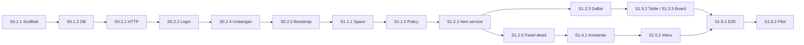

# TASKS — PMS (M0 – M6 dan GA)

| | |
|---|---|
| **Versi** | 0.2 (kolom Status ditambahkan; lihat [HANDOVER.md](HANDOVER.md)) |
| **Fungsi** | Urutan kerja berdasarkan dependensi dan daftar tugas teknis per story. Kriteria penerimaan lengkap ada di [BACKLOG.md](BACKLOG.md); dokumen ini tidak mengulanginya |
| **Aturan ukuran** | Satu tugas ≤ 0.5 hari ideal. Tugas yang lebih besar dipecah sebelum dikerjakan |
| **Cara dipakai** | Kerjakan story sesuai urutan di §1. Saat sebuah story dimulai, jadikan tugasnya **GitHub Issues** (satu issue per story, tugas sebagai checklist, label `M0`/`M1`/`M2` dan nama epic) agar progres terhubung ke commit dan PR. Centang di file ini hanya untuk gambaran awal; sumber kebenaran progres adalah issue |

---

## 1. Urutan eksekusi (dihasilkan dari dependensi)

**Status:** `DRAFT` `PROPOSED` `APPROVED` `IN_PROGRESS` `BLOCKED` `DONE`. `DONE` hanya dengan bukti di [TESTING.md](TESTING.md). Per 13 Nov 2026: seluruh story M0 dan M1 `DONE` kecuali S1.1.4 (`IN_PROGRESS`: required check CI diblokir GitHub, HTTP 403). Status per story M2 ada di tabel di bawah.

Urutan topologis dengan satu developer (tidak paralel), 5 hari kerja per minggu. **Jadwal ini akan bergeser**; kalibrasi ulang setelah M0 selesai.

<!-- SCHEDULE:START -->
| Urutan | Story | Judul | Hari | Hari ke- | Minggu | Status |
|---|---|---|---|---|---|---|
| 1 | S0.1.1 | Kerangka repo dan alur kontrak API | 1.5 | 0–1.5 | 1 | DONE |
| 2 | S0.1.2 | Tooling database dan migrasi identitas | 1.5 | 1.5–3 | 1 | DONE |
| 3 | S0.1.3 | Dockerfile, CI, dan image di GHCR | 1.5 | 3–4.5 | 1 | DONE |
| 4 | S0.2.1 | Platform HTTP | 1 | 4.5–5.5 | 2 | DONE |
| 5 | S0.2.2 | Login, logout, dan session | 1.5 | 5.5–7 | 2 | DONE |
| 6 | S0.2.6 | Email (SMTP + job) | 1 | 7–8 | 2 | DONE |
| 7 | S0.2.3 | Reset dan ganti password | 0.5 | 8–8.5 | 2 | DONE |
| 8 | S0.2.4 | Undangan dan penerimaan undangan | 1 | 8.5–9.5 | 2 | DONE |
| 9 | S0.2.5 | Perintah bootstrap | 0.5 | 9.5–10 | 2 | DONE |
| 10 | S0.3.1 | Setup frontend | 1 | 10–11 | 3 | DONE |
| 11 | S0.3.2 | Layar autentikasi dan shell kosong | 1 | 11–12 | 3 | DONE |
| 12 | S0.4.1 | Compose klien, update, dan backup | 1.5 | 12–13.5 | 3 | DONE |
| 13 | S0.4.2 | Observabilitas | 0.5 | 13.5–14 | 3 | DONE |
| 14 | S0.5.1 | Spike Gantt (SVAR) dan penjadwalan di Go | 1 | 14–15 | 3 | DONE |
| 15 | S1.1.1 | Data Space dan CRUD | 2 | 15–17 | 4 | DONE |
| 16 | S1.1.2 | Paket `policy` (mesin otorisasi) | 3 | 17–20 | 4 | DONE |
| 17 | S1.1.3 | API sharing dan ShareDialog | 3 | 20–23 | 5 | DONE |
| 18 | S1.2.1 | Skema item dan workflow default | 2 | 23–25 | 5 | DONE |
| 19 | S1.2.2 | Item service (create, get, patch) | 4 | 25–29 | 6 | DONE |
| 20 | S1.1.4 | Matriks tes otorisasi | 2 | 29–31 | 7 | IN_PROGRESS |
| 21 | S1.2.3 | Endpoint daftar (children dan root Space) | 2 | 31–33 | 7 | DONE |
| 22 | S1.2.4 | UI pembuatan project, folder, dan task | 2.5 | 33–35.5 | 8 | DONE |
| 23 | S1.2.5 | Panel detail item | 3 | 35.5–38.5 | 8 | DONE |
| 24 | S1.2.6 | Subitem | 1 | 38.5–39.5 | 8 | DONE |
| 25 | S1.3.1 | API view | 1.5 | 39.5–41 | 9 | DONE |
| 26 | S1.3.2 | Table view | 3.5 | 41–44.5 | 9 | DONE |
| 27 | S1.3.3 | Board view | 2.5 | 44.5–47 | 10 | DONE |
| 28 | S1.3.4 | ViewTabs dan pengelolaan view | 1.5 | 47–48.5 | 10 | DONE |
| 29 | S1.4.1 | Komentar dan mention | 2.5 | 48.5–51 | 11 | DONE |
| 30 | S1.4.2 | Lampiran file | 2.5 | 51–53.5 | 11 | DONE |
| 31 | S1.4.3 | Optimistic locking end-to-end | 1 | 53.5–54.5 | 11 | DONE |
| 32 | S1.4.4 | Realtime (SSE) | 2 | 54.5–56.5 | 12 | DONE |
| 33 | S1.5.1 | Sidebar dan navigasi | 1.5 | 56.5–58 | 12 | DONE |
| 34 | S1.5.2 | Notifikasi dan Inbox | 2.5 | 58–60.5 | 13 | DONE |
| 35 | S1.5.3 | My to-do | 1 | 60.5–61.5 | 13 | DONE |
| 36 | S1.5.4 | Pencarian global | 2.5 | 61.5–64 | 13 | DONE |
| 37 | S1.6.1 | Manajemen user dan seat | 3 | 64–67 | 14 | DONE |
| 38 | S1.6.2 | Profil dan pengaturan workspace | 1 | 67–68 | 14 | DONE |
| 39 | S1.7.1 | Soft delete, restore, dan Recycle bin | 2.5 | 68–70.5 | 15 | DONE |
| 40 | S1.8.1 | Tes E2E dan aksesibilitas | 2 | 70.5–72.5 | 15 | DONE |
| 41 | S1.8.2 | Performa dan kesiapan pilot | 1.5 | 72.5–74 | 15 | DONE |
| 42 | S2.1.1 | Work schedule (SET-07) | 2.5 | 74–76.5 | 16 | DONE |
| 43 | S2.1.2 | Dependensi item (data dan API) | 2.5 | 76.5–79 | 16 | DONE |
| 44 | S2.1.3 | Mesin penjadwalan di Go | 4.0 | 79–83 | 17 | DONE |
| 45 | S2.2.1 | Effort dan allocation (TASK-05B) | 2.5 | 83–85.5 | 18 | DONE |
| 46 | S2.2.2 | Progress project (TASK-09) | 2.0 | 85.5–87.5 | 18 | DONE |
| 47 | S2.3.1 | Definisi custom field dan API (TASK-10) | 3.0 | 87.5–90.5 | 19 | DONE |
| 48 | S2.3.2 | Tipe field lengkap (TASK-11A) | 3.0 | 90.5–93.5 | 19 | DONE |
| 49 | S2.4.1 | Tipe view Gantt dan Calendar | 1.0 | 93.5–94.5 | 19 | DONE |
| 50 | S2.4.2 | Gantt: bar, progres, drag/resize, milestone (VIEW-05A) | 4.0 | 94.5–98.5 | 20 | DONE |
| 51 | S2.4.3 | Gantt: dependensi dan penjadwalan (VIEW-05B) | 3.0 | 98.5–101.5 | 21 | DONE |
| 52 | S2.3.3 | Custom field di panel, Table, Board, dan pemilih kolom (VIEW-09) | 3.0 | 101.5–104.5 | 21 | DONE |
| 53 | S2.5.1 | Board swimlane dan field kartu (VIEW-03, VIEW-04) | 3.0 | 104.5–107.5 | 22 | DONE |
| 54 | S2.5.2 | Calendar (VIEW-06) | 2.5 | 107.5–110 | 22 | DONE |
| 55 | S2.5.3 | Preset filter dan sort Space (SPC-03) | 1.5 | 110–111.5 | 23 | DONE |
| 56 | S2.5.4 | UI multi-lokasi (SPC-10) | 1.5 | 111.5–113 | 23 | DONE |
| 57 | S2.6.1 | E2E, aksesibilitas, dan performa M2 | 2.0 | 113–115 | 23 | DONE |
| 58 | S3.1.1 | Editor workflow dan status (WF-02, WF-03A) | 4 | 115–119 | 24 | DONE |
| 59 | S3.2.1 | Approval pada item (SPC-12) | 3.5 | 119–122.5 | 25 | DONE |
| 60 | S3.2.2 | Blueprint (SPC-13) | 3 | 122.5–125.5 | 26 | DONE |
| 61 | S3.3.1 | Skema form dan API pembuat form (FORM-01, FORM-02) | 3.5 | 125.5–129 | 26 | DONE |
| 62 | S3.3.2 | UI form builder | 4 | 129–133 | 27 | DONE |
| 63 | S3.3.3 | Sharing form dan Manage forms (FORM-03, FORM-05) | 2 | 133–135 | 28 | DONE |
| 64 | S3.3.4 | Submit form internal menjadi item (FORM-06) | 2.5 | 135–137.5 | 28 | DONE |
| 65 | S3.3.5 | Form publik dan keamanan (SEC-05) | 3 | 137.5–140.5 | 29 | DONE |
| 66 | S3.3.6 | Pelacakan request (FORM-08) | 2.5 | 140.5–143 | 29 | DONE |
| 67 | S3.4.1 | Kustomisasi sidebar (NAV-02) | 1.5 | 143–144.5 | 29 | DONE |
| 68 | S3.4.2 | Stream aktivitas (NAV-04) | 2.5 | 144.5–147 | 30 | DONE |
| 69 | S3.4.3 | Halaman hasil pencarian (NAV-07) | 2 | 147–149 | 30 | DONE |
| 70 | S3.5.1 | 2FA TOTP (AUTH-05) | 3 | 149–152 | 31 | DONE |
| 71 | S3.6.1 | E2E, aksesibilitas, dan keamanan M3 | 2 | 152–154 | 31 | DONE |
| 72 | S4.1.1 | Skema time entry dan API | 2.5 | 154–156.5 | 32 | DONE |
| 73 | S4.1.2 | Timesheet mingguan (TASK-13) | 3.5 | 156.5–160 | 33 | DONE |
| 74 | S4.1.3 | Timelog view (VIEW-07) | 2.5 | 160–162.5 | 33 | DONE |
| 75 | S4.2.1 | Budget project (TASK-12) | 1.5 | 162.5–164 | 33 | DONE |
| 76 | S4.3.1 | Export project ke Excel (SPC-15) | 2.5 | 164–166.5 | 34 | DONE |
| 77 | S4.3.2 | Import dari Excel (SPC-15) | 3 | 166.5–169.5 | 34 | DONE |
| 78 | S4.4.1 | E2E dan regresi M4 | 1.5 | 169.5–171 | 35 | DONE |
| 79 | S5.1.1 | Skema dashboard dan widget (DASH-01, DASH-06) | 3 | 171–174 | 35 | DONE |
| 80 | S5.1.2 | Mesin data widget (DASH-02) | 4 | 174–178 | 36 | DONE |
| 81 | S5.1.3 | Widget daftar task dan template (DASH-01, DASH-02) | 3 | 178–181 | 37 | DONE |
| 82 | S5.1.4 | Widget visual (DASH-03A) | 4 | 181–185 | 38 | DONE |
| 83 | S5.1.5 | UI dashboard | 3 | 185–188 | 38 | DONE |
| 84 | S5.2.1 | Skema report dan daftar report (RPT-03) | 2.5 | 188–190.5 | 39 | DONE |
| 85 | S5.2.2 | Editor dan eksekusi report (RPT-02) | 4 | 190.5–194.5 | 39 | DONE |
| 86 | S5.2.3 | Template report (RPT-01) | 3 | 194.5–197.5 | 40 | DONE |
| 87 | S5.3.1 | Uji kecocokan angka dan E2E | 2.5 | 197.5–200 | 41 | DONE |
| 88 | S6.1.1 | Template Space (SPC-18) | 4 | 200–204 | 41 | IN_PROGRESS |
| 89 | S6.1.2 | Wizard first-run (AUTH-07) | 2.5 | 204–206.5 | 42 | IN_PROGRESS |
| 90 | S6.2.1 | Pengaturan workspace per user dan info akun (SET-03, SET-04) | 2 | 206.5–208.5 | 42 | IN_PROGRESS |
| 91 | S6.2.2 | Preferensi email notifikasi (SET-05) | 2 | 208.5–210.5 | 43 | IN_PROGRESS |
| 92 | S6.2.3 | Kosongkan Recycle bin (BIN-03) | 1 | 210.5–211.5 | 43 | IN_PROGRESS |
| 93 | S6.3.1 | Prosedur penghentian instance (USR-04) | 1.5 | 211.5–213 | 43 | IN_PROGRESS |
| 94 | S6.3.2 | Uji restore terhadap RTO (OPS-01) | 2 | 213–215 | 44 | IN_PROGRESS |
| 95 | S6.3.3 | Uji keamanan internal | 4 | 215–219 | 44 | IN_PROGRESS |
| 96 | S6.3.4 | Uji performa target NFR | 2.5 | 219–221.5 | 45 | IN_PROGRESS |
| 97 | S6.3.5 | UAT P0 + P1 dan lima flow Playwright | 3 | 221.5–224.5 | 45 | IN_PROGRESS |
| 98 | S6.3.6 | Perbaikan bug dan stabilisasi | 3 | 224.5–227.5 | 46 | IN_PROGRESS |
| 99 | GA.1 | Deploy instance klien pertama | 2 | 227.5–229.5 | 46 | PROPOSED |
| 100 | GA.2 | Migrasi data pilot | 2 | 229.5–231.5 | 47 | PROPOSED |
| 101 | GA.3 | Dokumentasi user | 2.5 | 231.5–234 | 47 | PROPOSED |
| 102 | GA.4 | Pelatihan dan serah terima | 1.5 | 234–235.5 | 48 | PROPOSED |
<!-- SCHEDULE:END -->

**Gelombang M2.** Gelombang berjalan berurutan; story yang tidak saling bergantung di dalam satu gelombang boleh paralel hanya oleh sesi terpisah dengan kepemilikan file yang jelas. `api/openapi.yaml`, nomor migrasi, `schedule`, dan `items/patch.go` dipegang satu sesi pada satu waktu.

| Gelombang | Story | Hari |
|---|---|---|
| A. Fondasi data | S2.1.1, S2.1.2, S2.3.1, S2.4.1 | 9 |
| B. Logika inti | S2.1.3, S2.2.1, S2.3.2 | 9.5 |
| C. Gantt dan field di tampilan | S2.2.2 → S2.4.2, S2.3.3 | 9 |
| D. Fitur turunan | S2.4.3, S2.5.1, S2.5.2, S2.5.3, S2.5.4 | 11.5 |
| E. Penutup | S2.6.1 | 2 |

Aturan: S2.1.3 titik risiko tertinggi (tes tabel ≥ 20 kasus lebih dulu, review independen, jangan mulai S2.4.3 sebelum benchmark 500 task lulus); ukur SVAR dengan 500 task di awal S2.4.2; setiap akhir gelombang jalankan seluruh suite Go dengan PostgreSQL nyata dan catat di TESTING; kalibrasi estimasi 41 hari setelah gelombang A. Jalur kritis M2: S2.1.1 → S2.1.2 → S2.1.3 → S2.4.2 → S2.4.3 → S2.6.1.

**Cakupan M3–GA (ditambahkan 13 Nov 2026).** Story M3 sampai GA di bawah baru berisi tugas teknis dan estimasi kasar; kriteria penerimaan lengkap ditulis di [BACKLOG.md](BACKLOG.md) saat milestone dimulai, dan estimasi dikalibrasi ulang dari kecepatan nyata M2. Total estimasi: M3 39 hari (rencana PRD 25), M4 17 (15), M5 29 (25), M6 27.5 (20), GA 8 (5), jadi **120.5 hari** melawan 90 hari di PRD (selisih +30.5). Selisih ini belum diputuskan.

## 2. Jalur kritis

Hal yang paling menentukan jadwal: **S1.1.2 (policy)** dan **S1.2.2 (item service)**. Keduanya dipakai hampir semua story berikutnya dan kesalahan desain di sini mahal diperbaiki; sediakan waktu review ekstra dan tulis tesnya lebih dulu.

## 3. Risiko jadwal yang perlu dipantau

| Risiko | Sinyal awal | Tindakan |
|---|---|---|
| Estimasi M1 terlalu rendah | Story M0 melewati estimasi > 20% | Pakai kecepatan nyata untuk menghitung ulang M1 sebelum S1.1.1 dimulai (lihat BACKLOG, bagian selisih) |
| `policy` ternyata lambat | p95 daftar > 300 ms pada data uji (S1.2.3) | Aktifkan rencana tabel closure (ARCHITECTURE §13) |
| SVAR tidak cukup | Hasil spike S0.5.1 negatif | Putuskan SVAR PRO atau library lain **sebelum** M2 direncanakan |
| Penjadwalan berantai lebih rumit dari spike (SS/FF/SF, lag negatif, libur) | Tabel kasus S2.1.3 terus bertambah | Tes tabel lebih dulu; batasi ke aturan M2-3; jangan tambah mode jadwal lain |
| SVAR MIT kurang untuk 500 task atau dependensi | Drag/link berhenti bekerja pada 500 task (S2.4.2) | Ukur di awal S2.4.2; fallback: tampilan baca-saja + edit lewat panel, catat sebagai keputusan baru |
| Filter/sort custom field lambat di `jsonb` | p95 Table > 1 detik di 500 item (S2.3.3) | Indeks ekspresi per tipe populer; ukur sebelum memilih |
| Perubahan jadwal berantai memicu banyak event SSE dan konflik versi | Toast konflik sering muncul saat dua orang mengedit | Satu event ringkas per transaksi (`affected_items`) |
| Estimasi M2 41 hari melebihi 30 hari rencana | Story pertama M2 melewati estimasi > 20% | Hitung ulang dari kecepatan nyata; tawarkan penundaan SPC-10 dan sebagian VIEW-04 |
| Bug popup Base UI | Dialog/menu gagal di browser nyata | Uji klik nyata di Playwright sejak S0.3.2 (DESIGN_SYSTEM §4.3) |

---

# 4. Tugas per story

## M0

### E0.1 Fondasi repo dan pipeline

**S0.1.1 Kerangka repo dan alur kontrak API**
- [x] Inisialisasi `server/` (go mod, `cmd/pms`), `web/` (Vite + TS), `Makefile` (`dev`, `gen`, `test`, `lint`)
- [x] Salin `api/openapi.yaml` (sudah ada) dan pasang `oapi-codegen` (konfigurasi strict server) + `openapi-typescript`
- [x] Tes `go list` untuk aturan ketergantungan paket; langkah CI "generate lalu `git diff --exit-code`"
- [x] Halaman hello memanggil `/healthz` lewat klien hasil generate

**S0.1.2 Tooling database dan migrasi identitas**
- [ ] Pool `pgx`, konfigurasi `sqlc` (`queries/`, `gen/`), runner goose tertanam di `pms migrate`
- [ ] Migrasi `0001_extensions` dan `0002_identity` (`account`, `users`, `sessions`, `user_tokens`)
- [ ] `readyz` memeriksa versi migrasi terbaru; tes migrasi maju pada database kosong di CI
- [ ] Helper tes: database sementara per paket tes (template DB + clone)

**S0.1.3 Dockerfile, CI, dan image di GHCR**
- [x] Dockerfile multi-stage (build web → build Go dengan `go:embed` → image minimal, user non-root)
- [x] Workflow Actions: lint, typecheck, `go test` + service Postgres, build; cache modul
- [x] Job rilis pada tag `v*` → push `ghcr.io/anissaefuddin/pms:<versi>` (private)
- [ ] Verifikasi: image berjalan dan melayani SPA + `/api/v1/healthz`

**S0.2.1 Platform HTTP**
- [ ] Router `net/http` + middleware: request ID, log `slog`, recover, batas body, cek `Origin`
- [ ] Penulis error `problem+json` + pemetaan `code` (WORKFLOWS §10)
- [ ] Loader konfigurasi env dengan validasi dan pesan galat jelas
- [ ] Tes middleware (Origin salah → 403, panic → 500 dengan `request_id`)

**S0.2.2 Login, logout, dan session**
- [ ] Hash argon2id + kebijakan password (≥ 8, daftar password umum)
- [ ] Tabel/query session: buat, rotasi, perbarui `last_seen` (≤ 1×/5 menit), cabut
- [ ] Endpoint `login`/`logout`/`me` + middleware autentikasi
- [ ] Rate limit memori per IP dan per email (+ komentar `shortcut:`)
- [ ] Tes: kedaluwarsa idle/absolut, pesan error seragam, rotasi ID

**S0.2.3 Reset dan ganti password**
- [ ] `forgot` (202 seragam) dan `reset` (token sekali pakai, cabut semua session)
- [ ] `change` (cabut session lain, rotasi session ini) + tes

**S0.2.4 Undangan dan penerimaan undangan**
- [ ] Pembuat token undangan + `GET /auth/invitations/{token}`
- [ ] `accept`: aktivasi, hash password, buat Personal space, buat session
- [ ] Tes: token kedaluwarsa, token terpakai (410), password lemah (422)

**S0.2.5 Perintah bootstrap**
- [ ] `pms bootstrap`: account, admin `invited`, workflow dan status default, Space "General"
- [ ] Idempoten + kode keluar ≠ 0 bila admin sudah ada; cetak link bila SMTP kosong
- [ ] Tes dua kali jalan

**S0.2.6 Email (SMTP + job)**
- [ ] Pasang River + migrasi River; klien SMTP; mode `log`
- [ ] Job `send_email` dengan retry; template `en` (undangan, reset)
- [ ] Tes dengan server SMTP tiruan

**E0.3** · **S0.3.1 Setup frontend**
- [ ] TanStack Router/Query, react-i18next (`en`), Tailwind v4, `data-brand`/`data-density`, mode gelap
- [x] Salin komponen `ui-kit`; ganti `LinkButton` ke adapter TanStack; font lokal
- [x] ESLint `no-literal-string`; Playwright + `axe` terpasang

**S0.3.2 Layar autentikasi dan shell kosong**
- [ ] Login, Forgot, Reset, Accept invitation, `/settings/security`
- [ ] Shell: sidebar + topbar + menu profil/logout; `?next=` hanya path internal
- [ ] Tes Playwright klik nyata untuk menu profil

**E0.4** · **S0.4.1 Compose klien, update, dan backup**
- [ ] `deploy/docker-compose.yml` + `.env.example` + label Traefik
- [ ] `update.sh` (backup pre-deploy → pull → up → tunggu `/readyz`)
- [ ] `backup.sh` (dump lalu file, retensi 14 hari, salin keluar) dan `restore.sh`
- [ ] Uji restore penuh pada instance uji; catat waktu terhadap RPO/RTO

**S0.4.2 Observabilitas**
- [ ] Metrik ARCHITECTURE §11 di `/metrics`; metrik `backup_last_success_timestamp` dari script
- [ ] Provisioning alert Grafana (5xx, job gagal, backup basi, disk)

**E0.5** · **S0.5.1 Spike Gantt dan penjadwalan**
- [x] Halaman SVAR dengan ±200 task dan dependensi dummy
- [x] Fungsi Go geser penerus FS dengan hari kerja Senin–Jumat + 3 tes
- [x] Tulis catatan keputusan di `docs/`

## M1

### E1.1 Space dan otorisasi

**S1.1.1 Data Space dan CRUD**
- [ ] Migrasi `spaces`, `shares`, `groups`, `group_members` + trigger validasi target share
- [ ] Query sqlc dan service Space; endpoint `/spaces*`
- [ ] Personal space saat aktivasi; guard hapus/bagikan

**S1.1.2 Paket `policy`**
- [x] Definisi tunggal matriks (share role, user type, kemampuan) sebagai data
- [x] Query CTE rekursif akses (leluhur lewat semua lokasi + share user/grup)
- [x] `Can()` + filter SQL untuk daftar; aturan 404 vs 403
- [x] Tes unit tabel-driven untuk seluruh kombinasi matriks

**S1.1.3 API sharing dan ShareDialog**
- [x] `GET/PUT` shares Space dan item (+ share diwarisi dengan asal)
- [x] ShareDialog (cari, role, peringatan hapus akses sendiri)
- [x] Alur "undang sebagai external" dari dialog (admin)

**S1.1.4 Matriks tes otorisasi**
- [x] Matriks 5 tipe × 4 role × 4 jalur untuk GET, PATCH, create subtask, dan DELETE Item pada endpoint nyata
- [x] Tes batas visibilitas Item dan Item di Personal Space
- [x] Tes batas visibilitas file, komentar, dan lampiran
- [ ] Jadikan langkah CI yang memblokir merge. GitHub menolak akses pengaturan required check pada paket repo privat saat ini (HTTP 403).

### E1.2 Item inti

**S1.2.1 Skema item dan workflow default**
- [ ] Migrasi `workflows`, `statuses`, `items`, `item_locations`, assignees, followers
- [ ] Trigger anti-siklus + tes; indeks DATABASE §4
- [ ] Seed workflow default lewat bootstrap

**S1.2.2 Item service**
- [x] `POST/GET/PATCH/DELETE /items` + optimistic locking (`If-Match`, 409/428)
- [x] `activity` dalam transaksi yang sama; follower otomatis
- [x] Aturan status (`completed_at`), validasi tanggal, assignee aktif
- [x] `reorder` dengan `rank` fractional
- [x] Tes konflik versi dan rollback ketika penulisan activity gagal

**S1.2.3 Endpoint daftar**
- [x] `/spaces/{id}/items` dan `/items/{id}/children` (filter, sort, kursor)
- [x] Data uji 500 item; p95 80 ms pada HTTP lokal dengan 200 Item per halaman

**S1.2.4 UI pembuatan project, folder, dan task**
- [x] Picker Space/container, kalender hari kerja, owner, default view, dan sharing di modal Create Item
- [x] Create task dari tombol **+** global. Entry point Table dan Board mengikuti S1.3.2–S1.3.3
- [x] Validasi nama dan pemetaan error server terstruktur ke field

**S1.2.5 Panel detail item**
- [x] Panel samping dengan `?task=` dan halaman `/tasks/$itemId`
- [x] StatusPicker, AssigneePicker, dan kalender hari kerja
- [x] Judul inline, deskripsi TipTap tersimpan saat kehilangan fokus, dan menu ⋯
- [x] Kontrol berdasarkan `my_capabilities`, PATCH dengan ETag, dan tes browser

**S1.2.6 Subitem**
- [x] Daftar, "Add subitem", dan navigasi kembali ke induk
- [x] Jumlah subitem pada baris yang tersedia. Form membuat Item baru dengan parent tetap, dan siklus lokasi diuji pada PostgreSQL
- [x] Tampilkan jumlah subitem pada kartu Board. Playwright memverifikasi angka pada kartu

### E1.3 View

**S1.3.1 API view**
- [ ] Migrasi `views`; CRUD, duplicate, default unik per scope
- [ ] Pembuatan view bawaan saat container dibuat

**S1.3.2 Table view**
- [ ] DataTable (TanStack Table + Virtual) dengan hierarki expand/collapse
- [ ] Edit inline sel; baris "+ Item"
- [ ] Reorder drag + "Move to…"; navigasi keyboard
- [ ] Filter/sort/group di URL; ukur 500 item

**S1.3.3 Board view**
- [ ] Kolom dari workflow; BoardCard (dnd-kit) + sensor keyboard
- [ ] Drag ubah status optimistis + rollback + toast
- [ ] "+ Add" per kolom

**S1.3.4 ViewTabs dan pengelolaan view**
- [ ] Menu per view (copy link, rename, duplicate, default, urut, hapus)
- [ ] Tes membuka URL tersalin memulihkan tampilan

### E1.4 Kolaborasi

**S1.4.1 Komentar dan mention**
- [x] Skema `comments`, `comment_mentions`; validator JSON ProseMirror (allowlist node/mark)
- [x] Endpoint komentar + ekstraksi mention
- [x] CommentThread + editor mention; tes XSS

**S1.4.2 Lampiran file**
- [x] Interface `Storage` + `LocalStorage` (+ komentar `shortcut:`)
- [x] Upload: batas ukuran, deteksi tipe, tolak executable, SHA-256, nama acak
- [x] Download berizin + header aman; FileDropzone + batas ukuran dan pesan penolakan
- [x] Tes file palsu (`.png` berisi ELF)

**S1.4.3 Optimistic locking end-to-end**
- [x] ConflictBanner + draf lokal + Reapply dan Discard; rollback dan toast untuk status
- [x] Tes E2E dua sesi

**S1.4.4 Realtime (SSE)**
- [x] Hub memori, heartbeat, `Last-Event-ID`, `resync`
- [x] Publikasi event setelah commit; izin penerima diperiksa saat pengiriman dan replay
- [x] `lib/realtime.ts` + invalidasi query + indikator koneksi
- [x] Tes E2E ≤ 3 detik

### E1.5 Navigasi dan pencarian

**S1.5.1 Sidebar dan navigasi**
- [x] Pohon Space/project/folder, Personal, Shared with me (`/me/shared`), serta rute Recycle bin melalui More. Daftar dan restore Recycle bin mengikuti S1.7.1.
- [x] Ciut/lebar per user, navigasi keyboard, dan Space terakhir dengan fallback Personal
- [x] `account_name` di `Me`, banner sesi kedaluwarsa, dan `Retry-After` pada 429 autentikasi

**S1.5.2 Notifikasi dan Inbox**
- [x] Migrasi `notifications`; pembuat notifikasi mengikuti WORKFLOWS §6
- [x] Inbox dengan filter Unread only, Mark all as read, Archive all, dan badge realtime
- [x] Job email transaksional untuk event selain komentar biasa

**S1.5.3 My to-do**
- [x] `GET /me/todo` dan UI dengan filter, sort, pagination, dan perubahan status ber-ETag

**S1.5.4 Pencarian global**
- [x] Kolom `tsvector` + indeks GIN; query berfilter akses
- [x] CommandPalette + `/search`; scope Everywhere, Space, dan Project
- [x] p95 HTTP lokal 46,18 ms pada 10.000 Item dan 500 komentar

### E1.6 Admin user

**S1.6.1 Manajemen user dan seat**
- [x] Invite/resend/deactivate/reactivate/ubah type + guard `last_admin` + hitung seat
- [x] UI Users + Groups + ringkasan seat; matriks `/settings/users/types`
- [x] Tes `seats_exhausted`, `last_admin`, pencabutan sesi, dan pembuatan token oleh worker undangan

**S1.6.2 Profil dan pengaturan workspace**
- [x] `GET/PATCH /me`; halaman profil, density, tema, dan pintasan komentar
- [x] Format tanggal, angka, zona waktu, dan awal minggu diterapkan di UI

### E1.7 Recycle bin

**S1.7.1 Soft delete, restore, dan Recycle bin**
- [x] Hapus kaskade dengan `deleted_root_id`; restore + fallback ke root Space
- [x] Halaman Recycle bin + toast Undo 8 detik
- [x] Item terhapus dikecualikan dari pencarian/to-do/notifikasi; tes multi-lokasi

### E1.8 Hardening dan kesiapan pilot

**S1.8.1 Tes E2E dan aksesibilitas**
- [x] 5 alur Playwright dengan PostgreSQL (login, buat proyek, buat task, drag status, komentar+mention → Inbox)
- [x] `axe` pada layar utama terang/gelap; workflow CI setiap PR

**S1.8.2 Performa dan kesiapan pilot**
- [x] Data uji 500/10 ribu item; p95 dicatat di TESTING
- [x] [Runbook pilot](PILOT_RUNBOOK.md) mencakup bootstrap, update, backup, restore, rotasi kunci, dan seat
- [x] Triase pilot dan latihan rollback DB + file; regresi otorisasi dan pemulihan lulus pada fixture

## M2

### E2.1 Jadwal dan dependensi

**S2.1.1 Work schedule (SET-07)**
- [x] `openapi.yaml`: `GET/PUT /settings/work-schedule`
- [x] Migrasi `work_schedules` (satu baris per account) dan `work_schedule_exceptions` (tanggal, nama)
- [x] Paket `schedule`: kalender dari data (ganti asumsi Senin–Jumat tetap)
- [x] Endpoint dan tes otorisasi (admin tulis, semua baca)
- [x] Layar pengaturan + tes Playwright

**S2.1.2 Dependensi item (data dan API)**
- [x] `openapi.yaml`: `GET/POST /items/{id}/dependencies`, `DELETE /dependencies/{id}`
- [x] Migrasi `00016` menambah `item_dependencies`, unik per pasangan terarah dan CHECK bukan diri sendiri
- [x] Deteksi siklus (CTE rekursif) dalam transaksi Serializable
- [x] Policy: butuh hak edit pada penerus dan hak lihat pada pendahulu
- [x] Tes integrasi PostgreSQL untuk izin, siklus, request bersamaan, soft delete, dan restore

**S2.1.3 Mesin penjadwalan di Go**
- [x] Mesin menangani empat tipe, lag bertanda, hari kerja/libur, milestone, dan tanggal parsial dalam ≥ 20 kasus tabel
- [x] Propagasi topologis memeriksa semua pendahulu aktif. Siklus pada data menyebabkan rollback
- [x] PATCH Item serta POST/PATCH dependensi menyimpan pergeseran, versi, dan aktivitas dalam satu transaksi. PATCH Item tetap memakai `If-Match`
- [x] Respons dan SSE mengirim `affected_items` sesuai izin baca. Satu event SSE diterbitkan setelah commit
- [x] PostgreSQL menguji konflik edit bersamaan dan p95 ≤ 300 ms pada rantai 500 task
- [x] Implementasi D-37/M2-2 dan D-38/M2-3 dicatat di `DECISIONS.md`

### E2.2 Effort dan progress

**S2.2.1 Effort dan allocation (TASK-05B)**
- [x] OpenAPI dan binding Go/TypeScript memuat `effort_minutes`, alokasi per assignee, dan `recalculate_duration`
- [x] Migrasi `00019` menambah kolom nullable dan CHECK nilai nonnegatif serta pasangan unit/nilai
- [x] `schedule.EffortDuration` memakai kapasitas workspace dan membulatkan ke atas. Tes unit dan PostgreSQL lulus
- [x] Panel Item mendukung jam, persen, jam/hari, peringatan di atas 100%, dan hitung ulang eksplisit. Tes Playwright lulus

**S2.2.2 Progress project (TASK-09)**
- [x] Aturan perhitungan, batas hari risiko, dan cakupan lokasi ditulis di `WORKFLOWS.md` §1.1
- [x] Migrasi `00021` menyimpan metode Project dan persen manual Task. API menghitung persen dan risiko Project saat baca
- [x] Tes tabel tiga metode, kasus kosong, ambang risiko, dan tes PostgreSQL untuk izin serta jalur lokasi
- [x] Panel Project dan baris Table menampilkan progres dan risiko. Panel Task menyimpan persen manual dengan `If-Match`

### E2.3 Custom field

**S2.3.1 Definisi custom field dan API (TASK-10)**
- [x] `openapi.yaml`: `/spaces/{id}/custom-fields` dan `fields` pada PATCH item
- [x] Migrasi `00017` menambah `custom_fields` (space, nama, tipe, opsi jsonb, posisi, arsip)
- [x] Validasi nilai pada PATCH item dalam transaksi yang sama dengan `If-Match`
- [x] Pengelolaan memerlukan akses penuh di Space. Nilai dibatasi ke lokasi Space yang terlihat pada item.
- [x] Dialog pengelolaan dari Space actions dan tes PostgreSQL/Chrome

**S2.3.2 Tipe field lengkap (TASK-11A)**
- [x] Migrasi `00020`, OpenAPI, dan validator untuk sepuluh tipe, dengan tes tabel untuk batas dan nilai kosong
- [x] Format dan parsing locale dengan `Intl`, diuji untuk id-ID dan en-US
- [x] Editor nilai per tipe memakai `ui-kit`, terhubung ke panel Item dengan `If-Match`
- [x] Definisi menyimpan marker berurutan dan agregasi default. Panel menerapkan marker pertama yang cocok. Fungsi agregasi numerik diuji untuk konsumen view
- [x] Chrome menguji Currency dan People dengan mock serta API Go dan PostgreSQL nyata

**S2.3.3 Custom field di panel, Table, Board, dan pemilih kolom (VIEW-09)**
- [x] Pemilih kolom (Management, Schedule, Other, Custom fields; Baselines nonaktif "Coming soon") dan penyimpanan di `views.config.columns`
- [x] Filter/sort server untuk `fields`: `sort=field:<id>` dan `field=<id>:<nilai>` (tanpa indeks tambahan, diukur). Multi select dan People tidak bisa diurut, People tidak punya filter di UI
- [x] Render dan edit sel per tipe di Table (dialog editor yang sama dengan panel)
- [x] Panel detail memuat semua field Space (S2.3.1/S2.3.2). Board menampilkan field yang dipilih pada kartu
- [x] Ukur 500 item dan catat di TESTING (sisi server; Table tetap virtual)

### E2.4 Gantt

**S2.4.1 Tipe view Gantt dan Calendar**
- [x] Migrasi maju `00018` menambah `gantt` dan `calendar` pada enum `view_type` tanpa mengubah baris atau aturan seed yang ada
- [x] OpenAPI, tipe klien dan sqlc diperbarui. `TestViewLifecycle` mencakup izin, duplikasi, rename, default, dan hapus untuk kedua tipe
- [x] ViewTabs menawarkan Gantt dan Calendar. Chrome memverifikasi pembuatan view public dan personal serta placeholder setelah reload

**S2.4.2 Gantt: bar, progres, drag/resize, milestone (VIEW-05A)**
- [x] Adaptor data Item → SVAR dan kembali (tanggal sebagai `YYYY-MM-DD`, tengah malam lokal, tanpa zona waktu). SVAR hanya melaporkan sisi yang digeser dan `diff` hari, tanggal baru dihitung dari item
- [x] Hierarki, lipat/buka, skala hari/minggu/bulan, sorotan hari ini
- [x] Drag/resize → PATCH `If-Match`. Layar berubah hanya setelah respons server, gagal (409/403) menyisakan bar semula dan toast
- [x] Mode baca untuk pengguna tanpa hak edit (`readonly` pada library)
- [x] Ukur 500 task (Chrome) dan catat
- [x] Navigasi keyboard dan axe (panah memilih, kiri/kanan menggeser sehari, Shift mengubah tanggal selesai)

**S2.4.3 Gantt: dependensi dan penjadwalan (VIEW-05B)**
- [x] Render link dari `POST /dependencies/query` (satu request untuk seluruh pohon) dan pemilih tipe di panel pendahulu. Lag belum bisa diubah di UI
- [x] Buat dengan klik pegangan bar (atau form panel yang bisa dipakai keyboard), ubah tipe, dan hapus lewat API. Bar penerus mengikuti data server setelah daftar dibaca ulang
- [x] Penjadwalan otomatis SVAR mati (`schedule.auto=false`), jadwal hanya dari backend
- [x] Tes Playwright: link, tipe, hapus, tambah pendahulu menggeser penerus, siklus ditolak dengan pesan server
- [x] Realtime: event SSE membuat query link ikut dibaca ulang (tanpa tes dua browser)

### E2.5 View lain dan Space

**S2.5.1 Board swimlane dan field kartu (VIEW-03, VIEW-04)**
- [x] Pengelompokan di klien (Board memuat satu daftar per Space/project)
- [x] Konfigurasi kartu di `views.config.columns` dan tombol "Card fields"
- [x] `days in status` dari kolom baru `items.status_changed_at` (migrasi `00022`), bukan riwayat aktivitas. Sampul dari `cover_attachment_id`
- [x] Tes Playwright untuk swimlane, drag lintas lajur dengan konfirmasi, dan pemilih kartu

**S2.5.2 Calendar (VIEW-06)**
- [x] Kalender bulanan dengan CSS grid, tanpa dependensi baru. Awal pekan dari profil, libur dan hari non-kerja dari work schedule
- [x] Memuat seluruh item daftar Space (bukan per rentang bulan), sama seperti Table dan Board
- [x] Drag → PATCH (penerus digeser server). Alt+panah menggeser sehari atau seminggu. Daftar Unscheduled
- [x] Tes Playwright dan axe

**S2.5.3 Preset filter dan sort Space (SPC-03)**
- [x] Migrasi kolom `importance` (`00023`, D-36) dan pemilih di panel detail
- [x] Sort `priority`, `importance`, `predecessors` di endpoint daftar dan `openapi.yaml`. Preset memakai `status_group` dan `assignee` yang sudah ada
- [x] UI preset (Table, Board, Calendar), sort Priority dan Importance tampil di My to-do, tes

**S2.5.4 UI multi-lokasi (SPC-10)**
- [x] Server: `PUT /items/{id}/locations` (ada di kontrak tetapi belum diimplementasi) menggantikan lokasi yang terlihat. Lokasi tersembunyi dipertahankan
- [x] Pemilih tujuan hanya menampilkan Space dengan hak Create dan project di dalamnya. Lokasi terakhir tidak bisa dihapus, siklus ditolak
- [x] Tes Playwright dan tes otorisasi lokasi (`TestReplaceItemLocations`)

### E2.6 Hardening

**S2.6.1 E2E, aksesibilitas, dan performa M2**
- [x] Tiga alur Playwright dengan Go API dan PostgreSQL (`TestBrowserM2Flows`, `m2-live.spec.ts`), masuk CI
- [x] Perluasan matriks otorisasi (`TestM2AuthorizationMatrix`: dependensi, custom field, lokasi, importance, IDOR)
- [x] Benchmark dan pencatatan p95 di TESTING
- [x] Perbarui `PILOT_RUNBOOK.md`, `TESTING.md`, `HANDOVER.md`. Gantt kini juga menampilkan custom field sebagai kolom

## M3

### E3.1 Workflow

**S3.1.1 Editor workflow dan status (WF-02, WF-03A)**
- [x] `openapi.yaml`: CRUD workflow dan status, `auto_assign`, daftar transisi, opsi `locked`
- [x] Migrasi kolom status (auto-assign, transisi, lock) dan tabel `status_transitions`; aman untuk data M1
- [x] Terapkan transisi di `PATCH /items/{id}` dan drag Board: transisi tak sah 422 dengan pesan jelas
- [x] Auto-assign saat masuk status (pengguna yang mengubah atau assignee tetap) dicatat di aktivitas
- [x] UI editor workflow: grup Active/Completed/Deferred/Cancelled, warna dari palet token, urutkan, hapus dengan pemindahan item
- [x] Tes: matriks transisi, lock, hapus status yang dipakai, dan otorisasi (hanya admin Space)

### E3.2 Approval dan blueprint

**S3.2.1 Approval pada item (SPC-12)**
- [x] `openapi.yaml`: `/items/{id}/approvals`, keputusan approve/reject dengan komentar
- [x] Migrasi `approvals` dan `approval_approvers` (keputusan per approver); penghitung (0/2) dihitung di server
- [x] Approver menerima notifikasi dan Inbox; hasil hanya dicatat, tidak mengubah status (D-41)
- [x] Policy: hanya approver yang memutuskan; keputusan boleh diubah, penghapusan approver menghapus keputusannya (tanpa reset otomatis)
- [x] UI panel approval dan tes otorisasi + Playwright

**S3.2.2 Blueprint (SPC-13)**
- [x] `openapi.yaml`: simpan item sebagai blueprint dan buat item dari blueprint
- [x] Migrasi `blueprints` (struktur item jsonb dengan status, assignee, tanggal relatif)
- [x] Pembuatan item dari blueprint dalam satu transaksi (hierarki, dependensi, field kustom)
- [x] UI simpan dan pakai blueprint; tes bahwa hasil tidak berbagi data dengan sumber

### E3.3 Formulir permintaan

**S3.3.1 Skema form dan API pembuat form (FORM-01, FORM-02)**
- [x] `openapi.yaml`: CRUD form, halaman, pertanyaan, response settings
- [x] Migrasi `request_forms` (definisi dan pengaturan respons sebagai jsonb tervalidasi), `form_submissions`
- [x] Validasi definisi: tipe pertanyaan, field wajib, multi-halaman, section header
- [x] Response settings: buat task/project, status awal, lokasi, assign to, buat approval
- [x] Tes integrasi dan otorisasi

**S3.3.2 UI form builder**
- [x] Editor pertanyaan dengan drag urutan dan pratinjau (semua tipe FORM-01)
- [x] Multi-halaman dan section header; pengaturan wajib per pertanyaan
- [x] Layar response settings dan penyimpanan dengan `If-Match`
- [x] Aksesibilitas keyboard dan axe; tes Playwright

**S3.3.3 Sharing form dan Manage forms (FORM-03, FORM-05)**
- [x] Akses internal (seluruh akun) dan eksternal (tautan publik dengan token acak)
- [x] Halaman Manage forms: nama, milik, akses, tautan, diubah oleh
- [x] Cabut dan rotasi tautan publik; tes bahwa tautan lama ditolak

**S3.3.4 Submit form internal menjadi item (FORM-06)**
- [x] Pemilih form di menu dan layar pengisian; validasi di server
- [x] Endpoint submit membuat item sesuai response settings dalam satu transaksi
- [x] Lampiran dari form memakai batas dan penyimpanan S1.4.2
- [x] Tes: field wajib, tipe salah, lokasi tanpa hak tulis

**S3.3.5 Form publik dan keamanan (SEC-05)**
- [x] Endpoint publik tanpa sesi dengan CSRF-aman dan token tautan
- [x] Rate limit per IP (memakai pengaturan proxy tepercaya), honeypot, batas jumlah dan ukuran lampiran
- [x] Item hasil memiliki pembuat khusus (requester eksternal); tidak ada data internal bocor di respons
- [x] Tes keamanan: spam, lampiran besar, tipe terblokir, tautan dicabut

**S3.3.6 Pelacakan request (FORM-08)**
- [x] Requester internal otomatis follower; daftar "My requests" beserta status
- [x] Akses terbatas pada item hasil form (bukan seluruh project) kecuali punya akses lain; tes IDOR
- [x] Email konfirmasi dan email saat status berubah untuk requester eksternal
- [x] UI My requests dan tes Playwright

### E3.4 Navigasi lanjutan

**S3.4.1 Kustomisasi sidebar (NAV-02)**
- [x] Pengaturan show/hide per user (Created by me, Workload, Calendars, Dashboards, My to-do, Request forms, Timesheets, Reports, Stream, Starred). API menerima kesepuluh kunci; halaman Settings hanya menawarkan yang sudah ada (My to-do, Request forms, Stream)
- [x] Search dan Inbox selalu tampil; item untuk fitur yang belum aktif disembunyikan
- [x] Simpan di profil dan tes

**S3.4.2 Stream aktivitas (NAV-04)**
- [x] `openapi.yaml`: `GET /stream` dengan filter Everything, Followed, Assigned to me, My conversations
- [x] Opsi "Hide auto updates"; paginasi cursor; hanya aktivitas yang boleh dilihat user
- [x] UI Stream dan tes otorisasi

**S3.4.3 Halaman hasil pencarian (NAV-07)**
- [x] Halaman penuh dengan preset filter, keyword, filter tambahan, dan sort Relevance
- [x] Memakai Search S1.5.4; tidak membocorkan hasil di luar hak
- [x] Tes dan axe

### E3.5 Keamanan akun

**S3.5.1 2FA TOTP (AUTH-05)**
- [x] Migrasi secret TOTP terenkripsi dan kode cadangan; kunci enkripsi dari konfigurasi
- [x] Setup: QR dan secret, verifikasi kode 6 digit; status aktif dan tanggalnya
- [x] Login meminta kode kedua; rate limit percobaan; pencabutan sesi saat 2FA diaktifkan
- [x] Reset 2FA oleh admin lewat prosedur tercatat (API + `security_events` + runbook; belum ada tombol UI dan belum ada email pemberitahuan); tes dan Playwright

### E3.6 Hardening M3

**S3.6.1 E2E, aksesibilitas, dan keamanan M3**
- [x] Alur Playwright: workflow dengan transisi, form publik → item → approval, My requests
- [x] Perluas matriks otorisasi (approval, form, stream) dan tes keamanan form publik
- [x] Perbarui `PILOT_RUNBOOK.md` (migrasi, kunci 2FA), `TESTING.md`, `HANDOVER.md`

## M4

### E4.1 Time tracking

**S4.1.1 Skema time entry dan API**
- [x] `openapi.yaml`: `/time-entries`, kategori, billing type, kunci (lock)
- [x] Migrasi `time_entries` dan indeks (user, tanggal, item)
- [x] Validasi durasi, tanggal, dan hak; entry terkunci tidak bisa diubah; tes otorisasi

**S4.1.2 Timesheet mingguan (TASK-13)**
- [x] Grid mingguan: baris per task (pin), sel durasi per hari, komentar, total
- [x] Simpan per sel dengan penanganan konflik; navigasi keyboard dan format durasi
- [x] Pin task dan pemilih task yang boleh dicatat; tes Playwright

**S4.1.3 Timelog view (VIEW-07)**
- [x] Tipe view `timelog` (enum) dan daftar entry per project
- [x] Kolom user, tanggal, durasi, kategori, komentar, billing type, lock; filter dan sort server
- [x] Tes performa pada 10 ribu entry

### E4.2 Budget

**S4.2.1 Budget project (TASK-12)**
- [x] Field budget (currency) di panel detail project memakai custom field S2.3.2
- [x] Tampilkan total jam aktual berdampingan; actual cost tidak termasuk (TASK-14, P2)
- [x] Tes dan otorisasi

### E4.3 Export dan import

**S4.3.1 Export project ke Excel (SPC-15)**
- [x] Endpoint export berbasis job dengan batas ukuran; hasil .xlsx berisi item, hierarki, tanggal, field kustom
- [x] Sanitasi nilai agar tidak menjadi formula (CSV/Excel injection)
- [x] Tes isi berkas dan hak akses

**S4.3.2 Import dari Excel (SPC-15)**
- [x] Unggah, pratinjau, dan pemetaan kolom; validasi per baris dengan laporan galat
- [x] Impor dalam satu transaksi atau per batch yang dapat dibatalkan; batas ukuran dan jumlah baris
- [x] Tes dengan berkas rusak, kolom tak dikenal, dan data besar

### E4.4 Hardening M4

**S4.4.1 E2E dan regresi M4**
- [x] Alur Playwright dengan PostgreSQL: isi Timesheet → tampil di Timelog dan total Budget
- [x] Matriks otorisasi time entry; perbarui TESTING dan HANDOVER
- [x] Alur ekspor → impor Excel memulihkan judul, tanggal, hierarki multi-induk, dan nilai Currency pada fixture PostgreSQL

## M5

### E5.1 Dashboard

**S5.1.1 Skema dashboard dan widget (DASH-01, DASH-06)**
- [x] `openapi.yaml`: CRUD dashboard per Space/user; rename, duplicate (nama + Space), move, delete
- [x] Migrasi `dashboards` dan `widgets` (konfigurasi jsonb tervalidasi)
- [x] Menghapus dashboard tidak menghapus data; tes otorisasi

**S5.1.2 Mesin data widget (DASH-02)**
- [x] Definisi data source, reporting on, metrics, break by, group by, field, filter sebagai skema tertutup
- [x] Penerjemah ke SQL parameter (tanpa SQL bebas dari klien) dan penerapan policy akses
- [x] Indeks dan batas waktu kueri; tes kecocokan dengan data mentah

**S5.1.3 Widget daftar task dan template (DASH-01, DASH-02)**
- [x] Widget to do this week, to review, completed, assigned to me
- [x] Template widget: my tasks, overdue, followed, backlog
- [x] Template widget starred: memakai bintang pribadi pada Item (`item_stars`, `PUT/DELETE /items/{id}/star`, `GET /stars`, halaman Starred, tombol bintang di panel Item)
- [x] Pembuat widget custom dari mesin data; tes (API: `config.query` divalidasi dan dihitung per pemirsa; formulir pembuat di dialog widget, S5.1.5)

**S5.1.4 Widget visual (DASH-03A)**
- [x] Indicator, pie (classic/donut/ring), column, bar, line, table
- [x] Legend, label, sumbu, irisan "Others"; warna dari token dan kontras aksesibel
- [x] Pratinjau saat mengedit dan tes visual dasar

**S5.1.5 UI dashboard**
- [x] Daftar dan tata letak dashboard, tambah/edit/hapus widget
- [x] Rename, duplicate, move, delete dengan konfirmasi
- [x] Tes Playwright dan axe

### E5.2 Report

**S5.2.1 Skema report dan daftar report (RPT-03)**
- [x] `openapi.yaml`: CRUD report, sharing, langganan
- [x] Migrasi `reports` (definisi jsonb) dan `report_subscriptions`
- [x] Daftar: nama, pembuat, Space, sharing, dibuat, diubah, langganan

**S5.2.2 Editor dan eksekusi report (RPT-02)**
- [x] Editor: judul, lokasi, data source multi-Space/project, based on (projects/tasks/time entries), layout table/column
- [x] Filter (status, assignee, tipe, importance, effort, tanggal) dan group by
- [x] Eksekusi memakai mesin data S5.1.2 dan policy; ekspor hasil; tes

**S5.2.3 Template report (RPT-01)**
- [x] Template: active tasks by assignee, weekly project status, overdue, due this month, unassigned, time spent, utilization
- [x] Report custom dari nol; tes angka per template
- [x] Pengiriman langganan lewat email memakai River

### E5.3 Hardening M5

**S5.3.1 Uji kecocokan angka dan E2E**
- [x] Tes otomatis: angka dashboard dan report cocok dengan data mentah pada fixture bervariasi
- [x] Alur Playwright membangun dashboard dan report tanpa developer
- [x] Ukur p95 widget dan report pada 10 ribu item; perbarui TESTING

## M6

### E6.1 Onboarding dan template

**S6.1.1 Template Space (SPC-18)**
- [x] `openapi.yaml`: daftar template per kategori (Marketing, HR, IT, PM, …) dan pembuatan Space dari template
- [x] Format template memuat project, task, view, form, custom field, workflow; versi dan kompatibilitas
- [x] Pembuatan Space dari template dalam satu transaksi dan idempoten; tes
- [x] UI pemilih template di Space baru

**S6.1.2 Wizard first-run (AUTH-07)**
- [x] Wizard untuk admin pertama: nama organisasi → proyek pertama + 3 task → pilih view → undang anggota
- [x] Hanya tampil sekali dan dapat dilewati; menyimpan status selesai di akun
- [x] Tes Playwright dan axe

### E6.2 Pengaturan

**S6.2.1 Pengaturan workspace per user dan info akun (SET-03, SET-04)**
- [x] Timezone, bahasa (hanya English), format tanggal/jam, awal minggu, default task (durasi dan effort; "backlogged" dan "effort mode" belum punya fitur, D-54), shortcut komentar
- [x] Account info: nama akun, status trial, role, tanggal bergabung, seat, daftar administrator (tanpa status trial: lihat D-54)
- [x] Tes dan axe

**S6.2.2 Preferensi email notifikasi (SET-05)**
- [x] Preferensi per jenis event (mention, assign, share, report, perubahan task)
- [x] Worker email menghormati preferensi; tes bahwa event dimatikan tidak mengirim email
- [x] UI pengaturan

**S6.2.3 Kosongkan Recycle bin (BIN-03)**
- [x] Hapus permanen dengan konfirmasi; hanya pemilik atau admin sesuai policy
- [x] File di penyimpanan ikut dibersihkan oleh housekeeping; tes tak ada yatim

### E6.3 Hardening dan kesiapan rilis

**S6.3.1 Prosedur penghentian instance (USR-04)**
- [x] Runbook: export data lengkap ke klien → backup akhir → hapus stack dan volume
- [x] Skrip export dan uji pada instance uji; tidak ada tombol hapus akun di UI

**S6.3.2 Uji restore terhadap RTO (OPS-01)**
- [x] Restore penuh pada instance bersih dengan data mendekati ukuran pilot; catat waktu
- [x] Bandingkan dengan RPO/RTO di PRD dan catat hasil di TESTING

**S6.3.3 Uji keamanan internal**
- [ ] Pemeriksaan OWASP pada auth, sesi, upload, form publik, IDOR di semua endpoint
- [x] Pemindaian dependensi dan image; perbaiki temuan high
- [ ] Laporan temuan dan bukti perbaikan

**S6.3.4 Uji performa target NFR**
- [ ] Ukur target NFR PRD §6 pada data skala klien; hasil lokal dan sisa pengujian di TESTING
- [ ] Optimalkan kueri dan indeks yang melampaui target

**S6.3.5 UAT P0 + P1 dan lima flow Playwright**
- [x] Daftar UAT dari PRD di [UAT.md](UAT.md)
- [ ] Hasil UAT dan lima flow Playwright hijau di CI
- [ ] Bukti per requirement P0 dan P1 di TESTING

**S6.3.6 Perbaikan bug dan stabilisasi**
- [ ] Triase temuan UAT dan keamanan; perbaiki sebelum rilis
- [ ] Bekukan skema dan kontrak; tandai rilis kandidat

## Rilis 1.0 (GA)

### EGA Rilis 1.0

**GA.1 Deploy instance klien pertama**
- [ ] Provisioning host, domain, TLS, SMTP, dan backup luar server milik klien
- [ ] Bootstrap, undang admin klien, dan uji dari image GHCR bertag

**GA.2 Migrasi data pilot**
- [ ] Skrip dan prosedur migrasi data pilot ke instance klien; uji pada salinan
- [ ] Verifikasi jumlah data dan akses; rencana rollback

**GA.3 Dokumentasi user**
- [ ] Panduan penggunaan per fitur utama dalam English
- [ ] Panduan admin: seat, backup, update, 2FA

**GA.4 Pelatihan dan serah terima**
- [ ] Sesi pelatihan admin dan pengguna; catat pertanyaan
- [ ] Serah terima runbook dan kontak dukungan

## M7 — Post-GA (P2)

Belum dipecah menjadi story: AUTH-08; NAV-08, 09; SPC-14, 16; VIEW-05C, VIEW-10; TASK-08B, TASK-11B, TASK-14; WF-03B; DASH-03B; FORM-04, 07; DASH-04, 05, 07, 08; RPT-04; CUST-01; SET-06, 08, 09. Diprioritaskan ulang berdasarkan feedback pilot (PRD §8).
