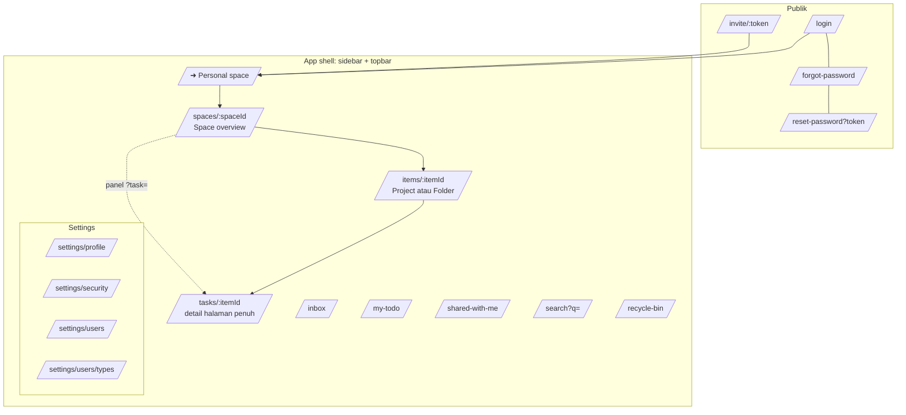
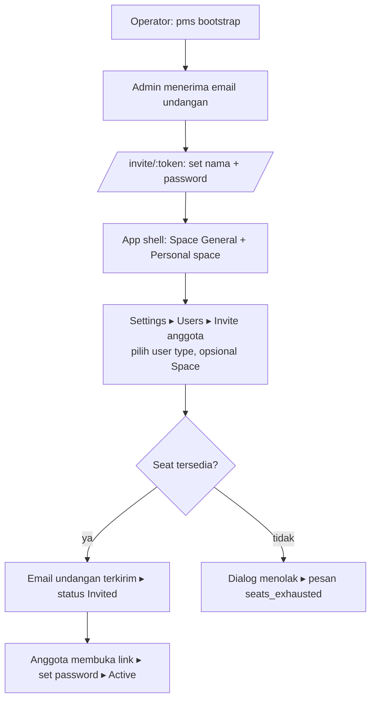
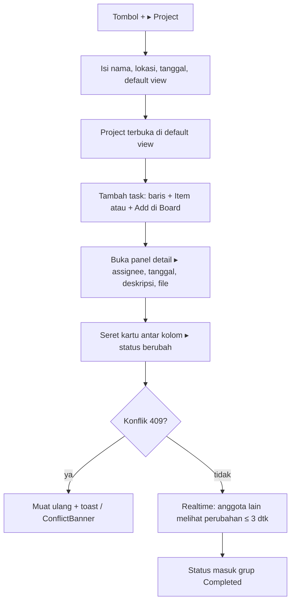
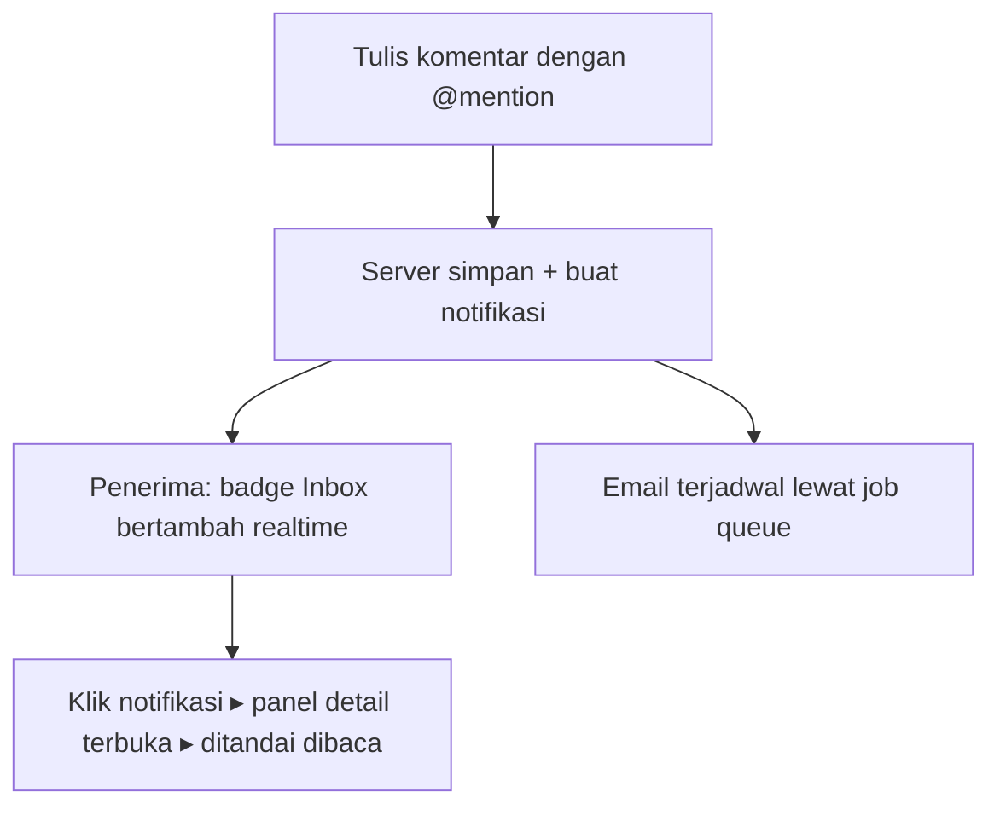
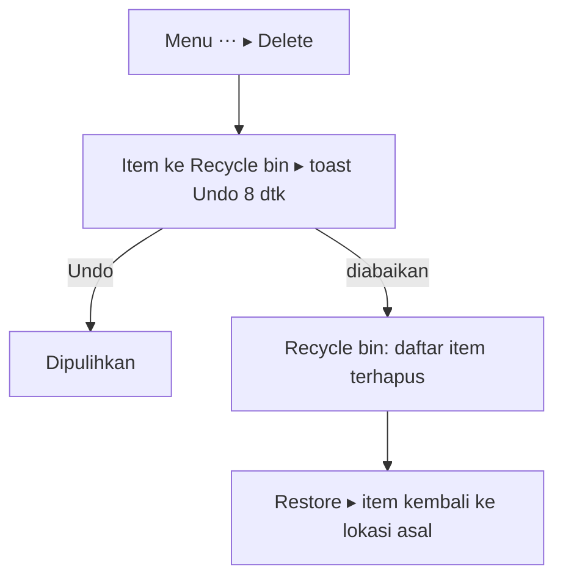

# UI SPEC — PMS

| | |
|---|---|
| **Versi** | 0.1 (draft) |
| **Cakupan** | Layar untuk M0 + M1. Layar M2+ ditulis saat milestone-nya dimulai |
| **Bahasa UI** | English (label di bawah ditulis sebagaimana tampil); dokumen ini Bahasa Indonesia |
| **Terkait** | [DESIGN_SYSTEM.md](DESIGN_SYSTEM.md) (komponen), [../api/openapi.yaml](../api/openapi.yaml) (endpoint), [WORKFLOWS.md](WORKFLOWS.md) (aturan status), [PRD_PMS.md](PRD_PMS.md) |

> Referensi layar Wrike dipakai hanya untuk fungsi. Tata letak di bawah dirancang untuk PMS.

---

## 1. Sitemap



## 2. Rute dan state di URL

| Rute | Layar | Search params (diketik zod) | PRD |
|---|---|---|---|
| `/login` | Login | `next` (path internal) | AUTH-01 |
| `/forgot-password` | Minta reset | – | AUTH-03 |
| `/reset-password` | Set password baru | `token` | AUTH-03 |
| `/invite/$token` | Terima undangan | – | AUTH-06 |
| `/` | Redirect ke Space terakhir dipakai, atau Personal space | – | NAV-01 |
| `/spaces/$spaceId` | Space overview | `view`, `task`, `q`, `status`, `assignee`, `type`, `sort`, `group` | SPC-02, SPC-04 |
| `/items/$itemId` | Project / Folder | sama dengan di atas | SPC-04, VIEW-01/02/08 |
| `/tasks/$itemId` | Detail task halaman penuh | – | TASK-03 |
| `/inbox` | Inbox | `unread` | NAV-03 |
| `/my-todo` | My to-do | `filter`, `sort` | NAV-05 |
| `/shared-with-me` | Item yang dibagikan langsung | – | NAV-01 |
| `/search` | Hasil pencarian penuh | `q`, `scope` | NAV-06 |
| `/recycle-bin` | Recycle bin | – | BIN-01, BIN-02 |
| `/settings/profile` | Profil + workspace settings | – | SET-01, SET-02 |
| `/settings/security` | Ganti password | – | AUTH-04 |
| `/settings/users` | Daftar user, undangan, grup, seat | `tab` (users/groups) | USR-01, USR-03 |
| `/settings/users/types` | Matriks izin user type | – | USR-02 |

Aturan state di URL:

- **Filter, sort, group, view aktif, dan task yang terbuka** di URL, sehingga menyalin alamat browser = menyalin tampilan (SPC-17 "Copy link to this view"). Back/forward browser bekerja sewajarnya.
- Parameter default tidak ditulis di URL (URL tetap pendek).
- Panel detail dibuka lewat `?task=<id>` di atas view mana pun; menutup panel menghapus parameter. Alamat `/tasks/$itemId` adalah halaman penuh (untuk tautan yang dibagikan) dan menampilkan isi panel yang sama.
- Parameter yang tidak valid diabaikan, bukan menyebabkan error.

## 3. App shell

```text
┌──────────────┬─────────────────────────────────────────────────────────────┐
│  PMS  [«]    │ Topbar:  ▸ Breadcrumb lokasi         [⌕ Search ⌘K] [+] ● 🔔 (JS)│
│              ├─────────────────────────────────────────────────────────────┤
│ ⌕ Search     │                                                             │
│ ✉ Inbox  (3) │                                                             │
│ ⋯ More       │                       Area konten                           │
│ ───────────  │                                                             │
│ SPACES    [+]│                                                             │
│  ◉ Personal  │                                                             │
│  ◉ General   │                                                             │
│   ▾ Projects │                                                             │
│     ▪ Alpha  │                                                             │
│     ▪ Beta   │                                                             │
│ ↗ Shared     │                                                             │
│ 🗑 Recycle   │                                                             │
└──────────────┴─────────────────────────────────────────────────────────────┘
```

| Bagian | Perilaku |
|---|---|
| Sidebar | Lebar 248 px, dapat diciutkan ke 56 px (ingat pilihan per user di localStorage). Pohon Space → project/folder dapat dibuka-tutup, urutan memakai `rank`. Item aktif disorot. "More" membuka menu: My to-do, Shared with me, Recycle bin, dan (M3+) Request forms, Dashboards, Reports, Timesheets |
| Topbar | Breadcrumb lokasi (menunjukkan jalur dari lokasi yang sedang dibuka bila item punya banyak lokasi); tombol Search membuka CommandPalette; tombol **+** membuka menu pembuatan; lonceng + jumlah belum dibaca (Inbox); `LiveIndicator`; menu profil (Profile, Security, Appearance, Log out) |
| Menu **+** | Task, Project, Folder, Space (Space hanya untuk admin/`create_space`), Invite (admin). Item yang tidak diizinkan disembunyikan |
| Kosong pertama | Admin baru: banner "Invite your team" + "Create your first project". User baru: "Ask a teammate to share a Space with you" |

## 4. Layar

Format tiap layar: **Tujuan · PRD · Milestone · Data & endpoint · Aksi · State · Validasi**.

### 4.1 Autentikasi

**Login** — AUTH-01, AUTH-02, SEC-04 · M0
Satu kartu di tengah: Email, Password (tombol tampilkan), tombol **Log in**, tautan "Forgot password?". Tanpa tautan daftar (tidak ada public signup). `POST /auth/login` → arahkan ke `next` (bila path internal) atau `/`. Galat 401: satu pesan "Incorrect email or password" untuk semua penyebab (termasuk akun invited/deactivated). 429: "Too many attempts. Try again in N minutes". Banner "Your session expired" bila datang dari 401. Logout (menu profil) → `POST /auth/logout` → `/login`.

**Forgot / Reset password** — AUTH-03 · M0
Forgot: satu field email, tombol "Send reset link"; setelah kirim selalu menampilkan "If an account exists, we sent a link" (tanpa membocorkan akun). Reset: dua field (New password, Confirm), indikator kekuatan, aturan ditulis (min 8 karakter). Token tidak valid (410) → pesan dan tombol "Request a new link". Setelah sukses → `/login` dengan toast.

**Accept invitation** — AUTH-06 · M0
`GET /auth/invitations/{token}` menampilkan email (tidak bisa diubah). Form: First name, Last name, Password, Confirm password, Department, Job title (opsional), checkbox persetujuan ToS (wajib). `POST /auth/invitations/accept` → masuk ke aplikasi. 410 → "This invitation has expired. Ask your admin to send a new one".

**Change password** — AUTH-04 · M0 (di `/settings/security`)
Current password, New password, Repeat. Sukses → toast "Password updated. Other sessions were signed out". (Bagian 2FA ditunda ke M3.)

### 4.2 Space dan navigasi

**Space overview** — SPC-02, SPC-04, SPC-01 · M1
Header: nama Space, deskripsi, tombol Share, menu ⋯ (Rename, Delete — hanya `shared` space dan `full`). Tab view (ViewTabs): Table dan Board bawaan. Isi: item di root Space. `GET /spaces/{id}/items`, `GET /spaces/{id}/views`. State kosong: "No projects yet" + tombol "Create project" bila `create`.

**Create / edit Space** — SPC-01 · M1
Dialog: Name (wajib, ≤ 120), Description, Sharing (ShareDialog ringkas). Personal space tidak bisa diubah namanya dan tidak bisa dibagikan.

**Project / Folder** — SPC-04, SPC-07, SPC-08, SPC-09, VIEW-01, VIEW-02, VIEW-08 · M1
Header: breadcrumb, nama (edit inline, `PATCH`), StatusPicker, tanggal (DateRangePicker), Owner, tombol Share, ViewTabs. Daftar anak dari `GET /items/{id}/children`. Tombol **Info** membuka ItemDetailPanel untuk project itu sendiri (deskripsi, files, aktivitas). Mengganti status project memakai StatusPicker yang sama (SPC-08).

**Create project** — SPC-05 · M1 (modal; wireframe di §5.4)
Panel kiri: Project name (wajib), Location (LocationPicker, default = lokasi saat ini), Type (radio Project/Folder), Default workflow (hanya baca di M1). Panel kanan: Owner (default: pembuat), Start date, Finish date, **Default view** (kartu: Table / Board), Sharing (avatar + tambah). Field finansial (billing type, budget) **belum tampil** (M4). `POST /items`. Setelah sukses buka project di default view.

**Create folder** — SPC-06 · M1: modal yang sama dengan Create project dengan Type = Folder; tanpa Owner, Start/Finish date.

**Share dialog** — SPC-11, USR-02 · M1
Kolom pencarian (user, grup, atau ketik email); hasil + role selector (Full / Editor / Limited / Read only) dengan penjelasan satu baris tiap role. Daftar yang sudah punya akses: nama, role, label "Inherited from <container>" (tidak bisa dihapus di sini, tautan ke container asal). Email yang bukan user: menawarkan "Invite as external user" (hanya admin; memakai `POST /users/invitations` dengan `share`). Simpan = `PUT …/shares`. Peringatan bila pengguna menghapus akses dirinya sendiri.

**Inbox** — NAV-03 · M1
Daftar notifikasi terbaru di atas; baris: avatar pelaku, kalimat ("Sam mentioned you in *Design review*"), cuplikan, waktu relatif; titik biru = belum dibaca. Toolbar: **Mark all as read**, **Archive all**, filter "Unread only". Klik baris → membuka item (`?task=`) dan menandai dibaca. Notifikasi baru muncul lewat event `notification.created` tanpa memuat ulang. State kosong: "You're all caught up".

**My to-do** — NAV-05 · M1
Daftar task di mana user adalah assignee; baris: judul, tag lokasi (project), tanggal, StatusPicker. Filter: All tasks / Only active / Only overdue. Sort: Priority*, Date, Date modified, Date created, Status, Importance*, Title. (*Priority/Importance menunggu custom field M2; opsi disembunyikan di M1 agar tidak menyesatkan.) `GET /me/todo`. Hanya task dengan status grup Active yang tampil di "Only active".

**Shared with me** — NAV-01 · M1: daftar item yang dibagikan langsung ke user dan tidak berada di Space yang bisa dia akses lewat cara lain (`GET /me/shared`).

**Search** — NAV-06 · M1
CommandPalette (Ctrl/Cmd+K): input, hasil dikelompokkan **Tasks**, **Projects & folders**, **Comments**, **Users**, masing-masing maksimal 5 dengan "Show all" menuju `/search?q=`. Scope: tab "Everywhere / This space / This project" saat dibuka dari dalam Space/project. Navigasi panah + Enter. Hasil menyorot kata cocok. Tidak ada hasil: "No results for “q”". Minimal 2 karakter sebelum query dikirim; debounce 200 ms.

**Recycle bin** — BIN-01, BIN-02 · M1
Tabel item terhapus: nama, tipe, lokasi asal, dihapus oleh, dihapus pada. Aksi per baris: **Restore** (`POST /recycle-bin/{id}/restore`; sukses → toast dengan tautan ke item). Aksi massal "Empty recycle bin" **belum ada** (BIN-03, M6) — tombol tidak ditampilkan. Item yang tidak bisa dipulihkan (Space asal terhapus) menampilkan alasan.

### 4.3 View dan item

**Table view** — VIEW-01 · M1 (wireframe di §5.1)
Kolom bawaan: Name (hierarki, expand/collapse), Status, Assignee, Start date, Due date. Edit inline sel (status, assignee, tanggal, judul). Baris terakhir "+ Item" membuat task. Pilihan kolom di menu header (kolom lain menyusul di M2). Seret baris untuk mengurutkan (`reorder`). Baris divirtualisasi (> 100 baris). Pilihan baris dengan `J/K`.

**Board view** — VIEW-02 · M1 (wireframe di §5.2)
Kolom = status workflow item induk, urut `position`. Kartu: judul, avatar assignee, rentang tanggal, jumlah subitem, jumlah lampiran/komentar. Seret kartu antar kolom = ubah status (+ urutan); pembaruan optimistis; gagal/konflik → kartu kembali dan toast. Tombol "+ Add" di tiap kolom (membuat dengan status kolom itu). Pengelompokan (swimlane) menyusul M2.

**View management** — VIEW-08, SPC-17 · M1
Menu ⋯ pada tab view: **Copy link to this view** (menyalin URL saat ini), **Rename**, **Duplicate** (dialog: nama + Public/Personal), **Set as default** (satu per scope), **Move left/right**, **Delete** (view default tidak bisa dihapus; ConfirmDialog). **+ Add view** menawarkan Table dan Board (Gantt, Calendar menyusul).

**Item detail panel** — SPC-07, TASK-03, TASK-04, TASK-05A, TASK-06, TASK-07, TASK-08A · M1 (wireframe di §5.3; anatomi di DESIGN_SYSTEM §4.4)
`GET /items/{id}`, `/comments`, `/attachments`, `/activity`. Semua edit memakai `PATCH` + `If-Match` (SEC-03). Bagian:

| Bagian | Perilaku |
|---|---|
| Judul | Edit inline; Enter menyimpan, Esc membatalkan; wajib, ≤ 500 karakter |
| Status | StatusPicker dari workflow item; hanya tampil untuk yang punya `change_status` |
| Assignee | AssigneePicker multi; pencarian nama/email; hanya user aktif yang bisa dipilih |
| Tanggal | DateRangePicker: Start, Due, Duration, "Working days only" (default aktif; sebelum M2 berarti Senin–Jumat). Due tidak boleh sebelum Start |
| Description | RichTextEditor, simpan otomatis saat blur dengan jeda 1 detik; konflik → ConflictBanner |
| Subitems | Daftar subtask ringkas + "Add subitem"; klik membuka panel subtask (tumpuk, breadcrumb di header) |
| Files | FileDropzone + daftar (nama, ukuran, pengunggah, tanggal, unduh, hapus). Batas ukuran tertulis; file ditolak menampilkan alasan (`file_too_large`, `file_type_blocked`) |
| Comments | CommentThread; editor dengan @mention (user, grup, "followers"), kirim lewat tombol atau pintasan; edit/hapus komentar sendiri |
| Activity | Daftar perubahan: "Sam changed status from New to In Progress" + waktu |
| Menu ⋯ | Copy link, Convert to milestone, Add to another location (multi-lokasi, M2 untuk UI), Delete (→ Recycle bin dengan toast Undo) |

Tombol aksi yang tidak diizinkan disembunyikan (`PermissionGate`).

**Create task** — TASK-01, TASK-02 · M1
Tiga jalur: (1) tombol **+** global → Task (modal ringkas: Name, Location, Status, Assignee, Dates); (2) baris "+ Item" inline di Table (Enter membuat dan tetap di baris berikutnya); (3) "+ Add" di kolom Board. Subtask dibuat dari panel detail induk.

### 4.4 Settings dan admin

**Profile & workspace** — SET-01, SET-02 · M1 (`/settings/profile`)
Bagian Profile: First/Last name, Company, Job title, Country, Location, Department, Phone. Bagian Workspace: Language (hanya English), Time zone, Date format, Time format, Week starts on, Density (Compact/Comfortable), Theme (Light/Dark/System), Shortcut kirim komentar. Simpan memakai `PATCH /me`; perubahan Density/Theme langsung berlaku.

**Users** — USR-01, USR-03 · M1 (`/settings/users`, admin)
Tab **Users** dan **Groups**. Users: tabel nama, email, user type, status (Active/Invited/Deactivated), terakhir login; pencarian dan filter status/type. Ringkasan seat di atas: "12 of 20 seats used · 2 pending". Aksi: **Invite** (dialog: Email, User type, pesan, opsional Space untuk dibagikan; tombol dinonaktifkan dengan penjelasan bila seat habis), **Resend invitation**, **Deactivate** (ConfirmDialog: jelaskan bahwa item tetap ada dan seat dibebaskan), **Reactivate**, ubah user type. Admin terakhir tidak bisa dinonaktifkan atau diturunkan (pesan `last_admin`). Non-admin tidak melihat menu ini.

**User types** — USR-02 · M1 (`/settings/users/types`)
Matriks baca-saja: baris = kemampuan (view, comment, change status, attach, edit, create, delete, share, manage users); kolom = Admin, Regular, External, Collaborator, Viewer; sel = ✓/—. Tautan dari dialog invite ("What can each type do?"). Matriks dibangkitkan dari definisi yang sama dengan `policy` agar tidak berbeda dari perilaku sebenarnya.

### 4.5 Halaman galat

| Halaman | Isi |
|---|---|
| 404 | "This page doesn't exist, or you don't have access" + tombol "Go to my space" |
| 500 / gagal muat | Ringkasan, tombol "Try again", `request_id` dengan tombol salin |
| Sesi habis | Mengarahkan ke `/login?next=…` dengan banner |
| Seat habis / aksi diblokir | Pesan spesifik dari `code`, bukan pesan umum |

## 5. Wireframe layar utama

### 5.1 Table view

```text
Project Alpha                                   [Share] [Info] [⋯]
[ Table ]  [ Board ]  [+ Add view]        (compact)
Filters: [Status ▾] [Assignee ▾] [Type ▾]  [Sort: Manual ▾]   ⌕ Filter items…
┌───┬──────────────────────────────┬─────────────┬──────────┬────────┬────────┐
│ ⠿ │ Name                         │ Status      │ Assignee │ Start  │ Due    │
├───┼──────────────────────────────┼─────────────┼──────────┼────────┼────────┤
│   │ ▾ Research                   │ ● In Progress│ (JS)(SL) │ 20 May │ 20 Jun │
│   │     Stakeholder interviews   │ ● Completed │ (JS)     │ 20 May │ 25 May │
│   │     User research            │ ● New       │ (SL)     │ 26 May │ 30 May │
│   │ ▸ Requirements  (3)          │ ○ New       │ —        │        │        │
│   │ + Item                                                                     │
└───┴──────────────────────────────┴─────────────┴──────────┴────────┴────────┘
```

### 5.2 Board view

```text
Project Alpha         [ Table ]  [ Board ]  [+ Add view]
┌── New (3) ───────┐ ┌── In Progress (2) ┐ ┌── Completed (1) ─┐ ┌ On Hold ┐ ┌ Cancelled ┐
│ ┌──────────────┐ │ │ ┌───────────────┐ │ │ ┌──────────────┐ │ │         │ │           │
│ │ Wireframes   │ │ │ │ Design review │ │ │ │ Brand pillars│ │ │         │ │           │
│ │ (SL)  25–28  │ │ │ │ (JS)(SL) 20–22│ │ │ │ (JS)   ✓     │ │ │         │ │           │
│ │ ▤3  📎1  💬2 │ │ │ └───────────────┘ │ │ └──────────────┘ │ │         │ │           │
│ └──────────────┘ │ │ ┌───────────────┐ │ │                  │ │         │ │           │
│ ┌──────────────┐ │ │ │ Prototype …   │ │ │                  │ │         │ │           │
│ + Add            │ │ + Add             │ │ + Add             │ │ + Add   │ │ + Add     │
└──────────────────┘ └───────────────────┘ └──────────────────┘ └─────────┘ └───────────┘
```

### 5.3 Item detail panel (di atas view)

```text
                                    ┌────────────────────────────────────────┐
  (view di belakang, redup)         │ #1234  Alpha › Research         ⤢ ⋯ ✕ │
                                    │ Stakeholder interviews                 │
                                    │ [● In Progress ▾] [(JS)(SL) ▾] [20–25 May ▾]│
                                    │ ☑ Working days only   Duration 4d      │
                                    │ ──────────────────────────────────────│
                                    │ Description                            │
                                    │ ┌────────────────────────────────────┐ │
                                    │ │ B I • 1. 🔗 <> @                    │ │
                                    │ │ Interview 5 stakeholders…           │ │
                                    │ └────────────────────────────────────┘ │
                                    │ Subitems (2)               [+ Add]     │
                                    │ Files (1)    ⬆ Drop files or browse    │
                                    │ ──────────────────────────────────────│
                                    │ [Comments]  Activity                   │
                                    │ (SL) Sam · 2h  Done with the first…    │
                                    │ ┌────────────────────────────────────┐ │
                                    │ │ Write a comment… @mention          │ │
                                    │ └────────────────────────────[Send]──┘ │
                                    └────────────────────────────────────────┘
```

### 5.4 Create project

```text
┌───────────────────────────────────────────────────────────────────────┐
│ Create project                                                      ✕ │
├──────────────────────────────┬────────────────────────────────────────┤
│ Project name *               │ Owner        (JS) ▾                    │
│ [_________________________]  │ Start date   [23/05/2026]              │
│ Location  [ General ▾ ]      │ Finish date  [23/06/2026]              │
│ Type      (•) Project        │                                        │
│           ( ) Folder         │ Default view                           │
│ Workflow  Default (read-only)│  [▦ Table ✓]   [▥ Board]               │
│                              │ Sharing                                │
│                              │  (JS)(SL)(+)                           │
├──────────────────────────────┴────────────────────────────────────────┤
│ [Create]  [Cancel]                                                    │
└───────────────────────────────────────────────────────────────────────┘
```

## 6. Alur pengguna

### 6.1 Akses pertama (admin dan anggota)



### 6.2 Buat proyek hingga selesai



### 6.3 Berkolaborasi



### 6.4 Hapus dan pulihkan



## 7. Matriks state per layar utama

| Layar | Memuat | Kosong | Error | Tanpa izin |
|---|---|---|---|---|
| Space/Project (Table, Board) | Skeleton baris/kolom | "No items yet" + Create bila `create` | Panel galat + Try again | 404 |
| Item detail panel | Skeleton bagian | Bagian kosong menampilkan petunjuk ("No files yet") | Galat per bagian (komentar gagal tidak memblokir panel) | 404 / aksi disembunyikan |
| Inbox | Skeleton daftar | "You're all caught up" | Try again | – |
| My to-do | Skeleton | "Nothing assigned to you" | Try again | – |
| Search | Skeleton hasil | "No results for “q”" | Try again | hasil dibatasi izin |
| Recycle bin | Skeleton | "Recycle bin is empty" | Try again | item tanpa izin tidak muncul |
| Users | Skeleton | "No users yet" (tidak mungkin; ada admin) | Try again | Menu tidak tampil; URL langsung → 404 |

## 8. Cakupan requirement M0 + M1 → layar

| PRD ID | Layar / bagian | Catatan |
|---|---|---|
| AUTH-01 | Login | |
| AUTH-02 | Menu profil ▸ Log out | |
| AUTH-03 | Forgot / Reset password | |
| AUTH-04 | `/settings/security` | |
| AUTH-06 | Accept invitation | |
| AUTH-09 | — | Tanpa UI (CLI operator) |
| SET-01 | Settings (shell + navigasi) | |
| SET-02 | `/settings/profile` | |
| SET-10 | — | Tanpa UI; hanya template email |
| SEC-01 | Item detail ▸ Files | Pesan penolakan upload |
| SEC-02 | — | Tes otomatis |
| SEC-03 | ConflictBanner, toast konflik | |
| SEC-04 | Login, banner sesi habis | |
| OPS-01, OPS-02, OPS-03 | — | Tanpa UI (operasional) |
| SPC-01 | Space overview, Create Space, sidebar | |
| SPC-02 | Space overview | |
| SPC-04 | Sidebar pohon, Project/Folder | |
| SPC-05, SPC-06 | Create project / folder | |
| SPC-07 | Project header + Item detail panel | |
| SPC-08 | StatusPicker di Project | |
| SPC-09 | DateRangePicker di Project | |
| SPC-11 | Share dialog | |
| SPC-17 | View management ▸ Copy link | |
| TASK-01 | Create task (3 jalur) | |
| TASK-02 | Subitems di panel detail | |
| TASK-03 | Item detail panel | |
| TASK-04 | StatusPicker, drag Board | |
| TASK-05A | DateRangePicker | |
| TASK-06 | AssigneePicker | |
| TASK-07 | Comments | |
| TASK-08A | Files | |
| VIEW-01 | Table view | |
| VIEW-02 | Board view | |
| VIEW-08 | View management | |
| WF-01 | StatusPicker (workflow default) | Tanpa layar sendiri; read-only |
| NAV-01 | App shell ▸ sidebar, Shared with me | "Hidden spaces" tidak punya requirement turunan; ditunda |
| NAV-03 | Inbox | |
| NAV-05 | My to-do | |
| NAV-06 | CommandPalette + Search | |
| USR-01 | Users ▸ Invite | |
| USR-02 | User types + Share dialog | |
| USR-03 | Users (daftar, seat, nonaktifkan) | |
| BIN-01 | Menu ⋯ ▸ Delete + Recycle bin | |
| BIN-02 | Recycle bin ▸ Restore | |
| Realtime (SSE) | LiveIndicator, pembaruan otomatis semua daftar | Bagian dari M1 |

**Celah yang ditemukan saat menulis dokumen ini** (sudah ditangani di kontrak atau dicatat):

1. Sidebar NAV-01 memuat "Shared with me" tetapi belum ada endpoint → ditambahkan `GET /me/shared` ke `openapi.yaml`.
2. "Hidden spaces" (NAV-01) tidak punya requirement turunan; **ditunda** sampai ada kebutuhan nyata.
3. Sort "Priority" dan "Importance" di My to-do (NAV-05) bergantung custom field (M2); opsinya disembunyikan di M1.
