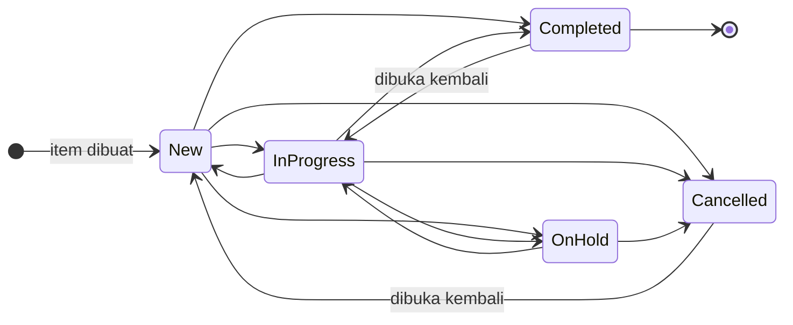
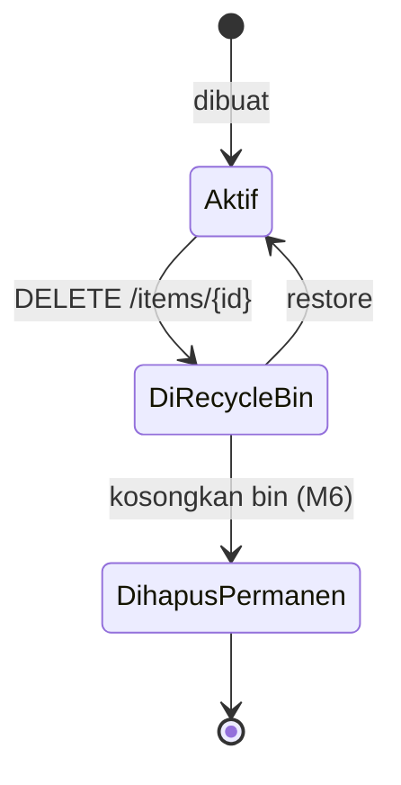
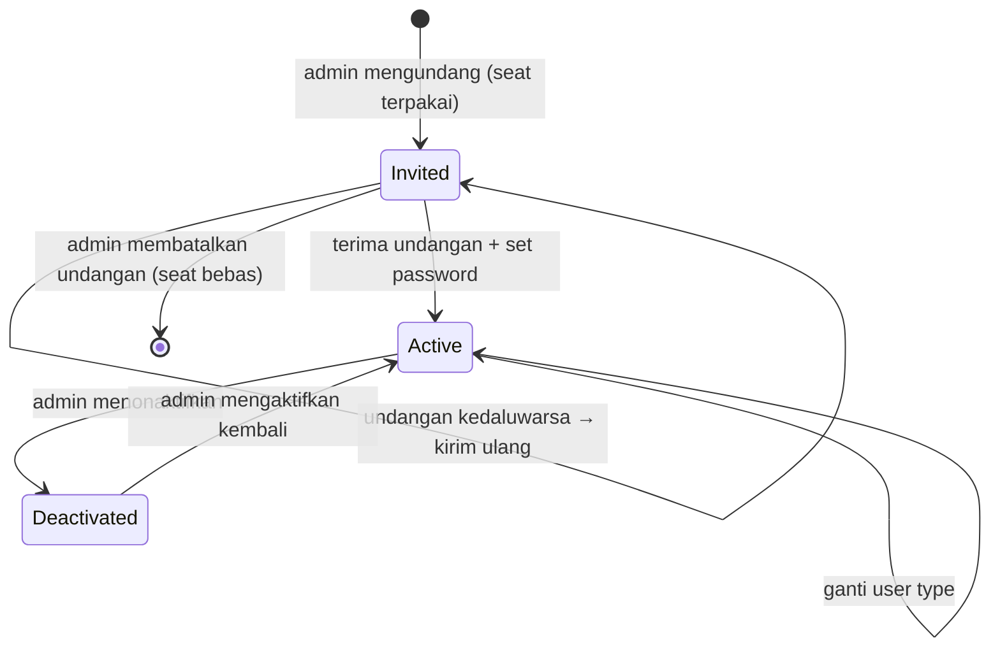
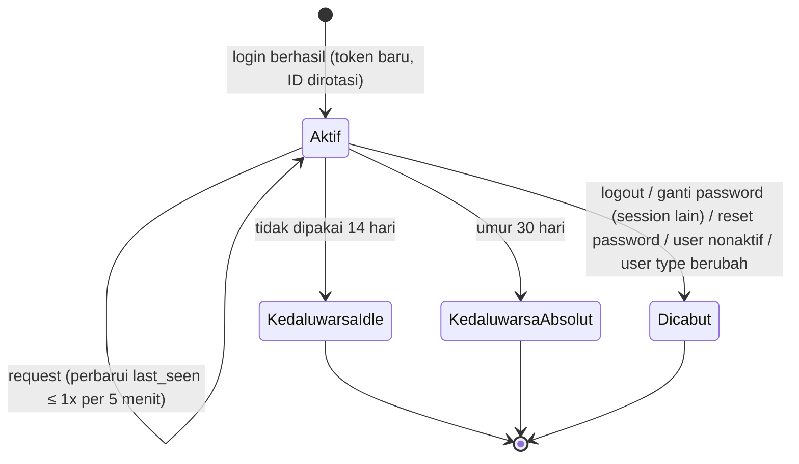
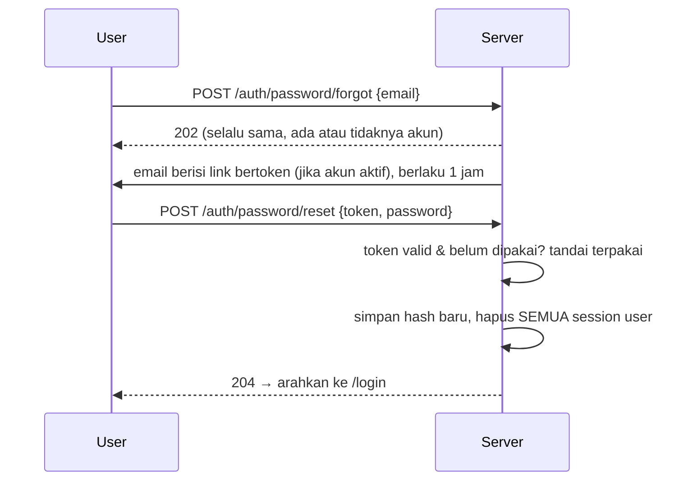
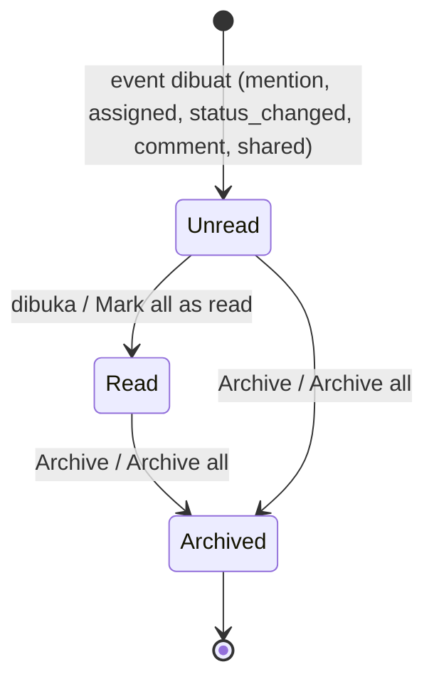
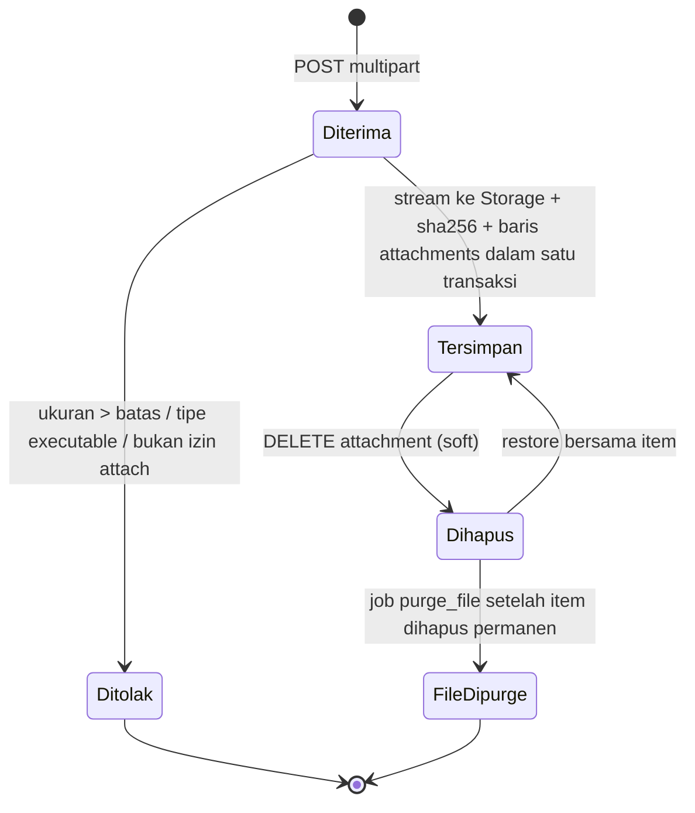
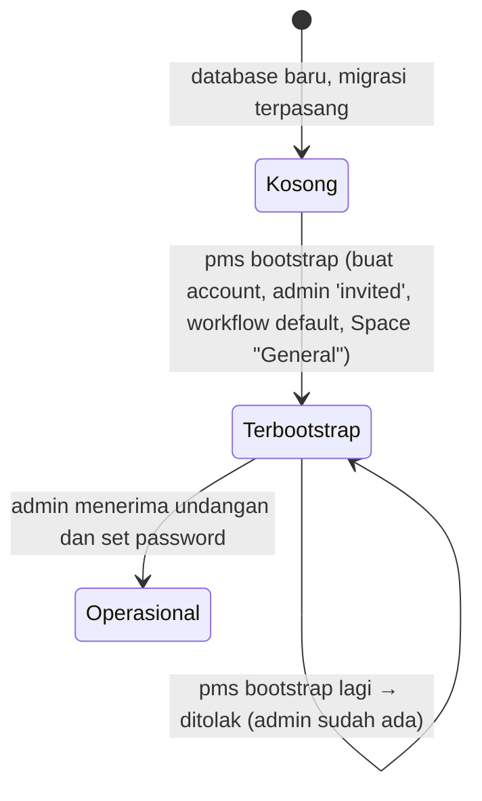

# WORKFLOWS — State machine PMS

| | |
|---|---|
| **Versi** | 0.1 (draft) |
| **Cakupan** | M0 + M1 dan progres project (M2). State machine approval dan request (M3) hanya ditandai sebagai placeholder di §9 |
| **Terkait** | [DATABASE.md](DATABASE.md), [ARCHITECTURE.md](ARCHITECTURE.md), [../api/openapi.yaml](../api/openapi.yaml) |

Tiap state machine berisi: diagram, tabel transisi (pemicu, guard, efek), dan hasil error. **Guard** adalah syarat yang dicek server; transisi yang gagal guard menghasilkan error pada kolom terakhir.

---

## 1. Status item

Status mengikuti workflow item. Di M1 hanya ada workflow default dan semua transisi antar-status bebas (kunci transisi baru di M3, WF-03A).

Grup status menentukan perilaku, bukan nama statusnya:

| Grup | Status default | Efek masuk grup | Efek keluar grup |
|---|---|---|---|
| Active | New, In Progress | – | – |
| Completed | Completed | `completed_at := now()` | `completed_at := NULL` |
| Deferred | On Hold | – | – |
| Cancelled | Cancelled | – | – |

| Pemicu | Guard | Efek | Error |
|---|---|---|---|
| `PATCH /items/{id}` dengan `status_id` | Punya kemampuan `change_status` (limited ke atas); `status_id` ada di workflow item; header `If-Match` sama dengan `version` | Update status, `version+1`, tulis `activity`, kirim notifikasi `status_changed` ke follower (kecuali pelaku), emit `item.updated` | 404 tanpa akses; 403 tanpa `change_status`; 422 status bukan milik workflow; 409 versi usang; 428 tanpa `If-Match` |
| Drag kartu di Board ke kolom lain | Sama seperti di atas | UI memperbarui secara optimistis, memanggil PATCH yang sama dengan `rank` baru | Saat 409 UI memuat ulang dan menampilkan toast konflik |
| Container (project/folder) diubah statusnya | Sama | Tidak mengubah status anak | – |

### 1.1 Progres dan risiko project (TASK-09)

Server menghitung progres dari task turunan yang dapat dijangkau melalui lokasi aktif project yang dapat dilihat pemanggil. Task dalam folder, subproject, dan subtask ikut dihitung. Setiap task dihitung sekali walaupun punya beberapa jalur atau lokasi. Task yang dihapus atau berstatus Cancelled dikecualikan. Jalur lokasi yang masuk Recycle bin juga dikecualikan.

| Metode project | Perhitungan |
|---|---|
| `task_count` (default) | Jumlah task Completed dibagi jumlah task yang dihitung |
| `weighted_duration` | Rata-rata persen task berbobot hari kerja. Bobot minimum satu untuk milestone dan task tanpa durasi |
| `average_percent` | Rata-rata persen semua task yang dihitung |

Persen task adalah 100 untuk Completed dan nilai manual 0–100 untuk status lain, dengan default 0 bila belum diisi. Persen project dibulatkan ke bilangan bulat terdekat. Project tanpa task yang dapat dihitung memiliki progres 0%. Metode project dan nilai manual task dapat diubah dengan kemampuan `edit` dan `If-Match`.

Risiko memakai tanggal UTC server. Project Completed atau Cancelled berisiko hijau. Untuk project lain, due date project dan due date task yang belum Completed diperiksa. Risiko merah jika ada tanggal yang sudah lewat, kuning jika tanggal terdekat jatuh hari ini hingga tiga hari kalender ke depan, dan hijau pada kondisi lain. Status project tidak mengganti hasil perhitungan persen task. Persen dan risiko project dihitung saat dibaca.

## 2. Siklus hidup item (penghapusan)

| Pemicu | Guard | Efek | Error |
|---|---|---|---|
| Hapus | Kemampuan `delete` (role `full`, plafon admin/regular) | `deleted_at/by/root_id` pada item dan turunan yang tidak punya lokasi hidup lain (DATABASE §5); lampiran tetap ada di disk; tidak ada notifikasi (hanya tercatat di `activity` container induk) | 403 tanpa `delete`; 404 tanpa akses |
| Restore | Pelaku punya `delete` pada item. Jika parent sudah tidak hidup, diperlukan `create` di root Space asal | `deleted_*` dikosongkan untuk seluruh `deleted_root_id` yang sama. Lokasi kembali ke parent yang masih hidup atau dipulihkan bersama item. Lokasi lain jatuh ke root Space asal | 403 jika izin kurang; 409 jika Space asal juga terhapus |
| Hapus permanen (M6) | Admin atau pemilik `full` | Baris dan lampiran dihapus; job `purge_file` menghapus file fisik | – |

**Selesai ≠ hapus.** Item `Completed`/`Cancelled` tetap Aktif dan bisa dicari; hanya `DELETE` yang memindahkannya ke Recycle bin (PRD §7).

## 3. Siklus hidup user

| Pemicu | Guard | Efek | Error |
|---|---|---|---|
| Undang (USR-01) | Admin; email belum terdaftar; `seat terpakai < MAX_SEATS`; user type valid | Buat `users(status=invited)` dan job `send_invitation_email`. Worker membuat token undangan berlaku 7 hari saat mengirim | 403 bukan admin; 409 email sudah ada; 422 `seats_exhausted` |
| Terima undangan (AUTH-06) | Token valid, belum dipakai, belum kedaluwarsa; password lolos kebijakan (≥ 8 karakter, bukan 10 password umum terburuk); persetujuan ToS | `status=active`, simpan hash argon2id, token ditandai terpakai, buat Personal space, buat session | 410 token kedaluwarsa/terpakai; 422 password lemah |
| Nonaktifkan (USR-03) | Admin; bukan admin aktif terakhir; bukan dirinya sendiri bila dia admin terakhir | `status=deactivated`; semua session dihapus; assignment dan item tetap; seat dibebaskan; follower di-skip saat notifikasi | 409 `last_admin` |
| Aktifkan kembali | Admin; seat tersedia | `status=active`; user harus login ulang | 422 `seats_exhausted` |
| Ganti user type | Admin; bukan menurunkan admin terakhir | Update; seluruh session user dirotasi/dicabut agar plafon baru langsung berlaku | 409 `last_admin` |

Login oleh user `invited` atau `deactivated` selalu mengembalikan pesan yang sama dengan password salah (tidak membocorkan status akun).

## 4. Session

Request dengan session kedaluwarsa atau dicabut → 401; SPA mengarahkan ke `/login` dengan `?next=` (hanya path internal yang diterima).

### 4.1 Login dengan 2FA TOTP (AUTH-05; S3.5.1)

| Langkah | Aturan |
|---|---|
| Daftar | `POST /me/2fa/setup` menyimpan secret baru terenkripsi (belum aktif); UI menampilkan QR dari `otpauth_uri` dan secret teks. `POST /me/2fa/enable` dengan kode 6 digit mengaktifkan, membuat 10 kode cadangan (tampil sekali), dan mencabut session lain. Setup yang tidak dikonfirmasi tidak mengubah login |
| Login | Password benar dan 2FA aktif: `202 {two_factor_required, challenge}` tanpa cookie. `POST /auth/login/2fa` dengan challenge (berlaku 5 menit, sekali pakai) dan kode TOTP atau kode cadangan membuat session. Session lama di browser itu diganti seperti login biasa |
| Kode | TOTP RFC 6238 (SHA-1, 30 detik, 6 digit), toleransi satu langkah. Langkah yang sudah dipakai ditolak (tidak bisa dipakai ulang, juga saat dua request bersamaan). Kode cadangan dipakai sekali dan tidak membedakan huruf besar-kecil |
| Batas | 5 kode salah per user per 15 menit lalu 429 (termasuk untuk kode yang benar), ditambah batas per IP yang sama dengan login |
| Matikan, kode cadangan baru | Perlu password dan kode saat ini; mematikan mencabut session lain; kode cadangan baru membatalkan yang lama |
| Reset admin | `POST /users/{id}/2fa/reset` menghapus secret dan kode cadangan, mengeluarkan user dari semua session, dan mencatat `2fa_reset_by_admin` di `security_events`. Tidak ada email pemberitahuan ke user (belum ada) |
| Kunci | `PMS_2FA_KEY` (dan `PMS_2FA_KEY_PREVIOUS` untuk rotasi). Tanpa kunci, 2FA tidak bisa diaktifkan (503 `not_configured`). Lihat `PILOT_RUNBOOK.md` |

## 5. Reset dan ganti password

Ganti password (AUTH-04): `POST /auth/password/change {current, new}` — memerlukan password lama yang benar; mencabut semua session **kecuali** yang sedang dipakai dan merotasi ID-nya.

## 6. Notifikasi (Inbox)

Aturan pembuatan (satu sumber untuk semua modul):

| Event | Penerima | Dikecualikan |
|---|---|---|
| `mention` | User/grup/follower yang disebut di komentar atau deskripsi | Pelaku |
| `assigned` | User yang baru ditambahkan sebagai assignee | Pelaku |
| `status_changed` | Follower item | Pelaku |
| `comment` | Follower item | Pelaku, dan user yang sudah menerima `mention` dari komentar yang sama |
| `shared` | Principal yang baru diberi share | Pelaku |

Hanya penerima yang masih berstatus `active` dan masih punya kemampuan `view` pada item yang dibuatkan notifikasi. Email dikirim sesuai preferensi (SET-05, M6; sebelum itu semua event email aktif kecuali `comment`).

## 7. Lampiran file

| Tahap | Guard | Hasil gagal |
|---|---|---|
| Diterima | Kemampuan `attach`; panjang konten ≤ `PMS_MAX_UPLOAD_MB` (`MaxBytesReader`) | 413 `file_too_large`; 403 |
| Deteksi tipe | Isi file bukan executable/arsip berisi executable (SEC-01) | 422 `file_type_blocked` |
| Tersimpan | `Storage.Put` sukses **sebelum** baris database di-commit; bila commit gagal, job `purge_file` membersihkan key yatim | 500; tidak ada baris |
| Download | Kemampuan `view` atas item pemilik | 404 tanpa akses (tidak 403) |

## 8. Bootstrap instance

`pms bootstrap` idempoten dan gagal dengan kode keluar ≠ 0 bila instance sudah dibootstrap. Satu-satunya pengulangan yang diizinkan adalah pemulihan: dengan email yang sama selagi admin itu masih `invited`, bootstrap menerbitkan token undangan baru (token lama dicabut) agar instance tidak terkunci setelah undangan kedaluwarsa. Bila SMTP belum dikonfigurasi, link undangan (`/invitations/<token>`, berlaku 7 hari) dicetak ke log.

## 9. Workflow, approval, dan request form (M3)

### 9.1 Editor workflow (WF-02, WF-03A; S3.1.1)

| Aturan | Isi |
|---|---|
| Siapa | Hanya user bertipe admin yang mengubah (workflow bersifat global, bukan per Space); semua user login boleh membaca `GET /workflows` |
| Invarian | Status pertama (posisi 0) harus grup Active, ada minimal satu status Completed, maksimal 30 status per workflow. Pelanggaran: 422 dan tidak ada yang tersimpan |
| Warna | 12 token palet tetap (`slate`, `blue`, `sky`, `teal`, `green`, `lime`, `amber`, `orange`, `red`, `pink`, `purple`, `indigo`), terpisah dari hue aksen (D-35) |
| Transisi | Status dengan `lock_transitions` hanya boleh dilanjutkan ke status di `allowed_next`. Berlaku di `PATCH /items/{id}` (termasuk drag Board); **tidak** berlaku saat item dibuat dan saat penghapusan status memindahkan item. Pelanggaran: 422 `validation_failed` pada field `status_id` |
| Auto-assign | Item yang masuk status ber-`auto_assign` menjadikan pelaku sebagai assignee dan follower; tercatat di activity bersama perubahan lain |
| Ubah grup status | Item yang sedang di status itu mendapat atau kehilangan `completed_at` sesuai grup baru |
| Hapus status | Bila dipakai item, `move_to` wajib (status lain di workflow yang sama; 409 `status_in_use` tanpa itu). Item dipindah dalam transaksi yang sama, `version+1`, `completed_at` mengikuti grup tujuan |
| Hapus workflow | Ditolak (409 `workflow_in_use`) untuk workflow default atau yang dipakai container maupun item |
| Nama | Unik tanpa membedakan huruf besar-kecil: 409 `name_taken` |

### 9.2 Approval (SPC-12; S3.2.1)

`Pending` bila belum ada penolakan dan belum semua setuju; `Rejected` bila ada satu approver menolak; `Approved` bila semua approver setuju. Status dan penghitung `approved_count/total` dihitung di server dan tidak disimpan. Keputusan hanya dicatat, tidak mengubah status item (D-41).

| Aksi | Syarat |
|---|---|
| Minta approval, ubah, hapus | Kemampuan `edit` pada item; approver harus user aktif yang bisa melihat item (1-20 orang); maksimal 50 approval per item |
| Putuskan | Hanya approver yang disebut, dengan kemampuan `view`; keputusan boleh diubah kemudian; `comment` opsional |
| Edit | `If-Match` dengan versi approval; menghapus approver menghapus keputusannya |
| Notifikasi | `approval_requested` ke approver baru; `approval_decided` ke pembuat approval |
| Berkas approval | Memakai lampiran item (tidak ada penyimpanan berkas terpisah) |

### 9.3 Request form (FORM-01, FORM-02, FORM-06, FORM-08; S3.3.x)

| Hal | Aturan |
|---|---|
| Milik | Form milik satu Space bersama (bukan Personal). Membuat dan mengubah butuh kemampuan `edit` pada Space, dan hak `create` pada Space tujuan (dan project/folder tujuan bila diisi), karena pengirim tidak punya hak di sana |
| Definisi | Halaman berisi pertanyaan dan section; key pertanyaan stabil. Batas: 10 halaman, 100 elemen, 50 opsi, lampiran 1-5 berkas per pertanyaan. Divalidasi oleh paket `forms` |
| Pengaturan respons | Tipe item (task atau project), status awal (harus milik workflow tujuan), lokasi, assignee tetap, pertanyaan judul, dan approval otomatis. Approver harus bisa melihat tujuan |
| Akses | `private` (hanya pengelola) atau `internal` (semua user login). Mengubah akses butuh kemampuan `share` pada Space. Tautan publik menunggu S3.3.5 |
| Kirim | `POST /forms/{id}/submissions` (JSON, atau multipart bila ada lampiran). Semua kesalahan jawaban dikembalikan sekaligus (`answers.<key>`). Item, lampiran, approval, dan catatan `form_submissions` dibuat dalam satu transaksi; berkas yang sudah tersimpan dihapus bila transaksi gagal |
| Atas nama | Item dibuat sebagai admin atas nama pengirim: pengirim tetap `created_by`, follower, dan pelaku activity. Pembatasan transisi status tidak berlaku saat item dibuat |
| Tujuan hilang | Bila Space atau project tujuan terhapus setelah form disimpan: 422 `form_unavailable` (bukan 403) |
| Akses pengirim ke item | Pengirim mendapat `view`, `comment`, `attach` (dibatasi plafon tipe user) pada **item itu saja**; bukan Space, project induk, saudara, atau anak. Berlaku selama item tidak dihapus. Daftar `GET /me/requests` memuat permintaan sendiri beserta status terkini |
| Belum ada | Email konfirmasi dan email perubahan status untuk requester eksternal (menunggu form publik, S3.3.5) |

## 10. Kode error yang konsisten

Semua error memakai `application/problem+json` (lihat openapi). Field `code` stabil dan dipakai UI untuk pesan terjemahan:

| `code` | HTTP | Arti |
|---|---|---|
| `not_found` | 404 | Tidak ada, atau tidak punya akses |
| `forbidden` | 403 | Terlihat tetapi aksi tidak diizinkan |
| `version_conflict` | 409 | `If-Match` tidak sama dengan versi saat ini |
| `precondition_required` | 428 | `If-Match` tidak dikirim |
| `validation_failed` | 422 | Bentuk atau aturan data salah; `errors[]` berisi field |
| `seats_exhausted` | 422 | Seat penuh |
| `last_admin` | 409 | Aksi akan menghilangkan admin terakhir |
| `file_too_large` | 413 | Melebihi batas upload |
| `file_type_blocked` | 422 | Tipe file ditolak |
| `token_invalid` | 410 | Token undangan/reset kedaluwarsa atau sudah dipakai |
| `rate_limited` | 429 | Terlalu banyak percobaan; `Retry-After` diisi |
| `unauthenticated` | 401 | Session tidak ada/kedaluwarsa |
