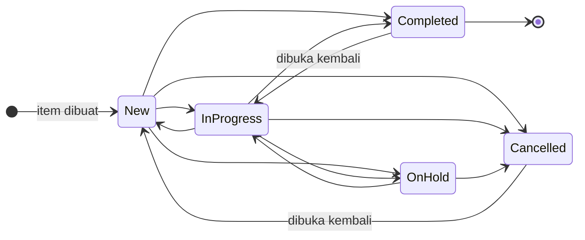
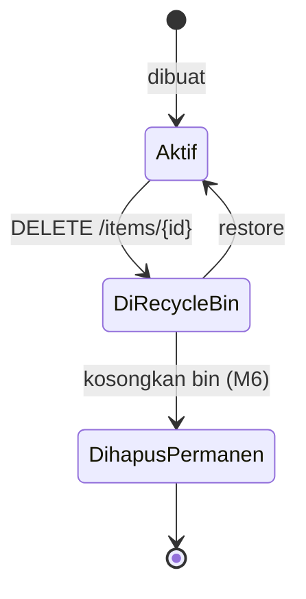
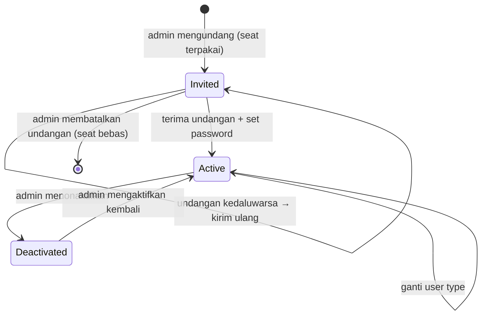
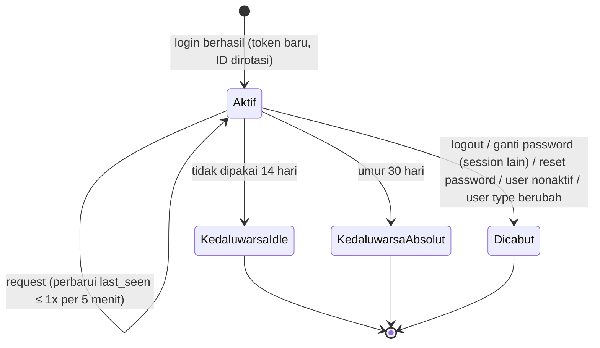
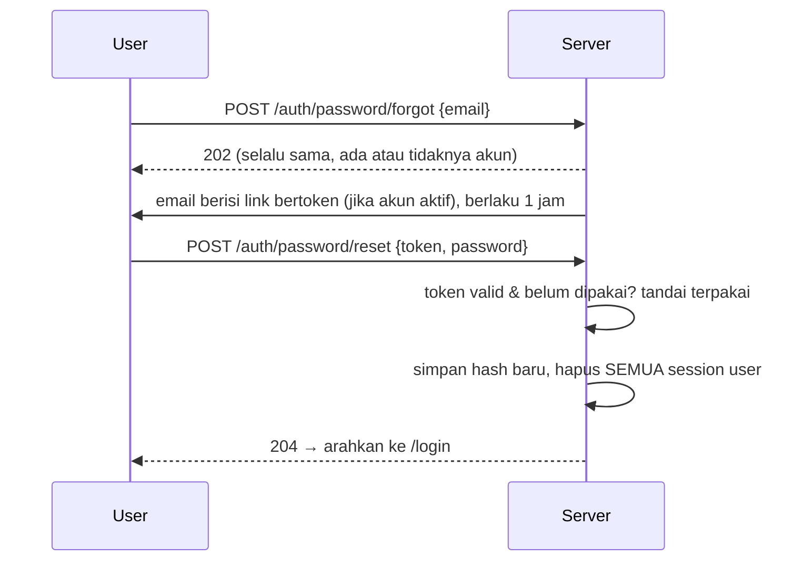
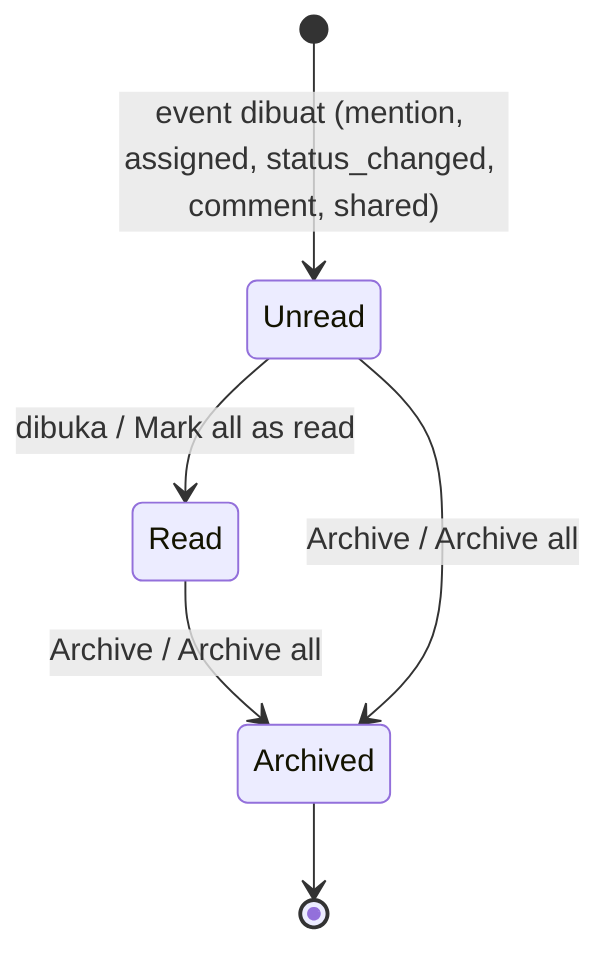
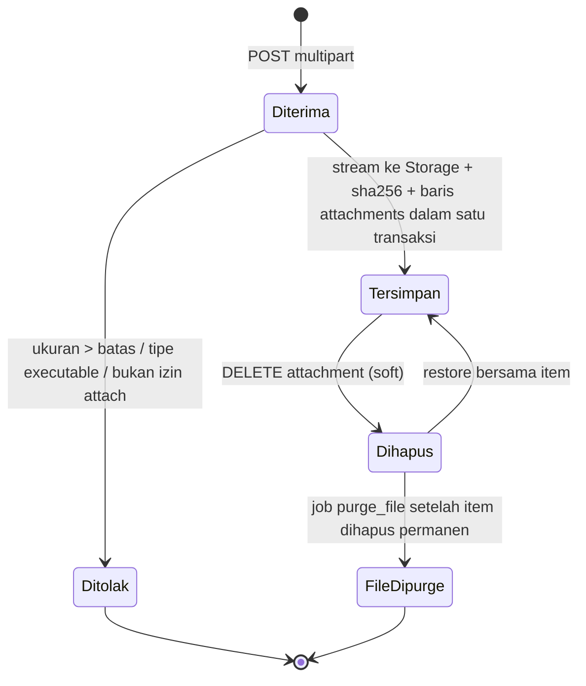
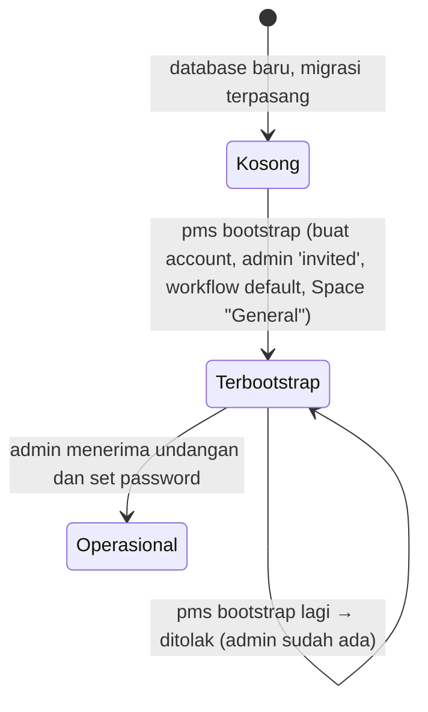

# WORKFLOWS — State machine PMS

| | |
|---|---|
| **Versi** | 0.1 (draft) |
| **Cakupan** | M0 + M1. State machine approval dan request (M3) hanya ditandai sebagai placeholder di §9 |
| **Terkait** | [DATABASE.md](DATABASE.md), [ARCHITECTURE.md](ARCHITECTURE.md), [../api/openapi.yaml](../api/openapi.yaml) |

Tiap state machine berisi: diagram, tabel transisi (pemicu, guard, efek), dan hasil error. **Guard** adalah syarat yang dicek server; transisi yang gagal guard menghasilkan error pada kolom terakhir.

---

## 1. Status item

Status mengikuti workflow item. Di M1 hanya ada workflow default dan semua transisi antar-status bebas (kunci transisi baru di M3, WF-03A).

Grup status menentukan perilaku, bukan nama statusnya:

| Grup | Status default | Efek masuk grup | Efek keluar grup |
|---|---|---|---|
| Active | New, In Progress | – | – |
| Completed | Completed | `completed_at := now()` | `completed_at := NULL` |
| Deferred | On Hold | – | – |
| Cancelled | Cancelled | – | – |

| Pemicu | Guard | Efek | Error |
|---|---|---|---|
| `PATCH /items/{id}` dengan `status_id` | Punya kemampuan `change_status` (limited ke atas); `status_id` ada di workflow item; header `If-Match` sama dengan `version` | Update status, `version+1`, tulis `activity`, kirim notifikasi `status_changed` ke follower (kecuali pelaku), emit `item.updated` | 404 tanpa akses; 403 tanpa `change_status`; 422 status bukan milik workflow; 409 versi usang; 428 tanpa `If-Match` |
| Drag kartu di Board ke kolom lain | Sama seperti di atas | UI memperbarui secara optimistis, memanggil PATCH yang sama dengan `rank` baru | Saat 409 UI memuat ulang dan menampilkan toast konflik |
| Container (project/folder) diubah statusnya | Sama | Tidak mengubah status anak | – |

## 2. Siklus hidup item (penghapusan)

| Pemicu | Guard | Efek | Error |
|---|---|---|---|
| Hapus | Kemampuan `delete` (role `full`, plafon admin/regular) | `deleted_at/by/root_id` pada item dan turunan yang tidak punya lokasi hidup lain (DATABASE §5); lampiran tetap ada di disk; tidak ada notifikasi (hanya tercatat di `activity` container induk) | 403 tanpa `delete`; 404 tanpa akses |
| Restore | Pelaku punya `delete` pada item. Jika parent sudah tidak hidup, diperlukan `create` di root Space asal | `deleted_*` dikosongkan untuk seluruh `deleted_root_id` yang sama. Lokasi kembali ke parent yang masih hidup atau dipulihkan bersama item. Lokasi lain jatuh ke root Space asal | 403 jika izin kurang; 409 jika Space asal juga terhapus |
| Hapus permanen (M6) | Admin atau pemilik `full` | Baris dan lampiran dihapus; job `purge_file` menghapus file fisik | – |

**Selesai ≠ hapus.** Item `Completed`/`Cancelled` tetap Aktif dan bisa dicari; hanya `DELETE` yang memindahkannya ke Recycle bin (PRD §7).

## 3. Siklus hidup user

| Pemicu | Guard | Efek | Error |
|---|---|---|---|
| Undang (USR-01) | Admin; email belum terdaftar; `seat terpakai < MAX_SEATS`; user type valid | Buat `users(status=invited)` dan job `send_invitation_email`. Worker membuat token undangan berlaku 7 hari saat mengirim | 403 bukan admin; 409 email sudah ada; 422 `seats_exhausted` |
| Terima undangan (AUTH-06) | Token valid, belum dipakai, belum kedaluwarsa; password lolos kebijakan (≥ 8 karakter, bukan 10 password umum terburuk); persetujuan ToS | `status=active`, simpan hash argon2id, token ditandai terpakai, buat Personal space, buat session | 410 token kedaluwarsa/terpakai; 422 password lemah |
| Nonaktifkan (USR-03) | Admin; bukan admin aktif terakhir; bukan dirinya sendiri bila dia admin terakhir | `status=deactivated`; semua session dihapus; assignment dan item tetap; seat dibebaskan; follower di-skip saat notifikasi | 409 `last_admin` |
| Aktifkan kembali | Admin; seat tersedia | `status=active`; user harus login ulang | 422 `seats_exhausted` |
| Ganti user type | Admin; bukan menurunkan admin terakhir | Update; seluruh session user dirotasi/dicabut agar plafon baru langsung berlaku | 409 `last_admin` |

Login oleh user `invited` atau `deactivated` selalu mengembalikan pesan yang sama dengan password salah (tidak membocorkan status akun).

## 4. Session

Request dengan session kedaluwarsa atau dicabut → 401; SPA mengarahkan ke `/login` dengan `?next=` (hanya path internal yang diterima).

## 5. Reset dan ganti password

Ganti password (AUTH-04): `POST /auth/password/change {current, new}` — memerlukan password lama yang benar; mencabut semua session **kecuali** yang sedang dipakai dan merotasi ID-nya.

## 6. Notifikasi (Inbox)

Aturan pembuatan (satu sumber untuk semua modul):

| Event | Penerima | Dikecualikan |
|---|---|---|
| `mention` | User/grup/follower yang disebut di komentar atau deskripsi | Pelaku |
| `assigned` | User yang baru ditambahkan sebagai assignee | Pelaku |
| `status_changed` | Follower item | Pelaku |
| `comment` | Follower item | Pelaku, dan user yang sudah menerima `mention` dari komentar yang sama |
| `shared` | Principal yang baru diberi share | Pelaku |

Hanya penerima yang masih berstatus `active` dan masih punya kemampuan `view` pada item yang dibuatkan notifikasi. Email dikirim sesuai preferensi (SET-05, M6; sebelum itu semua event email aktif kecuali `comment`).

## 7. Lampiran file

| Tahap | Guard | Hasil gagal |
|---|---|---|
| Diterima | Kemampuan `attach`; panjang konten ≤ `PMS_MAX_UPLOAD_MB` (`MaxBytesReader`) | 413 `file_too_large`; 403 |
| Deteksi tipe | Isi file bukan executable/arsip berisi executable (SEC-01) | 422 `file_type_blocked` |
| Tersimpan | `Storage.Put` sukses **sebelum** baris database di-commit; bila commit gagal, job `purge_file` membersihkan key yatim | 500; tidak ada baris |
| Download | Kemampuan `view` atas item pemilik | 404 tanpa akses (tidak 403) |

## 8. Bootstrap instance

`pms bootstrap` idempoten dan gagal dengan kode keluar ≠ 0 bila instance sudah dibootstrap. Satu-satunya pengulangan yang diizinkan adalah pemulihan: dengan email yang sama selagi admin itu masih `invited`, bootstrap menerbitkan token undangan baru (token lama dicabut) agar instance tidak terkunci setelah undangan kedaluwarsa. Bila SMTP belum dikonfigurasi, link undangan (`/invitations/<token>`, berlaku 7 hari) dicetak ke log.

## 9. Placeholder M3 (belum dirancang rinci)

| State machine | Catatan arah rancangan |
|---|---|
| Approval | `Pending → Approved \| Rejected \| Cancelled`; keputusan per approver, ambang "semua harus setuju"; guard: approver aktif dan punya `view` |
| Request form | `Submitted → Task dibuat → (mengikuti status item)`; requester menjadi follower; email ke requester eksternal saat grup Completed/Cancelled (FORM-08) |
| Workflow custom | Matriks transisi per status (`allowed_transitions`) + opsi lock; penghapusan status memerlukan pemetaan item ke status pengganti |

## 10. Kode error yang konsisten

Semua error memakai `application/problem+json` (lihat openapi). Field `code` stabil dan dipakai UI untuk pesan terjemahan:

| `code` | HTTP | Arti |
|---|---|---|
| `not_found` | 404 | Tidak ada, atau tidak punya akses |
| `forbidden` | 403 | Terlihat tetapi aksi tidak diizinkan |
| `version_conflict` | 409 | `If-Match` tidak sama dengan versi saat ini |
| `precondition_required` | 428 | `If-Match` tidak dikirim |
| `validation_failed` | 422 | Bentuk atau aturan data salah; `errors[]` berisi field |
| `seats_exhausted` | 422 | Seat penuh |
| `last_admin` | 409 | Aksi akan menghilangkan admin terakhir |
| `file_too_large` | 413 | Melebihi batas upload |
| `file_type_blocked` | 422 | Tipe file ditolak |
| `token_invalid` | 410 | Token undangan/reset kedaluwarsa atau sudah dipakai |
| `rate_limited` | 429 | Terlalu banyak percobaan; `Retry-After` diisi |
| `unauthenticated` | 401 | Session tidak ada/kedaluwarsa |
