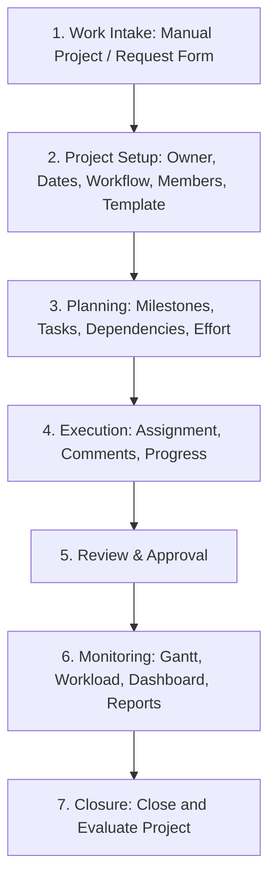

# Hasil Scanning Fitur Wrike

**Tanggal analisis:** 12 November 2026  
**Objek:** [Wrike](https://www.wrike.com/)  
**Metode:** Peninjauan dokumentasi dan halaman produk publik; bukan pengujian langsung seluruh fitur dalam akun berbayar.

## Ringkasan

Wrike merupakan platform *end-to-end work management* yang mencakup perencanaan proyek, penugasan, kolaborasi, persetujuan, pengelolaan sumber daya, pelaporan, otomasi, dan integrasi. Inventaris berikut dikelompokkan menjadi 12 modul.

## 1. Arsitektur Fitur Utama

Hierarki konseptual:

```text
Account / Workspace
└── Spaces
    ├── Projects
    │   └── Tasks / Subtasks / Custom Items
    └── Folders
        └── Tasks / Subtasks / Custom Items
```

- **Account / Workspace:** pengguna, administrasi, dan pengaturan keamanan.
- **Spaces:** area kerja tim, departemen, atau klien.
- **Projects:** tujuan, pemilik, jadwal, status, dan progres.
- **Folders:** pengelompokan pekerjaan.
- **Tasks / Subtasks / Custom Items:** unit kerja, penanggung jawab, status, dan effort.
- **Views:** Table, Board, Gantt, Calendar, dan Chart menampilkan data pekerjaan dalam representasi berbeda.

Proyek dapat dibuat secara manual dari antarmuka, dari *blueprint*, atau melalui *request form* sesuai konfigurasi.

## 2. Inventaris Fitur

Prioritas di bawah adalah klasifikasi analitis untuk pengembangan aplikasi custom, **bukan klasifikasi resmi Wrike**:

- **P0 — Core MVP:** fungsi dasar yang esensial.
- **P1 — Enhanced:** peningkatan efektivitas operasional.
- **P2 — Advanced:** kapabilitas lanjutan dan enterprise.

| Modul | Fitur yang teridentifikasi | Prioritas |
|---|---|---|
| 01. General Work Management | Workspace, Spaces, personal space, folder hierarchy, smart folders, global search, filtering, grouping, cross-tagging, work schedules | P0–P1 |
| 02. Project Management | Manual create project, project owner, status, start/due dates, subprojects, portfolio, milestones, progress calculation, task/subtask management, custom fields, dependency, baseline | P0–P2 |
| 03. Views & Reporting | Table, Board/Kanban, Gantt, Calendar, Chart, Files, custom views, dashboard, notifications, real-time reports | P0–P1 |
| 04. Advanced Reporting & BI | Advanced analytics, KPI dashboard, forecasting, performance metrics, Tableau integration, BI API | P2 |
| 05. AI Features | AI content generation, Copilot, task summarization, AI insights, project risk insights, AI agents, MCP Server | P2 |
| 06. Workflow Automation | Custom workflow, configurable statuses, conditional request forms, project/task templates, blueprints, approval flows, rule-based automation, custom item types | P1–P2 |
| 07. Resource Management | Resources view, workload charts, capacity visualization, effort estimation, allocation, time tracking, timesheets | P1 |
| 08. Advanced Resource & Capacity Planning | Job roles, resource bookings, individual skills, planned vs actual utilization, budget, hourly rates, asset scheduling | P2 |
| 09. Asset Creation & Collaboration | Comments, mentions, file attachments, document editor, versioning, file proofing, guest approval, external reviewers, Adobe integration | P0–P2 |
| 10. Integration | Public API, Google Drive, Microsoft 365, Slack, Jira, GitHub, Salesforce, Wrike Integrate, two-way sync | P1–P2 |
| 11. Admin & Security | Users, groups, user types, RBAC, custom access roles, sharing controls, SSO, 2FA, audit reports, locked spaces, encryption controls | P0–P2 |
| 12. Add-on Capabilities | Wrike Whiteboard, Datahub, Lock, Integrate, Sync, AI Elite action packs | P2 |

## 3. Pendalaman Fitur Utama

### A. Gantt & Dependency Management

- Penjadwalan interaktif dan milestone.
- Empat jenis dependensi: Finish-to-Start (FS), Start-to-Start (SS), Finish-to-Finish (FF), dan Start-to-Finish (SF).
- Perubahan jadwal dapat memengaruhi task yang memiliki dependensi.

### B. Multi-view Project Planning

- Pekerjaan yang sama dapat dilihat melalui Table, Board, atau Gantt.
- Tampilan yang berbeda tidak memerlukan duplikasi data task.

### C. Project Progress Engine

Wrike menyediakan tiga pendekatan progres: berdasarkan jumlah task yang selesai, berdasarkan durasi task yang selesai, atau rata-rata keduanya. Task yang dibatalkan atau ditangguhkan tidak dihitung dalam pendekatan tersebut.

### D. Workload & Resource Planning

- Visualisasi alokasi effort dan kapasitas anggota tim.
- Identifikasi *over-allocation*.
- *Resource booking* dapat dilakukan sebelum rincian task lengkap tersedia.

### E. Request Form & Approval

- Form untuk menerima kebutuhan pekerjaan.
- Pembuatan task atau proyek otomatis berdasarkan input form.
- Pengisian atribut, penetapan pemilik, dan pemicu approval.
- *Conditional branching* untuk menentukan alur berdasarkan jawaban.

### F. Workflow Automation

- Pola otomasi **WHEN → IF → THEN**.
- Contoh: perubahan status dengan kondisi tertentu memicu aksi yang telah ditentukan.
- Ketersediaan pemicu, aksi, dan kuota bergantung pada paket.

### G. Programme & Portfolio Timelines

Pembaruan Oktober 2026 memperkenalkan *programme and portfolio timelines* dengan dependensi lintas proyek untuk paket Pinnacle ke atas. Perubahan jadwal proyek pendahulu tidak otomatis menggeser proyek penerus; konflik ditampilkan untuk ditinjau pengguna.

## 4. Contoh Alur Bisnis End-to-End



**Catatan:** Ini adalah sintesis alur bisnis yang memungkinkan, bukan workflow wajib yang ditetapkan Wrike.

## 5. Perbedaan Fitur Berdasarkan Paket

| Paket | Harga publik | Kemampuan utama |
|---|---|---|
| Free | $0 | Task, project, Table, Board |
| Team | $10/user/bulan | Gantt, Dashboard, Calendar, automation |
| Business | $25/user/bulan | Request Forms, approval, workload, time tracking, custom item types |
| Pinnacle | Hubungi sales | Budgeting, resource bookings, advanced BI |
| Apex | Hubungi sales | Integrasi dan AI enterprise lebih luas, Whiteboard |

Harga Team dan Business adalah harga publik per pengguna per bulan dengan penagihan tahunan yang dirujuk dalam analisis November 2026. Paket, harga, dan add-on dapat berubah; periksa halaman harga resmi sebelum keputusan pembelian.

## 6. Status dan Batasan Scanning

**Tercakup:** katalog fitur, alur utama, dokumentasi bantuan, dan pembagian paket berdasarkan sumber publik.

**Belum diverifikasi langsung:** perilaku setiap tombol setelah login, konfigurasi enterprise secara menyeluruh, serta hasil uji positif/negatif menggunakan akun nyata.

Analisis ini merupakan *feature inventory* tingkat awal, bukan spesifikasi fungsional lengkap atau bukti hasil pengujian aplikasi.

## Referensi Resmi

1. [Wrike — Website](https://www.wrike.com/)
2. [Wrike — Features](https://www.wrike.com/features/)
3. [Wrike — Feature Comparison](https://www.wrike.com/comparison-table/)
4. [Wrike — Help Center](https://help.wrike.com/)
5. [Wrike — Pricing](https://www.wrike.com/price/)

---

*Dokumen ini sengaja tidak memuat bagian “Rekomendasi penerapan untuk LENS”.*
