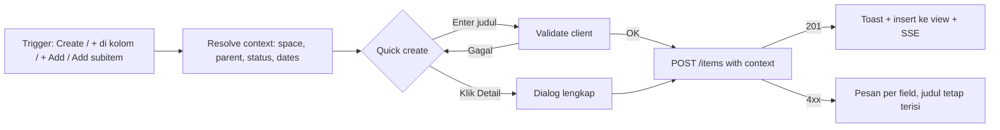

# Audit kode aktual: Create Task LENS

> Status: audit only. Tidak ada perubahan source code, database, commit, push, atau deploy.
> Basis: branch `feat/m12c-ui-clean` (HEAD `462b6cc`). Dibaca dari kode; tes yang dijalankan dibatasi pada tes tanpa database.
> Referensi perilaku Wrike: https://help.wrike.com/hc/en-us/articles/1500005120921-Creating-a-Task (dipakai sebagai acuan perilaku, bukan salinan UI).
> Klasifikasi: **Wrike parity** = perilaku yang disebut dokumentasi Wrike; **LENS requirement** = aturan dari PRD/kode LENS; **UX recommendation** = usulan, bukan kewajiban.

---

## A. Executive Summary

**Kondisi aktual.** Create Task di LENS terpusat di satu dialog (`CreateItemDialog`) dan satu endpoint (`POST /api/v1/items`). Validasi domain (permission per lokasi, aturan parent/allowed children, workflow, status, share) dilakukan di server dalam satu transaksi serializable. Dari sisi kode, jalur inti berjalan.

**Flow yang paling matang:** Workspace (menu Create dan Space), Table (tombol "+ Add" di bawah tabel), Board (tombol "+" per kolom status), dan subtask dari panel detail. Semuanya memakai dialog yang sama dan validasi server yang sama.

**Flow yang paling bermasalah:**
1. **Gantt**: hanya tombol "+ Add" yang membuka dialog tanpa tanggal. Tidak ada add above/below dan tidak ada create dari timeline.
2. **Calendar**: tidak bisa membuat Task dari tanggal, baik di Calendars maupun di Calendar View project (read-only).
3. **Workload**: tidak ada create Task dari lane resource. Halaman hanya menampilkan data, dan booking hanya untuk admin.

**Risiko terbesar:**
- Hampir semua jalur create memakai modal penuh, bukan quick-create inline. Ini bertentangan dengan ekspektasi Wrike "ketik nama lalu Enter".
- Tes integrasi backend dan E2E create tidak dijalankan di lingkungan ini (BLOCKED, lihat bagian C). Klaim "berfungsi" untuk perilaku runtime karena itu berstatus UNVERIFIED.

**Rekomendasi prioritas:**
1. Jalankan tes integrasi (`-tags integration`) dan E2E create di database terisolasi, untuk mengubah status UNVERIFIED menjadi PASS/FAIL.
2. Putuskan apakah Gantt, Calendar, dan Workload create termasuk scope (keputusan Product Owner, lihat F dan G).
3. Pertimbangkan quick-create inline di Board dan Table (UX).

---

## B. Actual Architecture

### B.1 Frontend

| Komponen | Lokasi | Peran |
|---|---|---|
| Dialog create | `web/src/components/create-item-dialog.tsx` | Modal create. `CreateForm` (63), `busy` guard (128), susun payload (142-143), autofocus judul (194), `<form onSubmit>` (189), tombol Create (309) |
| Menu Create global | `web/src/components/topbar.tsx` | Task (148), Project (149), Folder (150), tipe kustom (152), Blueprint (160). `CreateMenu` (125) |
| Board create | `web/src/components/view-workspace.tsx:209, 262-263`; `web/src/components/item-board.tsx:78` | `onAdd(column.id)` membuka dialog dengan `initialStatus` |
| Table create | `web/src/components/item-table.tsx:302` | Tombol "+ Add" di bawah tabel, `onAdd()` tanpa status |
| Gantt create | `web/src/components/item-gantt.tsx:72, 329` | Tombol "+ Add" saja. Callback sama dengan Table (`setCreating({})`) |
| Subtask | `web/src/components/item-detail.tsx:325`; `web/src/routes/_app/tasks.$itemId.tsx:88-90` | `CreateItemDialog` dengan `location.parent_item_id` |
| Calendar View | `web/src/components/view-workspace.tsx:240`; `web/src/components/item-calendar.tsx:24-25, 58, 64` | `readonly={!canEdit}`, tidak ada prop create |
| Calendars (lintas item) | `web/src/routes/_app/calendars.tsx` | `readonly`, data dari `/api/v1/me/todo` |
| Workload | `web/src/routes/_app/workload.tsx:83-104` | Hanya tampilan. Booking untuk admin (`/api/v1/resource-bookings`) |
| Validasi form | `web/src/lib/create-item-validate.ts` | Dipakai dialog untuk nama, Space, tanggal, dan parent |
| Menu create per Space | `web/src/lib/create-menu.ts` | Mengatur tipe yang ditawarkan (`menuAllows`) |

### B.2 Backend

| Bagian | Lokasi | Peran |
|---|---|---|
| Route | `server/internal/httpserver/server.go:204` | `POST /api/v1/items` → `requireUser(createItem)` |
| Handler | `server/internal/httpserver/items.go:106-120` | Decode, `items.Create`, notifikasi, publish SSE `item.created`, respons 201 |
| Create | `server/internal/items/create.go:32-38` | `inSerializable` dengan kunci advisory per parent |
| Lock dan retry | `server/internal/items/create.go:50-80, 99-124` | Retry saat 40001, urutan kunci tetap |
| Permission lokasi | `server/internal/items/create.go:194-207` | `View` gagal → `ErrNotFound` (404), `Create` gagal → `ErrForbidden` (403) |
| Cross-Space type | `server/internal/items/create.go:207-209` | Tipe kustom Space lain ditolak |
| Share | `server/internal/items/create.go:210-222` | Share hanya untuk Space `shared` dan kapabilitas `Share` |
| Parent dan allowed children | `server/internal/items/create.go:230-248` | Parent wajib, task hanya boleh berisi task (244-246), `allowed_children` (247-248) |
| Workflow | `server/internal/items/create.go:251-262, 297-304` | Child mewarisi workflow parent (226-228 menolak `workflow_id` pada child) |
| Status awal | `server/internal/items/create.go:306-310` | Status pertama workflow (`ORDER BY position`) |
| Status dari request | `server/internal/items/patch.go:283-323` | `applyFields` memvalidasi `status_id` ada di workflow yang sama. Aturan transisi hanya untuk item yang sudah ada (`incrementVersion`) |
| Ranking | `server/internal/items/create.go:336-345` | Rank di akhir sibling list |

### B.3 Persistensi dan cache

- Insert dan lokasi dilakukan dalam satu transaksi (`create.go:320-322`, 336-345).
- Frontend melakukan invalidasi query setelah `onCreated` (`create-item-dialog.tsx:164-167`). Event SSE `item.created` dikirim dari server (`items.go:116`).

### B.4 Tes yang ada

| Jenis | Berkas | Status di audit ini |
|---|---|---|
| Unit web | `web/src/lib/create-item-validate.test.ts` | **PASS** 7/7 |
| Unit Go paket items | `server/internal/items/*_test.go` | **PASS** 5 tes unit. Tes integrasi tidak ikut (build tag `integration`) |
| Integrasi Go create | `server/internal/httpserver/items_integration_test.go`, `create_lock_integration_test.go`, `item_types_integration_test.go`, `item_type_scope_integration_test.go`, dll | **BLOCKED**: butuh `-tags integration` dan database. `TEST_DATABASE_URL` tidak diatur, tidak ada Docker lokal |
| E2E | `web/tests/create-menu.spec.ts`, `create-menu-live.spec.ts`, `dr03-create-closes.spec.ts`, `items.spec.ts`, `board-lanes.spec.ts`, `gantt.spec.ts`, `calendar.spec.ts`, `workload-live.spec.ts` | **NOT RUN**: butuh aplikasi berjalan dan database. Tidak ada tes E2E yang khusus untuk Table "+ Add" atau Board create |

---

## C. Flow Coverage Matrix

Keterangan status: **MATCH** = ditemukan dan tervalidasi; **PARTIAL** = sebagian; **MISMATCH** = berbeda dari baseline tanpa keputusan produk; **BROKEN** = terbukti gagal; **NOT IMPLEMENTED** = dalam scope tetapi tidak ada; **NOT IN SCOPE** = tidak ada di PRD; **UNVERIFIED** = kode ada tetapi belum terbukti; **BLOCKED** = tidak bisa dijalankan di lingkungan ini.

| Flow | UI entry | Context | API | Permission | Tests | Status |
|---|---|---|---|---|---|---|
| FLOW-01 Workspace | Menu Create (topbar.tsx:148), default Task | Default Personal Space (create-item-dialog.tsx:71) | `POST /items` | View, Create per lokasi (create.go:202-206) | Unit payload PASS; E2E NOT RUN | **PARTIAL**: default sesuai Wrike, quick-create belum |
| FLOW-02 Board | "+" per kolom (item-board.tsx:78) | Status kolom dikirim sebagai `status_id` (dialog:143) | `POST /items` dengan `status_id` | Sama, plus validasi status di workflow (patch.go:283-323) | Integrasi BLOCKED; E2E board-lanes NOT RUN | **PARTIAL**: modal, bukan inline. Logika status MATCH (kode) tetapi UNVERIFIED |
| FLOW-03 Table | "+ Add" di bawah (item-table.tsx:302); subtask dari panel detail (item-detail.tsx:325) | Parent dari container (`tasks.$itemId.tsx:88`) | `POST /items` | Sama | Tidak ada E2E khusus | **PARTIAL**: tidak ada "Add subitem" di menu baris |
| FLOW-04 Gantt | "+ Add" (item-gantt.tsx:329) | Tanpa tanggal, tanpa parent di konteks baris | `POST /items` | Sama | gantt.spec.ts NOT RUN | **NOT IMPLEMENTED** untuk add above/below dan create dari timeline. Dicatat **NOT IN SCOPE** di PRD. Lihat G-05 |
| FLOW-05 Calendar | Tidak ada | Tidak ada | Tidak ada | — | calendar.spec.ts NOT RUN (tanpa create) | **NOT IN SCOPE** di PRD. Lihat G-06 |
| FLOW-06 Workload | Tidak ada create task. Booking admin saja (workload.tsx:83-104) | — | `/resource-bookings` untuk booking | Admin | workload-live.spec.ts NOT RUN | **NOT IN SCOPE** di PRD. Lihat G-07 |

**Cross-flow (bagian 4 pada prompt):**

| Aspek | Status | Bukti |
|---|---|---|
| Konteks (space, parent, type, workflow, status, assignee, tanggal) dikirim lengkap | **MATCH** (kode) | `create-item-dialog.tsx:142-149` |
| Validasi di backend, bukan hanya UI | **MATCH** | `create.go:194-248` |
| Konsistensi data (satu transaksi, tanpa orphan) | **MATCH** (kode) | `create.go:38, 320-345` |
| Duplikasi submit dicegah di sisi klien | **MATCH** (kode) | `create-item-dialog.tsx:128`, tombol disabled (309) |
| Duplikasi lintas klien | **NOT IMPLEMENTED** (tidak ada idempotency key) | Lihat G-10 |
| Fokus otomatis ke judul | **MATCH** (kode) | `create-item-dialog.tsx:194` |
| Enter membuat tanpa field opsional | **UNVERIFIED** | Form `onSubmit` ada (189). Perlu E2E |
| Draft dipertahankan saat gagal | **UNVERIFIED** | Tidak terbukti dari kode |

---

## D. Detailed Gap Ledger

Setiap temuan memuat langkah reproduksi, expected vs actual, bukti, severity, dan rekomendasi. Severity: P0 kebocoran atau korupsi data; P1 create gagal atau konteks salah; P2 UX atau inkonsistensi; P3 polishing.

### G-01 — Board create membuka modal, bukan quick-create inline
- **Flow:** FLOW-02
- **Expected (Wrike):** klik "+ Item" di kolom, ketik nama, Enter. Task langsung dibuat di kolom itu.
- **Actual:** klik "+" membuka `CreateItemDialog` penuh dengan `initialStatus` (`view-workspace.tsx:262-263`, `item-board.tsx:78`).
- **Langkah reproduksi:** buka Board, klik "+ Add" pada kolom mana pun.
- **Dampak:** lebih banyak klik untuk membuat Task sederhana. Status tetap benar.
- **Klasifikasi:** Wrike parity (UX). **Severity: P2.**
- **Rekomendasi:** input inline di kolom yang memanggil endpoint yang sama. Dialog tetap untuk field lanjutan.
- **Dependensi:** tidak ada perubahan API.
- **Tes yang perlu ditambahkan:** E2E Board create dengan Enter, memastikan status kolom dan urutan.

### G-02 — Status kolom Board: logika MATCH, runtime UNVERIFIED
- **Flow:** FLOW-02
- **Expected:** Task dibuat dengan status kolom tempat ia dibuat.
- **Actual (kode):** `create.go:306-310` menaruh status pertama workflow. Lalu `applyFields` (`patch.go:283-323`) menerima `status_id` dari request, memastikan status ada di workflow yang sama, dan tidak menerapkan aturan transisi karena `incrementVersion` false. Aturan transisi memang tidak berlaku saat create (komentar di `patch.go:316`).
- **Risiko:** kalau status kolom berasal dari workflow lain, server menolak. Ini sudah dijaga oleh `patch.go:306-307`.
- **Klasifikasi:** LENS requirement. **Status: MATCH (kode), UNVERIFIED (runtime).**
- **Tes yang perlu ditambahkan:** integrasi Create dengan `status_id` dari workflow lain (harus 400), dan dengan status kolom valid (harus 201 dan status terpasang).

### G-03 — Tidak ada "Add subitem" di menu baris Table
- **Flow:** FLOW-03
- **Expected (Wrike):** klik kanan folder/project, Add subitem, Task.
- **Actual:** subtask hanya bisa dibuat dari panel detail item (`item-detail.tsx:325`, `tasks.$itemId.tsx:88`). Tidak ditemukan menu baris dengan "Add subitem" di `item-table.tsx`.
- **Catatan:** PRD TASK-02 (subitem bertingkat, P0) terpenuhi lewat panel detail. Jadi ini gap parity dengan Wrike, bukan pelanggaran PRD.
- **Klasifikasi:** Wrike parity (UX). **Severity: P2.**
- **Rekomendasi:** tambahkan aksi "Add subitem" di menu baris Table, memakai `parent_item_id` baris.

### G-04 — Table "+ Add" membuat Task di container, tanpa konteks baris
- **Flow:** FLOW-03
- **Expected:** Task masuk ke hierarchy yang diharapkan, dan muncul sesuai sort, filter, dan grouping aktif.
- **Actual:** `onAdd()` (`item-table.tsx:302`) membuka dialog dengan `parent_item_id` container. Feedback jika filter aktif menyembunyikan Task baru tidak ditemukan di kode.
- **Klasifikasi:** LENS requirement (tidak menyesatkan). **Status: UNVERIFIED.**
- **Tes yang perlu ditambahkan:** E2E: filter aktif, buat Task yang tidak lolos filter, pastikan ada pesan atau tidak diam-diam hilang.

### G-05 — Gantt: tidak ada add above/below dan tidak ada create dari timeline
- **Flow:** FLOW-04
- **Expected (Wrike):** Add above/below dari baris Task. Membuat Task dengan drag pada timeline. Add above/below membuat Task satu hari dengan start date sama dengan acuan.
- **Actual:** `item-gantt.tsx` hanya punya `onAdd` (72) yang dipanggil dari tombol "+ Add" (329). Tidak ada handler pembuatan dari drag, dan tidak ada menu add above/below. Pencarian `subitem`/`drag create` di komponen Gantt tidak menemukan apa pun.
- **Klasifikasi:** Wrike parity. Di PRD tidak ada butir untuk ini. **Status: NOT IN SCOPE (keputusan produk diperlukan).** **Severity: P3** bila di luar scope.
- **Catatan:** drag di Gantt saat ini hanya untuk menggeser atau mengubah durasi (`item-gantt.tsx:185, 201`). Jangan disamakan dengan create.
- **Rekomendasi:** putuskan dulu. Bila masuk scope, buat fitur terpisah dengan kontrak tanggal inklusif dan durasi default.

### G-06 — Calendar: tidak ada create dari tanggal
- **Flow:** FLOW-05
- **Expected (Wrike Calendars):** klik tanggal, isi nama, pilih lokasi, Create. Durasi default per skala (minggu/bulan: 1 hari; kuartal: 5 hari; tahun: 1 bulan).
- **Actual:** Calendars (`calendars.tsx`) read-only. Calendar View di project (`view-workspace.tsx:240`) memakai `readonly={!canEdit}` dan `ItemCalendar` tidak punya prop create (`item-calendar.tsx:24-25`).
- **Klasifikasi:** Wrike parity. Di PRD tidak ada butir create dari kalender. **Status: NOT IN SCOPE (keputusan produk diperlukan).**
- **Catatan:** LENS menyebut Calendar View sebagai konsep terpisah dari fitur Calendars Wrike. Keduanya memang read-only untuk create.
- **Rekomendasi:** bila masuk scope, tambahkan klik tanggal ke `CreateItemDialog` dengan `start_date` dan `finish_date` terisi. Durasi default perlu keputusan produk.

### G-07 — Workload: tidak ada create Task dari lane resource
- **Flow:** FLOW-06
- **Expected (Wrike):** drag rentang tanggal pada baris assignee, isi nama, Task dibuat dengan assignee dari lane.
- **Actual:** `workload.tsx` hanya menampilkan data. Booking dibuat admin (`workload.tsx:83-104`, `/api/v1/resource-bookings`). Tidak ada jalur create Task.
- **Klasifikasi:** Wrike parity. Di PRD workload hanya tampilan dan alokasi. **Status: NOT IN SCOPE (keputusan produk diperlukan).**
- **Rekomendasi:** keputusan PO. Bila masuk scope, status **NOT IMPLEMENTED** dan butuh desain kapasitas, konflik, dan rollback alokasi.

### G-08 — Lokasi default: Personal Space (MATCH)
- **Flow:** FLOW-01
- **Expected (Wrike):** default Personal Space.
- **Actual:** `create-item-dialog.tsx:71` `location?.space_id ?? me.personal_space_id`. Menu global memulai dari Task (`topbar.tsx:148`).
- **Status: MATCH.** Pengguna bisa mengganti Space dan parent (fieldset lokasi, dialog sekitar baris 200).

### G-09 — Enter dan field opsional: UNVERIFIED
- **Flow:** FLOW-01
- **Expected (Wrike):** Enter membuat Task tanpa field opsional.
- **Actual (kode):** form `onSubmit` (189), judul `required` (194). Field lain dibuat opsional. Perilaku runtime belum diuji.
- **Status: UNVERIFIED.** **Tes:** E2E judul saja + Enter.

### G-10 — Idempotency lintas klien tidak ada (P2)
- **Flow:** semua
- **Expected:** submit ganda dari dua tab atau retry jaringan tidak membuat dua Task.
- **Actual:** dicegah di klien dengan `busy` (`create-item-dialog.tsx:128`). Server tidak punya idempotency key untuk `POST /items`. Retry setelah timeout jaringan bisa membuat duplikat.
- **Severity: P2.** **Rekomendasi:** `Idempotency-Key` header bila ada kebutuhan. Ini perubahan kontrak API, butuh keputusan.

### G-11 — Permission dan validasi parent: MATCH (kode)
- **Flow:** semua
- **Actual:** `View` gagal → 404 (`create.go:202-204`). `Create` gagal → 403 (205-206). Task tidak boleh berisi non-task (244-246). `allowed_children` ditegakkan (247-248). Tipe Space lain ditolak (207-209).
- **Status: MATCH (kode), UNVERIFIED (runtime).** Tes integrasi BLOCKED.

### G-12 — Konsistensi data saat create: MATCH (kode)
- **Actual:** insert item dan lokasi dalam satu transaksi serializable (`create.go:38, 320-345`). Ranking dan kunci advisory per parent (`create.go:99-124`).
- **Status: MATCH (kode).** Tes concurrency `create_lock_integration_test.go` tidak dijalankan.

### G-13 — Error dan feedback
- **Actual:** field error dari server dipetakan ke field (`create-item-dialog.tsx:170-172`). Sukses memakai toast (164). Error umum dan retry tidak terbukti.
- **Status: UNVERIFIED** untuk pesan error umum dan draft yang tetap ada setelah gagal.
- **Severity: P2** bila draft hilang.

### G-14 — Custom fields wajib: UNVERIFIED
- **Actual:** tidak ditemukan pemeriksaan field wajib di jalur create dialog dalam pembacaan ini. Ini belum dibuktikan.
- **Tes:** integrasi create dengan custom field wajib pada item type.

---

## E. Proposed UX Flow (per entry point)

Urutan umum: 1) Trigger, 2) resolusi konteks, 3) quick-create, 4) edit lanjutan opsional, 5) validasi, 6) persist, 7) feedback dan refresh view.

- **Workspace:** Trigger menu Create (Task default). Konteks Personal Space. Quick-create di dialog yang sudah ada. Saat ini belum inline.
- **Board:** Trigger "+" pada kolom. Konteks status kolom. Target: input inline di kolom.
- **Table:** Trigger "+ Add" atau "Add subitem" (belum ada di menu baris). Konteks parent. Muncul di posisi sesuai sort.
- **Gantt:** Trigger "+ Add" saja. Target bila di scope: add above/below dan create dari timeline, dengan tanggal dari rentang.
- **Calendar:** belum ada. Bila di scope: klik tanggal dengan durasi default yang didokumentasikan.
- **Workload:** belum ada. Bila di scope: drag pada lane dengan validasi kapasitas.

---

## F. Remediation Plan

### Batch 1 — Kontrak, permission, dan kebenaran data
- Jalankan tes integrasi create (`-tags integration`) di database terisolasi. Tanpa ini, status tetap UNVERIFIED. (Blocker, effort kecil, bila database tersedia.)
- Tambah tes integrasi: status dari workflow lain (400), status kolom valid (201), custom field wajib (G-14).
- Putuskan idempotency (G-10). Butuh keputusan kontrak.
- **Dependensi:** tidak ada. **Paralel:** ya.

### Batch 2 — Workspace, Board, dan Table
- Quick-create inline di Board (G-01). Effort sedang. Bergantung pada tes Batch 1.
- "Add subitem" di menu baris Table (G-03). Effort kecil.
- Feedback ketika filter menyembunyikan Task baru (G-04). Effort kecil.
- Draft dipertahankan saat gagal (G-13). Effort kecil.
- **Paralel:** G-03 dan G-04 bisa paralel. G-01 bergantung pada keputusan UX.

### Batch 3 — Gantt dan Calendar
- Hanya setelah keputusan scope (G-05, G-06). Bila masuk: add above/below, create dari drag timeline, create dari tanggal kalender, dengan aturan tanggal inklusif dan durasi default. Effort besar.

### Batch 4 — Workload (bila masuk scope)
- Create dari lane resource (G-07) dengan validasi kapasitas dan rollback alokasi. Effort besar. Butuh desain.

### Batch 5 — E2E, regresi UX, dan stabilisasi
- E2E untuk setiap entry point yang ada, termasuk Enter dan Escape, duplikasi submit, dan permission denial.
- Tambah E2E khusus Table "+ Add" dan Board create (belum ada).

---

## G. Final Recommendation

**Sebaiknya dipertahankan sekarang:**
- Dialog create tunggal dan endpoint `POST /items` dengan validasi server.
- Lokasi default Personal Space.
- Transaksi serializable dan kunci per parent.
- Pemeriksaan permission per lokasi.

**Perlu diperbaiki sekarang:**
- Jalankan tes integrasi dan E2E create, supaya klaim runtime bisa dibuktikan (Batch 1).
- Quick-create Board dan "Add subitem" di Table (Batch 2). Ini gap parity dengan Wrike yang paling terlihat pengguna.

**Perlu keputusan Product Owner:**
- Gantt create (add above/below dan dari timeline).
- Calendar create dari tanggal dan durasi default.
- Workload create dari lane.
- Idempotency key pada `POST /items`.

**Bisa ditunda:** polishing visual dan kenyamanan keyboard di dialog.

**Kesiapan untuk pilot internal dan production:**
- Berdasarkan kode yang diperiksa, jalur create inti (Workspace, Board, Table, subtask) terimplementasi dengan validasi server yang lengkap.
- Namun, bukti runtime belum ada. Tes integrasi dan E2E create tidak dijalankan di lingkungan ini (BLOCKED).
- **Rekomendasi:** siap untuk pilot internal terbatas setelah Batch 1 lulus. Belum dinyatakan siap production sebelum tes integrasi dan E2E create hijau di database terisolasi.

---

## H. Catatan metode dan batasan

- Audit dilakukan dengan membaca kode dan menelusuri jalur dari UI ke API. Tidak ada aplikasi yang dijalankan untuk audit ini.
- Pencarian komponen memakai nama dan kata kunci. Ada kemungkinan perilaku tersembunyi di komponen yang tidak terbaca.
- Tes yang dijalankan: `create-item-validate.test.ts` (7 PASS), `go test ./internal/items/` (5 PASS, tanpa integrasi).
- Tes yang tidak dijalankan: integrasi Go create (BLOCKED), seluruh E2E create (NOT RUN). Alasan: tidak ada `TEST_DATABASE_URL` dan tidak ada Docker lokal.
- Tidak ada secret atau token yang dicantumkan dalam laporan ini.
