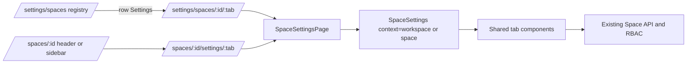

# LENS — Space Settings: reusability and contextual navigation

Branch: `feat/space-settings-breadcrumb` (base `origin/main` e8d44bc). Status: implemented and tested locally, not committed, not pushed, not deployed.

## 1. Root cause (existing navigation)

- The Workspace registry (`/settings/spaces`) linked each row's Settings to `/spaces/$spaceId/settings/general`.
  That route is inside the Space work area, so the user left the Settings context and the Space sidebar took over.
- The return path to the registry was only the breadcrumb, and the registry's search, filter and page were kept in component state, so they were lost on every trip.
- The Custom item types tab in Space settings rendered nothing: `SpaceSettings` imported `ItemTypesPanel` but had no `item-types` branch.

## 2. Route mapping

| Entry | Before | After |
|---|---|---|
| Registry row → Settings | `/spaces/$spaceId/settings/general` | `/settings/spaces/$spaceId/general` |
| Space header / sidebar → Settings | `/spaces/$spaceId/settings/$tab` | unchanged |
| Direct URL, bookmark (old) | `/spaces/$spaceId/settings/$tab` | unchanged (`spaces_.$spaceId.settings.$tab.tsx`) |
| Direct URL (new) | — | `/settings/spaces/$spaceId/$tab` (`settings/spaces_.$spaceId.$tab.tsx`) |
| Unknown tab | redirect to General in the Space context | redirect to General in the same context |
| Registry filters, sort, group, page | component state | URL search params on `/settings/spaces` |

Context is an explicit value, `SpaceSettingsContext = "workspace" | "space"`. It picks the tab URL and the back link. It is not hardcoded in the tab components.

## 3. Component reuse inventory

| Component | Responsibility | Action |
|---|---|---|
| `SpaceSettingsPage` (new export in `space-settings.tsx`) | Load Space, loading / 404 / error, render content | Shared by both routes. Replaces the duplicated route bodies |
| `SpaceSettings` | Tabs, breadcrumb, back link, unsaved-change guard | Added `context` prop only |
| `SettingsLayout` (`routes/_app/settings.tsx`) | Workspace Settings shell | Reused unchanged. The new route renders inside it |
| `SettingsSidebar` | Workspace Settings navigation | Reused unchanged |
| `GeneralTab`, `MembersTab`, `CustomFieldsTab`, `WorkflowDefaultsTab`, `SpaceToolsPanel`, `SpaceAutomationPanel`, `FormsList`, `BlueprintsTab`, `ItemTypesPanel` | Tab content | Reused unchanged. No copies |
| `SpacesManagement` (registry) | Registry | URL state, row action menu |

New components: 1 (`SpaceSettingsPage`) and 1 route file. Duplicated page logic: none.

## 4. Changed files

- `web/src/components/space-settings.tsx`: `SpaceSettingsContext`, `SpaceSettingsPage`, context-aware tab links and breadcrumb, back link, `item-types` tab branch.
- `web/src/routes/_app/spaces_.$spaceId.settings.$tab.tsx`: now uses `SpaceSettingsPage` with `context="space"`.
- `web/src/routes/_app/settings/spaces_.$spaceId.$tab.tsx` (new): Workspace-context route.
- `web/src/routes/_app/settings/spaces.tsx`: Settings link target, one row action menu, URL search state.
- `web/src/routeTree.gen.ts`: regenerated by the router plugin.
- `web/src/components/ui` and layout: no change.
- i18n: `spaces.json`, `settings.json` (en, id): back links, action menu label, empty states.
- Tests: `web/tests/space-settings-context.spec.ts` (new, 6 tests), `space-settings.spec.ts` (2 empty-state tests), `batch5-visual.spec.ts` (exact heading match).

## 5. RBAC compatibility

No change to backend, policy engine, API contracts or database.

- Settings link appears only where it did before: `canEdit` for the row menu's Settings item. Rename needs `edit`.
- Back link and tab navigation do not grant anything. The server still answers each request.
- D-17.1 unchanged: Workspace Admin still gets no content of a Shared Space.
- Members & access still follows `share`, Archive still follows explicit Space Admin.

## 6. UX changes

- Settings opened from the registry stays in the Settings shell with a "Back to all Spaces" link.
- Settings opened from a Space stays in the Space work area with a "Back to Space" link.
- Registry rows: the Space name is the link; one `···` menu holds Open, Copy link, Rename and Settings. Items follow capability.
- Registry filters, sort, group and page are in the URL and survive reload.
- Custom item types tab renders the existing panel. A Space with no types of its own shows an empty state with "New custom item type" (only for users who can manage).
- Blueprints tab empty state has a "Browse blueprints" action.

## 7. Verification

- `npm test`: 105 pass.
- `npx tsc -b`: pass. Note: `npx tsc --noEmit -p .` checks nothing in this repo (the root tsconfig only has references). Use `tsc -b` or `npm run typecheck`.
- `npx eslint src`: pass.
- Playwright, full suite: 608 passed, 0 failed, 43 skipped (live tests gated by env). Run before the last import cleanup; the cleanup was re-checked with tsc and eslint only.
- New tests: NAV-01, NAV-03, NAV-05, NAV-06, NAV-07, NAV-08, NAV-09, NAV-10, FUN-03, FUN-04, and URL state for the registry.

## 8. Open issues

- **Back to all Spaces does not restore the registry's search.** The back link goes to `/settings/spaces` with default filters. Browser Back does restore them. Fix would be to pass the registry search through the Settings link.
- **Space work area and Workspace context have separate sidebars by design.** The Workspace context keeps the Settings shell sidebar, so the Space's own tabs are the in-page list. This is the "Settings focus" the prompt asked for; there is no second sidebar.
- FUN-01, FUN-02, FUN-05 to FUN-09: not added in this change. The existing `space-settings` and `spaces` specs cover the same tabs and save paths, but they were not re-audited against each row of the prompt.
- Item types loading and error states are not separately tested.
- The Settings-to-Space entry link from Workspace context is not present on Space work area pages, which is expected.

## 9. Regression risks

- Old route `/spaces/$spaceId/settings/$tab` and the new route share one component; a change to `SpaceSettings` affects both.
- Registry URL state: an invalid search value is dropped silently by `validateSearch`.
- Row action menu replaces inline buttons. Keyboard users now open one menu instead of tabbing through four buttons.

## 10. Recommendation

Merge after review of the Back link behavior (section 8). Deploy only after the open decision on the registry Back link.

## Diagram

