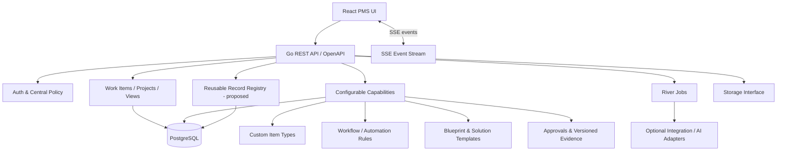
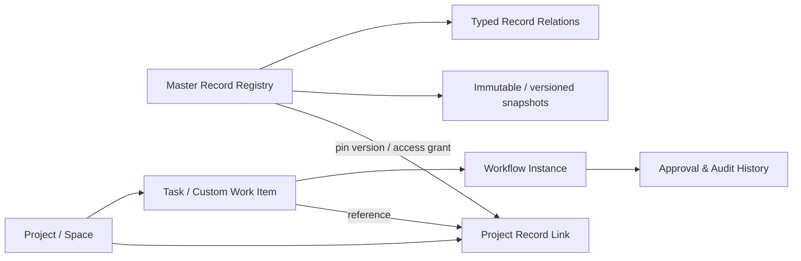
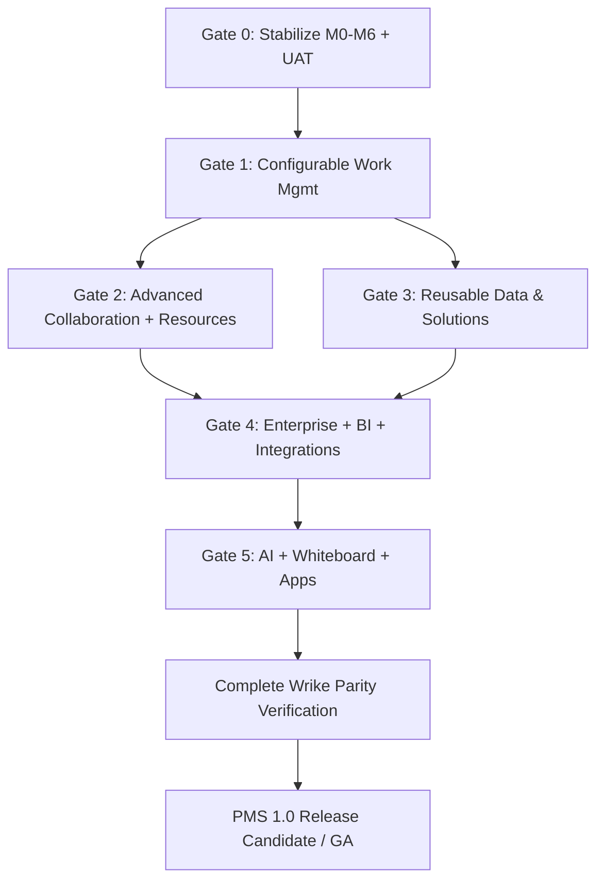
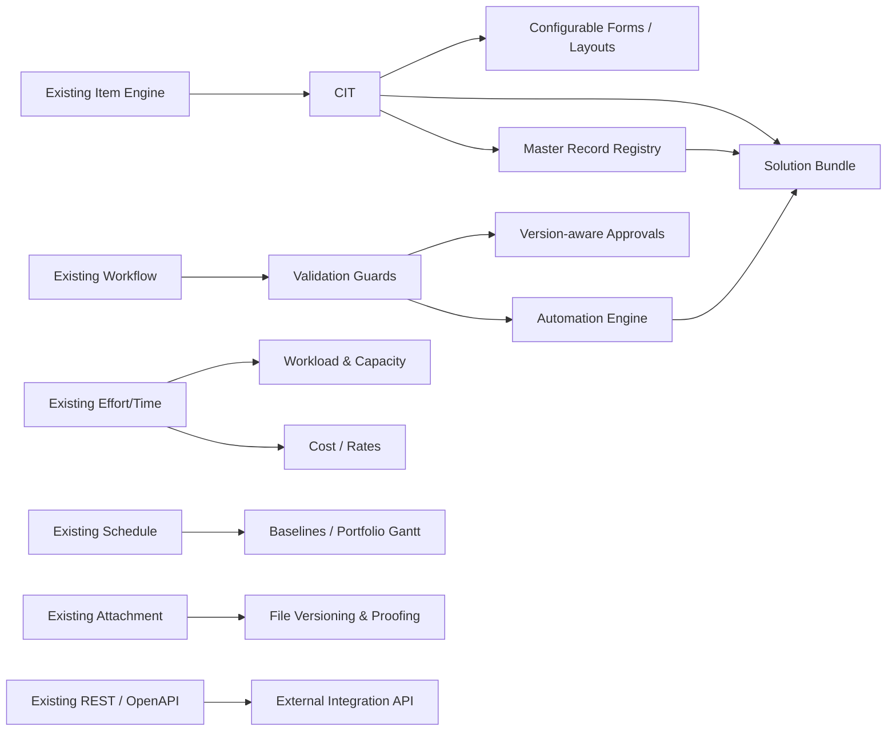
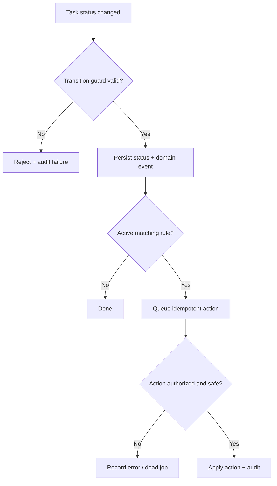
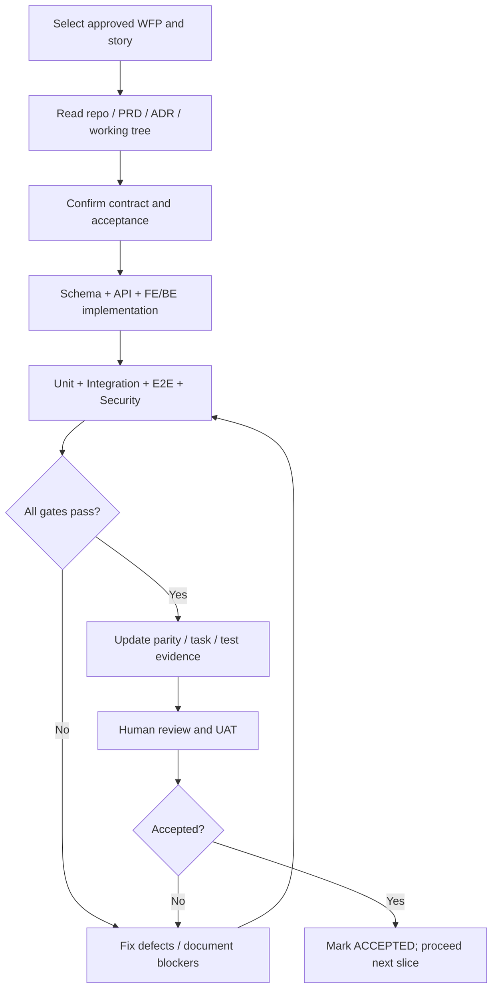

# PMS — Wrike Full Feature Parity Development Baseline

> **Status:** DRAFT — implementation planning baseline, **bukan** sign-off kesetaraan Wrike.  
> **Dokumen:** `PMS_WRIKE_PARITY_DEVELOPMENT_BASELINE.md`  
> **Versi dokumen:** 1.0-draft  
> **Tanggal baseline:** 13 November 2026 (Asia/Jakarta)  
> **Repo target:** `github.com/anissaefuddin/pms`  
> **Baseline laporan kode:** `main` @ `0872b69` (13 November 2026)  
> **Target produk:** **PMS 1.0 — seluruh fitur dalam Wrike Feature Baseline yang dibekukan dan disetujui**  
> **Owner/approver:** belum ditetapkan; isi dalam repo sebelum baseline dinyatakan final.

## 0. Tujuan dokumen dan aturan pemakaian

Dokumen ini adalah **acuan untuk melanjutkan development PMS di lokal** dengan target akhir menyamai kemampuan seluruh paket dan add-on Wrike yang masuk dalam *frozen feature baseline*. Dokumen ini menjembatani:

1. status implementasi PMS berdasarkan dokumentasi yang diunggah;
2. gap terhadap katalog Wrike yang telah dianalisis;
3. epic, dependency, acceptance criteria, dan rencana verifikasi;
4. aturan kerja coding agent agar tidak melakukan rewrite atau merusak fitur eksisting.

**Interpretasi objective:** cakupan 1.0 adalah *full feature parity*, bukan MVP minimalis. Untuk mengurangi risiko, pengerjaan dibagi ke **internal checkpoints 0.x / gates**, tetapi tidak otomatis mengeluarkan fitur enterprise/Pinnacle/Apex/add-on dari target 1.0. Semua penundaan atau perubahan target harus masuk *decision register* dan disetujui pemilik produk.

**Penting:** dokumen ini **tidak** mengklaim 100% inventaris Wrike telah terverifikasi. Katalog produk berubah, fitur berbeda menurut plan, lisensi, wilayah, dan add-on. Daftar di §4 adalah *initial parity register* yang **wajib direkonsiliasi satu per satu dengan dokumentasi resmi Wrike pada tanggal freeze**. Kemampuan yang belum tersedia di sumber publik tetap berstatus `NEEDS_SOURCE_VERIFICATION`, bukan otomatis dianggap dimiliki PMS atau Wrike.

### 0.1 Sumber dan tingkat kepercayaan

| Sumber | Penggunaan | Batasan |
|---|---|---|
| `dokumentasi-hasil-implementasi-prd.md` (unggahan) | Milestone, pengujian, status UAT, blocker | Berdasarkan laporan, **bukan audit langsung repo/runtime** |
| `feature-map-pms.md` (unggahan) | Fitur, requirement, lokasi kode, status | Menggambarkan baseline `0872b69`, dapat berubah di working tree |
| `docs/product/PRD.md` v0.3.2 **yang dilaporkan berada di repo** | Sumber requirement normatif saat developer memulai | **Tidak dilampirkan** dalam percakapan ini; harus dibaca langsung dari repo lokal |
| `PRD_PMS.md` v0.2 (unggahan sebelumnya) | Konteks arsitektur/keputusan awal | **Tidak boleh** mengalahkan PRD v0.3.2 yang lebih baru |
| `Wrike_Feature_Scanning.md` | Referensi historis hasil scanning | Tidak cukup sebagai bukti semua fitur terkini |
| `BUSINESS_OBJECT_REGISTRY_ARCHITECTURE.md` | Usulan registry untuk Engineering/Talent | Proposal, **belum** disetujui sebagai requirement produk |
| [Wrike comparison table](https://www.wrike.com/comparison-table/) | Inventaris resmi plan/feature | Perlu cek ulang saat freeze dan per update |
| [Wrike features](https://www.wrike.com/features/), [Solutions](https://www.wrike.com/solutions/?enable-filtering=1), [Help Center](https://help.wrike.com/) | Makna fitur, user flow, batasan perilaku | Referensi produk, **bukan** izin menyalin aset/brand/UI persis |

**Aturan precedence:** keputusan produk/PRD terbaru yang sudah disetujui > ADR/DECISIONS yang disetujui > API/domain contract yang berlaku > dokumen ini (planning) > dokumentasi historis; jika bertentangan, **catat konflik lalu minta keputusan**, jangan diam-diam memilih salah satu.

---

## 1. Snapshot implementasi yang harus dipertahankan

| Item | Kondisi berdasarkan laporan 13 Nov 2026 | Status verifikasi |
|---|---|---|
| Backend | Go `net/http`, modular monolith, satu binary | Dilaporkan ada |
| Frontend | React + Vite + TypeScript; TanStack Router/Query; Tailwind 4 + Base UI | Dilaporkan ada |
| API | OpenAPI sebagai kontrak; sekitar 116 path | Angka perkiraan laporan |
| Data | PostgreSQL 16; migrasi Goose `00001`–`00045`; `sqlc`/`pgx` | Dilaporkan ada |
| Job | River/PostgreSQL (email, housekeeping, report digest) | Dilaporkan ada |
| Events | SSE `/events` | Ada, konsistensi beban belum tervalidasi |
| Core PMS | Spaces, Project/Folder/Task, Table, Board, Gantt, Calendar, Timelog, sharing, RBAC | Kode dan tes otomatis dilaporkan ada |
| Workflow | Status editor, approval, Blueprint, form builder, request tracking | Kode dan tes otomatis dilaporkan ada |
| Analytics | Dashboard, widget, report, ekspor | Kode dan tes otomatis dilaporkan ada |
| Milestone M0–M5 | `DONE`, kecuali tugas `S1.1.4` di M1 | Bukan UAT acceptance |
| M6 | Kode ada, stories `IN_PROGRESS` | Belum selesai |
| GA | `GA.1`–`GA.4` `PROPOSED` | Belum deploy klien |
| P0/P1 UAT | **93 requirement NOT RUN** | **Release blocker** |
| Audit UI | **64/100**; 3 P1, 3 P2, 2 P3 | Perlu tindak lanjut |

**Batas penilaian:** `IMPLEMENTED` berarti *kode + bukti tes dilaporkan*, sedangkan `ACCEPTED` hanya bila UAT requirement lulus dan evidence terekam. Jangan mengubah `NOT RUN` menjadi `PASS` hanya karena unit/integration test hijau.

### 1.1 Hal yang sudah dilaporkan lulus

- Table 500 item p95 **498,8 ms**, Board 500 item p95 **451,6 ms**, ambang PRD 1.500 ms.
- Search 10.000 item p95 **60,0 ms**, target 800 ms.
- Gantt p95 **939–967 ms** pada 500–1.000 bar (pengukuran lokal).
- Dashboard 16 widget p95 **266,5 ms** lokal.
- Playwright lima suite lokal `PASS`, tetapi eksekusi GitHub Actions `NOT RUN`.
- Axe pada 18 layar light/dark `PASS` pada cakupan yang diuji.
- Audit dependency dan image container dilaporkan `PASS`.

**Jangan** mengekstrapolasi performa lokal menjadi SLA produksi tanpa test lingkungan, data, dan concurrency yang representatif.

### 1.2 Release blockers yang wajib ditutup terlebih dahulu (`GATE-0`)

| ID | Temuan / tugas | Evidence penutupan yang diminta |
|---|---|---|
| STAB-01 | Semua **93** requirement P0/P1 belum UAT | Matriks UAT: per requirement PASS/FAIL/BLOCKED, reviewer, tanggal, evidence |
| STAB-02 | Respons HTTP 500 intermiten pada `GET /me`, view list, time entries | RCA, perbaikan, regression test reproducible, error rate nol untuk skenario uji |
| STAB-03 | Required CI check / `S1.1.4` terganjal GitHub HTTP 403 | CI required check aktif dan lulus pada PR, dengan bukti run |
| STAB-04 | WSTG/endpoint coverage security belum lengkap | Inventory endpoint, positive/negative authorization test, laporan residual risk |
| STAB-05 | SSE status & komentar pada beban dan reconnect belum diverifikasi | Tes multi-user + reconnect + event ordering/idempotency |
| STAB-06 | Playwright belum berjalan di CI | Artefak run CI hijau + report + screenshots/traces jika fail |
| STAB-07 | UI-01/02: sidebar & Settings mobile | Fix + screenshot 390/768/1280 px; perilaku sesuai scope mobile |
| STAB-08 | UI-03: ARIA Gantt invalid | Audit accessibility ulang setelah fix; fallback/library patch jika perlu |
| STAB-09 | M6 `IN_PROGRESS` (onboarding, Settings, purge, backup/restore, decommission) | Status masing-masing story didukung test & acceptance |
| STAB-10 | GA belum dimulai | Runbook pilot, migration rehearsal, restore drill, exit gate, rollback/roll-forward plan |

**Aturan pengerjaan:** fitur baru boleh dieksplorasi di branch terpisah, tetapi **tidak boleh mengklaim release ready** atau men-deploy klien sebelum blocker yang relevan ditutup.

---

## 2. Definisi *full parity* dan cara mengukurnya

**Parity tidak berarti menyalin source code, desain visual, nama, ilustrasi, atau merek Wrike.** Yang dibandingkan adalah *capability* dan *observable behavior* dengan desain PMS orisinal.

Setiap fitur memiliki status tunggal:

| Status | Makna |
|---|---|
| `NEEDS_SOURCE_VERIFICATION` | Fitur, plan, atau perilakunya belum dipastikan dari referensi resmi |
| `NOT_STARTED` | Confirmed target tetapi belum ada implementasi |
| `PARTIAL` | Sebagian fungsi ada tetapi capability/acceptance belum lengkap |
| `IMPLEMENTED` | Kode ada dan automated test yang relevan lulus |
| `TESTED` | Functional + negative + integration/E2E yang relevan lulus |
| `ACCEPTED` | Product/UAT sign-off dengan evidence; baru dihitung parity |
| `N/A_APPROVED` | Tidak relevan/di luar cakupan dengan **keputusan eksplisit** (tidak boleh sepihak) |

**Satu fitur parity** memerlukan seluruh hal berikut: (1) sumber perilaku Wrike yang diverifikasi; (2) requirement dan owner; (3) implementasi end-to-end; (4) permission/edge/error cases; (5) automated test; (6) UAT; (7) bukti dan tanggal pemeriksaan.

Rumus cakupan — hanya setelah baseline fitur disetujui:

```text
Acceptance parity % = jumlah item ACCEPTED / jumlah item in-scope yang telah diverifikasi × 100%
```

Jangan menghitung fitur `NEEDS_SOURCE_VERIFICATION` sebagai accepted atau menghapusnya dari denominator tanpa keputusan. **Saat ini tidak ada angka parity yang sah untuk dilaporkan** karena inventaris seluruh Wrike belum difreeze/direview dan UAT P0/P1 belum berjalan.

### 2.1 Feature baseline freeze procedure

1. Buat `docs/parity/WRIKE_SOURCE_CATALOG_2026-11-13.md`.
2. Periksa plan **Free, Team, Business, Pinnacle, Apex**, juga add-on (Integrate, Sync, Datahub, Whiteboard, Lock, AI jika ditawarkan), plus web/mobile/desktop bila termasuk objective.
3. Untuk setiap fitur tulis: nama resmi, URL help/sales yang tepat, plan/add-on, kapabilitas rinci, batasan/kuota, tanggal dicek, dan evidence.
4. Bandingkan terhadap `docs/product/PRD.md` **yang aktual di repo** dan `feature-map-pms.md`; pecah fitur besar ke testable sub-capabilities.
5. Review owner produk dan QA; tandai *ambiguous*, plan-gated, atau third-party-dependent sebelum menetapkan scope.
6. **Freeze** snapshot dan beri version tag dokumen; perubahan fitur Wrike setelah tanggal freeze masuk change request, bukan secara otomatis memperluas release 1.0.

---

## 3. Arsitektur yang harus dipertahankan dan arah ekstensi

**Dilarang rewrite** seluruh aplikasi atau memigrasikan Go → framework lain tanpa ADR dan persetujuan eksplisit. Prioritaskan penambahan lapisan konfigurasi terhadap fondasi saat ini.



Prinsip implementasi:

- **Single canonical policy:** otorisasi dievaluasi server-side untuk UI/API/import/job/automation.
- **Event consistency:** perubahan dari UI, API, import, automation, dan background worker melewati layanan domain yang sama; tidak ada bypass aturan bisnis.
- **No forced domain tables:** Facility/HAZOP/Candidate tidak dibuat sebagai modul CRUD khusus bila cukup dengan object registry & solution template; tetapi data finansial sensitif dan engineering revision bisa memerlukan specialized rules.
- **Versioned configuration:** Blueprint, CIT, workflow, form, dan solution template punya ID stabil dan versi; project instance tidak berubah diam-diam ketika template diterbitkan ulang.
- **Backward-compatible evolution:** API/schema UI lama tetap bekerja atau melalui migrasi kompatibel dengan tes regresi.
- **Storage ownership:** lampiran dan record memiliki scope/owner/permission; external data tidak boleh terbuka lintas klien.

### 3.1 Pemisahan object generik vs pekerjaan



Ini penting untuk rencana **Losaka Engineering Asset** (Facility/Equipment/P&ID) dan **Talent Pool** (Candidate/Skill/CV): master data dipakai ulang antarkerja, tidak diduplikasi menjadi Task setiap kali ada proyek baru. Kedua solusi adalah **validation use cases**, bukan alasan memasukkan semua modul khususnya ke dalam core Wrike parity.

---

## 4. Initial Wrike Feature Parity Register

**Catatan:** register berikut menggabungkan kemampuan yang sudah dianalisis dari katalog Wrike dengan status PMS yang **dilaporkan**. Ini belum menjadi verifikasi resmi tiap fitur Wrike dan **bukan** pernyataan feature coverage lengkap. Tambah/perbaiki baris setelah memeriksa halaman dokumentasi resmi. Singkatan: `REP` = kode/tes dilaporkan; `PAR` = parsial; `GAP` = belum tercatat/di backlog; `VERIFY` = perlu cek sumber dan repo. Seluruh baris belum `ACCEPTED` sampai UAT.

| Parity ID | Kelompok | Capability target | PMS baseline (laporan) | Gap status | Epic | Paket/cek |
|---|---|---|---|---|---|---|
| WFP-001 | Work management | Spaces / team work areas | Space CRUD, Personal space | `REP` | `CORE` | Free+ |
| WFP-002 | Work management | Projects / folders / nested work | Project/Folder/Task hierarchy | `REP` | `CORE` | Free+ |
| WFP-003 | Work management | Task & subtask, assignees | CRUD, multi-assignee | `REP` | `CORE` | Free+ |
| WFP-004 | Work management | Multiple locations / cross-tagging | ItemLocations | `REP` | `CORE` | Verify |
| WFP-005 | Work management | Work schedules and calendar settings | SET-07 | `REP` | `CORE` | Verify |
| WFP-006 | Work management | Project progress tracking | TASK-09 | `REP` | `CORE` | Verify |
| WFP-007 | Work management | Template / Blueprint projects | SPC-13 | `REP` | `TPL` | Business+ |
| WFP-008 | Work management | Space templates | SPC-18 | `PAR` | `TPL` | Verify |
| WFP-009 | Work management | Custom item types | CUST-01 not implemented | `GAP` | `CIT` | Business+ |
| WFP-010 | Work management | Custom item layout and default fields | No verified configurable layout | `GAP` | `CIT` | Verify |
| WFP-011 | Work management | Custom fields (basic and advanced) | TASK-10/11A | `PAR` | `CIT` | Verify |
| WFP-012 | Work management | Formula custom fields | TASK-11B not implemented | `GAP` | `CIT` | Verify |
| WFP-013 | Work management | Global and scoped search | NAV-06/07 | `REP` | `CORE` | Free+ |
| WFP-014 | Work management | Starred and shared-with-me | Navigation additions | `REP` | `CORE` | Verify |
| WFP-015 | Work management | Guest / external collaborators | External sharing reported | `PAR` | `ENT` | Verify |
| WFP-016 | Planning & views | Table view inline edit / hierarchy | VIEW-01 | `REP` | `CORE` | Free+ |
| WFP-017 | Planning & views | Kanban Board / drag and drop | VIEW-02 | `REP` | `CORE` | Free+ |
| WFP-018 | Planning & views | Gantt bar, milestones | VIEW-05A | `REP` | `SCH` | Team+ |
| WFP-019 | Planning & views | Four dependency types | VIEW-05B | `REP` | `SCH` | Verify |
| WFP-020 | Planning & views | Automatic dependency scheduling | Go schedule engine | `PAR` | `SCH` | Verify |
| WFP-021 | Planning & views | Gantt baselines / variance | VIEW-05C not implemented | `GAP` | `SCH` | Verify |
| WFP-022 | Planning & views | Project/programme portfolio Gantt | Not documented | `GAP` | `SCH` | Pinnacle+ Verify |
| WFP-023 | Planning & views | Cross-project dependencies | Not documented | `GAP` | `SCH` | Pinnacle+ Verify |
| WFP-024 | Planning & views | Calendar view | Monthly Calendar | `REP` | `CORE` | Verify |
| WFP-025 | Planning & views | Timelog view | VIEW-07 | `REP` | `TIME` | Verify |
| WFP-026 | Planning & views | Files view | VIEW-10 not implemented | `GAP` | `FIL` | Verify |
| WFP-027 | Planning & views | Chart view | VIEW-10 not implemented | `GAP` | `BI` | Verify |
| WFP-028 | Planning & views | Saved, custom, personal views | VIEW-08, copy/share basics | `PAR` | `CORE` | Verify |
| WFP-029 | Planning & views | Board swimlanes / custom cards | VIEW-03/04 | `REP` | `CORE` | Verify |
| WFP-030 | Planning & views | Quick search/filter in table | Global search, table-specific not verified | `VERIFY` | `CORE` | Verify |
| WFP-031 | Workflow & intake | Custom workflow statuses | WF-01..03A | `REP` | `WF` | Business+ |
| WFP-032 | Workflow & intake | Allowed transitions / guards | WF-03B missing | `PAR` | `WF` | Verify |
| WFP-033 | Workflow & intake | Status-triggered approval | Basic approvals only | `PAR` | `APR` | Verify |
| WFP-034 | Workflow & intake | Any/All approval logic | Not documented | `GAP` | `APR` | Verify |
| WFP-035 | Workflow & intake | Approval history/reassignment | Basic approval history; advanced unverified | `PAR` | `APR` | Verify |
| WFP-036 | Workflow & intake | Request form builder | FORM-01/02 | `REP` | `FORM` | Business+ |
| WFP-037 | Workflow & intake | Public and internal forms | FORM-03/06 | `REP` | `FORM` | Business+ |
| WFP-038 | Workflow & intake | Conditional form branching | FORM-07 missing | `GAP` | `FORM` | Verify |
| WFP-039 | Workflow & intake | Form-to-CIT / Blueprint routing | Blueprint exists; mapping not verified | `PAR` | `FORM` | Verify |
| WFP-040 | Workflow & intake | Request tracking / My requests | FORM-08 | `REP` | `FORM` | Verify |
| WFP-041 | Workflow & intake | Request confirmation email customization | FORM-04 missing | `GAP` | `FORM` | Verify |
| WFP-042 | Workflow & intake | Automation rule engine WHEN/IF/THEN | Not in feature map | `GAP` | `AUT` | Verify |
| WFP-043 | Workflow & intake | Automation audit, quotas, retries | No generic engine | `GAP` | `AUT` | Verify |
| WFP-044 | Workflow & intake | Solution template bundles | No complete solution registry | `GAP` | `SOL` | Verify |
| WFP-045 | Resources | Effort estimation and allocation | TASK-05B | `REP` | `RSC` | Verify |
| WFP-046 | Resources | Workload charts by team/user | Not in feature map | `GAP` | `RSC` | Business+ |
| WFP-047 | Resources | Resources View / project allocation | Not in feature map | `GAP` | `RSC` | Verify |
| WFP-048 | Resources | Capacity/calendar exceptions | SET-07 schedule | `PAR` | `RSC` | Verify |
| WFP-049 | Resources | Resource reallocation / conflicts | Not in feature map | `GAP` | `RSC` | Verify |
| WFP-050 | Resources | Job roles and skills | Not implemented | `GAP` | `RSC` | Pinnacle+ |
| WFP-051 | Resources | Resource bookings | Not implemented | `GAP` | `RSC` | Pinnacle+ |
| WFP-052 | Resources | Planned vs actual utilization | Not implemented | `GAP` | `RSC` | Pinnacle+ |
| WFP-053 | Time & finance | Time tracking / entries | TASK-13 | `REP` | `TIME` | Business+ |
| WFP-054 | Time & finance | Weekly timesheet | TASK-13 | `REP` | `TIME` | Business+ |
| WFP-055 | Time & finance | Timelog lock / approvals | View exists; detailed behavior unverified | `VERIFY` | `TIME` | Verify |
| WFP-056 | Time & finance | Project budget field | TASK-12 | `REP` | `FIN` | Business+ Verify |
| WFP-057 | Time & finance | Billable/non-billable | No verified rates/flags | `GAP` | `FIN` | Verify |
| WFP-058 | Time & finance | Cost rates / bill rates | TASK-14 missing | `GAP` | `FIN` | Pinnacle+ Verify |
| WFP-059 | Time & finance | Actual/planned cost / forecast | TASK-14 missing | `GAP` | `FIN` | Pinnacle+ Verify |
| WFP-060 | Collaboration | Comments and @mentions | TASK-07 | `REP` | `COL` | Free+ |
| WFP-061 | Collaboration | Inbox / notification / activity stream | NAV-03/04 | `REP` | `COL` | Verify |
| WFP-062 | Collaboration | Attachments and download authorization | TASK-08A | `REP` | `FIL` | Verify |
| WFP-063 | Collaboration | File preview and Files view | No verified full view | `PAR` | `FIL` | Verify |
| WFP-064 | Collaboration | File versioning/history | Not documented | `GAP` | `FIL` | Verify |
| WFP-065 | Collaboration | File proofing/annotations | Not documented | `GAP` | `FIL` | Business+ Verify |
| WFP-066 | Collaboration | File versions comparison | Not documented | `GAP` | `FIL` | Verify |
| WFP-067 | Collaboration | External file reviewers / approvals | Only item-level approval verified | `PAR` | `FIL` | Verify |
| WFP-068 | Collaboration | External cloud storage | TASK-08B missing | `GAP` | `FIL` | Verify |
| WFP-069 | Collaboration | Collaborative docs/editor | Not documented | `GAP` | `FIL` | Verify |
| WFP-070 | Reporting | Dashboard and chart widgets | DASH-01..03A | `REP` | `BI` | Business+ |
| WFP-071 | Reporting | Report builder and export | RPT-01..03 | `REP` | `BI` | Business+ |
| WFP-072 | Reporting | Scheduled report subscription | RPT-04 early / partial | `PAR` | `BI` | Verify |
| WFP-073 | Reporting | Area / pivot / advanced widgets | DASH-03B missing | `GAP` | `BI` | Verify |
| WFP-074 | Reporting | Analytics board / drilldown | DASH-08 missing | `GAP` | `BI` | Pinnacle+ Verify |
| WFP-075 | Reporting | Public dashboard share with expiry | DASH-07 missing | `GAP` | `BI` | Verify |
| WFP-076 | Reporting | Advanced BI / external BI API | Not documented | `GAP` | `BI` | Pinnacle+ |
| WFP-077 | Reporting | Portfolio reporting | Basic report across sources; advanced unverified | `PAR` | `BI` | Verify |
| WFP-078 | Integration | Excel import/export | SPC-15 | `REP` | `INT` | Verify |
| WFP-079 | Integration | Public developer API with auth scopes | OpenAPI internal only verified | `VERIFY` | `INT` | Verify |
| WFP-080 | Integration | Webhooks / event delivery | SSE internal; no external webhook confirmed | `GAP` | `INT` | Verify |
| WFP-081 | Integration | Third-party connectors (Google, M365, Slack etc.) | Not documented | `GAP` | `INT` | Add-on/plan verify |
| WFP-082 | Integration | Two-way sync (Jira/GitHub etc.) | Not documented | `GAP` | `INT` | Add-on |
| WFP-083 | Integration | Integration automation orchestration | River jobs not equivalent | `GAP` | `INT` | Add-on |
| WFP-084 | Integration | Datahub / linked records | Not documented | `GAP` | `REG` | Add-on/plan verify |
| WFP-085 | Integration | External data synchronization | Not documented | `GAP` | `REG` | Add-on/plan verify |
| WFP-086 | Admin & security | User, group, license/seat types | USR-01..03 | `REP` | `ENT` | Verify |
| WFP-087 | Admin & security | Sharing role and item permission | SPC-11 + policy | `REP` | `ENT` | Verify |
| WFP-088 | Admin & security | TOTP / backup codes | AUTH-05 | `REP` | `ENT` | Verify |
| WFP-089 | Admin & security | SSO / SAML / provisioning | Not documented | `GAP` | `ENT` | Enterprise |
| WFP-090 | Admin & security | Custom access roles | Fixed roles + matrix, advanced unverified | `PAR` | `ENT` | Enterprise |
| WFP-091 | Admin & security | Security audit / activity reports | Item activity present | `PAR` | `ENT` | Enterprise |
| WFP-092 | Admin & security | Locked spaces and advanced policies | Not documented | `GAP` | `ENT` | Enterprise |
| WFP-093 | Admin & security | IP/access restrictions | Not documented | `GAP` | `ENT` | Enterprise |
| WFP-094 | Admin & security | Enterprise encryption/key management | Not documented | `GAP` | `ENT` | Add-on/Enterprise |
| WFP-095 | Admin & security | Backup, export, decommission | OPS/USR-04 partial | `PAR` | `ENT` | PMS-specific |
| WFP-096 | AI & visualization | AI assistant / summary / generation | Not documented | `GAP` | `AI` | Plan/add-on verify |
| WFP-097 | AI & visualization | AI agents / automated actions | Not documented | `GAP` | `AI` | Plan/add-on verify |
| WFP-098 | AI & visualization | AI risk/proactive insights | Not documented | `GAP` | `AI` | Plan/add-on verify |
| WFP-099 | AI & visualization | MCP / AI tool integration | Not documented | `GAP` | `AI` | Plan/add-on verify |
| WFP-100 | AI & visualization | Whiteboard / visual collaboration | Not documented | `GAP` | `VIS` | Add-on/plan verify |
| WFP-101 | AI & visualization | Whiteboard-item task conversion | Not documented | `GAP` | `VIS` | Verify |
| WFP-102 | Experience | Responsive web and accessibility | 64/100 UI, P1 open | `PAR` | `UX` | Verify |
| WFP-103 | Experience | Dark/light theme toggle | CSS present, preference unverified | `PAR` | `UX` | Verify |
| WFP-104 | Experience | Localization and language settings | i18n ready, English only | `PAR` | `UX` | Verify |
| WFP-105 | Experience | Native mobile/desktop experiences | Not implemented | `GAP` | `APP` | Verify scope |
| WFP-106 | Experience | Offline behaviors / push notifications | Not documented | `VERIFY` | `APP` | Verify scope |

> **Perhatian terhadap kolom paket:** nilai `Verify` dan `plan/add-on verify` sengaja ditandai untuk pemeriksaan lanjutan. Jangan menjadikan kolom tersebut bukti lisensi resmi. Setelah freeze, tiap WFP harus memiliki URL sumber spesifik, `feature_source_verified_at`, dan `source_owner`.

### 4.1 Template record untuk backlog/parity tracker

Gunakan schema berikut (contoh, bukan bukti sudah diimplementasikan):

```yaml
id: WFP-009
name: Custom Item Types
wrike_reference_url: ""             # URL halaman fitur/help spesifik, wajib diisi
wrike_plan_or_addon: ""               # Wajib diverifikasi
source_verified_at: null
pms_requirement_ids: [CUST-01, CIT-01]
epic: CIT
priority: critical
baseline_repo_commit: 0872b69
status: NOT_STARTED                  # ACCEPTED hanya setelah UAT
backend_paths: []
frontend_paths: []
openapi_paths: []
migrations: []
automated_test_refs: []
uat_test_refs: []
evidence_urls: []
blocking_decisions: []
acceptance_owner: null
accepted_at: null
```

---

## 5. Workstreams, dependency, dan target release gates



| Gate / internal release | Isi pekerjaan | Exit criteria terukur | Status awal |
|---|---|---|---|
| **G0 — Stabilization** | STAB-01..10, M6 acceptance, UAT P0/P1 | Tidak ada blocker keamanan/500; tes CI dan UAT kritis PASS | **Open** |
| **G1 — Configurable Work** | CIT, WF, AUT, FORM, APR, TPL, SOL fundamental | Admin membuat tipe objek & workflow tanpa migrasi; automation aman; form conditional; audit | Not started/partial |
| **G2 — Resource & Collaboration** | RSC, FIL, TIME, SCH advanced, UX | Workload/capacity, file review, baselines, cross-project plan dengan UAT | Not started/partial |
| **G3 — Data & Solution** | REG, linked records, reusable templates | Engineering + Talent POC menggunakan engine yang sama, permission aman | Proposed |
| **G4 — Enterprise Platform** | FIN, BI, INT, ENT advanced | BI, budget/cost, SSO, integrations, governance sesuai freeze | Not started/partial |
| **G5 — AI, Visual & Apps** | AI, VIS, APP, remaining parity items | Fitur plan/add-on yang sudah difreeze diuji dan diterima | Not started |
| **Final full parity** | Audit WFP menyeluruh | Semua verified in-scope WFP `ACCEPTED` atau `N/A_APPROVED`; known issues disetujui | Not ready |

**Catatan:** G2 dan G3 bisa berjalan sebagian paralel setelah kontrak G1 stabil. Semua gate dapat memiliki beberapa sprint/PR. **Tidak ada estimasi durasi terverifikasi**; harus dihitung berdasarkan kapasitas, velocity, dan complexity hasil discovery.

### 5.1 Urutan dependency utama



---

## 6. Epic implementation briefs (siap diturunkan menjadi story)

### 6.1 `STAB` — Stabilization / acceptance (**blocker**)

**Scope:** seluruh item STAB-01..10 pada §1.2. **Tidak menambah fitur baru** pada branch stabilisasi kecuali diperlukan memperbaiki defect.

**Definition of Done:** RCA HTTP 500 terdokumentasi; uji reproduksi lulus; tidak ada akses horizontal/vertical privilege escalation pada endpoint yang diuji; matriks 93 UAT P0/P1 selesai; M6 sign-off; CI berjalan; dashboard health tersedia.

### 6.2 `CIT` — Custom Item Types + field/layout configuration (**critical**)

**Dari baseline:** `CUST-01` belum; `TASK-10/11A` ada, formula `TASK-11B` belum.

**Minimal deliverables:** tipe custom dengan `key`, `display_name`, `icon`, `scope`, `default_workflow`, `allowed_parent_types`, `allowed_child_types`, field schema, layout sections, status aktif/publish; migration compatibility; search/filter/report dan form support.

**Acceptance criteria:**
- Admin membuat tipe `Drawing` atau `Candidate` tanpa migrasi database atau perubahan komponen khusus.
- User berizin membuat instans di Space yang benar; user tanpa izin mendapat 403.
- Field wajib, tipe data, referensi, default, pilihan, dan perubahan schema tervalidasi server-side.
- Tampilan Table/Board/detail, pencarian, export/import, audit, dan akses tetap konsisten.
- Mengubah atau menonaktifkan definisi tidak menghapus data historis diam-diam.

**Test:** schema validation, role matrix, migration/backfill, existing item backward compatibility, E2E create/edit/filter/permission.

### 6.3 `WF`, `APR`, `AUT` — Workflow guards, approvals, no-code automation (**critical**)

**Dari baseline:** workflow editor dan item approval ada; `WF-03B` belum; no-code automation tidak ditemukan dalam peta.

**Minimal deliverables:**
- `WF`: rules required field, allowed transitions, role/assignment gate; publish/version; deterministic transition errors.
- `APR`: Any/All approvers; review evidence per object/version; reassign/escalate; accept/reject; append-only history.
- `AUT`: WHEN event + IF conditions + THEN actions; scoped rule owner; safe editor/preview; execution log; retries; idempotency, loop guard, and permissions.

**Acceptance criteria:**
- Perubahan status via UI, REST, import, atau worker melewati guard yang sama.
- Transisi berizin sesuai konfigurasi; jika syarat belum terpenuhi, server mengembalikan error yang terstruktur dan **tidak** mengubah data.
- Review approval terhadap versi v1 tetap merujuk v1 meskipun v2 diterbitkan.
- Rule terpicu tepat sekali secara efektif pada pengiriman ulang event (idempotent outcome), dan tidak bisa membuat recursive loop tanpa batas.
- Admin dapat mematikan rule; log menunjukkan actor, rule-version, source-event, aksi, hasil, dan retry.

**Contoh otomasi generik:**



### 6.4 `FORM`, `TPL`, `SOL` — Conditional forms, templates, solution bundles (**high/critical**)

**Dari baseline:** form builder, request tracking, Blueprint ada; `FORM-07/04` belum; Space Template M6 partial.

**Minimal deliverables:** branching by answers; typed mapping to record/item; create from Blueprint; reviewer/assignee routing; confirmation mail; versioned Blueprint; solution bundle (types, fields, workflows, form, template, dashboard preset) with import/export and activation.

**Acceptance criteria:** pilihan pengguna menghasilkan form branch yang tepat, required fields dipenuhi, project/task/CIT benar-benar terbentuk, dan template version lama tidak berubah setelah publikasi versi baru.

### 6.5 `RSC`, `TIME` — Resource and capacity management (**critical**)

**Dari baseline:** effort, work schedule, time entry/timesheet sudah ada; Workload/Resources view belum tercatat.

**Minimal deliverables:** per-user weekly/daily capacity, workload chart, project/team view, unassigned backlog, over-allocation indicator, reallocation, skills/job roles, booking and utilization pada tahap advanced.

**Acceptance criteria:** capacity mengikuti work schedule + leave/holiday; perhitungan effort konsisten, tidak double-count lintas lokasi; perpindahan assignment memperbarui workload, access, dan audit; large-team performance diuji.

### 6.6 `SCH` — Scheduling and portfolio Gantt (**high**)

**Dari baseline:** dependency FS/SS/FF/SF, schedule engine Go, Gantt ada; baseline dan cross-project belum.

**Minimal deliverables:** baseline snapshots, planned/current/actual fields, variance, project-to-project dependencies, multi-project portfolio timeline, conflict reporting, critical-path/auto-schedule jika termasuk freeze.

**Acceptance criteria:** menyimpan baseline tidak mengubah current schedule; perubahan current tidak mengedit baseline; project dependency lintas space mengikuti permission; conflict tidak disembunyikan oleh auto-schedule; tes cycle detection dan timezone/workdays.

### 6.7 `FIL` — File versions / proofing / collaboration (**high**)

**Dari baseline:** attachment ada, cloud connector `TASK-08B` belum.

**Minimal deliverables:** file detail & Files view; immutable version metadata; preview; annotation/comment pinned to version; compare revisions; file-level approval; external share access; cloud Storage adapter setelah permission contract stabil.

**Acceptance criteria:** reviewer memeriksa versi yang benar; approval v1 tidak dipindahkan ke v2; unauthorized access ke file/version/thumbnail menghasilkan 403/404 sesuai kebijakan; virus/type/size scanning tetap aktif.

### 6.8 `REG` — Business Object Registry / Datahub-like records (**critical untuk use case multi-solution**)

**Status:** proposal baru, **bukan** requirement PRD yang telah disetujui. Referensi: `BUSINESS_OBJECT_REGISTRY_ARCHITECTURE.md`.

**Minimal deliverables:** `record_type`, `master_record`, `record_version`, typed `record_relation`, project linkage, ownership/scope, deduplication, lookup/mirror fields, search, data import, access grants, provenance.

**Acceptance criteria (dua POC):**
- **Asset:** P&ID/Facility record tunggal dipakai sebagai referensi dua kegiatan visitasi; tiap proyek bisa *pin* drawing revision tanpa menimpa histori.
- **Talent:** satu Candidate dikaitkan dengan dua Job Requisition; per-proses selection state berbeda; tidak menduplikasi profil kandidat.
- Seluruh data klien/organisasi tertutup bagi pihak lain kecuali dengan grant; data pribadi talent memiliki kontrol disclosure, retention, access/erasure sesuai kebijakan/hukum.
- Record registry bukan substitusi persetujuan engineering atas P&ID atau human decision untuk rekrutmen.

**Adapter lanjutan yang bukan bagian dari registry dasar:** ekstraksi P&ID CAD/PDF ke topology, CV parsing, dan matching berbasis AI. Modul ini dibuat sebagai worker/adapter dengan review manusia, setelah domain dan permission stabil.

### 6.9 `FIN` — Commercial planning / rates / costing (**high**)

**Dari baseline:** budget currency, timelog ada; rate dan actual cost `TASK-14` belum.

**Minimal deliverables:** billable flags, rate version/snapshot, cost calculation, planned/actual expense, financial reporting, permissions, export.

**Acceptance:** perubahan rate saat ini **tidak** mengubah historical cost secara diam-diam; project cost = time × applicable historical rate + approved expenses sesuai spec; finance-only data tidak muncul pada shared/public view.

### 6.10 `BI` — Advanced reporting & analytics (**high**)

**Dari baseline:** Dashboard/Report engine ada; pivot, advanced analytics, public link belum.

**Minimal deliverables:** area/pivot/advanced visualizations, portfolio roll-ups, drilldowns, scheduled report, public link constraints, BI data endpoints/exports, metrics consistency.

**Acceptance:** angka widget sesuai raw data dengan skenario permissions, timezone, filters; setiap metrik mempunyai definisi dan test; data client terisolasi.

### 6.11 `INT`, `ENT` — Integrations and enterprise governance (**high**)

**Dari baseline:** OpenAPI untuk internal FE/BE, SMTP, Excel, basic RBAC/TOTP; external public integration contract dan SSO enterprise belum terbukti.

**Minimal deliverables:** external API auth/scopes, API keys/service identity, webhook signatures/replay prevention, retries, connector framework, two-way sync conflict policy, SSO/SAML/SCIM bila masuk freeze; enterprise security audit and access policy; IP/network restrictions bila masuk freeze.

**Acceptance:** API key terbatas scope, rotation/revocation efektif; webhook delivery idempotent dan signed; sync tidak menimpa perubahan tanpa conflict strategy; custom roles least privilege; login/role provisioning lifecycle teruji.

### 6.12 `AI`, `VIS`, `APP`, `UX` — AI / Whiteboard / platform experience (**full parity scope, later gates**)

**Dari baseline:** AI dan Whiteboard tidak ditemukan; pengalaman mobile/Settings punya temuan.

**Minimal deliverables:** permission-aware AI assistance/agent calls with confirmation and audit; MCP exposure dengan least privilege; collaborative whiteboard yang dapat menghubungkan item; app/mobile/desktop/localization sesuai baseline yang telah disetujui; perbaikan aksesibilitas.

**Acceptance:** AI tidak dapat mengambil data yang tidak boleh diakses aktor; destructive actions perlu confirmation dan audit; Whiteboard tidak membypass RBAC; kemampuan mobile/desktop harus diverifikasi sebagai requirement tersendiri, bukan diklaim otomatis parity hanya karena web responsive.

---

## 7. Kontrak teknis, migrasi, dan regression safety

| Area | Kebijakan development |
|---|---|
| Repo | Baca branch, commit, `git status`, active PR, dan pending changes sebelum edit |
| PRD | Baca `docs/product/PRD.md` terbaru, `docs/architecture/DECISIONS.md`, `docs/roadmap/history/TASKS.md`, `docs/quality/TESTING.md`, `docs/quality/UAT.md` jika tersedia |
| API | Update `api/openapi.yaml` **sebelum** kode Go/TS; regenerate sesuai script repo, jangan manual edit output generated |
| Database | Migration **append-only** untuk schema yang telah dirilis/dipakai; verifikasi existing `00001`–`00045`; jangan rewrite baseline tanpa ADR |
| Domain | UI/API/import/worker menggunakan domain service/authorization yang sama; test cross-boundary |
| Event | Domain event transactional/outbox jika reliability mensyaratkan; River idempotency dan failure recovery |
| Security | Negative tests setiap endpoint baru: 401/403/404, IDOR, multi-location, public token, least privilege |
| UI | Reuse design system; empty/loading/error/permission/error-retry states wajib; responsive + keyboard/a11y |
| Performance | Jangan melampaui target NFR awal; tambah benchmark pada critical query dan concurrency scenarios |
| Git | Tidak auto push/merge/deploy/tag. Commit hanya atas instruksi atau workflow yang telah disepakati |
| Audit | Semua keputusan perubahan domain/kontrak dicatat sebagai ADR; open questions tidak ditutup sepihak |

### 7.1 Workflow aman per vertical slice



### 7.2 Minimal evidence setiap story

- Link WFP ID + PRD requirement ID, scope, out-of-scope, dependencies.
- Existing file references (`server/internal/...`, `web/src/...`), OpenAPI changes, migrations.
- Unit/integration/E2E commands actually run and outcomes, including skipped/unrun.
- Authorization/edge-case coverage.
- Before/after screenshots untuk UI, termasuk responsive/a11y where relevant.
- Performance measurement when critical path affected.
- Risk/rollback notes and doc updates.

---

## 8. Quality gates / UAT / performance

### 8.1 Test coverage matrix

| Layer | Minimum test evidence |
|---|---|
| Go unit | Domain validations, transitions, state machine, calculations |
| Go integration + Postgres | Isolation, FK/unique, transaction rollback, data version, concurrent writes |
| API contract | OpenAPI schema validation + generated Go/TS parity; error responses |
| Security | Permission matrix, IDOR, file/record access, external tokens, session lifecycle |
| Web component | Loading/empty/error, interactions, keyboard, aria, responsive |
| Playwright E2E | Real user workflows, two-user collaboration, guarded transitions |
| Automation/queue | retries, idempotency, dead job, event loops, permissions |
| Performance | Latency/concurrency against explicit dataset, environment and percentile |
| UAT | Reviewer signoff and screenshots/log/evidence per requirement |

### 8.2 Acceptance scenarios lintas modul yang wajib ada

| ID | Scenario | Expected result |
|---|---|---|
| E2E-PAR-01 | Admin membuat custom type + required field | Tipe muncul di create menu; validation server berlaku |
| E2E-PAR-02 | User read-only membuat custom record/item | 403; no DB side-effect |
| E2E-PAR-03 | Workflow restricted transition | Ditolak jika field/reviewer belum valid; tidak merusak state |
| E2E-PAR-04 | Automation triggered by UI / API / import | Hasil idempotent; trigger sources konsisten |
| E2E-PAR-05 | Form branching → blueprint → item | Hanya pertanyaan dan item yang sesuai dibuat |
| E2E-PAR-06 | Multi-reviewer Any/All approval | Outcome sesuai policy; riwayat persetujuan tersimpan |
| E2E-PAR-07 | Workload + leave calendar | Overallocated terdeteksi dan dihitung benar |
| E2E-PAR-08 | Gantt baseline lalu reschedule | Baseline immutable; variance terhitung |
| E2E-PAR-09 | File v1 approved → file v2 uploaded | Approval tetap pin v1; v2 perlu state baru |
| E2E-PAR-10 | Formula / reporting cross-space | Hasil akurat, unauthorized data tidak bocor |
| E2E-PAR-11 | Service account API / webhook | Scope dan signature enforced |
| E2E-PAR-12 | SSO provision/deprovision (jika in-scope) | Akses revoked tepat waktu |
| E2E-PAR-13 | Registry: Facility dipakai 2 proyek | Master tunggal, pinned revision per proyek |
| E2E-PAR-14 | Registry: Candidate dipakai 2 requisition | 2 application states, profil tunggal, data privacy |
| E2E-PAR-15 | AI agent membaca record tanpa grant | Ditolak; no unauthorized data in output |
| E2E-PAR-16 | Whiteboard task convert | Work item dibuat dengan RBAC, provenance |

### 8.3 Performance safeguards

Pertahankan target yang telah disebut dalam laporan sebagai **regression reference**, bukan bukti parity:

| Flow | Baseline lokal 13 Nov 2026 | Kebijakan |
|---|---|---|
| Table 500 item | p95 498,8 ms | Tidak memburuk material; target PRD p95 < 1.500 ms |
| Board 500 item | p95 451,6 ms | Target PRD p95 < 1.500 ms |
| Search 10k items | p95 60,0 ms | Target PRD p95 < 800 ms |
| Gantt 1k bars | p95 967 ms | Ulangi pada dataset + hardware yang sama dan representatif |
| Dashboard 16 widgets | p95 266,5 ms | Retest saat registry/BI ditambah |
| SSE | Partial | Tetapkan uji status/comment update <= 3 detik termasuk reconnect |

Untuk capability baru, tetapkan target p95/p99, dataset size, concurrency, setup perangkat, dan resource limits **sebelum** benchmark; jangan mengarang angka atau mengklaim target tercapai sebelum ada run.

---

## 9. Prioritas backlog untuk developer lokal

**P0/BLOCKER** = wajib sebelum baseline dianggap stabil. **P1/P2 di bagian ini adalah urutan pengerjaan**, bukan persetujuan mengeluarkan fitur dari scope full-parity 1.0.

| Urutan | Story group | Exit artifact | Depends on |
|---|---|---|---|
| 00 | `STAB-01..10` | Laporan stabilisasi, UAT, CI & WSTG evidence | Existing PMS |
| 01 | `PAR-CAT-01` Frozen Wrike feature catalog | Baseline URLs, plan, behavior, signed inventory | Product review |
| 02 | `CIT-01..06` Custom item types + layouts | Versioned CIT, fields, API, UI, tests | `CORE`, policies |
| 03 | `WF-04..08` Workflow guards/versioning | Transition validation, audit | Existing workflow |
| 04 | `AUT-01..07` Rule builder and runner | WHEN/IF/THEN + logs, idempotency | Domain events, WF |
| 05 | `APR-01..05` Advanced approvals | Any/All and revision evidence | WF, file/item version |
| 06 | `FORM-09..12`, `TPL-01..04` | Conditional forms + Blueprint versions | CIT, WF |
| 07 | `RSC-01..07` | Capacity, workload, bookings | Effort, schedule |
| 08 | `SCH-01..05` | Baselines & portfolio scheduling | Existing schedule |
| 09 | `FIL-01..07` | File versions, preview/proofing, external storage | Existing storage/auth |
| 10 | `REG-01..12`, `SOL-01..04` | Master data and reusable solution packs | CIT, versioning, auth |
| 11 | `FIN-01..05`, `BI-01..06` | Cost engine and advanced analytics | Time, registry, reports |
| 12 | `INT-01..07`, `ENT-01..07` | Public API, webhooks, SSO, governance | Policy, auth, events |
| 13 | `AI-01..05`, `VIS-01..04`, `APP-01..05` | AI, Whiteboard, platforms | Strong RBAC/integration |
| 14 | `PAR-UAT-ALL` | All in-scope WFP accepted with evidence | Every preceding gate |

**Catatan ID:** nama ID epic/story di atas adalah **usulan**. Periksa collision dengan `docs/roadmap/history/TASKS.md` dan gunakan ID canonical dari repository; jangan langsung mengganti ID yang sudah ada.

### 9.1 Sprint pertama — rekomendasi isi pekerjaan

1. **Repository preflight:** catat branch/HEAD/status, PRD v0.3.2 actual, git diff, migrations, OpenAPI scripts, test commands, CI config.
2. **Stabilization triage:** reproduksi HTTP 500, prioritas P0/P1 UI, SSE, required check GitHub, WSTG, M6.
3. **UAT planning:** 93 requirement masuk matriks uji dengan actor, prerequisites, evidence location.
4. **Feature freeze:** verifikasi resmi seluruh paket/add-on Wrike dan buat requirement mapping WFP.
5. **CIT technical design:** schema options, policy scope, versioning, render abstraction, migration impact.
6. **Implement satu vertical slice CIT** pada branch fitur setelah design signoff: type definition → create instance → render → filter/search → policy → tests.

Jangan langsung mengembangkan semua epic dalam satu prompt/PR.

---

## 10. Template execution task untuk AI coding agent

Salin bagian berikut sebagai template instruksi kerja lokal; **jangan** menganggapnya mengotorisasi commit/push/merge/deploy.

```text
ROLE:
  Solution Architect + Technical Lead + Senior FE/BE Engineer + QA.

CONTEXT:
  Repository PMS lokal, PRD canonical dari docs/product/PRD.md, DECISIONS,
  TASKS, TESTING, UAT, feature-map-pms.md, dan
  PMS_WRIKE_PARITY_DEVELOPMENT_BASELINE.md.

GOAL:
  Implement HANYA [EPIC-ID]/[WFP-ID] yang telah dipilih,
  mempertahankan semua fitur existing, tidak rewrite.

PREFLIGHT:
  1. Baca docs/product/PRD.md, docs/architecture/DECISIONS.md, docs/roadmap/history/TASKS.md,
     docs/quality/TESTING.md, docs/quality/UAT.md jika ada.
  2. Periksa git status, branch, HEAD, WIP/unstaged changes.
  3. Temukan modul, endpoint, UI, migrasi, tes yang sudah ada.
  4. Bandingkan dengan sumber Wrike yang sudah diverifikasi
     di frozen feature catalog. Jangan mengarang feature behavior.
  5. Tampilkan gap dan implementation plan per vertical slice.

CONSTRAINTS:
  - Pertahankan Go + React/Vite + PostgreSQL, OpenAPI-first.
  - Migration append-only; jangan reset DB atau rewrite migrations.
  - Domain validation dan authorization server-side.
  - Reuse UI components; cegah duplicate components/paths.
  - Jangan ubah status DONE atau approval tanpa evidence.
  - Jangan git commit, push, merge, deploy, atau tag tanpa instruksi.

EXECUTION:
  Implement BE+FE+tests untuk satu feature slice; jalankan test
  dengan perintah nyata yang ditemukan di repo (jangan asumsi scripts).
  Update docs dan gap matrix; catat failed/skipped/not-run.

OUTPUT FORMAT:
  1. Ringkasan apa yang berubah
  2. Daftar path berkas diubah
  3. Migrasi/API/contract impact
  4. Test results + command + evidence
  5. Security/performance impact
  6. Remaining gaps, blockers, decisions needed
  7. Git status akhir (tanpa commit/push)
```

### 10.1 Perintah preflight aman (read-only)

```bash
pwd
git status --short
git branch --show-current
git rev-parse --short HEAD
git log -5 --oneline
find docs -maxdepth 2 -type f | sort | head -100
ls api server web deploy .github/workflows 2>/dev/null
```

Jangan otomatis menjalankan `goose up`, `docker compose down -v`, `git reset --hard`, `git clean -fd`, `git push`, atau perintah perubahan state lain sebelum mengerti environment, backup, dan instruksi user.

---

## 11. Open decisions sebelum full parity implementation

| ID | Pertanyaan | Usulan keputusan awal | Owner |
|---|---|---|---|
| DEC-PAR-01 | Apa definisi tepat “semua fitur Wrike”? | Semua in-scope pada frozen catalog semua plan/add-on, termasuk mobile/desktop bila disetujui | Product Owner |
| DEC-PAR-02 | Apakah fitur yang memerlukan provider eksternal wajib identik atau functional equivalent? | Functional equivalent yang testable; catat dependensi layanan | Product Owner / Architect |
| DEC-PAR-03 | Apakah registry untuk Asset/Talent termasuk 1.0 parity atau vertical extension? | Gate tersendiri, jangan klaim fitur resmi Wrike jika bukan | Product Owner |
| DEC-PAR-04 | Bagaimana custom item dan master record berbeda? | Work Item tetap untuk pekerjaan; Master Record untuk referensi reusable | Architect |
| DEC-PAR-05 | Bagaimana SSO/auth enterprise ditambahkan tanpa merusak session login saat ini? | Adapter identity dengan migration strategy | Security / Architect |
| DEC-PAR-06 | Apakah native apps wajib dirilis dengan 1.0? | Keputusan explicit, bukan diam-diam N/A | Product Owner |
| DEC-PAR-07 | Bagaimana rules dan configs dipublish/version/revert? | Immutable versions + safe rollout | Architect |
| DEC-PAR-08 | Bagaimana deduplication dan client access untuk talent/asset? | Record owner, sharing grants, purpose limitation | Security / Domain Owner |
| DEC-PAR-09 | Bagaimana fitur Wrike baru setelah freeze ditangani? | Change request, impact, approve/reject | Product Owner |
| DEC-PAR-10 | Apakah ada pilot production terbatas sebelum full parity GA? | Boleh sebagai alpha/pilot, **jangan** diberi label feature parity | Product Owner |

---

## 12. Definition of Ready / Done / Release Acceptance

### 12.1 Definition of Ready (per story)

- [ ] WFP verified dengan URL, plan, tanggal, pemilik requirement.
- [ ] Requirement / user flow dan negative cases terdefinisi.
- [ ] Dependency dan model data/permission disetujui.
- [ ] Kontrak API, frontend state, audit behavior jelas.
- [ ] Test plan dan acceptance owner disepakati.
- [ ] Tidak ada keputusan domain material yang masih diasumsikan.

### 12.2 Definition of Done (per story)

- [ ] Kode FE/BE, migration, API/generated types konsisten.
- [ ] Unit/integration/E2E/security test yang relevan PASS, failures dicatat.
- [ ] Accessibility, empty/loading/error states diuji.
- [ ] Backward compatibility dan performance regression dievaluasi.
- [ ] Dokumentasi requirement/ADR/feature map/parity matrix diperbarui.
- [ ] QA review dan UAT selesai; status baru dinaikkan ke `ACCEPTED` jika berhak.

### 12.3 Release 1.0 gate (target full feature parity)

- [ ] Frozen catalog semua paket/add-on selesai divalidasi.
- [ ] Semua WFP in-scope `ACCEPTED` (atau `N/A_APPROVED` dengan keputusan); tidak ada yang `NEEDS_SOURCE_VERIFICATION` tanpa resolusi.
- [ ] 93 P0/P1 original UAT selesai dan disetujui.
- [ ] Semua release blocker STAB ditutup.
- [ ] Uji WSTG yang relevan, CI E2E, dependency scanning, backup/restore drill lulus.
- [ ] Multi-user access/roles + public links + integrations + AI permissions diverifikasi.
- [ ] Performance regression pada workload realistis memenuhi NFR.
- [ ] Deployment rehearsal, migration, rollback/roll-forward, monitoring, support runbook lengkap.
- [ ] Human product sign-off, security sign-off, dan release approval tercatat.

---

## 13. Dokumentasi turunan yang perlu ada di repo

```text
docs/
├── PRD.md                             # canonical; already exists per report
├── DECISIONS.md                       # canonical ADR/decision log
├── TASKS.md                           # canonical backlog/story IDs
├── TESTING.md                         # test plan and evidence
├── UAT.md                             # per-requirement acceptance
├── PMS_WRIKE_PARITY_DEVELOPMENT_BASELINE.md
└── parity/
    ├── WRIKE_SOURCE_CATALOG_2026-11-13.md
    ├── WRIKE_FEATURE_PARITY_MATRIX.md
    ├── PARITY_DECISIONS.md
    ├── PARITY_TEST_EVIDENCE.md
    └── gate-reports/
        ├── G0_STABILIZATION.md
        ├── G1_CONFIGURATION.md
        ├── G2_RESOURCE_COLLAB.md
        ├── G3_REGISTRY_SOLUTIONS.md
        ├── G4_ENTERPRISE.md
        └── G5_AI_VIS_APPS.md
```

File di atas adalah **struktur target**. Jangan menyatakan sudah tersedia; agent harus melihat keadaan repo dan membuat hanya dokumen yang dibutuhkan.

## 14. Keputusan rekomendasi

1. **Lanjutkan repository PMS saat ini; tidak rewrite.** Fondasi M0–M5 dilaporkan sudah kuat, tetapi belum diterima lewat UAT.
2. **Jadikan G0 Stabilization sebagai jalur kritis.** 93 UAT, HTTP 500, CI required check, security dan UI P1 tidak boleh dilompati.
3. **Tetapkan frozen Wrike full-feature catalog.** Tanpa ini, target “semua fitur” tidak dapat dinilai dan terus bergerak.
4. **Pekerjaan capability pertama setelah stabilisasi:** Custom Item Types → workflow guards/automation → advanced approvals/forms → resource management. Ini membuka configurable solutions tanpa membuat banyak modul khusus.
5. **Business Object Registry adalah ekstensi reusable**, bernilai untuk Asset Management dan Talent Pool; tempatkan sebagai gate terpisah dengan POC, kepemilikan/privasi, dan aturan review manusia.
6. **Lindungi integritas domain, permission, versioning, evidence.** Semua workflow harus berlaku seragam dari UI/API/import/job.
7. **Release 1.0 hanya dinyatakan full Wrike parity setelah seluruh WFP yang disepakati lulus UAT.** Laporan `DONE`, jumlah endpoint, dan performa lokal saja tidak cukup.

---

## Lampiran A — Referensi publik untuk diverifikasi saat baseline freeze

- [Wrike Features](https://www.wrike.com/features/)
- [Wrike Comparison Table](https://www.wrike.com/comparison-table/)
- [Wrike Solutions](https://www.wrike.com/solutions/?enable-filtering=1)
- [Wrike Help Center](https://help.wrike.com/)
- [Wrike Pricing](https://www.wrike.com/price/)

## Lampiran B — Provenance

Dokumen ini diturunkan dari **dua laporan yang diunggah** (baseline `0872b69`, 13 November 2026), dari PRD v0.2 yang sebelumnya disertakan sebagai konteks historis, serta analisis perbandingan Wrike dalam percakapan ini. **PRD v0.3.2 dan current working tree tidak dibaca secara langsung** saat dokumen dibuat; lakukan pemeriksaan ulang di lokal sebelum eksekusi. Tidak ada perubahan repo, commit, push, merge, atau deployment yang dilakukan melalui pembuatan file Markdown ini.
