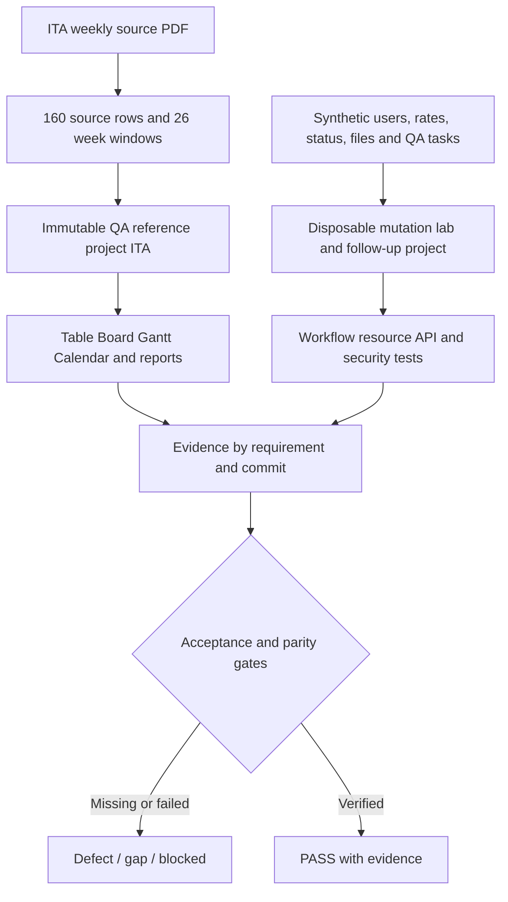
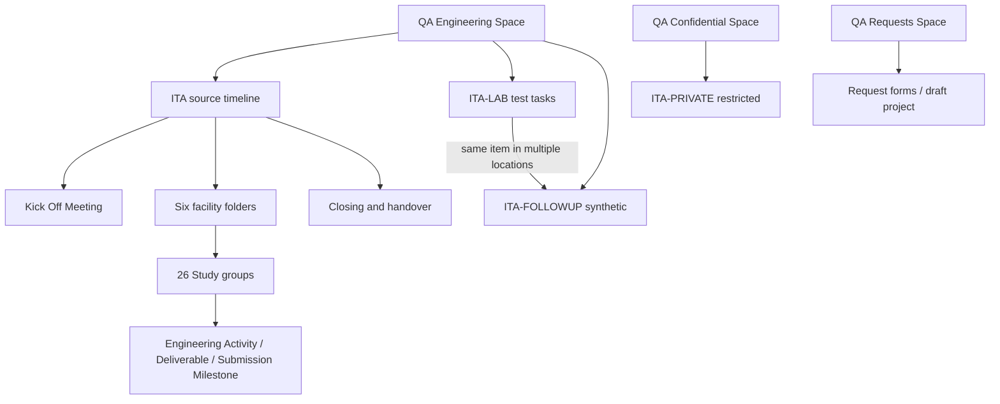

# PMS Phase 1 — ITA seed configuration & acceptance test pack

**Status:** proposal QA fixture, NOT RUN on PMS. **Source:** `TIMELINE ITA INTERNAL - 201026.pdf` p.1, `PRD(4).md` v0.4, `TASKS(2).md`, and prior 106-item `PMS_WRIKE_PARITY_DEVELOPMENT_BASELINE.md`. Scope = M0–M12 + GA rehearsal; M12b separate proposed scope; M13 excluded per draft D-55. Do not infer sign-off from the PRD. This is not a production seed or an actual database migration. Date reference 2026-11-15 (Asia/Jakarta).

## 1. Objectives and contents

Use the existing ITA timeline to run a representative end-to-end project while independently exercising every PRD requirement, including admin, API, file handling, cross-project behavior, and enterprise integrations. This pack tests **the actual behavior of the existing implementation**; it must not be used to silently implement missing features or to inflate passing results.

| File | Purpose |
|---|---|
| `seed_config.json` | Logical fixture: identities, spaces, project hierarchy, schedules, statuses, types/fields, workflow, resources, forms, versioned files, integration and load-test conditions. Map to actual PMS schema/API locally. |
| `timeline_source.csv` | 160 source rows, stable key, parent, source weekly range, PDF coordinates and color. Source-only evidence; no real assignee, actual date, cost or status inferred. |
| `weeks.csv` | 26 exact labeled week windows in PDF. |
| `test_matrix.csv` | 208 cases: 154 requirement cases, 20 additional NFR/gate/GA cases, 16 proposed UI cases and 18 parity probes. All NOT RUN. Open CSV in Excel (UTF-8). |
| `wrike_parity_probe.csv` | Candidate links to the earlier 106 WFP rows. Verify against latest canonical WFP matrix before reporting parity. |
| `fixtures/` | Two synthetic PDF revisions, PNG and text for files/annotations/versioning; not engineering data. |
| `verify_seed.py` | Offline structural validation of pack only, does not exercise PMS. |

## 2. Source timeline and interpretation

PDF page 1 has weekly color blocks and row labels, not day-level execution history. Text and colored PDF vector rectangles were matched by coordinates; source row sequence preserved. Week boundaries use the exact header labels, including 30 Nov–4 Dec, 28 Dec–1 Jan and 28–31 Mar. Green marks are used as a **seed convention** for milestone point dates at the end of the marked week; they do not prove completion or official milestone semantics. The header begins 5 Oct 2026 and ends 31 Mar 2027; the kickoff is marked 12–16 Oct, closing 22–26 Mar. Last week has no leaf task block. Project seed uses header start/end; close is a distinct milestone. Preserve the original window as source metadata even if the app represents a milestone as a single date. No inferred dependencies attached to the source timeline. The document has no contractual M1/M2 mapping, assigned staff, progress, actual costs, or confirmed final approval evidence.

| Location | Study groups | Activity rows | Green submission markers | Total leaf rows |
|---|---:|---:|---:|---:|
| Lalang Platform | 5 | 16 | 10 | 26 |
| Kurau Plant | 5 | 16 | 10 | 26 |
| Melibur Plant | 5 | 16 | 10 | 26 |
| DC Kuat | 5 | 16 | 10 | 26 |
| AI Selatan | 3 | 7 | 4 | 11 |
| MSTB | 3 | 7 | 4 | 11 |
| Project-level kickoff/close | 0 | 0 | 2 | 2 |
| **Total** | **26** | **78** | **50** | **128** |

Source includes Process Safety (PSI shorthand only in seed keys), HAZOP, HAZID, MAH and SECE in four facilities; AI Selatan and MSTB contain Process Safety (optional verified PSI), MAH and SECE only. Maintain six facility headings and 26 study headings (32 structural nodes), plus 128 scheduled leaves. Source rows = 160, plus one project wrapper = 161 logical nodes; app counts may exclude the project or folders. Do not count folders as scheduled activities. Some study activities overlap submissions: preserve them; don't impose an inferred finish-to-start sequence.

## 3. Logical seed model

### Data provenance and fixture policy

- Source-only CSV is immutable. Source project dates may be rolled up from source date ranges. Do not use the PDF as evidence of actual completion. Simulated run as of 2026-11-15: 42 Completed, 74 Backlog, 10 In Progress, 1 In Review, 1 Blocked on the 128 scheduled leaves; 32 grouping nodes not assigned execution status in JSON. Dates in fixture are not actual start/finish. If PMS automatically rolls up dates/status, report derived differences rather than altering the source CSV.
- All 17 fictional users use `.test` email addresses; use local mail sink and an environment-provided QA password. No real credentials. Use 5 user types, all 4 share roles, separate negative identities and inactive user. Use synthetic booking, skills, rates, budget, review and history. If a role name is absent, map using the actual policy and record a discrepancy.
- Four configured item types: Study, Engineering Activity, Deliverable, Submission Milestone. Create only if CIT exists. Facility as Folder is a hierarchy representation, **not** Business Object Registry. If type creation or layout is unavailable, load a base Task/Folder representation for unrelated tests and mark the relevant CIT case NOT_IMPLEMENTED/PARTIAL; never call fallback parity.
- `ITA-LAB` is the target for all mutations, `ITA-FOLLOWUP` tests shared item and cross-project planning, `ITA-CLOSED`/`ITA-DRAFT` demonstrate auxiliary project states, `ITA-PRIVATE` tests restricted access. Do not hardcode business modules for ITA. If app supports typed links, use it; negative link fixture must be attempted in a test, not silently inserted by bypassing permissions.
- All submission/approval/file histories must be created through the relevant public or admin API/UI or existing official service fixtures. No handcrafted history that would make a feature appear functional. Source fixture schema is not a claim that these fields are accepted by OpenAPI. Resolve `PMS_SEED_PASSWORD` locally, never log it. `REG-00` is a design review only; implementation excluded from Phase 1.

### Test oracle examples

| Example | Expected oracle |
|---|---|
| Lalang HAZOP Workshop | source week 2–6 Nov 2026 |
| Lalang HAZOP IFR | source 9–13 Nov; fixture milestone 13 Nov |
| Lalang HAZOP IFA | source 7–11 Dec; fixture milestone 11 Dec |
| Closing project | source 22–26 Mar 2027; fixture milestone 26 Mar |
| Formula Quantity × Unit Cost | 3 × 150,000 = IDR 450,000; after qty 4 = IDR 600,000 |
| Time entries TE-01, TE-02, TE-03 | total 9 hours, 7 billable; use controlled date for TE-03 on 17 Nov |
| Actual Cost per current TASK-14 | IDR 1,200,000 (4×150,000 + 3×200,000); verify rate snapshot at creation and after update |
| All-hours cost parity gap | IDR 1,500,000 including 2 nonbillable hours; this is a comparison probe, not the currently approved PRD formula |
| Capacity u-psi 16–20 Nov | 24 h after one synthetic leave and one synthetic holiday; LAB-I 40 h should exceed capacity |
| File revisions | `QA-PID-SAMPLE-R1.pdf` and R2 distinct checksums and metadata; v1 approved does not approve v2 |

## 4. Execution plan for local developer or coding agent

1. **Preflight/read only:** capture repository branch, dirty worktree and candidate commit SHA, exact `docs/PRD.md`, `TASKS.md`, `api/openapi.yaml`, migrations, seed helpers, existing test suites and canonical WFP matrix. Reconcile differences from the attached PRD; don't assume paths or routes beyond inspected contracts. Preserve uncommitted work. Confirm development/QA environment only; stop if target is production or not demonstrably isolated.
2. **Prepare:** use a new disposable QA DB/instance, local SMTP sink, test storage and test IdP/provider accounts. Save backup or snapshot before load. Use separate namespace `QA-ITA-20261115`, stable mapping fixture keys → server IDs, env-only secrets. Do not replace production users, keys, files, or use real client contacts. `python3 verify_seed.py` checks artifact integrity, not application behavior.
3. **Map:** implement a thin seed loader *using existing API/service/test fixture paths* in an isolated test command; no schema change to support seed. Map source date precision, statuses, type IDs, parent keys, access, dates/timezone and effort semantics to actual contracts. If unsupported, explicitly record `[feature] SKIPPED_UNSUPPORTED` in seed report and test NOT_IMPLEMENTED or BLOCKED with evidence; load core hierarchy with built-in types to continue unrelated tests. If PRD/API conflict, record it. Use official service fixture only for setup state that cannot be generated safely (e.g. history, clock); tests still use actual feature surface.
4. **Load ordered:** instance/auth bootstrap → users/groups → Space/share/work schedule → workflows/basic project → source tree parent-first → sandbox projects/tasks → CIT/custom fields and links if supported → views/templates/forms/rates → time entries/bookings/versions → dashboards/reports. For testing creation flows, create independent clones or deferred setup. Do not seed negative attempts, simulate success, or activate external delivery by default. Keep automation disabled until its tests. Reset between mutation groups; run seed twice and compare identity/counts (idempotent, no duplicated projects or notifications).
5. **Run tests:** run native unit/integration/Playwright suites as currently scripted, then each row of `test_matrix.csv`. For multi-step rows, persist sub-assertion statuses separately so no partial action becomes an aggregate PASS. UI and API should be exercised where relevant; direct DB inspection is secondary evidence only. Verify actual values by independent query or fixture oracle. Use screenshots at 1440 and 390 px, plus browser console/network evidence where relevant. Record API codes/raw redacted data, not secrets. Do not change expectations retrospectively to pass tests.
6. **Live integration gate:** GitHub issue and Google Calendar disposable account with env credentials; use HTTP fixtures separately. OIDC/SAML/SCIM isolated IdP; MinIO/Pydio isolated test namespace; webhook receiver local. Missing prerequisite = BLOCKED. Passing mock tests must not be counted as passing live acceptance. Review and clean provider mutations only inside selected sandbox.
7. **Report:** `test_matrix.csv` is editable, not self-executing. Fill actual, status, evidence relative path, tested commit, tester/date, defect ID. Record missing buttons/routes, HTTP failures, wrong calculations, data leakage, layout defects and acceptance status. Update WFP candidate mapping only after canonical reconciliation. Report scope denominators (PRD, in-scope WFP, UI proposed, gap probes separately). Never mark a requirement PASS from a checkbox or from seed loading alone.
8. **Release gate:** sequence G0 → G1a/G1b → G2a/G2b → G4 → GA rehearsal. If gates are blocked but code exists, test independently where safe and disclose dependency risk. Final go/no-go requires UAT and product/security signoff. Follow actual TASKS/DECISIONS status and do not overwrite it automatically.

## 5. Case result semantics

| Status | Meaning |
|---|---|
| NOT RUN | No execution evidence yet. |
| PASS | All applicable assertions met against recorded candidate/environment. |
| FAIL | Available feature executed but expected behavior failed. |
| PARTIAL | At least one applicable path works; one or more sub-capabilities absent or unverified. |
| NOT_IMPLEMENTED | Capability is absent after actual UI/API/code verification. |
| BLOCKED | Required test dependency unavailable, e.g. external IDP credentials. |
| N/A_APPROVED | Explicit approved exclusion with decision ID; never automatically inferred. |

Recommended evidence folder `docs/qa/ita-phase1/<commit>/` with `SEED_REPORT.md`, key-to-ID map (no secrets), result CSV, screenshots, redacted API request/response, test logs and `GAP_REPORT.md`. Preserve baseline evidence for audit. Execution coverage = executed applicable tests / applicable tests; acceptance coverage = PASS / in-scope tests; report blockers separately. Do not use 208 as a Wrike parity denominator. WFP candidate register has 106 entries but full source catalog/approved scope must be reconciled. Out-of-scope candidate items require approved D-55 evidence. 154 requirement rows include REG-00 design-only review. WFP-076 external BI is excluded per PRD scope; WFP-081/082 broad connector catalog only partly represented by two pilot connectors. Do not infer full addon parity.

## 6. Suggested agent instruction (copy and run in repository)

> Act as QA Lead, Test Automation Engineer and Release Engineer. Read this pack and actual repository docs/API. Execute read-only preflight, then isolated QA seed preparation. Generate an idempotent loader adapted to the existing PMS contract; do not alter production, reset existing DBs, commit/push, or implement missing features to make the test pass. Use ITA source timeline as read-only reference; all extra fixtures synthetic. Execute each PRD test matrix row and proposed UI/parity probes separately with positive and negative assertions. Record each actual result, candidate SHA, source ID, screenshot/log/API evidence, and blocker or defect. If a capability is unavailable, report NOT_IMPLEMENTED/PARTIAL; if prerequisite missing, BLOCKED. Do not assume any test is PASS from static documentation. Separate local fixture tests, live provider acceptance, and UI/UX review. Check idempotence, security, RPO/RTO, UI and performance. Produce SEED_REPORT.md, TEST_EXECUTION_REPORT.md, GAP_REPORT.md, current test_matrix.csv and parity evidence. No feature fixes in this task; proposed fixes in a separate backlog.

## 7. Limitations

The actual local PMS working tree, OpenAPI, canonical WFP matrix, actual screenshots and gate reports were not supplied for this task. No live deployment/provider, UAT, or feature execution has been performed. This pack is a logical fixture and acceptance specification, not a ready-to-import SQL/Excel schema; mapping to current app is required. Weekly source cannot determine exact day, work effort, milestones approved by client, cost, real task status, dependencies or real team. Dates chosen for seed point milestones follow end-of-week convention. PDF and image fixtures are synthetic and must never be used as valid engineering P&ID. Gap probes compare support variants, not proven Wrike parity; scope and acceptance evidence must be updated after execution.
