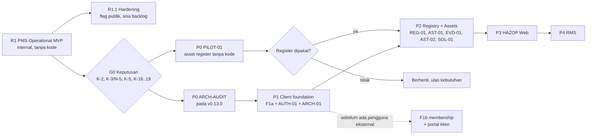

# Rencana implementasi roadmap MVP — LENS Unified Platform (C-lite+)

| | |
|---|---|
| **Status** | DRAFT — untuk keputusan pemilik produk. Tidak ada kode, skema, atau deployment yang diubah oleh dokumen ini |
| **Tanggal** | 26 November 2026 |
| **Baseline kode** | `v0.13.0` = `main` @ `72f9902` (lihat [checkpoint](../current/README.md)) |
| **Sumber** | [LENS Unified Platform — C-lite+ Architecture v0.2](https://docs.maloka.app/doc/lens-unified-platform-c-lite-architecture-bZPEK9VvTj) (LENS-ARCH-001, PROPOSED) · [Analisa ide LENS Hybrid Platform, pembaruan 26 Nov](https://docs.maloka.app/doc/analisa-ide-lens-hybrid-platform-kelayakan-kelebihan-kekurangan-dan-risiko-hdeEW5YDcj) |
| **Versi rilis** | Tetap `0.x.y` sampai pemilik produk menyetujui MVP 1 |

Rencana ini menerjemahkan arsitektur C-lite+ dan koreksi analisa menjadi fase kerja yang bisa dieksekusi di repo ini: apa yang dikerjakan, di file mana, syarat lulusnya, dan keputusan yang harus diambil sebelum mulai. Ukuran (S/M/L/XL) relatif antar-epic, **bukan estimasi hari**; estimasi ulang dilakukan setelah pilot.

## 1. Posisi dan prinsip

**Arah yang dipakai:** pertahankan dan kembangkan PMS (bukan rewrite), satu modular monolith, dua engine (Work Engine yang ada + Business Object Registry minimal), batas klien di level Space, definisi solution statis, Pydio sebagai DMS kerja dan evidence approved sebagai snapshot immutable di storage PMS. `losaka-lens` dibekukan, HazopApp hanya sumber knowledge (K-1, diputuskan 26 Nov).

**Prinsip eksekusi:**

1. **Rilis dulu, kembangkan bertahap.** R1 (PMS Operational MVP) tanpa perubahan kode. Fitur platform baru di branch terpisah dan mati secara bawaan sampai gate-nya lulus.
2. **Satu perubahan kode = ulang regresi.** Setiap commit setelah scope freeze mengulang regresi terarah dan smoke test.
3. **Bukti, bukan status.** `LOCAL_PASS` ≠ `CI_PASS` ≠ `UAT_ACCEPTED`. Blocked/skipped bukan PASS.
4. **Ekspansi aditif.** Migrasi expand–migrate–contract; tidak ada migrasi destruktif sebelum jendela rollback lewat.
5. **Tidak bisa di-waive:** isolasi klien, evidence approved yang immutable, guard keselamatan engineering.
6. **Artefak sedikit.** Sebelum P2 cukup tiga dokumen turunan (lihat §8), bukan 13.

## 2. Peta fase



| Fase | Tujuan | Kode baru? | Gate keluar |
|---|---|---|---|
| **R1** | PMS dipakai internal untuk proyek nyata | Tidak | Gate R1 (§3.4) |
| **R1.1** | Tutup backlog pasca-rilis yang berisiko | Ya, kecil | Regresi + smoke |
| **G0** | Keputusan arsitektur dan urutan | Tidak | Keputusan tercatat di [DECISIONS.md](../architecture/DECISIONS.md) |
| **P0** | Audit dampak nyata + pilot sintetis | Tidak | Impact assessment + keputusan lanjut/berhenti |
| **P1** | Batas klien dan aturan modul | Ya | G3 isolasi klien |
| **P2** | Registry minimal + vertical slice Assets + evidence | Ya | G4 asset/evidence |
| **P3** | HAZOP Web native | Ya | G5 safety |
| **P4** | RMS | Ya | G6 risk |
| **P5** | Ekstensi (RBI/LOPA/SIL, Commercial, AI, intelligent P&ID) | — | Kasus bisnis terpisah |

## 3. R1 — PMS Operational MVP (internal, tanpa kode)

Tujuan: rilis v0.13.0 untuk pemakaian internal Losaka. Customer **bukan** batas keamanan di R1; satu Space per customer dijaga secara operasional. Timebox 5 hari hanya berlaku selama tidak ada patch.

### 3.1 Butir kerja

| ID | Butir | Cara (tanpa kode) | Hari |
|---|---|---|---|
| MVP-01 | Upgrade staging ke v0.13.0, ulang suite otomatis | `deploy/update.sh ghcr.io/anissaefuddin/pms:v0.13.0`; jalankan smoke test staging; audit DEF-045 read-only | D1 |
| MVP-08 | Backup off-host | `STORAGE=local`; isi `BACKUP_REMOTE` (rclone `crypt`); pasang rclone di host; pastikan `pms-backup.timer` aktif | D1 |
| MVP-09 | Host, domain, TLS, IdP, SMTP production | Putuskan host (jangan menumpang DMS production tanpa catatan risiko); SMTP dengan SPF/DKIM; SSO **tidak** diaktifkan sebelum diuji | D1 |
| — | Target restore off-host | Docker di mesin lain; siapkan D1, jangan tunggu D4 | D1 |
| MVP-02 | Customer reference | Custom field Workspace `single_select` "Customer", nilai `KODE — Nama`, **ditugaskan ke tiap Space customer** (bukan ke tipe Project: `item_type_fields` hanya default) dan diisi di Project. **Kode customer harus stabil sejak hari pertama** (akan di-backfill ke `clients` di P1). **Status: prosedur siap + tes `TestCustomerReferenceRecipe` lulus; eksekusi di staging menunggu MVP-01.** [Prosedur](../operations/r1/MVP-02_CUSTOMER_REFERENCE.md) | D2 |
| MVP-03 | Project master | Seed otomatis `PMS_SEED=project-master` saat start: field Workspace `Contract/PO Number` (text) dan `Contract Value` (IDR, hanya grup `Contract Managers`). Sekali per database (`seed_runs`). Penugasan ke Space customer tetap manual. **Status: kode + tes lulus; aktif di staging setelah MVP-01.** [Prosedur](../operations/r1/MVP-03_PROJECT_MASTER.md). *Ini perubahan kode: berlaku aturan §3.3* | D2 |
| MVP-04 | Tautan Pydio | Field text atau deskripsi proyek (tidak ada tipe URL); cek di staging apakah tautan bisa diklik | D2 |
| SEC-PUB | Tutup endpoint publik | Blok prefix `/api/v1/public/` di reverse proxy (dashboard, form, snapshot Gantt); cabut token publik yang sudah ada | D2 |
| MVP-06 | Akses | Grant eksplisit manajemen ke tiap Space customer (D-17.1) agar Portfolio terisi | D2 |
| MVP-05 / MVP-12 | Onboarding Excel | Template **advanced** (sudah membawa Status, Workflow, Assignee Email, Depends On). Buat user dan grant **sebelum** import | D3 |
| MVP-07 | Monitoring | Widget dashboard `group_by` field Customer dan health; Portfolio tidak menampilkan custom field | D3 |
| B-5 | Pemeriksaan "satu Space satu customer" | Query read-only berkala atas `item_locations` dan `shares` yang menampilkan item dengan lokasi di Space milik customer berbeda | D3 |
| — | Regresi terarah + uji negatif akses + restore off-host | Bandingkan checksum dump + files | D4 |
| — | GO/NO-GO internal | Gate §3.4 | D5 |
| MVP-13 | Konektor Pydio | **Ditunda** | — |
| — | Customer Lite native | **Dikeluarkan dari R1**, masuk P1 sebagai backfill dari `single_select` | — |

### 3.2 Query pemeriksaan B-5 (draf, read-only)

Langkah 1 mendaftar item yang punya lokasi di lebih dari satu Space; langkah 2 (manual atau join ke nilai custom field Customer) memilah yang Space-nya milik customer berbeda. Simpan hasil sebagai bahan dry-run migrasi `spaces.client_id`.

```sql
-- langkah 1; setelah P1 bandingkan langsung spaces.client_id
SELECT il.item_id, array_agg(DISTINCT il.space_id) AS spaces
FROM item_locations il
GROUP BY il.item_id
HAVING count(DISTINCT il.space_id) > 1;
```

Ulang untuk `shares` lintas Space. Hasil yang tidak kosong ditinjau pemilik bisnis; gate R1 mensyaratkan hasilnya kosong atau dijelaskan.

### 3.3 Aturan perubahan

Bila ada patch kode selama R1, timebox lepas: perbaikan → ulang D4 → gate. Patch keamanan (mis. flag endpoint publik di aplikasi) masuk R1.1, bukan R1.

### 3.4 Gate R1

| Gate | Syarat |
|---|---|
| Release | Staging = v0.13.0, smoke lulus, CI kandidat hijau, DEF-045 diaudit |
| Security | `curl` ke `/api/v1/public/dashboards/*`, `/api/v1/public/forms/*`, `/api/v1/public/gantt/*` ditolak (403/404) dari luar; query B-5 kosong; SSO mati bila belum diuji |
| Recovery | `STORAGE=local`; set backup (dump + files + `SHA256SUMS`) ada di remote; restore off-host dijalankan dan checksum cocok |
| Akses | Uji negatif: user tanpa grant tidak melihat Space customer lain di list, search, dashboard |
| Operasi | Runbook production + rollback dan smoke staging RC3 (lokal: `outputs/qa-final/pr28-20261126/PRODUCTION_DEPLOYMENT_AND_ROLLBACK_RUNBOOK.md`, `STAGING_DEPLOYMENT_AND_SMOKE_TEST.md`); kontak dukungan |
| Sign-off | Pemilik produk menandatangani GO internal; R1 **bukan** 1.0 kecuali diputuskan lain (N-5) |

## 4. R1.1 — Hardening pasca-rilis

Kode kecil, tiap butir dengan tes dan regresi terarah. Sumber: [backlog sesudah rilis](../qa/releases/v0.13.0/POST_RELEASE_IMPROVEMENT_BACKLOG.md) dan blocker analisa.

| ID | Butir | Lokasi kode | Ukuran |
|---|---|---|---|
| SEC-PUB-2 | Flag konfigurasi untuk mematikan dashboard/form/Gantt publik (default mati untuk instance internal); form publik tanpa unggahan sampai scan malware (SEC-05) ada | `server/internal/config`, `httpserver/dashboards_public.go`, `forms_public.go`, `gantt_snapshots.go` | S |
| BKP-2 | Backup mencakup backend `s3` atau menolak start bila `STORAGE≠local` tanpa rencana backup | `deploy/backup.sh`, `docs/guides/admin/backup-restore.md` | S |
| RT-32 | Edit booking | `items`/`schedule`, UI workload | S |
| RT-15 | Inheritance field dari parent | `items` | M |
| DEF-043 | Batch notifikasi submit timesheet (100 entry < 2.000 statement, < 500 ms) | `httpserver` timesheet | S |
| RACE-1 | Sisa race DEF-049; petakan `40P01` ke 409 | `httpserver`, `policy` | S |
| OBS-1 | Catat cause 500, log 503 | `httpserver` middleware | S |
| UI-1, ACL-1 | Picker assignee mengikuti aturan server; putuskan aturan hapus assignee | `web/src/components`, `policy` | S |
| TEST-2 | Tambah CrossView, CreateNested, WorkspaceQuickCreate, Gantt perf ke CI | `.github/workflows/ci.yml` | S |
| N-2 | Ganti rujukan defect Pydio menjadi **LL-DEF-023/037** di semua dokumen | docs | S |

## 5. G0 — Keputusan sebelum fase platform

| ID | Keputusan | Pilihan | Saran | Pemilik |
|---|---|---|---|---|
| **K-3 / N-5** | Hubungan R1 dengan D-55 | (a) R1 dihitung acceptance yang dimaksud D-55 (amandemen D-55) · (b) P1+ menunggu gate 1.0 yang didefinisikan ulang | Pilih salah satu dan catat; tanpa ini P1 tertahan syarat tanpa tanggal | Pemilik produk |
| K-2 | Model klien | Instance tunggal, Space terikat customer, isolasi keras lewat instance terpisah | Setujui | Produk, Security, Legal |
| K-4 | Dasar registry | ADR-REG ([parity/adr](../parity/adr/ADR-REG-registry-and-typed-relations.md)) + lifecycle publish | ADR-REG | Arsitektur |
| K-5 | Backend evidence | `local` atau S3 dengan versioning/object lock, **bukan** `pydio` | Sebutkan backend eksplisit | Arsitektur, Infra |
| K-6 | Hak data pasca-kontrak | Per klien | Tinjau kontrak sebelum data nyata masuk registry | Legal |
| K-16 | R1 memakai `STORAGE=local` | — | Setujui | Infra |
| K-17 | Endpoint publik ditutup di proxy selama R1 | — | Setujui | Security |
| K-18 | Host production PMS terpisah dari DMS production | — | Putuskan di D1 | Infra |
| K-19 | Membership klien (F1b) ditunda sampai ada pengguna eksternal | — | Setujui | Produk |
| K-7, K-8, K-9..K-15 | Talent keluar, penamaan, solution statis, shell, HAZOP native, Commercial future, monolith, legacy knowledge-first, tanpa plugin runtime | Sesuai C-lite+ §25 | Setujui sebagai paket | Pemilik produk |

## 6. Fase platform

### P0 — Audit dan pilot (paralel dengan R1/R1.1, tanpa kode produksi)

| Epic | Isi | Keluaran | Ukuran |
|---|---|---|---|
| **ARCH-AUDIT** | Ulang angka akses pada v0.13.0: pemanggilan `policy`, SQL ke `shares`/`item_locations` di luar `policy`, berkas yang menulis ke `items`, SQL langsung di `httpserver`. Inventaris Space/lokasi/share nyata per customer. Rekonsiliasi ADR-REG, ADR-CIT, DEC-PAR-03/04 | `docs/roadmap/PMS_PLATFORM_IMPACT_ASSESSMENT.md` | M |
| **PILOT-01** | Space "Asset Register" dengan custom item type `Equipment` dan `Drawing`, custom field per tipe (satuan di nama field), field `relation`, approval file per versi, import Excel advanced. Data **sintetis** 50–100 aset, satu fasilitas, 2–3 minggu, di instance terisolasi | Data dictionary nyata + keputusan lanjut/berhenti | S |
| **LEGACY-INV** | Inventaris model dan aturan `losaka-lens` (klien, kontrak, BAST, revisi dokumen) dan HazopApp (studi, node, deviasi, safeguard, matriks risiko). Data historis **tidak dihapus** sebelum retensi diputuskan | Bagian dari impact assessment | S |

**Lanjut ke P2 bila:** engineer membuka register minimal mingguan untuk pekerjaan simulasi nyata, minimal satu aset dipakai dua proyek, dan batas pilot (status wajib, polusi laporan, tag tidak unik, pin versi hanya file) benar-benar menghalangi. **Berhenti bila** register hanya diisi sekali.

### P1 — Client foundation

Prasyarat: G0 (termasuk K-3/N-5), ARCH-AUDIT selesai, backup off-host terbukti.

| Epic | Isi | Titik kode | Keluar (AC) | Ukuran |
|---|---|---|---|---|
| **ARCH-01** | Perketat `architecture_test.go` **sebelum** paket baru: `clients`, `registry`, `assets` tidak saling impor internal dan tidak menulis SQL ke tabel paket lain | `server/architecture_test.go` | AC-40 | S |
| **F1a / CLI-01** | Tabel `clients` (UUID, kode, nama, status, kebijakan data), `spaces.client_id` (null hanya untuk internal terverifikasi; unknown dikarantina). Backfill dari custom field "Customer" R1. Halaman admin Client Directory minimal | migrasi baru `0036x_clients.sql`, `server/queries`, paket baru `server/internal/clients`, `api/openapi.yaml`, `web/src/routes/_app/settings/` | AC-01, AC-23, AC-30 | M |
| **AUTH-01** | Gerbang klien **per lokasi sebelum union** di `visibleSpaces`/`CanOnSpace` dan `itemsCaps`; constraint: semua lokasi, parent/child, share, dependensi, relasi item milik owner yang sama; tolak move/copy/blueprint/otomasi/form lintas klien; filter sebelum count di search & dashboard | `server/internal/policy/engine.go`, `item.go`, `share_paths.go`; `items` (lokasi, move, relasi, dependensi), `automation`, `forms`, `analytics`, `overview` | AC-02, AC-04, AC-08, AC-18, AC-19, AC-29, AC-33 + suite negatif semua permukaan | L |
| **MIG-01** | Expand–migrate–contract: inventaris → pemetaan oleh pemilik bisnis → dry-run di salinan DB → backfill idempoten → validasi constraint → aktifkan. Rollback yang menjaga isolasi (binary lama tidak boleh melayani data ber-scope) | `deploy/`, migrasi, runbook | AC-23, AC-24, R-22 | M |
| **F1b** | `client_memberships` + filter per lokasi untuk pengguna eksternal. **Ditunda** sampai ada pengguna klien (K-19); wajib sebelum portal klien, bersama scan malware unggahan | `policy`, `clients` | AC-03, AC-14, AC-38 | L |

**Gate G3:** semua Space terpetakan (tidak ada unknown di luar karantina), AC P1 lulus, nol defect security critical/high, regresi PMS penuh lulus (AC-25), p95 list/search/portfolio dibanding baseline v0.13.0.

### P2 — Registry minimal + Assets vertical slice

Prasyarat: G3 dan hasil pilot "lanjut". Skema dari data dictionary pilot, bukan tebakan.

| Epic | Isi | Titik kode | Keluar (AC) | Ukuran |
|---|---|---|---|---|
| **REG-01** | `object_types` (didefinisikan di kode/seed, tanpa builder), `master_records`, `record_versions.data jsonb` tervalidasi schema version, lifecycle draft → review → published (immutable), tautan Task → record dengan pin versi, optimistic locking. Record **tanpa** fitur item; diskusi/penugasan lewat Task tertaut | paket baru `server/internal/registry`, migrasi, `events` (aggregate generik) | AC-06, AC-07, AC-11, AC-13, AC-26, AC-31 | L |
| **AST-01** | Tipe facility, functional tag, equipment; hierarki; keunikan tag per klien/fasilitas; tipe quantity (nilai + satuan); import Excel dengan pratinjau; export | `server/internal/assets`, `projectexcel` (pola) | AC-05, AC-10, AC-12 | L |
| **EVD-01** | Interface evidence: salin revisi approved ke storage PMS (`local`/S3 per K-5) dengan checksum; staging snapshot gagal tidak menghasilkan revisi palsu; konektor baca Pydio (pola adapter `losaka-lens`) | `server/internal/storage`, primitive `attachment_versions` | AC-09, AC-15, AC-17, AC-32, AC-39 | M |
| **AST-02** | Drawing dan revisi engineering, pemetaan tag per revisi, viewer, Asset 360 ber-scope | `assets`, `web/src/routes/_app/assets*` | AC-09, AC-10 | L |
| **SOL-01** | Definisi solution statis + Solution Switcher di shell (dipindah dari P1, N-7: baru berguna saat Assets ada). Cek kapabilitas di server, bukan hanya menyembunyikan route | `web/src/routes/_app`, `httpserver` | AC-21, AC-22, AC-34, AC-35 | M |

**Gate G4:** vertical slice (aset dipakai dua proyek, revisi 02 tetap setelah 03 publish, evidence dapat dipulihkan dengan checksum cocok), backup/restore mencakup evidence, hak data klien disetujui Legal sebelum data nyata.

### P3 — HAZOP Web · P4 — RMS

Desain domain dan worksheet boleh mulai paralel dengan data sintetis; integrasi production setelah G4.

| Epic | Isi | Keluar (AC) | Ukuran |
|---|---|---|---|
| HAZ-01 | Domain relasional native (study, node, deviation, cause, consequence, safeguard, recommendation) dari knowledge HazopApp; worksheet entri cepat; snapshot studi approved | AC-20, AC-41, validasi SME | XL |
| HAZ-02 | Rekomendasi → Task PMS idempoten; task selesai ≠ closeout teknis | AC-20, AC-42 | M |
| RSK-01 | Risk register, versi kriteria, matriks, kontrol | AC-27 | L |
| RSK-02 | Treatment → PMS, risk review; eksekusi ≠ penerimaan risiko | AC-20 | M |

Gate G5 (UAT worksheet, review SME independen) dan G6 (kriteria berversi, mapping sumber, UAT).

## 7. Peta ke kode yang ada

| Area baru | Pakai ulang | Jangan |
|---|---|---|
| Customer | Custom field `single_select` (R1) → `clients` (P1) | Customer Lite native di R1 |
| Akses klien | `policy` terpusat, D-17.1 | Pemeriksaan klien serial **setelah** union lokasi |
| Record | Pola versi append-only, validator custom field, optimistic locking | Generalisasi komentar/lampiran/approval/follower ke record (biaya XL) |
| Evidence | `attachment_versions`, SHA-256, D-82 | Backend `pydio` sebagai evidence store; fallback ke versi terbaru |
| Event | `domain_events` + dispatcher | Broker atau envelope baru |
| Solution | `spacetemplates` `Format`/`Version` | Manifest install/upgrade, runtime plugin |
| Navigasi | Pola Customize sidebar | Switcher sebelum ada solution kedua |

## 8. Dokumen turunan

Digabung menjadi tiga sebelum P2 (N-9). Simpan di `docs/roadmap/` (rencana) atau `docs/architecture/` (keputusan).

| Dokumen | Isi | Gate |
|---|---|---|
| `PMS_PLATFORM_IMPACT_ASSESSMENT.md` | ARCH-AUDIT v0.13.0 + inventaris legacy | G0/P0 |
| `CLIENT_OWNERSHIP_ACCESS_AND_MIGRATION.md` | Model ownership, matriks grant, suite negatif, rencana migrasi & rollback | G3 |
| `REGISTRY_AND_ASSET_PRD.md` | Registry minimal, data dictionary pilot, evidence | G2/G4 |

PRD HAZOP dan RMS ditulis setelah G4. Keputusan K-* yang disetujui dicatat di [DECISIONS.md](../architecture/DECISIONS.md).

## 9. Risiko utama

| ID | Risiko | Mitigasi di rencana ini |
|---|---|---|
| R-02 | Kebocoran antar-klien lewat multi-lokasi, share, relasi, agregat | B-5 di R1; AUTH-01 per lokasi sebelum union; suite negatif semua permukaan |
| R-03 | 1.0/MVP tertunda karena cakupan bertambah | R1 tanpa kode; platform di branch terpisah; keputusan N-5 |
| R-04 | Bus factor 1, review manusia di-waive | Reviewer kedua untuk `policy`, migrasi, aturan domain mulai P1 |
| R-05 / R-17 | Evidence hilang atau berubah diam-diam | Snapshot immutable di `local`/S3 (K-5), checksum, AC-09/17/39 |
| R-07 | Hak data klien habis setelah kontrak | K-6 sebelum data nyata masuk registry |
| R-12 | Unggahan berbahaya | Form publik ditutup (R1), flag (R1.1), scan sebelum portal klien |
| R-14 | Backup hanya di server yang sama | Gate Recovery R1 |
| R-16 | Biaya generalisasi fitur item ke record | Record minimal + Task tertaut |

## 10. Langkah berikutnya

1. Pemilik produk memutuskan K-3/N-5, K-5, K-16..K-19 (§5).
2. Jalankan R1 D1 (upgrade staging, backup off-host, target restore, host production).
3. Paralel: mulai ARCH-AUDIT pada v0.13.0 dan siapkan instance terisolasi untuk PILOT-01.
4. Setelah GO R1: pecah R1.1 menjadi issue/PR kecil.
