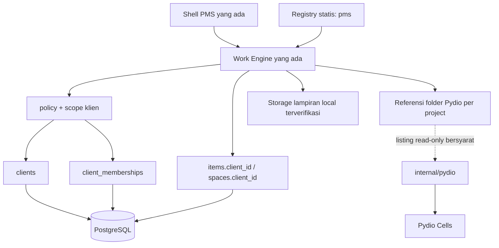
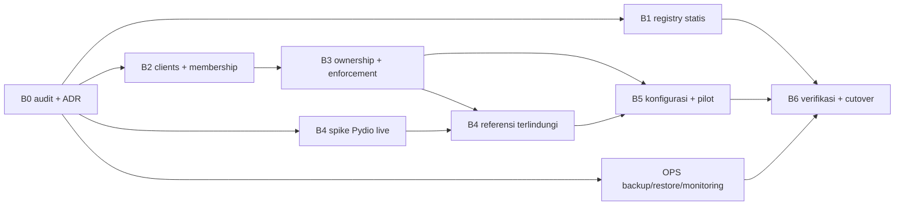

# Rencana implementasi MVP — PMS Platform Ready (R1 + R2, C-lite+ minimum)

| | |
|---|---|
| **Versi** | 0.2 — detail task untuk persetujuan implementasi. Menggantikan v0.1 (26 Nov: R1 tanpa kode lalu fase P0–P4) |
| **Tanggal** | 27 November 2026 |
| **Sumber utama** | [PMS-MVP-IMP-002 v0.1](sources/PMS_PLATFORM_READY_MVP_IMPLEMENTATION_PLAN.md) (27 Nov) |
| **Sumber pendukung** | [C-lite+ Architecture v0.2](https://docs.maloka.app/doc/lens-unified-platform-c-lite-architecture-bZPEK9VvTj) · [Analisa kelayakan, pembaruan 26 Nov](https://docs.maloka.app/doc/analisa-ide-lens-hybrid-platform-kelayakan-kelebihan-kekurangan-dan-risiko-hdeEW5YDcj) · [checkpoint v0.13.0](../current/README.md) |
| **Baseline kode** | `v0.13.0` = `72f9902`. Branch kerja `docs/restructure-mvp-roadmap`, 6 commit di atas v0.13.0 (sampai `336b290`, checkpoint audit 27 Nov). Belum di-push: cabang remote tidak ada. Scope dan ADR: [MVP_SCOPE.md](MVP_SCOPE.md), [ADR-CLIENT-SCOPE-MVP](../architecture/ADR-CLIENT-SCOPE-MVP.md) (keduanya PROPOSED). Lihat §3 |
| **Target** | Produksi **internal**, PMS satu-satunya solution aktif, tanpa Solution Switcher |
| **Versi rilis** | `0.x.y` sampai pemilik produk menyetujui MVP 1. Usulan kandidat: `v0.14.0` |

Ukuran S/M/L relatif antar-task, **bukan hari**. Estimasi dibuat setelah B0. Rilis ditentukan gate (§7), bukan tanggal atau persentase E2E.

## 1. Keputusan dan perubahan dari v0.1

| Topik | v0.1 (26 Nov) | v0.2 (27 Nov, PMS-MVP-IMP-002) |
|---|---|---|
| Bentuk rilis | R1 tanpa kode (5 hari), platform di fase P1+ | R1 + R2 digabung: rilis operasional **plus** fondasi klien minimum |
| Customer | Custom field `single_select` (MVP-02) | Entitas native `clients` + `client_memberships`; customer project **diturunkan dari owner**, bukan field yang bisa diedit terpisah |
| Isolasi klien | Operasional (satu Space satu customer, cek B-5) | Ditegakkan di `policy`, constraint, dan semua jalur tulis/baca/worker |
| Solution registry | P2 bersama Assets (SOL-01) | Registry statis di kode, hanya `pms`, **tanpa UI** |
| Business Object Registry | P2 | Tetap ditunda. Hanya kontrak di ADR, tanpa tabel kosong |
| Pydio | Field text + listing read-only (MVP-04/13) | P0 link-first; listing read-only P1 **bersyarat** live gate dan model identitas yang disetujui |
| Timebox | 5 hari | Dilepas. Estimasi setelah B0 |
| D-55 | Registry setelah 1.0 | Diamandemen: fondasi klien dan registry statis dimajukan; BOR tetap ditunda (dicatat di ADR, B0-06) |

Tidak termasuk MVP: runtime BOR, AIMS, HAZOP Web, RMS, Solution Switcher, installer manifest, visual builder, entitlement per klien, pengguna eksternal, portal klien, sinkron/tulis Pydio, evidence store.

## 2. Scope freeze

| ID | Lingkup | Prioritas | Batch |
|---|---|---|---|
| R1-01 | Verifikasi kandidat rilis, CI, kasus QA BLOCKED | P0 | B0, B6 |
| R1-02 | Field/workflow project standar, Space customer, portfolio | P0 | B5 |
| R1-03 | Import pilot dan rekonsiliasi WBS, tanggal, status, progres, assignee | P0 | B5 |
| R1-04 | Backup off-host, restore, monitoring, deployment | P0 | OPS, B6 |
| R2-01 | Solution Registry statis, hanya `pms` | P0 | B1 |
| R2-02 | Customer native: CRUD/arsip, kode/UUID stabil | P0 | B2 |
| R2-03 | Membership klien dan ownership stabil, constraint owner sama | P0 | B2, B3 |
| R2-04 | Penegakan ownership di policy dan semua jalur langsung/bypass | P0 | B3 |
| R2-05 | Referensi Pydio per project, akses link-first yang aman | P0 | B4 |
| R2-06 | Integrasi Pydio read-only (folder/metadata) | P1 bersyarat | B4 |
| R2-07 | Kontrak BOR dan ekstensi dijaga di ADR | P0 (dokumen) | B0 |
| R1-05 | SMTP/reminder; patch Excel status/assignee hanya bila onboarding membutuhkan | P1 | B5 |
| NEXT | BOR, AIMS, HAZOP Web, RMS, konektor penuh, switcher | Ditunda | §9 |

Bila R2-06 tidak lulus gate otorisasi atau keandalan: konektor dimatikan (`PMS_PYDIO_LINK_URL` kosong) dan pemilik produk menerima link-first secara tertulis. Isolasi klien, recovery, dan kebenaran inti project **tidak boleh di-waive**. Kembali ke rencana R1-saja adalah keputusan scope terpisah, bukan penurunan otomatis.

## 3. Status pekerjaan yang sudah ada di branch

| Commit | Isi | Posisi di v0.2 |
|---|---|---|
| `c096bb3` | Restrukturisasi `docs/`, checkpoint v0.13.0, roadmap v0.1 | Tetap. Roadmap diganti dokumen ini |
| `e779358` | MVP-02: prosedur Customer `single_select` + `TestCustomerReferenceRecipe` | **Digantikan B2.** Jangan dikonfigurasi di staging bila v0.2 disetujui; field ganda yang bisa beda dengan owner Space dilarang (B5). Prosedur disimpan sebagai fallback R1-saja. Tes tetap valid (mengunci perilaku field Workspace) |
| `fdff421` | MVP-03: seed `PMS_SEED=project-master` (Contract/PO Number, Contract Value terbatas), tabel `seed_runs` | Tetap. Field kontrak opsional di B5 |
| `c4f7afc` | MVP-04/13: field `Pydio Folder`, tautan di panel item, `GET /items/{id}/pydio-files` (S3 gateway, SigV4, token layanan, root), `storage.SignV4` | Basis B4. Celah terhadap v0.2: validasi tautan saat **tulis**, model identitas (token layanan vs delegasi), live gate. Lihat B4 |

## 4. Arsitektur target MVP



Satu binary, satu database, deployment dan frontend yang ada. Instance tetap batas tenant (D-01). Klien di instance Losaka adalah scope data. Legacy `losaka-lens` dan HazopApp hanya sumber knowledge.

## 5. Batch dan task detail

Konvensi: setiap task menjadi satu PR kecil (atau bagian PR batch) dengan tes. "Selesai bila" adalah syarat merge; AC mengacu ke §7.



B1, B2, spike B4 dan OPS boleh paralel setelah B0. **Migrasi dan perubahan `policy` diserialkan**: satu PR terbuka pada satu waktu untuk `server/migrations/` dan `server/internal/policy/`.

### B0 — Baseline, audit dampak, ADR (S–M)

| ID | Task | Detail dan lokasi | Output | Selesai bila |
|---|---|---|---|---|
| B0-01 | Identitas kandidat | Catat `main` SHA, tag, digest image, versi skema (`GET /api/v1/version` sebagai admin), versi staging nyata, run CI terakhir | `docs/qa/releases/v0.14.0/CANDIDATE.md` | Staging dan kandidat terdokumentasi dengan bukti |
| B0-02 | Klasifikasi QA RC3 | 6 BLOCKED + 7 BACKLOG dari 118 UAT RC3 ([laporan](../qa/releases/v0.13.0/FINAL_RELEASE_REPORT.md)): dampak ke scope gabungan, pemilik, keputusan | Tabel di `CANDIDATE.md` | Tiap kasus: blocker / tidak relevan / diterima dengan pemilik |
| B0-03 | Inventaris permukaan akses | Ulang angka akses pada HEAD: pemanggilan `policy`; SQL langsung ke `items`, `item_locations` (49 berkas non-tes per 27 Nov), `shares`, `item_relations`, `item_dependencies`; handler publik (`dashboards_public.go`, `forms_public.go`, `gantt_snapshots.go`); worker (`automation`, `duereminders`, `reportdigest`, `connectors`, `webhooks`, `mail`, `housekeeping`, `realtime`/SSE `httpserver/events.go`) | `docs/roadmap/PMS_PLATFORM_IMPACT_ASSESSMENT.md` §1: tabel jalur × baca/tulis × titik enforcement | Setiap jalur punya pemilik task di B3 |
| B0-04 | Inventaris data | Read-only di salinan DB staging/production: Space (shared/personal), item per Space, item multi-lokasi lintas Space (query B-5, §8.2), share lintas Space, grup, user eksternal, dependensi/relasi lintas Space, blueprint, form, automation, lampiran, konfigurasi `PMS_STORAGE` aktual | Impact assessment §2 + CSV di lokasi internal (bukan git) | Angka per kategori; daftar Space campuran |
| B0-05 | Pemetaan klien | Pemilik bisnis mengklasifikasi tiap Space: klien X / internal / belum jelas. Space campuran: rencana split. **Unknown ≠ internal** | `CLIENT_MAPPING.csv` (internal, bukan git) + ringkasan di impact assessment | Ditandatangani pemilik bisnis |
| B0-06 | ADR | Satu ADR baru: amandemen D-55 (fondasi klien + registry statis dimajukan, BOR tetap ditunda), D-01 dipertahankan, D-17.1 dipertahankan, D-08 (batas evidence Pydio), aturan assign Full di semua path (DEC-06 Rev.1), model identitas Pydio (K-21) | `docs/architecture/ADR-CLIENT-SCOPE-MVP.md` + baris di `DECISIONS.md` | Disetujui pemilik produk |
| B0-07 | Scope, branch, matriks tes | Branch `release/pms-platform-ready-mvp` dari baseline terverifikasi; matriks tes AC (§7) dengan lokasi tes; rencana rollback; estimasi | `docs/roadmap/MVP_SCOPE.md` | Estimasi per batch tercatat; scope dibekukan |

### B1 — Solution Registry statis, tanpa UI (S)

> **Status 27 Nov 2026:** B1-01, B1-02, B1-03, B1-05 (sebagian), dan B1-06 dikerjakan lokal. B1-04 ditunda. Bukti dan keterbatasan: [MVP_SCOPE §11](MVP_SCOPE.md#11-bukti-eksekusi-b1-27-nov-2026).

| ID | Task | Detail dan lokasi | Selesai bila |
|---|---|---|---|
| B1-01 | Paket registry | `server/internal/solutions`: tipe `Definition{ID, Name, Required, Enabled, Capabilities}`, `Builtin()` mengembalikan salinan immutable berisi tepat satu `pms` ("Projects", required, enabled, `work_management`). Capability adalah metadata, **bukan** kapabilitas RBAC | Unit test SOL-01: tepat satu aktif, ID kosong/duplikat ditolak |
| B1-02 | Validasi saat start | `Validate(defs)` dipanggil di `serve()` (`server/cmd/pms/main.go`, sebelum seed); start gagal bila `pms` hilang, dimatikan, atau ada ID tak dikenal | SOL-02: tes start gagal untuk tiap kasus |
| B1-03 | Aturan arsitektur | Tambah `solutions` ke daftar paket platform di `server/architecture_test.go` (tanpa impor paket bisnis) | `TestPackageDependencies` lulus |
| B1-04 | Ekspos operator (opsional) | Hanya bila dibutuhkan verifikasi operator: field `solutions` di respons admin `GET /api/v1/version` (`httpserver/server.go:version`), backward-compatible, + OpenAPI | Endpoint sweep lulus; non-admin tidak melihat field |
| B1-05 | Tidak ada perubahan navigasi | Tidak menyentuh `web/src/routes`, sidebar, URL. Tidak ada prefix `pms` atau kolom baru di `items` | SOL-03/04: suite Playwright yang ada hijau; grep tidak menemukan route AIMS/HAZOP/RMS |
| B1-06 | Kontrak ekstensi | Bagian di ADR B0-06: cara solution kedua didaftarkan nanti | SOL-05 |

### B2 — Customer Master dan membership (M)

> **Status 27 Nov 2026 (B3-07 dan B3-08):** revocasi membership langsung pada Space, item, share, dan assignment (RV-01..08, 8 PASS). Tidak ada cache otorisasi resource; `policyCache` hanya IP/OTP. Mutasi lokasi (move, tambah, reparent, restore) memeriksa kepemilikan stabil dan membership dalam transaksi yang sama (LOC-01..17, CON-1..3). Follow-up B3-06: lokasi tidak cocok membuat serah terima gagal tertutup (AF-1..4). Jalur automation dengan aktor lain tetap terbuka sebagai B3-13. B3-02 tetap PARTIAL (copy, template, dependensi: B3-09/10). Bukti: [MVP_SCOPE §23](MVP_SCOPE.md#23-bukti-eksekusi-b3-07-b3-08-dan-penutupan-terbatas-b3-06-27-nov-2026-prompt-022--complete-pada-tingkat-policy-dan-mutasi-pusat).
>
> **Status 27 Nov 2026 (B3-05 dan B3-06):** eligibility item dipasang di gate `itemsCaps` dan `SharedOnEveryPath`; assignee baru pada item client harus anggota Customer (`assignee_ineligible`). IT 15/15, ML 8/8, AS 12/12 + AS-13, dan regresi 90/90 item, 78/78 Space, 39/39 pembuatan, 22/22 penugasan lulus. Kontrol negatif dibuktikan. Pembacaan `items` langsung di luar policy dan mutasi lokasi (B3-08/09) tetap terbuka; B3-02 tetap PARTIAL. Bukti: [MVP_SCOPE §22](MVP_SCOPE.md#22-bukti-eksekusi-b3-05-dan-b3-06-eligibility-item-dan-penugasan-27-nov-2026-prompt-021--complete-pada-tingkat-policy-pusat).
>
> **Status 27 Nov 2026 (B3-SC dan B3-04):** B3-SC selesai dan B3-04 selesai pada tingkat policy dan creation pusat. Pembuatan shared Space mewajibkan kepemilikan eksplisit (`internal` atau `client`), membership Customer dicek di transaksi yang sama (SC-01..17), bootstrap General `internal`, dan Create Space UI memakai Customer Picker membership. Verifikasi: SP 28/28, Space 78/78, pembuatan 39/39, penugasan 22/22, CRT 23 entri, frontend 24 PASS. Bypass item (B3-05) dan SQL langsung tetap terbuka; B3-02 tetap PARTIAL. Bukti: [MVP_SCOPE §21](MVP_SCOPE.md#21-bukti-penutupan-b3-sc-dan-b3-04-27-nov-2026-prompt-020--complete-untuk-tingkat-policy-dan-creation-pusat).
>
> **Status 27 Nov 2026:** B3-04 pada tingkat policy pusat: SP-01..28 PASS. Fixture uji diperbarui (`f.space` internal eksplisit). Ledger: 70/78 Space, 37/39 pembuatan, 18/22 penugasan PASS. Sisa 12 tes gagal karena pembuatan Space lewat API ditolak (pembuat tidak melihat Space unresolved). Ini membutuhkan **B3-SC** (wajib sebelum penutupan B3). Belum di-commit. Bukti: [MVP_SCOPE §20](MVP_SCOPE.md#20-pembaruan-b3-04-konvensi-fixture-dan-ledger-regresi-27-nov-2026--partial).
>
> **Status 27 Nov 2026:** B3-04 pada tingkat policy pusat: predikat eligibility client di `spaceRows` (SP-01..SP-28 PASS, kontrol negatif terbukti). Regresi tes Space lama BELUM selesai (54 tes Space, 8 tes pembuatan, 7 tes penugasan gagal karena fixture unresolved dan membership), sehingga belum di-commit. Bypass item (B3-05) tetap terbuka. Bukti: [MVP_SCOPE §19](MVP_SCOPE.md#19-bukti-eksekusi-b3-04-eligibility-space-pusat-27-nov-2026--partial).
>
> **Status 27 Nov 2026:** B3-03 selesai pada tingkat pembuatan pusat: kepemilikan diturunkan server dari Space atau induk, dan ditolak jika unresolved, tidak cocok, atau Customer diarsipkan (CRT-01..19, 23 entri PASS; regresi penugasan 22 PASS). B3-02 tetap PARTIAL karena enforcement lintas tabel pada mutasi belum ada. Pembuatan Space bersama dengan ownership masih pending. Bukti: [MVP_SCOPE §18](MVP_SCOPE.md#18-bukti-eksekusi-b3-03-kepemilikan-saat-pembuatan-item-27-nov-2026).
>
> **Status 27 Nov 2026:** B3-01 dan B3-02 fondasi selesai di tingkat skema (`00364_client_scope.sql`, 18 tes OWN-DB PASS). Kolom dan constraint baris sudah ada. Protokol lintas tabel didokumentasikan (ADR §7i), tetapi enforcement pada jalur mutasi belum ada, sehingga B3-02 tetap PARTIAL. Operasional belum diverifikasi. Bukti: [MVP_SCOPE §17](MVP_SCOPE.md#17-bukti-eksekusi-b3-01-dan-b3-02-fondasi-skema-kepemilikan-27-nov-2026).
>
> **Status 27 Nov 2026:** B2-08 selesai: lookup kelayakan `GET /api/v1/clients/eligible` (membership default, administrative hanya Workspace Admin) dan Customer Picker yang dapat dipakai ulang. Tes EL-01..EL-15 dan PK-01..PK-10 lulus. B2 secara implementasi selesai. AC-04 tetap PARTIAL sampai B3. Bukti: [MVP_SCOPE §16](MVP_SCOPE.md#16-bukti-eksekusi-b2-08-dan-penutupan-b2-eligibility-dan-customer-picker-27-nov-2026).
>
> **Status 27 Nov 2026:** B2-07 selesai: halaman Pelanggan di Settings (daftar, buat, edit, arsip, anggota) dengan 6 tes Playwright lulus. Bukti: [MVP_SCOPE §15](MVP_SCOPE.md#15-bukti-eksekusi-b2-07-customer-settings-ui-27-nov-2026).
>
> **Status 27 Nov 2026:** B2-04, B2-05, dan B2-06 selesai: guard admin, audit transaksional, dan 8 operasi REST dengan OpenAPI. AC-03 PASS di tingkat CRUD dan audit. AC-04 PARTIAL sampai B3. Bukti: [MVP_SCOPE §14](MVP_SCOPE.md#14-bukti-eksekusi-b2-04-06-authorization-audit-api-27-nov-2026).
>
> **Status 27 Nov 2026:** B2-03 selesai di tingkat domain service (`server/internal/clients`, 26 tes PASS). B2-04..06 belum dikerjakan. Bukti: [MVP_SCOPE §13](MVP_SCOPE.md#13-bukti-eksekusi-b2-03-domain-service-27-nov-2026).
>
> **Status 27 Nov 2026:** B2-01 dan B2-02 selesai di tingkat skema (`00363_clients.sql`, tes DB-01..16 lulus). B2-03 dan seterusnya belum dikerjakan. Bukti: [MVP_SCOPE §12](MVP_SCOPE.md#12-bukti-eksekusi-b2-01-02-skema-27-nov-2026).

| ID | Task | Detail dan lokasi | Selesai bila |
|---|---|---|---|
| B2-01 | Migrasi `clients` | `00363_clients.sql`: `id uuid`, `code text` (dinormalisasi huruf besar, `UNIQUE`, immutable via trigger atau guard aplikasi), `name`, `short_name`, `status` (`active`/`archived`), `created_at/by`, `updated_at`, `archived_at/by`. Tanpa delete destruktif | Migrasi naik/turun di DB kosong dan salinan staging |
| B2-02 | Migrasi `client_memberships` | `client_id`, `user_id` (FK), `status` (`active`/`revoked`), `granted_at/by`, `revoked_at/by`; unik aktif per (client, user) | Constraint diuji (duplikat ditolak) |
| B2-03 | Paket domain | `server/internal/clients`: `List/Get/Create/Update/Archive`, `ListMembers/Grant/Revoke`. Normalisasi kode, tolak duplikat, kode tidak bisa diubah. Arsip menolak Space/item/tautan baru, mempertahankan baca historis yang berhak. Query di `server/queries` (sqlc) mengikuti konvensi | Unit/integrasi: duplikat, arsip, kode immutable (AC-03) |
| B2-04 | Otoritas | Konfigurasi customer: Workspace Admin (kapabilitas admin yang ada). Membership = **eligibility**, bukan grant Full/Editor/Read. Admin tidak mendapat akses konten dari halaman Customers (D-17.1) | AC-04, AC-05 |
| B2-05 | Audit | Aksi baru di `httpserver/audit.go` + D-90: `client.created`, `client.updated`, `client.archived`, `client.member_granted`, `client.member_revoked`; penolakan dicatat bila pola yang ada mencatatnya | Baris audit diuji |
| B2-06 | API | `GET/POST /api/v1/clients`, `GET/PATCH /api/v1/clients/{id}`, `POST /api/v1/clients/{id}/archive`, `GET/POST /api/v1/clients/{id}/members`, `DELETE /api/v1/clients/{id}/members/{userId}` (revoke, bukan hapus baris). OpenAPI + `go tool oapi-codegen` + `npm run generate` | Endpoint sweep; 403 untuk non-admin; tes kontrak |
| B2-07 | UI Settings → Customers | `web/src/routes/_app/settings/customers.tsx` (+ detail), entri di `components/settings-sidebar.tsx`, i18n `en`/`id`. Daftar/cari, buat, edit, arsip, tab Members (assign/revoke), daftar Space terkait **sesuai akses pemanggil** | Playwright mock: CRUD, arsip, member; aksesibilitas label |
| B2-08 | Picker | Picker customer hanya menampilkan customer yang eligible untuk pemanggil (membership atau admin konfigurasi) | Tes: user non-member tidak melihat customer di picker |

Tidak termasuk: Client Hub/360, kontak, hierarki organisasi, undangan otomatis, entitlement per klien.

### B3 — Ownership, migrasi, dan enforcement (L, risiko tertinggi)

Registry customer sendiri **bukan** isolasi. Filter, label, atau menu tersembunyi bukan keamanan.

**B3a — Skema dan model**

| ID | Task | Detail dan lokasi | Selesai bila |
|---|---|---|---|
| B3-01 | Kolom owner | `00364_client_scope.sql` (aditif): `spaces.client_id uuid NULL REFERENCES clients`, `spaces.scope_state` (`internal`/`client`/`unresolved`, default `unresolved` untuk baris lama), `items.client_id uuid NULL` (owner stabil, ditetapkan saat create dari lokasi asal), `items.scope_state` serupa. Personal Space = `internal` | Migrasi di salinan DB; baris lama `unresolved` |
| B3-02 | Constraint | DB: CHECK konsistensi `scope_state`/`client_id`. Invarian multi-tabel (semua lokasi item di Space dengan owner sama) ditegakkan di transaksi tulis dengan penguncian; trigger hanya bila bisa ditulis tanpa race | Tes konkurensi move/copy paralel (AC-10, AC-33 C-lite+) |
| B3-03 | Owner saat create | `items/create.go`: owner = owner Space lokasi pertama; tolak bila Space `unresolved`. Subitem mewarisi owner parent | Tes create di Space klien/internal/unresolved |

**B3b — Policy (gerbang per lokasi sebelum union)**

| ID | Task | Detail dan lokasi | Selesai bila |
|---|---|---|---|
| B3-04 | Gerbang Space | `policy/engine.go` `visibleSpaces`/`SpaceAccessFor`/`CanOnSpace`: Space `client` hanya untuk pemegang membership aktif; `unresolved` ditolak di mode enforcement; internal tetap memakai grant eksplisit (bukan bypass semua klien). Workspace Admin tidak dikecualikan | AC-05, AC-07 |
| B3-05 | Gerbang item per lokasi | `policy/item.go` `itemsCaps`: buang lokasi yang Space-nya tidak eligible **sebelum** menggabungkan cap; buang lokasi yang owner Space-nya ≠ `items.client_id`. `share_paths.go`: share langsung juga lewat gerbang membership | AC-07, AC-29 C-lite+ |
| B3-06 | Aturan assign tidak melemah | Penyaringan lokasi tidak boleh menghapus path restriktif sehingga assign "naik" (Full di semua path relevan, DEC-06 Rev.1). Tes eksplisit untuk item multi-lokasi | AC-06 |
| B3-07 | Revoke dan cache | **Dikoreksi (audit B0-03).** `policyCache` (`httpserver/access_policy.go:33`) hanya untuk IP allowlist dan OTP, bukan otorisasi, dan tidak diubah di sini. Tidak ada cache keputusan Space atau item yang perlu diinvalidasi: pastikan pencabutan membership berlaku langsung pada pembacaan berikutnya. Token publik dan file yang sudah terbit ditinjau (lihat B3-17) | AC-14 C-lite+, AC-10 |

**B3c — Jalur tulis (same-owner)**

| ID | Task | Lokasi | Selesai bila |
|---|---|---|---|
| B3-08 | Lokasi tambahan, move, restore | `items/location.go`, `items/recycle.go`, `items/reorder.go`, `httpserver` move handler | Lintas klien/internal ditolak 422 tanpa bocor label/jumlah (AC-09) |
| B3-09 | Copy/duplicate/blueprint | `items/blueprints.go`, `httpserver/space_template_save.go`, `space_templates.go`: instansiasi ke Space tujuan dengan owner tujuan; referensi lintas klien disanitasi atau ditolak | AC-11 |
| B3-10 | Dependensi dan relasi | `item_dependencies`, `item_relations` (field relation), `items/scheduling.go`: kedua ujung harus owner sama | AC-09 |
| B3-11 | Share | `spaces/item_shares.go`, share Space: penerima (termasuk anggota grup hasil ekspansi) harus eligible | AC-10 |
| B3-12 | Form | `httpserver/forms.go`, `forms_public.go`, `forms/`: Space tujuan form menentukan owner; routing lintas klien ditolak | AC-11 |
| B3-13 | Automation dan worker | `automation/engine.go`, `rules.go`: aktor rule dievaluasi ulang saat eksekusi/replay; target lintas owner ditolak. Sama untuk `duereminders`, `reportdigest`, `connectors/pilot.go`, `webhooks` | AC-11 |
| B3-14 | Import | `items/excel_import.go`, `projectexcel/`: semua baris ke Space tujuan dengan owner tujuan; `Depends On` lintas owner ditolak per baris | AC-11 |

**B3d — Jalur baca dan agregat**

| ID | Task | Lokasi | Selesai bila |
|---|---|---|---|
| B3-15 | List, search, portfolio, overview, workload | `items/list.go`, `items/search.go`, `items/portfolio.go`, `overview/`, `httpserver/workload.go`, `analytics/` | Filter **sebelum** count dan saran (AC-08, AC-19 C-lite+) |
| B3-16 | Notifikasi, SSE, mail, webhook payload | `httpserver/events.go`, `realtime`, `mail/`, `webhooks.go`, `time_entry_notify.go` | User non-eligible tidak menerima event/mail berisi metadata klien (AC-08) |
| B3-17 | Lampiran, preview, export, tautan publik | `httpserver/attachments.go`, `project_files.go`, `previews/`, `projectexcel/export.go`, `gantt_snapshots.go`, `dashboards_public.go`. **SEC-PUB-2 masuk ke sini:** flag `PMS_PUBLIC_LINKS` (default mati) untuk dashboard/form/Gantt publik, menggantikan blok proxy; token lama dicabut | AC-12, AC-11 |

**B3e — Migrasi data**

| ID | Task | Detail | Selesai bila |
|---|---|---|---|
| B3-18 | Dry-run | Perintah `pms client-scope dry-run --mapping FILE` (read-only): klasifikasi tiap Space dan item, laporan konflik (multi-lokasi lintas klien, share/dependensi/relasi lintas klien, unresolved) | Laporan reproducible di salinan DB |
| B3-19 | Backfill | `pms client-scope apply --mapping FILE`: batch idempoten, checkpoint, transaksi, audit; mempertahankan ID, hierarki, file, workflow, jadwal. Split Space campuran sesuai mapping. Konflik dikarantina, tidak dihapus | Jumlah lama = baru; ulang dry-run hingga tidak ada `unresolved` aktif (AC-13) |
| B3-20 | Mode enforcement | Enforcement aktif sejak binary baru melayani data ber-scope. **Tidak ada mode permisif.** Data nyata klien tidak dibuka sebelum B3-04..17 lulus | Tes: `unresolved` ditolak, bukan disembunyikan |
| B3-21 | Rollback | Binary lama tidak menegakkan ownership: tidak boleh melayani data ber-scope. Runbook: hentikan tulis/maintenance, restore DB+files terverifikasi atau deploy perbaikan maju; rekonsiliasi tulisan sejak backup; RPO/RTO tercatat | Rehearsal di staging terdokumentasi (AC-19) |
| B3-22 | Fixture negatif bersama | Fixture Go di `httpserver` (§7.2) dipakai semua tes B3; tambahkan ke CI `authorization-matrix` | Job CI hijau, jumlah tes minimum dinaikkan |

### B4 — Referensi dan integrasi Pydio (M)

Basis: `c4f7afc`. Lampiran yang ada tetap di storage `local` (K-16); `PMS_STORAGE` tidak diubah.

| ID | Task | Detail dan lokasi | Selesai bila |
|---|---|---|---|
| B4-01 | Putuskan entitas referensi (K-22) | Opsi: (a) field Workspace `Pydio Folder` yang ada (satu folder per project, sudah di seed); (b) lampiran tautan D-83 (`attachments.link_url`, migrasi `00092`) dengan label; (c) tabel baru. Saran **(a)** untuk MVP: satu folder kanonik per project, tanpa tabel baru | Keputusan di ADR |
| B4-02 | Validasi saat tulis | Nilai field `Pydio Folder` divalidasi saat PATCH/import/blueprint: HTTPS, host `PMS_PYDIO_LINK_URL`, di dalam `PMS_PYDIO_LINK_ROOTS` (pakai `pydio.Client.Folder`). Tidak menyimpan URL bertanda tangan atau token | Tes: tautan host lain/root lain ditolak 422 saat tulis |
| B4-03 | Visibilitas | Tautan mengikuti akses item + grant field + gerbang klien B3 (otomatis lewat `items.Get`) | AC-14 bagian PMS |
| B4-04 | Spike live Pydio | Di Cells staging: versi/edisi, format URL web (`/<workspace>/<path>`), S3 gateway `/io` + SigV4 (`gatewaysecret`), apakah token per-user bisa didelegasikan (OIDC yang sama dengan PMS) | Laporan spike di prosedur [MVP-04/13](../operations/r1/MVP-04_13_PYDIO_FOLDER.md) |
| B4-05 | Model identitas (K-21) | Prioritas: identitas user terdelegasi + ACL Pydio. Bila tidak tersedia: token layanan sempit (read-only, hanya workspace proyek) **hanya** bila otorisasi per-user di PMS terbukti dan Pydio memverifikasi ulang saat file dibuka. Tanpa salah satunya: listing tidak diekspos | Keputusan tertulis pemilik produk + Security |
| B4-06 | Hardening listing | Endpoint `GET /items/{id}/pydio-files` yang ada: cek owner B3 (otomatis), tolak redirect dari gateway (`CheckRedirect`), pagination terbatas (sudah 200), timeout (sudah 10 s), log tanpa nama file/kredensial | Tes redirect ditolak; review log |
| B4-07 | Live gate | Listing berhak; user/klien salah ditolak; akses dicabut; kredensial gagal; timeout; folder dihapus/rename; tidak ada kebocoran di log; tidak ada operasi tulis | AC-15; bila gagal: matikan konektor, catat blocker, persetujuan link-first |
| B4-08 | STO-1 | Backend `PMS_STORAGE=pydio` memakai `Bearer`; perbaiki ke `storage.SignV4` **atau** tolak `PMS_STORAGE=pydio` saat start sampai diuji | Tidak memengaruhi MVP (storage `local`) |

Tidak termasuk: proxy isi file, tulis/overwrite, sinkron, provisioning folder otomatis, jaminan revisi historis. LL-DEF-023/037 dicek ulang sebelum ada ketergantungan evidence.

### B5 — Konfigurasi operasional dan onboarding (M)

| ID | Task | Detail | Selesai bila |
|---|---|---|---|
| B5-01 | Customer dari owner | Tampilkan customer project dari `items.client_id`/Space (panel item, tabel, Portfolio, Overview). **Tidak** memakai field `single_select` Customer (MVP-02) | Tidak ada dua sumber customer yang bisa berbeda |
| B5-02 | Create project | Dialog create (`components/CreateItemDialog`): pilih Space yang eligible, atau customer lalu Space yang kompatibel. Perubahan customer kemudian = migrasi terkontrol | Playwright: user hanya melihat Space eligible |
| B5-03 | Filter customer | Pakai filter Space yang ada bila cukup; filter native ber-scope hanya bila monitoring membutuhkan | Keputusan di MVP_SCOPE |
| B5-04 | Field project minimum | Nama/kode, customer (turunan), PM, mulai/selesai, status, progres, health (manual), update status terakhir, tautan dokumen. Opsional: Contract/PO, planned effort (seed MVP-03) | Template project/blueprint disetujui PM |
| B5-05 | Seed dan konfigurasi | `PMS_SEED=project-master`; tugaskan field ke Space klien; grup `Contract Managers`; konfigurasi Pydio (B4) | Checklist prosedur MVP-03 dan MVP-04/13 |
| B5-06 | Grant manajemen | Grant eksplisit manajemen ke Space klien (D-17.1) + membership klien | Portfolio manajemen = daftar project aktif yang disetujui |
| B5-07 | Pilot import | Satu project nyata, ke staging setelah B3 dan hak data; template Excel advanced; user dan grant dibuat sebelum import. Rekonsiliasi WBS, dependensi, tanggal, status, progres, assignee vs sumber. Data sintetis untuk tes lebih awal | PM menandatangani (AC-17) |
| B5-08 | RT-04 | Patch import hanya bila status/assignee manual secara material menghambat adopsi | Keputusan tercatat |
| B5-09 | SMTP dan reminder (R1-05) | SMTP production (SPF/DKIM), due reminder, digest | Smoke e-mail ke provider nyata |
| B5-10 | Onboarding bergelombang | Setelah GO: gelombang project dengan rekonsiliasi per project | Daftar onboarding ditandatangani pemilik |

> **Status PROMPT #026 (blocker lokal B3 ditutup):** PARTIAL untuk B3 implementasi dan verifikasi lokal; B4 development GO bersyarat. Stars, baselines, directory, automation terjadwal, report subscription, FILE-07, dan konflik automation/template dites. Belum: isolasi karantina per resource, portfolio/laporan lintas Customer, tinjauan konektor end-to-end. Operasional EXTERNAL_BLOCKED. Produksi: NOT READY. Rincian di `docs/qa/releases/v0.14.0/B3_CLOSURE.md` §11.

### OPS — Backup, restore, monitoring, deployment (paralel sejak B0)

| ID | Task | Detail | Selesai bila |
|---|---|---|---|
| OPS-01 | Host production | Putuskan host (K-18), domain, TLS, IdP (SSO tidak diaktifkan sebelum diuji), terpisah dari DMS production atau risiko dicatat | Keputusan + catatan kapasitas |
| OPS-02 | Backup off-host | `PMS_STORAGE=local`; `BACKUP_REMOTE` (rclone crypt) atau `BACKUP_RSYNC_DEST`; `pms-backup.timer` aktif; metrik umur backup | Set backup (dump + files + `SHA256SUMS`) ada di remote |
| OPS-03 | Target restore | Mesin/Docker terpisah, disiapkan di awal | `restore-test.sh` lulus, checksum cocok (AC-18) |
| OPS-04 | Monitoring | Health/readiness, log, alert backup dan 5xx (`deploy/monitoring/`) | Alert diterima (AC-19) |
| OPS-05 | Runbook | Deploy, rollback yang menjaga isolasi (B3-21), kontak dukungan | Runbook direview |

### B6 — Verifikasi rilis dan cutover (M)

| ID | Task | Detail | Selesai bila |
|---|---|---|---|
| B6-01 | Kandidat | Tag usulan `v0.14.0` dari release branch; CI `test`, `authorization-matrix`, `parity-e2e` hijau; digest dicatat | AC-01 |
| B6-02 | Regresi terarah | Suite otomatis penuh + tes negatif B3 + smoke inti (create/update project/task, tanggal, status, assignee, progres, Gantt, Portfolio) di kandidat persis | AC-16 |
| B6-03 | Bukti per AC | Untuk tiap AC: SHA kandidat, perintah/hasil/log, environment, PASS/FAIL/BLOCKED/DEFERRED, risiko sisa | `docs/qa/releases/v0.14.0/ACCEPTANCE.md` |
| B6-04 | Rehearsal cutover | Di staging: freeze tulis, backup + checksum, migrasi, backfill, health, smoke negatif, rollback | Durasi dan RPO tercatat |
| B6-05 | Cutover production | Jendela terkontrol; data nyata klien dibuka hanya setelah gate | AC-21 |
| B6-06 | GO/NO-GO | §7.3 | Persetujuan tercatat |

## 6. Gelombang eksekusi dan PR

| Gelombang | Isi | PR (usulan nama branch) |
|---|---|---|
| W0 | B0 | `docs/mvp-impact-assessment`, `docs/adr-client-scope` |
| W1 | B1, B2, spike B4-04, OPS-01..03 | `feat/solutions-registry`, `feat/clients-master`, `feat/clients-ui` |
| W2 | B3 (diserialkan), B4-02/05/06 | `feat/client-scope-schema` → `feat/client-scope-policy` → `feat/client-scope-writes` → `feat/client-scope-reads` → `feat/client-scope-migration`; `feat/pydio-link-validation` |
| W3 | B5, regresi terarah | `chore/pilot-config` |
| W4 | B6 | `release/0.14.0` |

Semua PR ke `release/pms-platform-ready-mvp`, lalu release branch ke `main` lewat PR. Branch `docs/restructure-mvp-roadmap` di-merge lebih dulu sebagai basis.

## 7. Acceptance criteria

### 7.1 AC dan lokasi bukti

| ID | Kriteria (wajib kecuali ditandai) | Task | Bukti |
|---|---|---|---|
| AC-01 | SHA/digest/skema kandidat terverifikasi di staging; build dan migrasi lulus | B0-01, B6-01 | CI run + `version` |
| AC-02 | Registry statis tepat satu PMS aktif; registrasi invalid gagal; navigasi tidak berubah | B1 | Unit + Playwright yang ada |
| AC-03 | UUID/kode customer stabil, duplikat ditolak, arsip menjaga histori, CRUD diaudit | B2 | Integrasi `clients` |
| AC-04 | Membership add/revoke diaudit; membership tanpa grant tidak memberi akses konten | B2, B3-04 | Fixture negatif |
| AC-05 | Workspace Admin tanpa grant tidak membaca konten Space klien/privat | B3-04 | Fixture negatif |
| AC-06 | Aturan Full/Editor/Read/Limited dan assign semua path sesuai matriks yang ada | B3-06 | `authorization-matrix` |
| AC-07 | Aktor klien A ditolak untuk URL/API, lookup, list, count klien B | B3-04/05/15 | Fixture negatif + endpoint sweep |
| AC-08 | Search, Portfolio, Workload, laporan, notifikasi tidak membocorkan metadata | B3-15/16 | Integrasi |
| AC-09 | Lokasi, move, restore, copy, dependensi, relasi lintas klien/internal ditolak | B3-08/10 | Integrasi |
| AC-10 | Share grup, membership dicabut, mutasi bersamaan tidak menembus constraint | B3-02/07/11 | Tes konkurensi |
| AC-11 | Blueprint/form/import/automation/job/webhook memakai scope sama; jalur publik tak disetujui diblok | B3-09/12/13/14/17 | Integrasi |
| AC-12 | Lampiran, preview, export, tautan bertanda tangan mengikuti scope/revoke | B3-17 | Integrasi |
| AC-13 | Pemetaan Space/item/parent/lokasi terekonsiliasi; unresolved dikarantina; tidak ada ID/file hilang | B3-18/19 | Laporan dry-run + rekonsiliasi |
| AC-14 | Tautan Pydio hanya untuk user PMS berhak; ACL Pydio terkonfirmasi | B4-02/03/04 | Integrasi + spike |
| AC-15 | (Bersyarat) Listing read-only lulus uji otorisasi dan gangguan, **atau** konektor mati dengan fallback disetujui | B4-07 | Live gate |
| AC-16 | Smoke inti project/task/Gantt/Portfolio lulus | B6-02 | Playwright + Go |
| AC-17 | WBS/import pilot terekonsiliasi dan diterima PM | B5-07 | Tanda tangan PM |
| AC-18 | Backup/restore off-host dengan checksum, DB + files, runbook | OPS-02/03 | Laporan drill |
| AC-19 | Health, log, alert terverifikasi; rollback tidak membuka data ber-scope | OPS-04, B3-21 | Rehearsal |
| AC-20 | Isu BLOCKED/BACKLOG diklasifikasi; tidak ada defect kritis keamanan/data/recovery/inti terbuka | B0-02, B6-03 | Register |
| AC-21 | Akses production internal saja; rencana onboarding; persetujuan GO tercatat | B6-05/06 | Sign-off |

### 7.2 Fixture tes bersama (B3-22)

Klien A, B, dan internal. Dua Space A, satu Space B, satu Space internal, Personal Space. User: hanya-A, hanya-B, A+B, tanpa membership; Workspace Admin tanpa grant konten; peran Full/Editor/Read/Limited; anggota grup; aktor layanan (automation). Multi-lokasi dalam klien yang sama diizinkan sesuai permission yang ada; lokasi A+B ditolak. Verifikasi API negatif, invarian DB, tautan langsung, aksi background, agregat, dan Pydio (identitas salah, gangguan).

### 7.3 GO / NO-GO

GO production hanya setelah B6 dan semua AC wajib PASS. **NO-GO** untuk: kebocoran klien, ownership belum terselesaikan, regresi inti PMS, kehilangan data, recovery gagal, eksposur provider kritis yang belum diverifikasi. BLOCKED pada AC kritis = NO-GO. Fitur non-kritis boleh ditunda dengan pemilik dan workaround tercatat.

## 8. Keputusan dan pemeriksaan

### 8.1 Keputusan yang dibutuhkan

| ID | Keputusan | Saran | Kapan |
|---|---|---|---|
| K-3 / N-5 | Amandemen D-55: fondasi klien + registry statis dimajukan ke MVP, BOR tetap ditunda | Setujui (dasar dokumen ini) | B0-06 |
| K-2 | Model klien: instance tunggal, Space terikat klien, isolasi keras via instance terpisah | Setujui | B0-06 |
| K-5 | Evidence bukan di backend `pydio` | Tetap | B0-06 |
| K-16 | `PMS_STORAGE=local` untuk MVP | Setujui | OPS-02 |
| K-17 | Tautan publik: flag `PMS_PUBLIC_LINKS` default mati (menggantikan blok proxy) | Setujui | B3-17 |
| K-18 | Host production terpisah dari DMS production | Putuskan | OPS-01 |
| K-19 | Pengguna eksternal/portal klien tetap di luar MVP | Setujui | B0-06 |
| K-20 (baru) | Customer project diturunkan dari owner; field `single_select` Customer (MVP-02) tidak dipakai | Setujui | B5-01 |
| K-21 (baru) | Model identitas listing Pydio: delegasi user, atau token layanan sempit dengan syarat B4-05, atau link-first | Putuskan setelah spike B4-04 | B4-05 |
| K-22 (baru) | Entitas referensi folder Pydio | Field `Pydio Folder` yang ada | B4-01 |

### 8.2 Query pemeriksaan multi-lokasi (B0-04, B3-18)

```sql
-- item dengan lokasi di lebih dari satu Space; setelah B3-01 bandingkan spaces.client_id
SELECT il.item_id, array_agg(DISTINCT il.space_id) AS spaces
FROM item_locations il
WHERE il.deleted_root_id IS NULL
GROUP BY il.item_id
HAVING count(DISTINCT il.space_id) > 1;
```

Ulang untuk `shares`, `item_dependencies`, dan `item_relations` lintas Space.

## 9. Roadmap sesudah MVP

| Milestone | Isi |
|---|---|
| MVP (dokumen ini) | PMS saja, fondasi klien, registry statis, referensi dokumen, monitoring |
| Next | BOR minimal + AIMS vertical slice: schema version, identitas MasterRecord, pin versi, review/publish, relasi bertipe, tautan Task, record aset, P&ID, evidence (C-lite+ P2: REG-01, AST-01, EVD-01, AST-02) |
| Later | Definisi statis solution kedua + Solution Switcher |
| Later | HAZOP Web native (knowledge HazopApp), RMS, engineering lanjutan |

Ditunda: tabel/runtime BOR, schema builder, framework approval/komentar/lampiran generik, manifest/instalasi dinamis, entitlement, entitas tenant, Client Hub penuh, SSO/SCIM kecuali diperlukan untuk akses nyata, Pydio tulis/versi, evidence store, Talent, Commercial, AI. ADR-REG dan C-lite+ v0.2 tetap acuan desain, bukan mandat implementasi sekarang.

### 9.1 Backlog pasca-rilis (dari v0.13.0)

Sumber: [backlog RC3](../qa/releases/v0.13.0/POST_RELEASE_IMPROVEMENT_BACKLOG.md). SEC-PUB-2 pindah ke B3-17; STO-1 ke B4-08.

| ID | Butir | Lokasi | Ukuran |
|---|---|---|---|
| BKP-2 | Backup mencakup backend `s3`, atau start ditolak bila `STORAGE≠local` tanpa rencana backup | `deploy/backup.sh` | S |
| RT-32 | Edit booking | `items`/`schedule`, UI workload | S |
| RT-15 | Inheritance field dari parent | `items` | M |
| DEF-043 | Batch notifikasi submit timesheet | `httpserver` timesheet | S |
| RACE-1 | Sisa race DEF-049; `40P01` → 409 | `httpserver`, `policy` | S |
| OBS-1 | Catat cause 500, log 503 | middleware `httpserver` | S |
| UI-1, ACL-1 | Picker assignee mengikuti server; aturan hapus assignee | `web/src/components`, `policy` | S |
| TEST-2 | CrossView, CreateNested, WorkspaceQuickCreate, Gantt perf ke CI | `.github/workflows/ci.yml` | S |
| N-2 | Rujukan defect Pydio → LL-DEF-023/037 di semua dokumen | docs | S |

## 10. Risiko utama

| ID | Risiko | Mitigasi |
|---|---|---|
| R-02 | Kebocoran antar-klien lewat multi-lokasi, share, relasi, agregat, worker | Gerbang per lokasi sebelum union (B3-04/05), constraint (B3-02), fixture negatif bersama (B3-22), inventaris B0-03 |
| R-09 | Pemetaan Space salah atau unknown dianggap internal | Mapping ditandatangani (B0-05), `unresolved` ditolak, dry-run berulang |
| R-22 | Rollback ke binary lama membuka data ber-scope | B3-21, rehearsal B6-04 |
| R-10 | Regresi fitur PMS | Migrasi aditif, PR kecil diserialkan, suite penuh di kandidat |
| R-04 | Bus factor 1, review manusia di-waive di v0.13.0 | Reviewer kedua untuk `policy` dan migrasi B3 |
| R-12 | Unggahan berbahaya, tautan publik | Flag publik default mati (B3-17) |
| R-14 | Backup hanya di server yang sama | OPS-02/03 sebelum data nyata |
| R-PY | Listing Pydio menampilkan nama file ke user tanpa hak Pydio | K-21, live gate B4-07, kill switch konfigurasi |
| R-SC | Scope B3 lebih besar dari kapasitas | Estimasi setelah B0; pemilik produk boleh memilih rilis R1-saja terpisah, bukan menurunkan enforcement diam-diam |

## 11. Batas dokumen

Disusun dari PMS-MVP-IMP-002, C-lite+ v0.2, analisa kelayakan, dan pembacaan kode pada branch `c4f7afc` (nama berkas, fungsi `policy`, migrasi terakhir `00362`). Belum ada audit penuh (B0-03), belum dilihat: data Space nyata, staging/production, enam kasus QA BLOCKED, kapabilitas Pydio staging, kapasitas tim. Nama tabel, migrasi, endpoint, paket, dan perintah CLI adalah usulan yang disesuaikan setelah B0.
