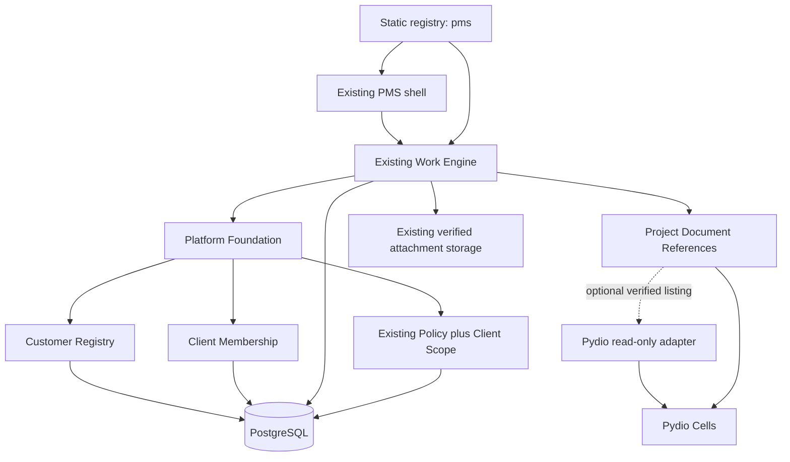
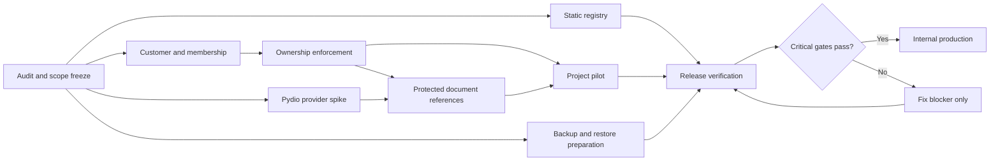
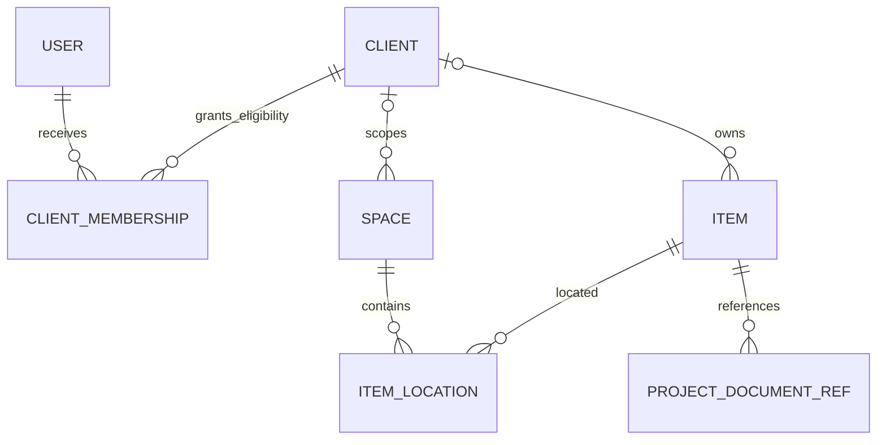
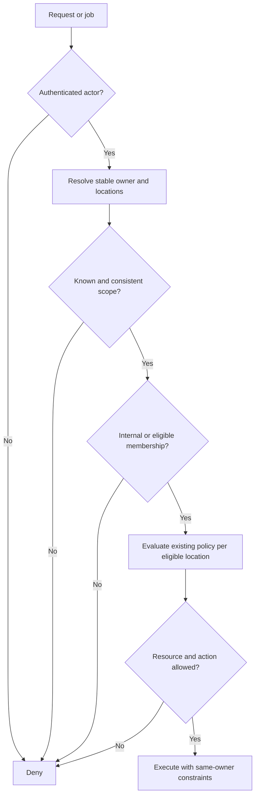

# PMS Operational MVP — Platform Ready
## Implementation Plan: Combined Release 1 + Release 2 (C-lite+ Minimum)

> **Document ID:** PMS-MVP-IMP-002  
> **Version:** 0.1 — Proposed for implementation approval  
> **Date:** 27 November 2026  
> **Baseline documented:** PMS v0.13.0 / `72f9902`; staging v0.12.5 at the time of the 26 November report. Recheck actual HEAD, deployment and QA before starting.  
> **Target:** internal production MVP, PMS as the only active solution, no UI Solution Switcher.  
> **References:** `PMS_OPERATIONAL_MVP_RELEASE_PLAN.md` §§2–9; `LENS_HYBRID_PLATFORM_ARCHITECTURE_v0.2_C-lite-plus.md` §§6, 8, 9, 13, 16, 21–23; PMS IA/feature map v0.13.0 §§3.4, 3.5, 5, 8; Claude feasibility review §§3, 7–9.

## 1. Executive decision

Combine operational release preparation with the minimum Platform Foundation required to avoid rework when AIMS, HAZOP Web and RMS are added. Preserve the current PMS application shell, work hierarchy, workflow, scheduling, roles and APIs. Native Customer Master, client membership, client-bound Spaces, ownership enforcement, Pydio project references and a minimal read-only connector, and a static registry for `pms` are the intended combined scope. Production remains internal only.

**Do not implement Business Object Registry (BOR) runtime now.** Although Release 2 in the earlier plan included it, C-lite+ v0.2 places the actual registry at P2 alongside the first asset vertical slice. Preserve the design contract and module boundary only; avoid empty tables, placeholder CRUD and unused abstractions. Customer is a native system entity, not a MasterRecord. No UI switcher, manifest installer, visual builder, per-client solution entitlement, asset/HAZOP/RMS routes, or separate services.

The prior five-day operational-only timebox is not a reliable estimate after adding ownership enforcement. Size after the impact audit; release gates, not a deadline or a perfect E2E percentage, determine production readiness.

## 2. Scope freeze

| ID | Scope | Priority / exit |
|---|---|---|
| R1-01 | Verify exact release candidate, CI and blocked QA | P0 |
| R1-02 | Standard project fields/workflow, customer Spaces, portfolio | P0 |
| R1-03 | Pilot import and reconcile WBS, dates, status, progress, assignees | P0 |
| R1-04 | Backup off-host, restore, monitoring, deployment | P0 |
| R2-01 | Static Solution Registry, only `pms` | P0 |
| R2-02 | Native customers, CRUD/archive, stable code/UUID | P0 |
| R2-03 | Client memberships and stable ownership, same-owner constraints | P0 |
| R2-04 | Enforce ownership at policy and all direct/bypass surfaces | P0 |
| R2-05 | Project Pydio references and safe link-first access | P0 |
| R2-06 | Read-only Pydio folder/metadata integration | P1 conditional; target combined MVP if ACL and live provider checks pass |
| R2-07 | Preserve future BOR/extension contracts in ADR | P0 docs only |
| R1-05 | SMTP/reminders, Excel status/assignee patch | P1; patch only if actual onboarding requires it |
| NEXT | BOR runtime, AIMS, HAZOP Web, RMS, full connector, switcher | Deferred |

If read-only Pydio cannot meet authorization or reliability requirements, retain link-first as the explicitly approved reduced scope; disable the unverified connector. Do not waive client isolation, recovery or core project correctness to meet a date. Any fallback to the earlier R1-only plan is a separate Product Owner scope decision, not an automatic permission downgrade. No external users, customer portals or public data sharing in this release.

## 3. Target architecture



One binary, one database, existing deployment and frontend. Instance remains tenant boundary (D-01); clients inside Losaka instance are business/data scopes. Keep native domain boundaries and existing package conventions. Legacy losaka-lens and HazopApp are knowledge sources only, not runtime dependencies.

## 4. Work packages and dependencies

| Batch | Work package | Depends on | Relative effort* | Exit |
|---|---|---|---|---|
| B0 | Baseline, impact audit, ADR, release scope | — | S–M | Candidate identity, bypass inventory, mapping plan |
| B1 | Static registry and architecture guard | B0 | S | PMS-only registry and unchanged routes |
| B2 | Customer Master and membership | B0 | M | Canonical customer identity and scoped CRUD |
| B3 | Ownership migration and enforcement | B2 | L | No cross-client access or mutation; mapping validated |
| B4 | Pydio link + read-only adapter | B0; B2/B3 for protected endpoints | M | Links verified, connector safe or explicitly deferred |
| B5 | Configure PMS and onboard pilot | B3, B4 minimum | M | Actual pilot accepted; portfolio reconciled |
| B6 | Release verification and cutover | B1–B5 | M | Targeted evidence, restore, production GO |

*Relative sizing only (S/M/L); not developer-day estimates. B1, B2, connector spike and infrastructure preparation may run in parallel after B0 if there is capacity. Avoid concurrent changes to shared policy/migrations; serialize those merges.



## 5. B0 — baseline and impact assessment

- Confirm actual `main`, candidate tag/SHA/digest/schema, staging version, existing CI and QA evidence. The prior report says 105 PASS, 6 BLOCKED, 7 BACKLOG from 118 local QA scenarios; not production UAT. Classify every blocked case by impact on combined scope.
- Inspect actual package boundaries, migration naming, `policy` and direct SQL, `item_locations`, shares, Space Admin, personal Spaces, custom field relation, automation, reports, files, public endpoints and workers. Identify existing architecture tests. Do not assume proposed package names exist.
- Inventory Spaces/projects/items, all locations, grants, groups, external users, dependencies, relations, templates, forms, automation, attachment references, current customer mapping and actual storage configuration.
- Confirm data rights and authorized user groups; approve client/internal mapping with business owner; inspect mixed-client Spaces and personal Space workflows. Unknown is not internal.
- Create/update ADR covering revised D-55 sequencing (bring forward client foundation and static registry; BOR remains deferred), D-01 single instance, D-17.1 explicit access, and D-08 Pydio evidence limitations. Preserve role semantics of current release (including Full for assignment on every relevant path).
- Record release branch, test matrix, change scope, rollback, and timebox after audit. No production changes at this point.

**Output:** `MVP_SCOPE.md`, impact inventory, approved mapping, decision register, candidate evidence and release checklist. Filenames are proposals; follow repo conventions.

## 6. B1 — Minimum Static Solution Registry (no UI)

### 6.1 Contract

Use a small immutable, typed, in-code registry (Go or existing platform package convention). One known solution `pms`, enabled and required for this edition. No database, admin CRUD, config parser, dynamic install, event bus or frontend navigation rebuild. The registry is product/module metadata, not an authorization mechanism.

Illustrative Go contract (adapt to existing packages, not drop-in code):

```go
type SolutionDefinition struct {
    ID           string
    Name         string
    Required     bool
    Enabled      bool
    Capabilities []string
}

// Return an immutable copy; identifiers below are solution metadata,
// not new RBAC capabilities or permission grants.
func BuiltinSolutions() []SolutionDefinition {
    return []SolutionDefinition{{
        ID: "pms", Name: "Projects", Required: true, Enabled: true,
        Capabilities: []string{"work_management"},
    }}
}
```

Keep default landing `/dashboards`, existing URLs, sidebar and Settings. `pms` is not a prefix to add to every URL or a column to add to `items`. Build-time/static registration plus startup validation: unique nonblank stable IDs, known/required PMS enabled, no unknown executable module. Provide minimal `Lookup` / `ListEnabled` only if used. Avoid introducing dynamic dependencies until second solution requires them. Use registry at actual composition/startup boundary to assert PMS is registered; do not add dead metadata or reroute all handlers. Expose read-only registered solution info in existing System information/version endpoint **only if** needed for operator verification and backward-compatible; no new Settings screen required.

| Test | Acceptance |
|---|---|
| SOL-01 | Exactly `pms` active; duplicate/empty IDs rejected |
| SOL-02 | Unknown ID and disabling mandatory PMS rejected |
| SOL-03 | Existing default route, sidebar, direct deep links and APIs unchanged |
| SOL-04 | No AIMS/HAZOP/RMS route, switcher, installer or permission bypass |
| SOL-05 | Existing build/lint/architecture tests pass; extension contract documented |

## 7. B2 — Native Customer Master and memberships

Use one canonical table `clients` (UI label Customers); do not maintain separate Customer and Client tables. Fields: UUID, immutable unique normalized code, legal/display name, optional short name, active/archived status, audit timestamps. Retain existing internal scope explicitly; no fake external customer necessary. Add minimal `client_memberships` (client ID, existing user ID, audit metadata, active/revoked state or audited deletion), unique membership, foreign keys. Membership is an eligibility gate, not a Full/Editor/Read grant. Existing identity/user types and grants remain source of truth for actions.

Admin Settings entry: Customers. Search/list, create, edit, archive, authorized customer detail, Members (assign/revoke), list relevant Spaces subject to access. Distinguish configuration authority from content authority. Admin can manage customer metadata only under defined capability; no automatic access to private content. Ordinary picker lists only eligible customer contexts. No full Client Hub/360, contacts, org hierarchy, invitation automation, or per-client entitlement.

API suggestions (reconcile OpenAPI conventions first): `GET/POST /api/v1/clients`, `GET/PATCH /api/v1/clients/{id}`, archive action, list/add/revoke memberships. No destructive delete of referenced customers. Normalize and reject duplicate codes; archive prevents new work/links by defined rule while preserving authorized historical reads; define ongoing work transition before archiving. Audit mutations, membership changes and rejected attempts as appropriate.

## 8. B3 — Client ownership enforcement and migration

This is the highest-risk work package. Native client registry alone is not isolation. Do not treat filters, labels or hidden menu as security.

### 8.1 Conceptual model



Physical names subject to schema audit. Recommend additive `spaces.client_id` and stable explicit item ownership (`items.client_id` or equivalent owner association) plus an explicit internal/assigned marker during migration. Nullable owner may represent internal only after verification; unknown must be distinguishable and inaccessible in new mode. For existing Personal Space, preserve private permissions and internal classification; do not allow client items to escape into personal/internal scope through multi-location. Same-owner validation includes parent/child, all locations, move/copy/restore, share recipients, dependency, relations, blueprint instantiation, forms, automation, import and background services. Default reject cross-client/internal links and moves; no automatic client reassignment. DB constraints where expressible; multi-table invariants transactional with appropriate locking/concurrency checks. Audit all write paths; service/API, import and worker must share enforcement.

### 8.2 Authorization

Effective resource access = existing policy (role ceilings, resource grants, action rules) evaluated only over eligible, same-owner locations, plus membership for client-owned resources. Apply gate **before** union of location grants. Do not grant content from membership alone; workspace/platform admin is not exempt. Preserve stricter assignment rules (Full on every relevant path as documented), and ensure filtering cannot remove a restrictive path to accidentally upgrade assignment. Internal resources use existing explicit permissions; internal is not an all-client bypass. All authorized portfolio views aggregate only visible resources. Share validates target membership/eligibility, including group expansion; revoke denies subsequent reads/actions even if a resource grant remains. Invalidate authorization caches and review already issued file/public tokens. Restrict unapproved external/public forms, links, API access and uploads server-side. Worker/service actors run in approved scope and reauthorize at execution/replay.



### 8.3 Migration (expand–migrate–enforce)

1. Backup database/files and rehearse off-host restore. Expand schema with additive migrations following goose and existing code conventions; no destructive DDL. Do not expose real client data before enforcement is effective.
2. Generate dry-run mapping report from all Spaces, items, locations and related data; classify each Space as client/internal/unresolved. Split mixed-client Spaces with approved mapping; resolve or quarantine cross-scope links and grants, no silent data deletion or internal fallback.
3. Backfill customer UUID, memberships and stable item owner in idempotent batches on cloned DB, preserving IDs, hierarchy, counts, file references, workflow and schedule. Reconcile counts and conflicts; repeat dry-run until no unresolved active records.
4. Validate constraints and enforce policy on staging. Ensure unknown scope is denied, not merely hidden. Verify direct SQL and list/aggregate bypasses; test concurrent writes and revoke. Maintain audited reconciliation report.
5. Cutover during controlled window; final delta or write freeze, validate backup/checksum, migration, candidate health, negative smoke tests. Enable real internal data only after gates pass.

Rollback: old binary may not enforce ownership. Do not serve newly scoped data with old binary or disable authorization as fallback. Stop writes/use maintenance mode, restore verified compatible DB/files or deploy forward fix; document/reconcile writes since backup and RPO/RTO. Never silently discard user updates.

## 9. B4 — Pydio integration minimum

**P0 link-first:** project document reference includes item/project ID, provider, label, canonical workspace/folder locator (stable ID/path only if provider supports it), verified HTTPS link and timestamps; reuse existing link entity if adequate. Do not persist signed URLs or tokens. Authorized editors manage references, authorized readers see link; Pydio ACL controls access after click. Use configured trusted HTTPS origin; no user-provided arbitrary server fetch/redirect, no public secret-bearing links. Existing attachments remain on verified current storage (do not switch `PMS_STORAGE`).

**P1 target read-only connector:** optional native listing of folder/metadata/deep links for configured project workspace. First test actual Pydio provider/API/edition and auth. Prefer delegated user identity and Pydio ACL; if unavailable, use explicitly approved narrow service identity only with independently proven user-level authorization at PMS and Pydio; otherwise do not expose listing. No shared unrestricted service account proxy. Backend checks project/owner access before listing, restrict canonical configured root, reject traversal and untrusted endpoints/redirects, keep secrets server-side, use timeout and bounded pagination, avoid logging credentials/filenames outside authorized scope. No file content proxy, write, overwrite, sync, automated folder provisioning, historical revision guarantee, or evidence engine. Pydio failure degrades listing only; PMS monitoring stays available. Link remains usable if Pydio itself is available and user authorized.

Live gate: authorized listing, wrong-user/wrong-client denial, revoked access, credential failure, timeout, folder renamed/missing, no leakage in logs, no writes. Recheck DEF-023/DEF-037 before any future read/write or historical evidence dependency. They were documented previously, not confirmed current. If gate fails, record blocker and switch off connector; Product Owner explicitly accepts link-first reduced scope.

## 10. B5 — Operational configuration and onboarding

Retain Workspace Overview, Portfolio, Table/Board/Gantt, My Work, Workload and notifications. Use existing settings/CIT/custom fields/workflows/blueprints as appropriate, no new project engine. Project customer displayed from native owner; no duplicate editable customer dropdown that disagrees with Space. Create project selects eligible Space or customer then compatible Space; future change of customer requires controlled migration. Customer filter via existing Space filters if sufficient; add scoped native filter only if required to monitor. Settings entry for Customers, existing Apps & Integrations for Pydio config where suitable. No Solution Switcher.

Project minimum: project name/code, customer (derived from owner), PM, start/finish, status, progress, health (manual), last status update, document link when available. Contract/PO number and planned effort optional. Validate active project inventory, approved source timeline, users/group grants, WBS hierarchy, dependency, status and dates. Import one actual project only into authorized staging/pilot after enforcement and data-rights checks (synthetic for earlier tests). Reconcile missing status/assignees (RT-04), patch only if manual effort materially blocks adoption. Management sees all authorized active projects via existing Portfolio/Overview; explicit grants required. PM accepts pilot data and owners sign off onboarding list. After GO, onboard other active projects in waves with per-project reconciliation.

## 11. B6 — risk-based tests and acceptance

Keep existing automated gates; run focused integration/unit/negative tests on touched modules and policy-dependent surfaces, plus core workflow smoke on exact candidate. Because ownership is cross-cutting, do not limit testing to two policy queries. Enumerate actual endpoints/workers; cover every affected surface via shared regression fixtures and targeted tests. Do not reopen entire human code review by default, but require business acceptance and operational evidence. No fixed 100% E2E target; no critical waiver.

| ID | Acceptance criteria (all mandatory unless marked conditional) |
|---|---|
| AC-01 | Exact candidate SHA/digest/schema verified on staging; existing build and migrations pass |
| AC-02 | Static registry has exactly active PMS; invalid registration fails; navigation unchanged |
| AC-03 | Customer UUID/code stable, duplicates rejected, archive preserves history, CRUD audited |
| AC-04 | Membership add/revoke audited; membership without resource grant cannot access content |
| AC-05 | Workspace Admin without grant cannot read client/private Space content |
| AC-06 | Full/Editor/Read/Limited and all-path assignment rules match actual existing matrix |
| AC-07 | Client A actor denied Client B direct URL/API, lookup, list and counts |
| AC-08 | Search, Portfolio, Workload, reports and notifications reveal no unauthorized metadata |
| AC-09 | Cross-client/internal location, move, restore, copy, dependency and relation denied |
| AC-10 | Group share, revoked membership and concurrent mutations cannot bypass owner constraints |
| AC-11 | Blueprint/forms/import/automation/jobs/webhooks apply same scope; unapproved public paths blocked |
| AC-12 | Attachments, previews, export and signed links respect effective scope/revocation policy |
| AC-13 | Existing Space/item/parent/location mapping reconciled; unresolved data quarantined; no lost IDs/files |
| AC-14 | Project Pydio link visible only to authorized PMS users; Pydio ACL confirmed |
| AC-15 | Read-only listing authorization and outage tests pass OR connector disabled with approved fallback (conditional) |
| AC-16 | Core create/update project/task, dates, status, assignee, progress and Gantt/Portfolio smoke passes |
| AC-17 | Pilot WBS/import reconciled against source and accepted by PM |
| AC-18 | Off-host backup/restore with checksum, DB+files and recovery runbook demonstrated |
| AC-19 | Health/readiness, logs, monitoring alerts verified; rollback does not expose scoped data |
| AC-20 | Blocked/backlog issues classified; no unresolved critical security/data/recovery/core defect |
| AC-21 | Production internal access only, active project onboarding plan, GO approval recorded |

Test fixture: clients A/B and internal, two A Spaces, one B Space, personal Space; A-only/B-only/both/none users, platform admin without content grant, Full/Editor/Read/Limited, group membership and service actor. Same-client multi-location allowed only per existing permissions; A+B location rejected. Verify negative API, DB invariants, direct links, background actions and aggregates; include Pydio wrong identity and outage tests. Evidence per AC includes candidate SHA, test command/result/log, environment, PASS/FAIL/BLOCKED/DEFERRED and residual risk. BLOCKED critical = NO-GO.

## 12. Execution and release sequencing

| Wave | Target | Decision |
|---|---|---|
| W0 | Audit + scope/ADR freeze | Estimate after B0; do not assume original 5-day target |
| W1 | B1 static registry, B2 customer, Pydio spike, ops prep | Small PRs, unchanged PMS routes |
| W2 | B3 ownership migration/security, B4 protected references | Security first; no real client data before gate |
| W3 | B5 pilot configuration/import, targeted regression | Accept operational data and verify all affected surfaces |
| W4 | B6 candidate, restore rehearsal, cutover | GO only on critical gates; onboard remaining projects in waves |

Branch suggestion: `release/pms-platform-ready-mvp` from verified stable baseline; small feature branches for static registry, clients, ownership, Pydio; merge via tested PRs. Keep release candidate isolated from future AIMS/HAZOP/RMS changes. Use next semver consistent with repo policy (e.g. v0.14.0 if appropriate; not an assigned tag), not forced v1.0. Update OpenAPI, schema docs, IA/permission matrix, release notes and operational runbook. For every batch record changed files/migrations, test results, open issues, and scope deviations; do not mark pass without evidence. No unrelated UI redesign or cleanup.

## 13. Post-release roadmap

| Milestone | Scope |
|---|---|
| MVP | PMS only, client foundation, static registry, document references, monitoring |
| Next | BOR minimal vertical slice + AIMS; schema versions, MasterRecord identity and version pin, review/publish, typed relations, work links, asset records, P&ID/evidence |
| Later | Static definition for second solution + UI Solution Switcher when more than one solution exists |
| Later | Native HAZOP Web (legacy knowledge), RMS and advanced engineering |

Deferred: BOR tables/runtime, schema builder, generic approval/comment/attachment framework, dynamic Solution Manifest/installation, application entitlement, tenant entity, full Client Hub, SSO/SCIM unless necessary for actual access, full Pydio read/write/versioning, evidence store, Talent, Commercial, AI and all noncritical PMS gaps. Keep ADR-REG and C-lite+ v0.2 as design baseline, not implementation mandate now.

## 14. GO / NO-GO and limitations

GO for design and controlled implementation after scope/ADR confirmation; production GO only after B6 and all mandatory ACs pass. No-go for client leakage, unresolved ownership, core PMS regression, data loss, failed recovery or unverified critical provider exposure. Noncritical features can be deferred with recorded owner and workaround. If security scope proves too large, Product Owner can choose separate earlier R1-only internal release with previously approved boundaries; never quietly downgrade combined MVP enforcement.

This plan uses the documented v0.13.0 state, previous release plan, C-lite+ and feasibility review, not a fresh source-code audit. Actual six blocked QA cases, current deployment, schema/policy, data ownership, provider capabilities and developer capacity remain to be verified. API/DDL/module names, batch effort and registry contract are design proposals. No code, repository, database or deployment changes have been made. Mermaid diagrams are conceptual; rendering not independently tested.
